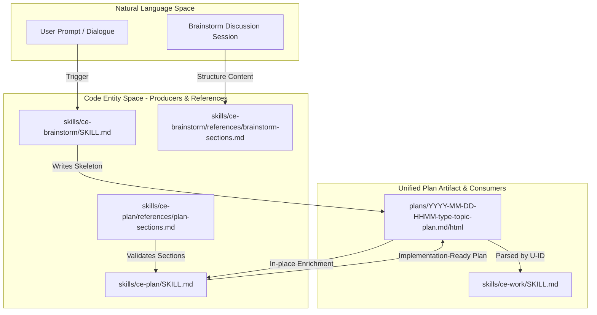
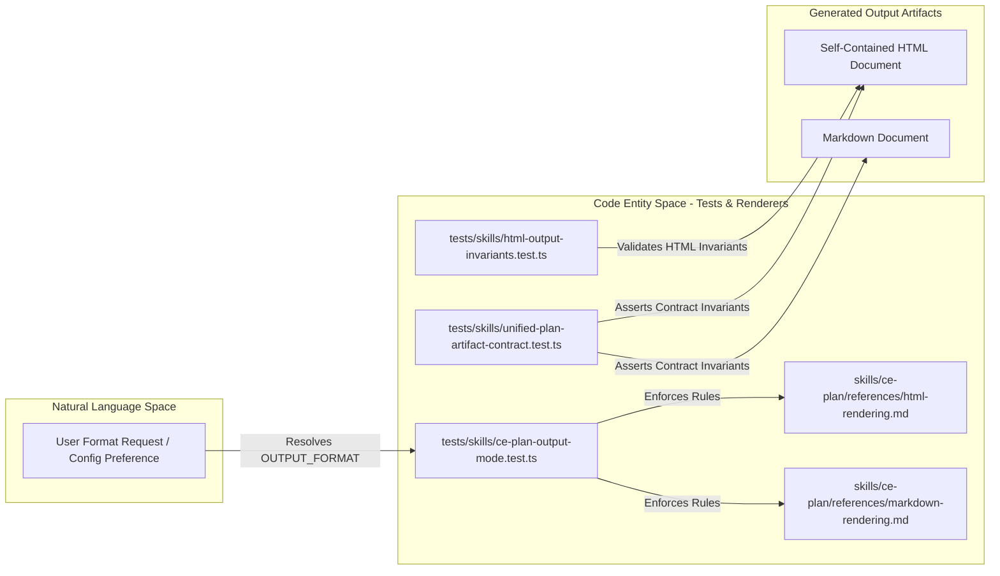

<!-- source: DeepWiki mcp.deepwiki.com · repo EveryInc/compound-engineering-plugin · extra page Unified Plan Artifact Contract · fetched 2026-10-30 -->

# Unified Plan Artifact Contract

Relevant source files

The following files were used as context for generating this wiki page:

- [skills/ce-brainstorm/references/brainstorm-sections.md](skills/ce-brainstorm/references/brainstorm-sections.md)
- [skills/ce-brainstorm/references/handoff.md](skills/ce-brainstorm/references/handoff.md)
- [skills/ce-brainstorm/references/html-rendering.md](skills/ce-brainstorm/references/html-rendering.md)
- [skills/ce-brainstorm/references/markdown-rendering.md](skills/ce-brainstorm/references/markdown-rendering.md)
- [skills/ce-ideate/references/html-rendering.md](skills/ce-ideate/references/html-rendering.md)
- [skills/ce-ideate/references/ideation-sections.md](skills/ce-ideate/references/ideation-sections.md)
- [skills/ce-ideate/references/markdown-rendering.md](skills/ce-ideate/references/markdown-rendering.md)
- [skills/ce-plan/references/html-rendering.md](skills/ce-plan/references/html-rendering.md)
- [skills/ce-plan/references/markdown-rendering.md](skills/ce-plan/references/markdown-rendering.md)
- [skills/ce-plan/references/plan-handoff.md](skills/ce-plan/references/plan-handoff.md)
- [skills/ce-plan/references/plan-sections.md](skills/ce-plan/references/plan-sections.md)
- [skills/ce-plan/references/resume.md](skills/ce-plan/references/resume.md)
- [skills/ce-plan/references/universal-planning.md](skills/ce-plan/references/universal-planning.md)
- [tests/skills/ce-brainstorm-output-mode.test.ts](tests/skills/ce-brainstorm-output-mode.test.ts)
- [tests/skills/ce-ideate-output-mode.test.ts](tests/skills/ce-ideate-output-mode.test.ts)
- [tests/skills/ce-plan-output-mode.test.ts](tests/skills/ce-plan-output-mode.test.ts)
- [tests/skills/html-output-invariants.test.ts](tests/skills/html-output-invariants.test.ts)
- [tests/skills/unified-plan-artifact-contract.test.ts](tests/skills/unified-plan-artifact-contract.test.ts)

## Purpose and Scope

This page details the **Unified Plan Artifact Contract**, the shared schema, invariant rules, rendering specifications, and validation mechanisms governing implementation plan artifacts produced and consumed across the `ce-brainstorm` and `ce-plan` skills within the codebase (`[skills/ce-brainstorm/SKILL.md]`, `[skills/ce-plan/SKILL.md]()`). It outlines stable plan artifact sections, required metadata keys, Unit ID (`U-ID`) conventions, contract test coverage in `[tests/skills/unified-plan-artifact-contract.test.ts]()`, and format-specific rendering rules (`[skills/ce-plan/references/plan-sections.md]()`, `[skills/ce-brainstorm/references/brainstorm-sections.md]()`).

This contract guarantees a deterministic, uniform artifact interface for downstream consumers such as `ce-work`, `ce-doc-review`, human readers, and automated execution engines.

Sources: `[tests/skills/unified-plan-artifact-contract.test.ts:1-145]()`, `[skills/ce-plan/references/plan-sections.md:1-110]()`, `[skills/ce-brainstorm/references/brainstorm-sections.md:1-129]()`

---

## 1. Overview of the Unified Plan Artifact Contract

The **Unified Plan Artifact** is a single authoritative file moving through progressive lifecycle phases:
- **`ce-brainstorm`** (`[skills/ce-brainstorm/references/brainstorm-sections.md]()`) produces requirements-only skeleton artifacts.
- **`ce-plan`** (`[skills/ce-plan/references/plan-sections.md]()`) enriches these skeletons in place into implementation-ready plans featuring technical design, unit breakdown, verification contracts, and definition of done criteria.
- **`ce-work`** (`[skills/ce-work/SKILL.md]()`) consumes the final implementation-ready artifact to execute structured units of work.

Key metadata frontmatter requirements enforced by `[tests/skills/unified-plan-artifact-contract.test.ts]()`:
- `artifact_contract: ce-unified-plan/v1`: Declares compliance with the unified schema.
- `product_contract_source`: Tracks origin (e.g., `ce-brainstorm`, `ce-plan-bootstrap`).
- `execution`: Classifies execution domain (`code` for software features, `knowledge-work` for non-code deliverables).
- **Absence of mutable status fields**: Older `artifact_readiness` fields and general `status` fields are explicitly prohibited to prevent state drift (`[skills/ce-plan/references/plan-sections.md:41-42]()`).

Sources: `[tests/skills/unified-plan-artifact-contract.test.ts:124-133]()`, `[skills/ce-plan/references/plan-sections.md:22-44]()`

---

## 2. Section ID Registry and Artifact Schema

Unified plan artifacts organize content into stable logical sections. Downstream skills grep or anchor-scan for these canonical headings and HTML anchor IDs before parsing bodies (`[skills/ce-plan/references/plan-sections.md:45-92]()`):

| Logical Section | Markdown Heading | HTML id | Reader / Agent Use |
|---|---|---|---|
| Goal Capsule | `## Goal Capsule` | `goal-capsule` | Objective (outcome), Means (chosen approach), authority hierarchy, stop conditions |
| Product Contract | `## Product Contract` | `product-contract` | Requirements, actors, flows, acceptance examples, product scope |
| Product Requirements | `### Requirements` under Product Contract | `product-requirements` | Requirement extraction for review and implementation trace |
| Planning Contract | `## Planning Contract` | `planning-contract` | KTDs, technical design, assumptions, sequencing |
| Implementation Units | `## Implementation Units` | `implementation-units` | `U-ID` work packets (`U1.`, `U2.`) for execution |
| Verification Contract | `## Verification Contract` | `verification-contract` | Repo-specific test commands and quality gates |
| Definition of Done | `## Definition of Done` | `definition-of-done` | Global and per-unit completion criteria |
| Appendix | `## Appendix` | `appendix` | Long research, raw notes, or supporting detail |

Sources: `[skills/ce-plan/references/plan-sections.md:45-67]()`, `[skills/ce-brainstorm/references/brainstorm-sections.md:23-68]()`

---

## 3. Contract Validation and Test Enforcement

Contract invariants are verified by test suites such as `[tests/skills/unified-plan-artifact-contract.test.ts]()`, which reads reference documents and validates structural compliance. Output format configuration is governed by tests like `[tests/skills/ce-plan-output-mode.test.ts]()` and `[tests/skills/ce-brainstorm-output-mode.test.ts]()`.

Key validation rules:
- **Mandatory Metadata Tags**: Asserts the presence of `artifact_contract: ce-unified-plan/v1` (`[tests/skills/unified-plan-artifact-contract.test.ts:125]()`).
- **Forbidden Fields**: Asserts the complete absence of `artifact_readiness` and `status` fields (`[tests/skills/unified-plan-artifact-contract.test.ts:126-132]()`).
- **Section ID Anchors**: Verifies all required section IDs (`goal-capsule`, `product-contract`, `product-requirements`, `planning-contract`, `implementation-units`, `verification-contract`, `definition-of-done`) are present in `[skills/ce-plan/references/plan-sections.md]()`.

Sources: `[tests/skills/unified-plan-artifact-contract.test.ts:123-145]()`, `[tests/skills/ce-plan-output-mode.test.ts:37-80]()`

---

## 4. Markdown and HTML Rendering Rules

Artifact rendering is separated from content structure through dedicated format references:
- Markdown: `[skills/ce-plan/references/markdown-rendering.md]()`, `[skills/ce-brainstorm/references/markdown-rendering.md]()`
- HTML: `[skills/ce-plan/references/html-rendering.md]()`, `[skills/ce-brainstorm/references/html-rendering.md]()`

Key HTML rendering invariants tested in `[tests/skills/html-output-invariants.test.ts]()`:
- **Single Self-Contained File**: No companion `.css`, `.js`, or `.svg` files (`[skills/ce-plan/references/html-rendering.md:21-25]()`).
- **Visible Metadata Only**: No hidden JSON frontmatter blocks (`<script type="application/json">`) or `<meta name="created">` / `<meta name="origin">` tags (`[tests/skills/html-rendering.md:26-32]()`, `[tests/skills/html-output-invariants.test.ts:30-52]()`).
- **Stable IDs**: Every ID-bearing item (`R-`, `U-`, `KTD-`, etc.) carries an `id="..."` anchor attribute and displays the ID textually (`[tests/skills/html-rendering.md:44-46]()`).
- **Source and Composition Footer**: A visible footer (`<footer class="composition-signal">`) records composition timestamps and upstream sources (`[tests/skills/html-rendering.md:54-58]()`, `[tests/skills/html-output-invariants.test.ts:65-81]()`).

Sources: `[skills/ce-plan/references/html-rendering.md:1-64]()`, `[tests/skills/html-output-invariants.test.ts:1-105]()`

---

## 5. Diagrams: Bridging Natural Language Space to Code Entity Space

### Diagram 1: Artifact Lifecycle Flow and Code Entity Mapping

Sources: `[skills/ce-brainstorm/SKILL.md]`, `[skills/ce-plan/SKILL.md]`, `[skills/ce-plan/references/plan-sections.md:22-44]()`, `[skills/ce-brainstorm/references/brainstorm-sections.md:23-35]()`

### Diagram 2: Validation and Rendering Architecture

Sources: `[tests/skills/unified-plan-artifact-contract.test.ts:1-145]()`, `[tests/skills/ce-plan-output-mode.test.ts:37-120]()`, `[tests/skills/html-output-invariants.test.ts:1-142]()`, `[skills/ce-plan/references/html-rendering.md:1-64]()`

---

## Sources

- `[tests/skills/unified-plan-artifact-contract.test.ts:1-145]()`
- `[skills/ce-plan/references/plan-sections.md:1-110]()`
- `[skills/ce-brainstorm/references/brainstorm-sections.md:1-129]()`
- `[skills/ce-plan/references/plan-handoff.md:1-55]()`
- `[tests/skills/ce-plan-output-mode.test.ts:1-150]()`
- `[skills/ce-brainstorm/references/handoff.md:1-92]()`
- `[skills/ce-plan/references/html-rendering.md:1-126]()`
- `[tests/skills/html-output-invariants.test.ts:1-142]()`
- `[tests/skills/ce-ideate-output-mode.test.ts:1-145]()`

---

