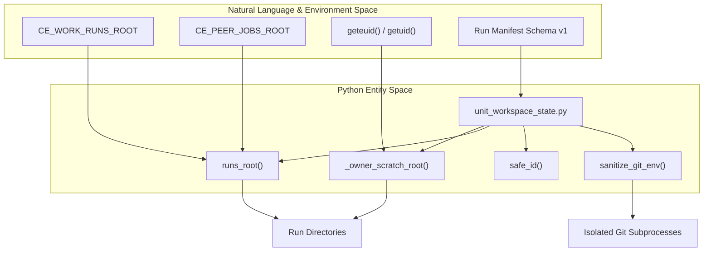
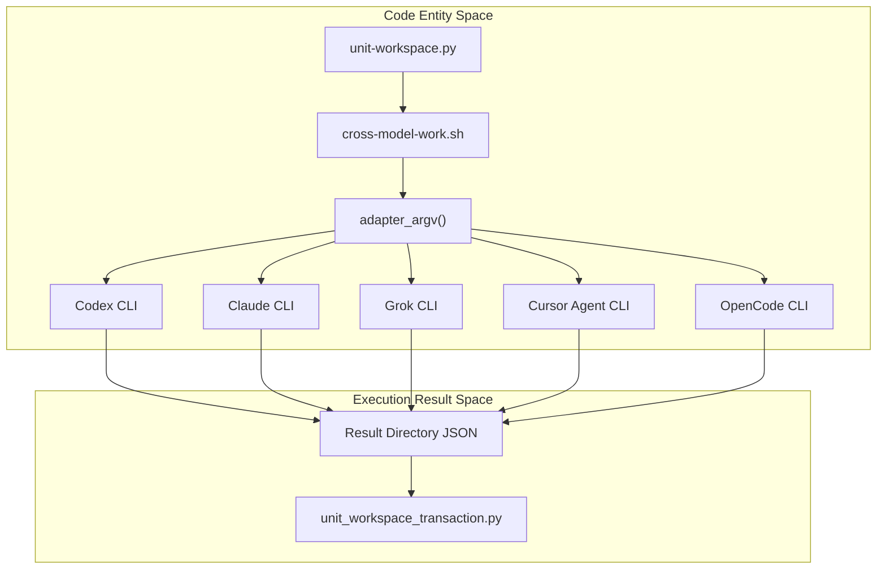

<!-- source: DeepWiki mcp.deepwiki.com · repo EveryInc/compound-engineering-plugin · extra page Unit Workspaces and Cross-Model Execution · fetched 2026-10-30 -->

# Unit Workspaces and Cross-Model Execution

<details>
<summary>Relevant source files</summary>

The following files were used as context for generating this wiki page:

- [docs/plans/2026-08-15-2303-fix-cross-model-verify-warm-checkout-plan.md](docs/plans/2026-08-15-2303-fix-cross-model-verify-warm-checkout-plan.md)
- [docs/plans/2026-09-27-1745-fix-test-stall-watchdog-plan.md](docs/plans/2026-09-27-1745-fix-test-stall-watchdog-plan.md)
- [skills/ce-work/references/execution-engines.md](skills/ce-work/references/execution-engines.md)
- [skills/ce-work/scripts/unit-workspace.py](skills/ce-work/scripts/unit-workspace.py)
- [skills/ce-work/scripts/unit_workspace_ignored.py](skills/ce-work/scripts/unit_workspace_ignored.py)
- [skills/ce-work/scripts/unit_workspace_integration.py](skills/ce-work/scripts/unit_workspace_integration.py)
- [skills/ce-work/scripts/unit_workspace_jobs.py](skills/ce-work/scripts/unit_workspace_jobs.py)
- [skills/ce-work/scripts/unit_workspace_transaction.py](skills/ce-work/scripts/unit_workspace_transaction.py)
- [tests/helpers/process.ts](tests/helpers/process.ts)
- [tests/skills/ce-brainstorm-visual-probe-server.test.ts](tests/skills/ce-brainstorm-visual-probe-server.test.ts)
- [tests/skills/ce-work-cross-model-integration.test.ts](tests/skills/ce-work-cross-model-integration.test.ts)
- [tests/skills/ce-work-unit-workspace-transport.test.ts](tests/skills/ce-work-unit-workspace-transport.test.ts)
- [tests/skills/ce-work-unit-workspace-verification.test.ts](tests/skills/ce-work-unit-workspace-verification.test.ts)
- [tests/skills/helpers/ce-work-workspace-harness.test.ts](tests/skills/helpers/ce-work-workspace-harness.test.ts)
- [tests/skills/helpers/ce-work-workspace-harness.ts](tests/skills/helpers/ce-work-workspace-harness.ts)
- [tests/skills/helpers/run-in-group.py](tests/skills/helpers/run-in-group.py)

</details>


This document details the internal mechanics of `ce-work`'s unit workspaces, focusing on the Python helper modules (`unit_workspace_state.py`, `unit_workspace_transaction.py`, `unit_workspace_jobs.py`, `unit_workspace_ignored.py`), workspace isolation policies, execution engines, and the `cross-model-work.sh` execution and evaluation routes.

## Purpose and Scope

The `ce-work` skill manages task implementation through isolated unit workspaces and dual execution engines (native vs. cross-model). The unit workspace infrastructure ensures crash recovery, atomic canonical integration, and strict repository protection. Python helpers coordinate state management, job record-keeping, and ignored-file diffing without executing model CLIs directly or modifying the canonical checkout prematurely.

Sources:
* [skills/ce-work/references/execution-engines.md:1-5]()
* [skills/ce-work/scripts/unit_workspace_state.py:1-6]()

---

## Unit Workspace Python Helpers

The workspace subsystem relies on modular Python components residing in `skills/ce-work/scripts/`. Each script handles a distinct domain of state persistence, transaction control, preparation/job recording, or ignored-file tracking.

### `unit_workspace_state.py`

`unit_workspace_state.py` serves as the central state manager for run manifests, directory resolution, and validation.

* **Schema Versioning**: Defines `SCHEMA_VERSION = 1` [skills/ce-work/scripts/unit_workspace_state.py:33-33]() for manifest compatibility.
* **Owner Scratch Root**: Resolves temporary directories securely via UID lookup (`geteuid`/`getuid`), falling back to system-wide paths [skills/ce-work/scripts/unit_workspace_state.py:37-41](), [skills/ce-work/scripts/unit_workspace_state.py:127-133]().
* **Runs Root Resolution**: Prioritizes `CE_WORK_RUNS_ROOT`, then `CE_PEER_JOBS_ROOT/ce-work`, and finally the owner scratch root [skills/ce-work/scripts/unit_workspace_state.py:136-143]().
* **Safe ID Validation**: Enforces strict naming constraints via regex for run IDs, unit IDs, and attempt IDs [skills/ce-work/scripts/unit_workspace_state.py:44-44](), [skills/ce-work/scripts/unit_workspace_state.py:146-149]().
* **Git Environment Sanitization**: Scrubs local repository variables (`GIT_ALTERNATE_OBJECT_DIRECTORIES`, `GIT_DIR`, `GIT_WORK_TREE`, etc.) to isolate child processes [skills/ce-work/scripts/unit_workspace_state.py:53-73]().
* **Unit Lifecycles**: Tracks states including `queued`, `authoring`, `authored`, `integration-pending`, `integrated`, `restoring`, `verified`, `committed`, `preserved`, `cleaned`, and `native-completed` [skills/ce-work/scripts/unit_workspace_state.py:49-52]().

#### Diagram: State and Directory Resolution Architecture

Sources:
* [skills/ce-work/scripts/unit_workspace_state.py:33-73]()
* [skills/ce-work/scripts/unit_workspace_state.py:127-149]()

### `unit_workspace_transaction.py`

`unit_workspace_transaction.py` implements fail-stop canonical integration for terminalized external units.

* **Canonical Integration**: Applies patches and tree commits from isolated worker outputs back into the main repository safely.
* **Verification Execution**: Runs configured verification commands (`_verification_command`) to validate integrated changes [skills/ce-work/scripts/unit_workspace_transaction.py:41-48]().
* **Automatic Rollback**: Reverts the repository state via `_restore_owned_verification` if verification fails or exact pre-fold restoration cannot be mathematically proven [skills/ce-work/scripts/unit_workspace_transaction.py:64-111]().
* **Concurrency Locking**: Utilizes `locked_manifest` to prevent race conditions during state transitions [skills/ce-work/scripts/unit_workspace_transaction.py:72-72](), [skills/ce-work/scripts/unit_workspace_transaction.py:94-94]().
* **Verification Logging**: Captures stderr/stdout from verification runs into private log files under `result/` [skills/ce-work/scripts/unit_workspace_transaction.py:113-127]().

Sources:
* [skills/ce-work/scripts/unit_workspace_transaction.py:41-48]()
* [skills/ce-work/scripts/unit_workspace_transaction.py:64-111]()
* [skills/ce-work/scripts/unit_workspace_transaction.py:113-127]()

### `unit_workspace_jobs.py`

`unit_workspace_jobs.py` governs unit preparation (`cmd_prepare`) and retry validations.

* **Preparation Flow**: Validates unit/attempt IDs, computes packet digests, checks for a clean repository state, and provisions authorization structures [skills/ce-work/scripts/unit_workspace_jobs.py:85-144]().
* **Retry Validation (`_validate_retry_base`)**: Verifies that retry requests reference valid canonical commit hashes and preserve required ancestry branches [skills/ce-work/scripts/unit_workspace_jobs.py:18-55]().
* **Wave Head Tracking (`_record_retry_base`)**: Updates wave progression records to authorize multiple attempt heads [skills/ce-work/scripts/unit_workspace_jobs.py:58-82]().

Sources:
* [skills/ce-work/scripts/unit_workspace_jobs.py:18-82]()
* [skills/ce-work/scripts/unit_workspace_jobs.py:85-144]()

### `unit_workspace_ignored.py`

`unit_workspace_ignored.py` tracks changes to git-ignored files during canonical verification passes.

* **Inventorying (`inventory_ignored_state`)**: Performs `lstat` calls across git-ignored filepaths, recording file type, size, modification timestamps, and permissions [skills/ce-work/scripts/unit_workspace_ignored.py:39-59](). Unreadable or locked paths are marked as `uninspectable` rather than causing hard failures [skills/ce-work/scripts/unit_workspace_ignored.py:40-48]().
* **Diffing (`diff_ignored_state`)**: Compares pre-verification and post-verification inventories to produce structured counts and sample arrays of changed, created, or removed ignored files [skills/ce-work/scripts/unit_workspace_ignored.py:67-93]().

Sources:
* [skills/ce-work/scripts/unit_workspace_ignored.py:39-93]()

---

## Workspace Isolation Policy

The workspace isolation model separates external worker processes from the host repository:

* **Detached Worktrees**: External units execute within sibling Git worktrees created under private scratch directories (`/tmp/compound-engineering-<uid>/ce-work/<run-id>/`) [skills/ce-work/references/cross-model-execution.md:50-52]().
* **Index Write Prohibition**: External agents are restricted from modifying the Git index directly (`git add`, `git commit`). The host controller handles snapshotting and commit creation [skills/ce-work/references/cross-model-execution.md:44-48]().
* **Authority Scope Reduction**: Workers inherit restricted authority bounds; they cannot broaden task scopes, trigger pull requests, or alter routing targets [skills/ce-work/references/cross-model-execution.md:41-43](), [skills/ce-work/references/cross-model-work-eval.md:65-66]().
* **Git Environment Scrubbing**: Local git config injection prevention via `unit_workspace_state.py` ensures isolation [skills/ce-work/scripts/unit_workspace_state.py:53-73]().

Sources:
* [skills/ce-work/references/cross-model-execution.md:39-52]()
* [skills/ce-work/references/cross-model-work-eval.md:65-69]()
* [skills/ce-work/scripts/unit_workspace_state.py:53-73]()

---

## Execution Engines

`ce-work` supports multiple execution engines determined by live intent, caller bindings, or standing configurations.

1. **Native (Inline / Subagent)**: Executes tasks directly within the host environment following `references/execution-strategy.md` [skills/ce-work/references/execution-engines.md:3-5]().
2. **Goal-Mode / Dynamic-Workflow**: Specialized pathways for executing implementation-ready unified plans.
3. **Cross-Model Execution**: Dispatches isolated packets to external AI model CLIs through the bundled adapter.

### Engine Resolution Hierarchy
Resolutions follow an ordered precedence from task intent down to fallback execution:
1. Explicit assignment/constraint in the current task [skills/ce-work/references/execution-engines.md:11-13]().
2. Still-active session preferences [skills/ce-work/references/execution-engines.md:14-14]().
3. Typed caller bindings (e.g., LFG pipeline context) [skills/ce-work/references/execution-engines.md:15-16]().
4. Active project instructions and conventions [skills/ce-work/references/execution-engines.md:17-17]().
5. Enabled per-checkout YAML configuration (`config.local.yaml` / `config.yaml`) [skills/ce-work/references/execution-engines.md:32-38](), [skills/ce-work/references/execution-engines.md:42-43]().
6. Native execution fallback [skills/ce-work/references/execution-engines.md:18-18]().

Sources:
* [skills/ce-work/references/execution-engines.md:3-44]()

---

## `cross-model-work.sh` Execution and Evaluation Routes

The `cross-model-work.sh` script (`skills/ce-work/scripts/cross-model-work.sh`) translates unit execution requests into CLI invocations for external models.

### Usage and Invocation Schema
```bash
cross-model-work.sh <authorization-json> <workspace> <unit-packet> <expected-packet-sha256> <result-dir>
```
Introspection mode (`--emit-adapter <route>`) allows inspecting adapter commands without spawning model calls [skills/ce-work/scripts/cross-model-work.sh:14-15]().

### Route Vocabulary and Contracts
Supported routes map to specific harnesses, targets, and default models:
* `codex`: Uses `codex exec` with ephemeral flags and restricted write scopes [skills/ce-work/scripts/cross-model-work.sh:115-126]().
* `claude`: Uses `claude -p` with safe-mode and permission bypasses [skills/ce-work/scripts/cross-model-work.sh:128-135]().
* `grok-cli`: Uses `grok` with disabled auxiliary features [skills/ce-work/scripts/cross-model-work.sh:137-144]().
* `cursor`, `composer`, `grok-cursor`: Uses `cursor-agent` with streaming JSON outputs, sandboxing, and trust flags [skills/ce-work/scripts/cross-model-work.sh:146-158]().
* `opencode`: Uses `opencode run` [skills/ce-work/scripts/cross-model-work.sh:160-163]().

#### Diagram: Cross-Model Execution Flow (`cross-model-work.sh`)

Sources:
* [skills/ce-work/scripts/cross-model-work.sh:6-163]()
* [tests/skills/ce-work-cross-model-routes.test.ts:33-41]()

### Behavioral Evaluation
`references/cross-model-work-eval.md` defines evaluation fixtures and expected response schemas (`selected_engine`, `binding_source`, `requested_route`, `actual_or_next_route`, `egress_before_action`, etc.) to verify cross-model contract integrity across modifications [skills/ce-work/references/cross-model-work-eval.md:3-42]().

Sources:
* [skills/ce-work/references/cross-model-work-eval.md:3-42]()

---

