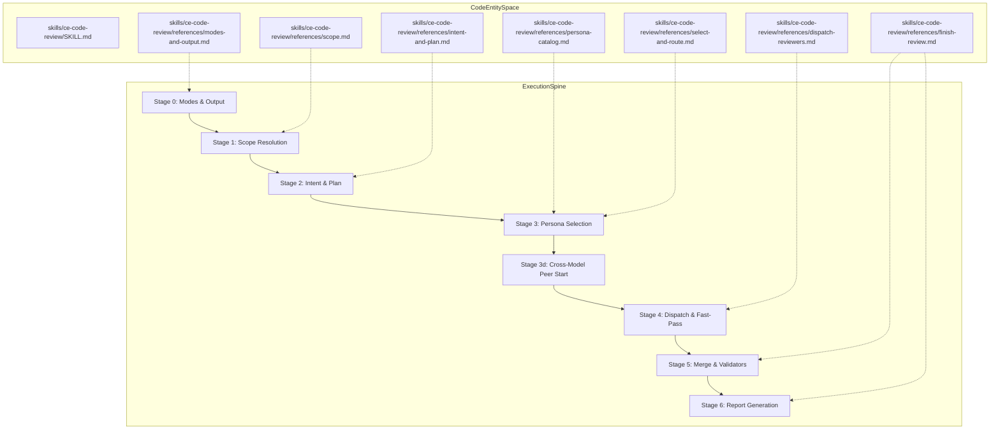
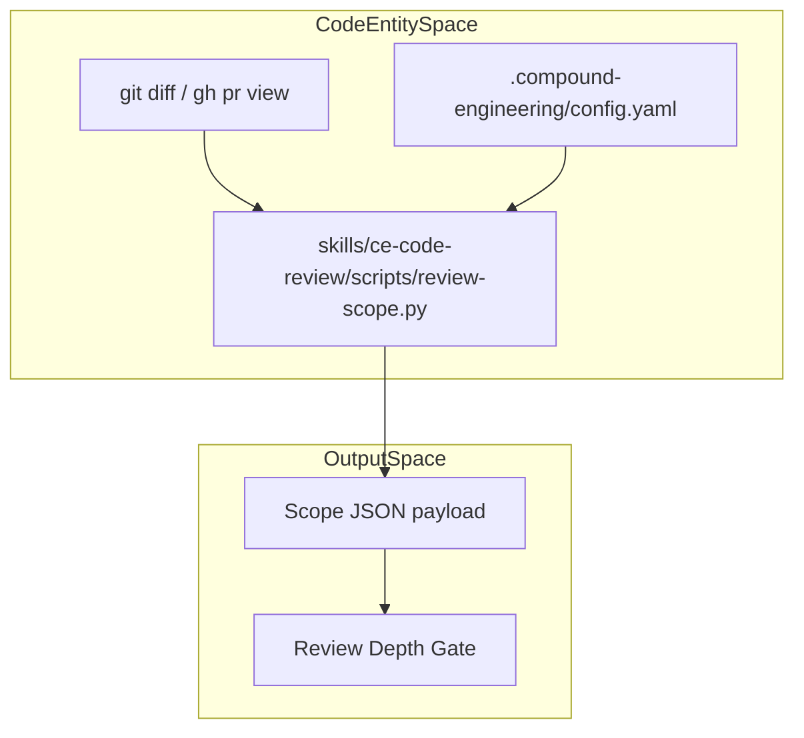
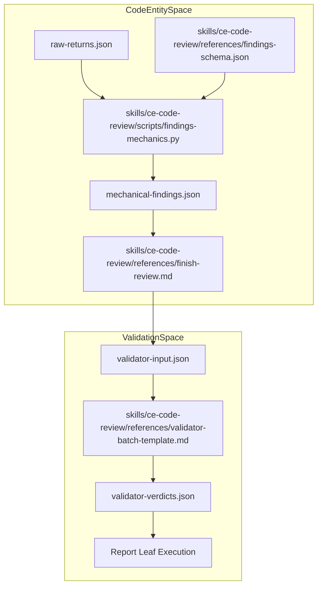

<!-- source: DeepWiki mcp.deepwiki.com · repo EveryInc/compound-engineering-plugin · extra page ce-code-review Pipeline · fetched 2026-10-30 -->

# 3.4.1 ce-code-review Pipeline

<details>
<summary>Relevant source files</summary>

The following files were used as context for generating this wiki page:

- [docs/plans/2026-07-13-001-feat-code-review-line-provenance-plan.md](docs/plans/2026-07-13-001-feat-code-review-line-provenance-plan.md)
- [docs/plans/2026-09-23-001-fix-ce-code-review-unrequested-behavior-rules-plan.md](docs/plans/2026-09-23-001-fix-ce-code-review-unrequested-behavior-rules-plan.md)
- [docs/solutions/skill-design/anti-poll-scope-and-async-subagent-dispatch.md](docs/solutions/skill-design/anti-poll-scope-and-async-subagent-dispatch.md)
- [docs/solutions/skill-design/cross-harness-cross-model-tool-invocation.md](docs/solutions/skill-design/cross-harness-cross-model-tool-invocation.md)
- [docs/solutions/skill-design/named-frameworks-with-detection-conditions-for-review-personas.md](docs/solutions/skill-design/named-frameworks-with-detection-conditions-for-review-personas.md)
- [docs/solutions/skill-design/watch-loops-need-a-blocked-external-terminal-state.md](docs/solutions/skill-design/watch-loops-need-a-blocked-external-terminal-state.md)
- [skills/ce-babysit-pr/references/pipeline.md](skills/ce-babysit-pr/references/pipeline.md)
- [skills/ce-brainstorm/references/model-tiers.md](skills/ce-brainstorm/references/model-tiers.md)
- [skills/ce-code-review/SKILL.md](skills/ce-code-review/SKILL.md)
- [skills/ce-code-review/references/action-class-rubric.md](skills/ce-code-review/references/action-class-rubric.md)
- [skills/ce-code-review/references/depth-paths.md](skills/ce-code-review/references/depth-paths.md)
- [skills/ce-code-review/references/diff-scope.md](skills/ce-code-review/references/diff-scope.md)
- [skills/ce-code-review/references/dispatch-reviewers.md](skills/ce-code-review/references/dispatch-reviewers.md)
- [skills/ce-code-review/references/findings-schema.json](skills/ce-code-review/references/findings-schema.json)
- [skills/ce-code-review/references/finish-input.md](skills/ce-code-review/references/finish-input.md)
- [skills/ce-code-review/references/finish-review.md](skills/ce-code-review/references/finish-review.md)
- [skills/ce-code-review/references/intent-and-plan.md](skills/ce-code-review/references/intent-and-plan.md)
- [skills/ce-code-review/references/modes-and-output.md](skills/ce-code-review/references/modes-and-output.md)
- [skills/ce-code-review/references/persona-catalog.md](skills/ce-code-review/references/persona-catalog.md)
- [skills/ce-code-review/references/personas/adversarial-reviewer.md](skills/ce-code-review/references/personas/adversarial-reviewer.md)
- [skills/ce-code-review/references/personas/api-contract-reviewer.md](skills/ce-code-review/references/personas/api-contract-reviewer.md)
- [skills/ce-code-review/references/personas/correctness-reviewer.md](skills/ce-code-review/references/personas/correctness-reviewer.md)
- [skills/ce-code-review/references/personas/data-migration-reviewer.md](skills/ce-code-review/references/personas/data-migration-reviewer.md)
- [skills/ce-code-review/references/personas/julik-frontend-races-reviewer.md](skills/ce-code-review/references/personas/julik-frontend-races-reviewer.md)
- [skills/ce-code-review/references/personas/maintainability-reviewer.md](skills/ce-code-review/references/personas/maintainability-reviewer.md)
- [skills/ce-code-review/references/personas/security-reviewer.md](skills/ce-code-review/references/personas/security-reviewer.md)
- [skills/ce-code-review/references/personas/testing-reviewer.md](skills/ce-code-review/references/personas/testing-reviewer.md)
- [skills/ce-code-review/references/review-output-template.md](skills/ce-code-review/references/review-output-template.md)
- [skills/ce-code-review/references/scope.md](skills/ce-code-review/references/scope.md)
- [skills/ce-code-review/references/select-and-route.md](skills/ce-code-review/references/select-and-route.md)
- [skills/ce-code-review/references/subagent-template.md](skills/ce-code-review/references/subagent-template.md)
- [skills/ce-code-review/references/validator-batch-template.md](skills/ce-code-review/references/validator-batch-template.md)
- [skills/ce-code-review/scripts/findings-mechanics.py](skills/ce-code-review/scripts/findings-mechanics.py)
- [skills/ce-code-review/scripts/review-scope.py](skills/ce-code-review/scripts/review-scope.py)
- [skills/ce-commit-push-pr/references/apply-and-handoff.md](skills/ce-commit-push-pr/references/apply-and-handoff.md)
- [skills/ce-sweep/references/model-tiers.md](skills/ce-sweep/references/model-tiers.md)
- [skills/ce-test-browser/references/pipeline-orchestration.md](skills/ce-test-browser/references/pipeline-orchestration.md)
- [skills/lfg/references/shipping.md](skills/lfg/references/shipping.md)
- [tests/ce-code-review-mechanics.test.ts](tests/ce-code-review-mechanics.test.ts)
- [tests/review-skill-contract.test.ts](tests/review-skill-contract.test.ts)
- [tests/skill-eval-cell/fixtures/review-artifact-quote/correctness.json](tests/skill-eval-cell/fixtures/review-artifact-quote/correctness.json)
- [tests/skill-eval-cell/fixtures/review-artifact-quote/returns.json](tests/skill-eval-cell/fixtures/review-artifact-quote/returns.json)
- [tests/skill-eval-cell/fixtures/review-validator-veto/run/finish-input.json](tests/skill-eval-cell/fixtures/review-validator-veto/run/finish-input.json)
- [tests/skill-eval-cell/fixtures/review-validator-veto/run/synthesized-findings.json](tests/skill-eval-cell/fixtures/review-validator-veto/run/synthesized-findings.json)
- [tests/skill-eval-cell/fixtures/review-validator-veto/run/validator-outcome.json](tests/skill-eval-cell/fixtures/review-validator-veto/run/validator-outcome.json)

</details>


## Purpose and Scope

The `ce-code-review` skill orchestrates a deterministic, multi-stage code review pipeline within the compound-engineering-plugin ecosystem [skills/ce-code-review/SKILL.md:1-40](). Its goal is to produce actionable, evidence-based findings on a named diff or pull request (PR), evaluating code for bugs, regressions, test coverage, standards compliance, and maintainability, without making unapproved mutations or requiring blocking user interactions [skills/ce-code-review/SKILL.md:9-38](). The pipeline manages multiple specialized reviewer personas, consolidates their output using mechanical rules in helper scripts, validates findings via independent validators, and finally generates comprehensive review reports [skills/ce-code-review/references/finish-review.md:3-33]().

This page documents the full six-stage execution spine, detailing core mechanisms including deterministic scope resolution via `skills/ce-code-review/scripts/review-scope.py`, nuanced persona selection from a modular catalog, dispatching of concurrent reviewers with the embedded "fast-pass" scanner, subagent prompt templating (`skills/ce-code-review/references/subagent-template.md`), confidence anchor policies including the "quote-the-line" gate, mechanized findings deduplication and routing via `skills/ce-code-review/scripts/findings-mechanics.py` and `skills/ce-code-review/references/findings-schema.json`, batches of validator agents (`skills/ce-code-review/references/validator-batch-template.md`), and the finish-review routing that sequences post-collection merges and validations into a final report emission [skills/ce-code-review/references/finish-review.md:1-33]().

Sources: `skills/ce-code-review/SKILL.md:1-41` [skills/ce-code-review/SKILL.md:1-40](), `skills/ce-code-review/references/finish-review.md:1-33` [skills/ce-code-review/references/finish-review.md:1-33]()

---

## 1. Execution Spine Overview

The `ce-code-review` skill implements a six-stage sequential pipeline with strict ordering and isolated responsibilities [skills/ce-code-review/SKILL.md:23-34](). Each stage loads distinct reference documents that encode behavior rules, output contracts, and orchestrator policies [skills/ce-code-review/SKILL.md:25-33](). The execution spine is summarized below:

| Stage | Step Description | Reference File |
|--------|----------------|----------------|
| 0 | Resolve modes and output shape; settle invocation args, conflicts, gateways, and quick review short-circuit. | `skills/ce-code-review/references/modes-and-output.md` [skills/ce-code-review/SKILL.md:27]() |
| 1 | Resolve review scope by inspecting diffs, PR metadata, and local configuration. Apply Review depth gating including the "Lite" early exit. | `skills/ce-code-review/references/scope.md` [skills/ce-code-review/SKILL.md:28]() |
| 2 | Write the intent summary and surface the plan document the final Stage verifies against. | `skills/ce-code-review/references/intent-and-plan.md` [skills/ce-code-review/SKILL.md:29]() |
| 3 | Select reviewer personas guided by diff contents and configured corpora, find applicable project standards, and decide on adversarial review routing (local adversarial vs cross-model peer). | `skills/ce-code-review/references/persona-catalog.md`, `skills/ce-code-review/references/select-and-route.md` [skills/ce-code-review/SKILL.md:30]() |
| 3d | If adversarial cross-model peer is selected and permitted, start the detached peer job asynchronously before local dispatch. | `skills/ce-code-review/references/cross-model-review.md` [skills/ce-code-review/SKILL.md:31]() |
| 4 | Dispatch the selected reviewers as a bounded concurrent batch, collect their terminal outcomes via blocking waits, and incorporate the fast-pass quick scanning findings immediately before launching the batch. | `skills/ce-code-review/references/dispatch-reviewers.md` [skills/ce-code-review/SKILL.md:32]() |
| 5 & 6 | After collection, write the `finish-input.json` state and invoke two leaf subagents in sequence: the merge leaf (fold-in, dedup, confidence filter via `skills/ce-code-review/scripts/findings-mechanics.py`) and the report leaf (launch validator batch, fold validator results, produce final report). | `skills/ce-code-review/references/finish-review.md` [skills/ce-code-review/SKILL.md:33]() |

The spine strictly forbids subagent launches nested inside leaf agents, mandates modular reference loading to avoid exceeding prompt size limits, and ensures that critical behavioral rules enforce no unintended tree mutations, no blocking user asks, and explicit mutability only on `apply:local` [skills/ce-code-review/SKILL.md:33-39]().

**Diagram 1:** ce-code-review Six-Stage Execution Spine and Code Entities



Sources: `skills/ce-code-review/SKILL.md:23-34` [skills/ce-code-review/SKILL.md:23-34](), `skills/ce-code-review/references/finish-review.md:1-33` [skills/ce-code-review/references/finish-review.md:1-33](), `tests/review-skill-contract.test.ts:131-186` [tests/review-skill-contract.test.ts:131-186]()

---

## 2. Review Scope Resolution

The scope stage (Stage 1) deeply analyzes diff contents, changed files, PR metadata, and local repo configuration to produce a deterministic scope object [skills/ce-code-review/references/scope.md:1-71](). This uses the Python helper script `skills/ce-code-review/scripts/review-scope.py` to categorize changed files (counting executable lines, uncountable files, frontend signals), identify untracked exclusions, detect hard blocks (e.g., CI workflow changes or large diffs), and establish eligibility for the "Lite" review mode [tests/ce-code-review-mechanics.test.ts:44-162]().

Scope resolution returns a JSON object containing:
- `mode`: Review invocation scope mode (`local-aligned`, `standalone`, `pr-remote`, `branch-remote`) [skills/ce-code-review/references/finish-input.md:25-26]()
- `changed_files`: List of repository-relative paths changed in the review [tests/ce-code-review-mechanics.test.ts:58]()
- `changed_lines`, `exec_lines`: Line counts differentiating executable and total lines [tests/ce-code-review-mechanics.test.ts:55-56]()
- `hard_block_full`: Boolean indicating if the review is hard-blocked (e.g., due to uncounted files or migrations) [tests/ce-code-review-mechanics.test.ts:113-120]()
- `lite_eligible`: Optional boolean showing if the review can skip later stages early [tests/ce-code-review-mechanics.test.ts:61]()

**Diagram 2:** Scope Resolution Data Flow



Sources: `skills/ce-code-review/references/scope.md:1-71` [skills/ce-code-review/references/scope.md:1-71](), `tests/ce-code-review-mechanics.test.ts:10-153` [tests/ce-code-review-mechanics.test.ts:10-153]()

---

## 3. Persona Catalog and Reviewer Selection

At Stage 3, the skill selects a roster of reviewer personas from a categorized catalog, matching reviewers to the diff content and codebase context [skills/ce-code-review/references/persona-catalog.md]().

### Persona Catalog Organization

The catalog includes:
- **Core personas:** Always spawned, e.g., `correctness-reviewer` [skills/ce-code-review/references/dispatch-reviewers.md:46]().
- **Standards gates:** `project-standards-reviewer` runs when standards files are present [skills/ce-code-review/references/finish-input.md:41]().
- **Generic conditionals:** e.g., `testing-reviewer` [skills/ce-code-review/references/personas/testing-reviewer.md:1](), `maintainability-reviewer` [skills/ce-code-review/references/personas/maintainability-reviewer.md:1](), `agent-native-reviewer`, `learnings-researcher` [skills/ce-code-review/references/finish-input.md:46]().
- **Cross-cutting conditionals:** e.g., `security-reviewer`, `performance-reviewer`, `api-contract-reviewer`, `data-migration-reviewer`, `reliability-reviewer`, `adversarial-reviewer` [skills/ce-code-review/references/dispatch-reviewers.md:46]().
- **Stack-Specific conditionals:** e.g., `julik-frontend-races-reviewer`, `swift-ios-reviewer` [skills/ce-code-review/references/personas/julik-frontend-races-reviewer.md:1]().

### Model Tier Assignment

Personas inherit platform model tiers [skills/ce-code-review/references/dispatch-reviewers.md:22-28]():
- **Session model (no override):** `correctness-reviewer`, `security-reviewer`, and `adversarial-reviewer` [skills/ce-code-review/references/dispatch-reviewers.md:46]().
- **Mid-tier:** Every other persona and CE local prompt asset, using the platform's balanced mid-tier model (e.g., Sonnet class in Claude Code) [skills/ce-code-review/references/dispatch-reviewers.md:26-47]().

Sources: `skills/ce-code-review/references/persona-catalog.md` [skills/ce-code-review/references/persona-catalog.md](), `skills/ce-code-review/references/dispatch-reviewers.md:22-49` [skills/ce-code-review/references/dispatch-reviewers.md:22-49]()

---

## 4. Dispatch and Fast-Pass Mechanism

### 4.1 Fast-Pass Scan

Immediately before launching the concurrent batch of persona subagents (Stage 4), the orchestrator executes a fast-pass scan on the diff to detect high-signal P0/P1 issues [skills/ce-code-review/references/dispatch-reviewers.md:3-10]().
- Scans for data/SQL safety, injection, broken control flow, missing `await`, swapped arguments, enum mismatches, null dereferences [skills/ce-code-review/references/dispatch-reviewers.md:7]().
- Assigns severity P0/P1 based on `skills/ce-code-review/references/action-class-rubric.md` [skills/ce-code-review/references/dispatch-reviewers.md:9]().
- Enters Stage 5 as a pseudo-reviewer named `fast-pass`, capped at anchor 50 unless corroborated by independent persona findings [skills/ce-code-review/references/dispatch-reviewers.md:11-14]().

### 4.2 Concurrency and Subagent Collection

- Subagents write their full analysis JSON artifact to `{run_dir}/{reviewer_name}.json` and return compact JSON with merge-tier fields [skills/ce-code-review/references/subagent-template.md:25-38]().
- The orchestrator uses blocking collection capabilities within bounded intervals [skills/ce-code-review/SKILL.md:32]().
- Detached background polling is strictly forbidden for local reviewers; only the cross-model peer runs detached [skills/ce-code-review/SKILL.md:32](), [docs/solutions/skill-design/anti-poll-scope-and-async-subagent-dispatch.md:37-41]().

Sources: `skills/ce-code-review/references/dispatch-reviewers.md:1-50` [skills/ce-code-review/references/dispatch-reviewers.md:1-50](), `docs/solutions/skill-design/anti-poll-scope-and-async-subagent-dispatch.md:25-64` [docs/solutions/skill-design/anti-poll-scope-and-async-subagent-dispatch.md:25-64]()

---

## 5. Subagent Template and Confidence Anchors

### 5.1 Subagent Prompt Template

Each reviewer subagent receives a prompt generated from `skills/ce-code-review/references/subagent-template.md` [skills/ce-code-review/references/subagent-template.md:1-68](), containing:
- Persona instructions from `skills/ce-code-review/references/personas/{persona}.md` [skills/ce-code-review/references/subagent-template.md:12-14]().
- Calibration directives [skills/ce-code-review/references/subagent-template.md:16-18]().
- Strict output contracts for artifact file writes and compact returns [skills/ce-code-review/references/subagent-template.md:24-41]().

### 5.2 Confidence Anchors and Quote-the-Line Gate

- Valid confidence anchors are strictly discrete: `0`, `25`, `50`, `75`, or `100` [skills/ce-code-review/references/subagent-template.md:55]().
- **Quote-the-line gate:** Findings at confidence anchor `75` or `100` require a `first_evidence` string providing the verbatim motivating line with file and line reference [skills/ce-code-review/references/subagent-template.md:37](). Missing quotes demote findings to anchor 50 at merge time [skills/ce-code-review/references/subagent-template.md:37]().
- Anchors `0` and `25` represent non-confident or uncertain claims and are suppressed silently [skills/ce-code-review/references/subagent-template.md:61-62]().

Sources: `skills/ce-code-review/references/subagent-template.md:1-68` [skills/ce-code-review/references/subagent-template.md:1-68]()

---

## 6. Findings Mechanics and Validation

### 6.1 Findings Merging and Deduplication

After reviewer returns are collected, the merge leaf executes the mechanical helper script `skills/ce-code-review/scripts/findings-mechanics.py` [skills/ce-code-review/references/finish-review.md:7-17]():

```bash
"$PY" "$SKILL_DIR/scripts/findings-mechanics.py" < "$RUN_DIR/raw-returns.json" > "$RUN_DIR/mechanical-findings.json"
```

This helper handles schema validation against `skills/ce-code-review/references/findings-schema.json`, exact fingerprint deduplication, route merging, confidence filtering, and deterministic sorting [skills/ce-code-review/references/finish-review.md:7]().

### 6.2 Validator Batches

Validator subagents evaluate batches of up to eight merged findings using `skills/ce-code-review/references/validator-batch-template.md` [skills/ce-code-review/references/validator-batch-template.md:3]() under a protected-subject policy [skills/ce-code-review/references/validator-batch-template.md:24-50]().
- Validators return verdicts (`confirmed`, `rejected`, or `unresolved`) with a reason grounded in inspected evidence [skills/ce-code-review/references/validator-batch-template.md:25,61-64]().
- Findings are written to `{run_dir}/validator-verdicts.json` [skills/ce-code-review/references/validator-batch-template.md:56]().

### 6.3 Finish-Review Routing

The finish pipeline coordinates state across `skills/ce-code-review/references/finish-input.md` [skills/ce-code-review/references/finish-input.md:13-63]() and `skills/ce-code-review/references/finish-review.md` [skills/ce-code-review/references/finish-review.md:1-2]() through three distinct execution phases:
1. **Merge leaf:** Executes Stage 5 and initial Stage 5b steps, generating `synthesized-findings.json` and `validator-input.json` [skills/ce-code-review/references/finish-input.md:5]()
2. **Validator batch dispatch:** Run by the dispatch context to populate `validator-verdicts.json` and `validator-outcome.json` [skills/ce-code-review/references/finish-input.md:6]()
3. **Report leaf:** Executes Stage 5b step 5 and Stage 6 to produce final reports [skills/ce-code-review/references/finish-input.md:7]()

**Diagram 3:** Findings Processing and Validation Flow



Sources: `skills/ce-code-review/references/finish-review.md:1-33` [skills/ce-code-review/references/finish-review.md:1-33](), `skills/ce-code-review/references/finish-input.md:1-63` [skills/ce-code-review/references/finish-input.md:1-63](), `skills/ce-code-review/references/validator-batch-template.md:1-70` [skills/ce-code-review/references/validator-batch-template.md:1-69]()

---

