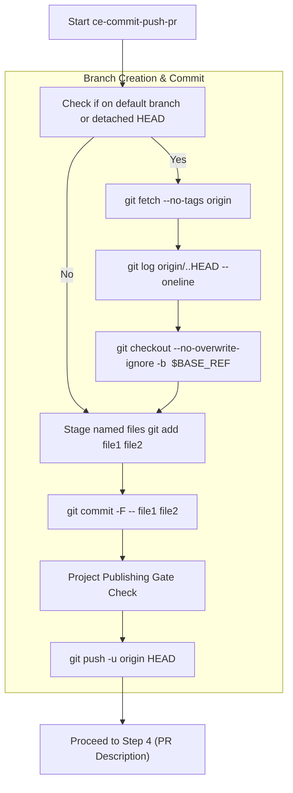
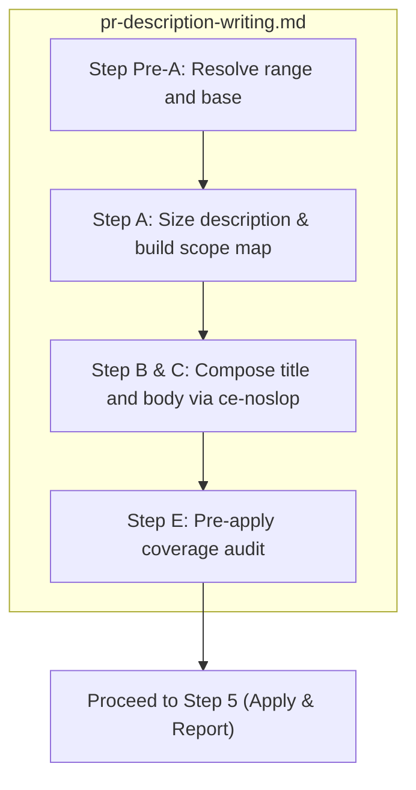

<!-- source: DeepWiki mcp.deepwiki.com · repo EveryInc/compound-engineering-plugin · extra page ce-commit-push-pr — Commit, Push, PR · fetched 2026-10-30 -->

# ce-commit-push-pr — Commit, Push, PR

Relevant source files

The following files were used as context for generating this wiki page:

- [skills/ce-babysit-pr/references/pipeline.md](skills/ce-babysit-pr/references/pipeline.md)
- [skills/ce-brainstorm/references/model-tiers.md](skills/ce-brainstorm/references/model-tiers.md)
- [skills/ce-code-review/references/depth-paths.md](skills/ce-code-review/references/depth-paths.md)
- [skills/ce-code-review/references/finish-input.md](skills/ce-code-review/references/finish-input.md)
- [skills/ce-code-review/references/modes-and-output.md](skills/ce-code-review/references/modes-and-output.md)
- [skills/ce-code-review/references/scope.md](skills/ce-code-review/references/scope.md)
- [skills/ce-commit-push-pr/SKILL.md](skills/ce-commit-push-pr/SKILL.md)
- [skills/ce-commit-push-pr/references/apply-and-handoff.md](skills/ce-commit-push-pr/references/apply-and-handoff.md)
- [skills/ce-commit-push-pr/references/branch-creation.md](skills/ce-commit-push-pr/references/branch-creation.md)
- [skills/ce-commit-push-pr/references/commit-and-push.md](skills/ce-commit-push-pr/references/commit-and-push.md)
- [skills/ce-commit-push-pr/references/pr-description-writing.md](skills/ce-commit-push-pr/references/pr-description-writing.md)
- [skills/ce-commit-push-pr/references/stack-submit.md](skills/ce-commit-push-pr/references/stack-submit.md)
- [skills/ce-commit/SKILL.md](skills/ce-commit/SKILL.md)
- [skills/ce-sweep/references/model-tiers.md](skills/ce-sweep/references/model-tiers.md)
- [skills/ce-test-browser/references/pipeline-orchestration.md](skills/ce-test-browser/references/pipeline-orchestration.md)
- [skills/lfg/references/shipping.md](skills/lfg/references/shipping.md)
- [tests/ce-commit-contract.test.ts](tests/ce-commit-contract.test.ts)
- [tests/commit-push-pr-contract.test.ts](tests/commit-push-pr-contract.test.ts)
- [tests/commit-push-pr-worktree-safety.test.ts](tests/commit-push-pr-worktree-safety.test.ts)

The `ce-commit-push-pr` skill is designed to streamline the process of committing changes, pushing them to a remote repository, and creating or updating a Pull Request (PR) [skills/ce-commit-push-pr/SKILL.md:1-3](). It handles various scenarios, from simple single-PR workflows to complex stacked PRs, and integrates with `ce-babysit-pr` for automated PR monitoring [skills/ce-commit-push-pr/SKILL.md:15](), [skills/ce-commit-push-pr/references/apply-and-handoff.md:39-42](). This page details its mechanics, PR description writing guidelines, and interaction with other tools.

## Purpose and Scope

`ce-commit-push-pr` serves as the primary shipping and PR authoring engine within the skill catalog [skills/ce-commit-push-pr/SKILL.md:1-3](). It is invoked when code is ready for review, or when only a PR description needs to be drafted or updated [skills/ce-commit-push-pr/SKILL.md:3](). The skill manages branch creation, commit and push operations, PR description generation (including scope mapping, umbrella outcomes, and program altitude), and optionally uses `gh stack` for stacked PRs [skills/ce-commit-push-pr/SKILL.md:19-24](), [skills/ce-commit-push-pr/references/pr-description-writing.md:62-73](). A critical component is the **Project publishing gate** which ensures all project-defined requirements are met before any external write operation [skills/ce-commit-push-pr/SKILL.md:52-54](). Finally, it can hand off to `ce-babysit-pr` for continuous PR monitoring [skills/ce-commit-push-pr/references/apply-and-handoff.md:39-42]().

Sources: [skills/ce-commit-push-pr/SKILL.md:1-5]()

## Modes of Operation

The `ce-commit-push-pr` skill operates in several modes, determined by the user's intent or explicit modifiers [skills/ce-commit-push-pr/SKILL.md:10-18]():

*   **Description-only** — the user wants *just* a description ("write/draft a PR description", "describe this PR"). Run Step 4 only and print it. Apply it only if asked [skills/ce-commit-push-pr/SKILL.md:13]().
*   **Description update** — refresh or rewrite an existing PR's description, with no commit or push intent. Resolve PR presence, run Step 4 in PR mode on that URL, then Step 5 to preview, confirm, and apply via `gh pr edit` [skills/ce-commit-push-pr/SKILL.md:14]().
*   **Full workflow** — otherwise: Steps 1–5. Enter **Stack mode** instead when intent or preference wants a stack [skills/ce-commit-push-pr/SKILL.md:15]().
*   **`mode:pipeline` modifier** — set by orchestrated callers such as `lfg`. Run the resolved mode non-interactively and suppress every blocking ask, taking conservative defaults [skills/ce-commit-push-pr/SKILL.md:17-18]().

Sources: [skills/ce-commit-push-pr/SKILL.md:10-18]()

## Branch Creation and Git Mechanics

Before any commits or pushes, `ce-commit-push-pr` handles branch creation and ensures a clean working state by reading `references/context.md` [skills/ce-commit-push-pr/SKILL.md:26-27]().

### Context and Git Probes

*   Every `git` and `gh` probe is its own `argv`-form call, gathering and re-verification alike, and its exit status is control flow [skills/ce-commit-push-pr/SKILL.md:30]().
*   Probe output is a snapshot; re-verify branch, remote, and PR state right before each consequential action [skills/ce-commit-push-pr/SKILL.md:32]().
*   Only an exit-0 `[]` from a query against the base repo means "no open PR" [skills/ce-commit-push-pr/SKILL.md:34-35]().

### Branch Creation from Default Branch

When on the default branch or detached HEAD, the skill creates a feature branch following `references/branch-creation.md` [skills/ce-commit-push-pr/SKILL.md:27]():
1. Fetch fresh remote base [skills/ce-commit-push-pr/references/branch-creation.md:9-10]().
2. Check for unpushed local commits [skills/ce-commit-push-pr/references/branch-creation.md:16-17]().
3. Create the feature branch using `git checkout --no-overwrite-ignore -b <branch-name> "$BASE_REF"` [skills/ce-commit-push-pr/references/branch-creation.md:33](). This specific flag protects ignored user data when switching to a fresh base [tests/commit-push-pr-contract.test.ts:10-20]().

### Commit and Push Mechanics

The skill reads `references/commit-and-push.md` for commit and push operations [skills/ce-commit-push-pr/SKILL.md:49](). It avoids blanket staging (`git add -A` or `git add .`) and requires naming explicit files [skills/ce-commit-push-pr/SKILL.md:55](), [skills/ce-commit-push-pr/references/commit-and-push.md:9-17](). Pushing uses `git push -u origin HEAD` [skills/ce-commit-push-pr/references/commit-and-push.md:23-26]().

#### Diagram: Branch Creation and Git Flow

Sources: [skills/ce-commit-push-pr/SKILL.md:26-55](), [skills/ce-commit-push-pr/references/branch-creation.md:1-38](), [skills/ce-commit-push-pr/references/commit-and-push.md:1-26](), [tests/commit-push-pr-contract.test.ts:10-20]()

## Project Publishing Gate

A critical feature of `ce-commit-push-pr` is the **Project publishing gate** [skills/ce-commit-push-pr/SKILL.md:52](). Before publishing commits (`git push -u origin HEAD`, `gh stack submit`, or final push flows), the skill resolves every applicable pre-push or review-ready requirement from the project's active instructions and conventions [skills/ce-commit-push-pr/SKILL.md:52-54](). 

Only evidence valid for the exact commit state being sent satisfies the gate; otherwise, the skill stops before the external write and reports missing or failing checks [skills/ce-commit-push-pr/SKILL.md:53](). This gate is enforced uniformly across all publishing surfaces [tests/commit-push-pr-contract.test.ts:22-51]().

Sources: [skills/ce-commit-push-pr/SKILL.md:52-54](), [tests/commit-push-pr-contract.test.ts:22-51]()

## PR Description Writing

The skill mandates reading `references/pr-description-writing.md` in full [skills/ce-commit-push-pr/SKILL.md:59](). The core principle is to explain what the diff cannot show: what was impossible before and is now possible, cutting sentences a reader can reconstruct from the diff itself [skills/ce-commit-push-pr/references/pr-description-writing.md:3-5]().

### Key Steps in Description Writing
1.  **Step Pre-A: Resolve range and base** — Supports current-branch mode or PR mode using `gh pr view` and `git log` [skills/ce-commit-push-pr/references/pr-description-writing.md:22-47]().
2.  **Step A: Size the description** — Size by decision cost, not diff shape [skills/ce-commit-push-pr/references/pr-description-writing.md:62-64](). Builds an internal **scope map** from the oneline commit list and three-dot diff, groups material outcome clusters, names an umbrella outcome, and evaluates **Program altitude** (lead-in and lead-out for multi-PR series) [skills/ce-commit-push-pr/references/pr-description-writing.md:66-73](), [tests/commit-push-pr-contract.test.ts:80-97]().
3.  **Step B & C: Title and body assembly** — Composes the title and body using `ce-noslop` prose rules while respecting the project's PR-body contract template [skills/ce-commit-push-pr/references/pr-description-writing.md:14-18]().
4.  **Step E: Pre-apply coverage audit** — Audits coverage against the scope map and program context [tests/commit-push-pr-contract.test.ts:73-78]().

#### Diagram: PR Description Workflow

Sources: [skills/ce-commit-push-pr/SKILL.md:59](), [skills/ce-commit-push-pr/references/pr-description-writing.md:1-73](), [tests/commit-push-pr-contract.test.ts:53-147]()

## Stack-Submit via `gh stack`

When stack mode is active (opt-in via explicit intent or standing preference), the skill loads `references/stack-submit.md` before Step 3 [skills/ce-commit-push-pr/SKILL.md:19-24]().
*   **Probe** — Checks for `gh` and `gh stack` availability [skills/ce-commit-push-pr/references/stack-submit.md:9-17]().
*   **Topology** — Classifies the chain by PR number, rooting layers appropriately using `gh stack init` or `gh stack add` [skills/ce-commit-push-pr/references/stack-submit.md:18-33]().
*   **Retrospective construction** — Inspects the complete change set and derives the smallest useful set of linear, independently reviewable layers in dependency order [skills/ce-commit-push-pr/references/stack-submit.md:35-41]().
*   **Submission** — Step 5 executes `gh stack submit --auto --open` [tests/commit-push-pr-contract.test.ts:25]() and sets the handoff posture to `posture:stack-ready` or `posture:stack-land` [skills/ce-commit-push-pr/SKILL.md:23-24]().

Sources: [skills/ce-commit-push-pr/SKILL.md:19-24](), [skills/ce-commit-push-pr/references/stack-submit.md:1-41](), [tests/commit-push-pr-contract.test.ts:25]()

## Apply and Handoff to `ce-babysit-pr`

Step 5 (`references/apply-and-handoff.md`) handles applying the PR via `gh pr create` or `gh pr edit`, running explainer archival if configured, and handing off to `ce-babysit-pr` [skills/ce-commit-push-pr/SKILL.md:65](), [skills/ce-commit-push-pr/references/apply-and-handoff.md:1-42]().

*   **Explainer archival** — When `pr_teaching_archive` is active and a `## New concepts` section is present, explainers are written to `<root>/explainers/`, committed, and linked via head-branch blob URLs in the PR body [skills/ce-commit-push-pr/references/apply-and-handoff.md:14-21]().
*   **Babysit Handoff** — Enabled by default (`auto_babysit`), the skill transitions execution to `ce-babysit-pr` after a successful PR creation or stack submit, passing the necessary posture (`posture:stack-ready`, etc.) [skills/ce-commit-push-pr/references/apply-and-handoff.md:27-42](). Users may opt out via configuration (`auto_babysit: false`) [skills/ce-commit-push-pr/references/apply-and-handoff.md:37]().

Sources: [skills/ce-commit-push-pr/SKILL.md:65](), [skills/ce-commit-push-pr/references/apply-and-handoff.md:1-42]()

---

