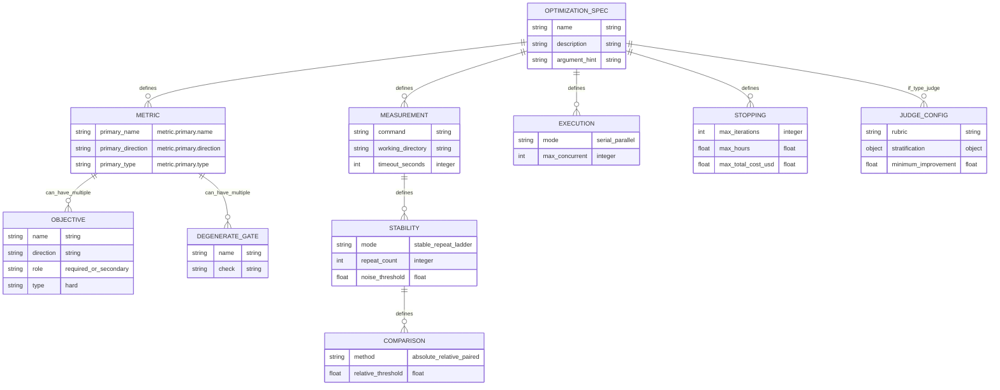
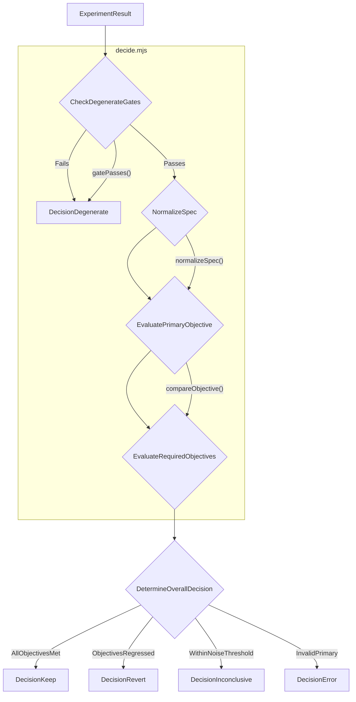

<!-- source: DeepWiki mcp.deepwiki.com · repo EveryInc/compound-engineering-plugin · extra page ce-optimize — Metric-Driven Optimization · fetched 2026-10-30 -->

# 3.4.2 ce-optimize — Metric-Driven Optimization

Relevant source files

The following files were used as context for generating this wiki page:

- [docs/guides/ce-optimize.md](docs/guides/ce-optimize.md)
- [skills/ce-optimize/SKILL.md](skills/ce-optimize/SKILL.md)
- [skills/ce-optimize/references/experiment-log-schema.yaml](skills/ce-optimize/references/experiment-log-schema.yaml)
- [skills/ce-optimize/references/experiment-prompt-template.md](skills/ce-optimize/references/experiment-prompt-template.md)
- [skills/ce-optimize/references/judge-prompt-template.md](skills/ce-optimize/references/judge-prompt-template.md)
- [skills/ce-optimize/references/loop.md](skills/ce-optimize/references/loop.md)
- [skills/ce-optimize/references/measurement.md](skills/ce-optimize/references/measurement.md)
- [skills/ce-optimize/references/optimize-spec-schema.yaml](skills/ce-optimize/references/optimize-spec-schema.yaml)
- [skills/ce-optimize/references/persistence.md](skills/ce-optimize/references/persistence.md)
- [skills/ce-optimize/references/spec.md](skills/ce-optimize/references/spec.md)
- [skills/ce-optimize/references/wrap-up.md](skills/ce-optimize/references/wrap-up.md)
- [skills/ce-optimize/scripts/decide.mjs](skills/ce-optimize/scripts/decide.mjs)
- [tests/skills/ce-optimize-decide.test.ts](tests/skills/ce-optimize-decide.test.ts)

The `ce-optimize` skill is designed for metric-driven optimization, focusing on confirming improvements to a measurable target [skills/ce-optimize/SKILL.md:7-9](). It attributes workload costs or scores variants to identify and retain winning changes [skills/ce-optimize/SKILL.md:11](). This skill is used when a system's metric needs to move, and the optimal change is not already known [skills/ce-optimize/SKILL.md:3](). It contrasts with `ce-debug` (for diagnosis) and `ce-work` (when the change is already known) [skills/ce-optimize/SKILL.md:3]().

This page details the `ce-optimize` workflow, including its `optimize-spec` schema, measurement processes, the `decide.mjs` loop gate [tests/skills/ce-optimize-decide.test.ts:8](), experiment logging, persistence mechanisms, wrap-up procedures [skills/ce-optimize/references/wrap-up.md:5-52](), and the roles of its research and judge agents [skills/ce-optimize/references/measurement.md:6-8](), [skills/ce-optimize/references/loop.md:22-22]().

Sources: [skills/ce-optimize/SKILL.md:3-11](), [skills/ce-optimize/references/wrap-up.md:5-52](), [tests/skills/ce-optimize-decide.test.ts:8]()

---

## Optimization Specification (`optimize-spec` Schema)

The optimization process begins with defining a target through an optimization specification [skills/ce-optimize/references/spec.md:1-3](). This can be provided as a YAML file or interactively built with the user [skills/ce-optimize/SKILL.md:53-53](). The specification is validated against rules defined in `references/optimize-spec-schema.yaml` [skills/ce-optimize/references/spec.md:16-17]().

The core decision in spec creation is whether the target is qualitative or quantitative, determining the `type: hard` versus `type: judge` setting [skills/ce-optimize/references/spec.md:21-22]().

*   **`type: hard`**: Used for scalar, objectively measurable metrics with a clear "better" direction (e.g., build time, latency, memory usage) [skills/ce-optimize/references/spec.md:24-28]().
*   **`type: judge`**: Used when output quality requires semantic understanding or human judgment (e.g., clustering quality, search relevance, summarization quality) [skills/ce-optimize/references/spec.md:32-37](). This mode often involves a three-tier approach:
    *   **Degenerate gates**: Cheap, fast checks to reject obviously broken solutions [skills/ce-optimize/references/spec.md:40-40]().
    *   **LLM-as-judge**: Scores sampled outputs against a rubric [skills/ce-optimize/references/spec.md:41-41]().
    *   **Diagnostics**: Logged metrics that explain score changes but are not used for gating [skills/ce-optimize/references/spec.md:42-43]().

For `type: judge` optimizations, the skill guides the user in designing a sampling strategy and a scoring rubric [skills/ce-optimize/references/spec.md:48-81]().

Sources: [skills/ce-optimize/SKILL.md:53-53](), [skills/ce-optimize/references/spec.md:1-81]()

### Diagram: `optimize-spec` Schema Overview

Sources: [skills/ce-optimize/references/optimize-spec-schema.yaml:1-172]()

---

## Measurement

Measurement establishes the baseline and validates the harness before optimization begins [skills/ce-optimize/references/measurement.md:3-4]().

### Phase 1: Measurement Scaffolding

This phase builds or validates the measurement harness and establishes a baseline [skills/ce-optimize/references/measurement.md:38-41](). It includes several mandatory gates:

1.  **Clean-Tree Gate**: Ensures no uncommitted changes exist in `scope.mutable` or `scope.immutable` files [skills/ce-optimize/SKILL.md:53-54](), [skills/ce-optimize/references/measurement.md:49-51]().
2.  **Build or Validate Measurement Harness**: If a harness is provided, it is executed via `measure.sh` and its JSON output is validated against expected metrics and gates [skills/ce-optimize/references/measurement.md:55-66](). If the agent needs to build the harness, it analyzes the codebase, creates an evaluation script, adds it to `scope.immutable`, and validates its output [skills/ce-optimize/references/measurement.md:68-74]().
3.  **Establish Baseline**: Runs the measurement harness on the original code to capture baseline performance [skills/ce-optimize/references/persistence.md:42-42]().
4.  **Parallelism Readiness Probe**: Evaluates parallel execution capabilities [skills/ce-optimize/references/measurement.md:3-4]().
5.  **User Approval Gate**: Requires explicit user sign-off on the assembled Phase 1 information (baseline, parallel readiness, scope, and cost) before entering Phase 2 [skills/ce-optimize/SKILL.md:55-58]().

Sources: [skills/ce-optimize/SKILL.md:53-58](), [skills/ce-optimize/references/measurement.md:38-74](), [skills/ce-optimize/references/persistence.md:42-42]()

---

## The `decide.mjs` Loop Gate

The `decide.mjs` script [skills/ce-optimize/scripts/decide.mjs:1-13]() is central to the optimization loop (Phase 3). It determines the outcome of each experiment (`keep`, `revert`, `inconclusive`, `censored`, `degenerate`) by comparing candidate metrics against the baseline and current best, managing multi-objective eligibility, noise-aware comparison, and measurement ladder progression [skills/ce-optimize/scripts/decide.mjs:2-4]().

Key exported functions within `decide.mjs` include:
*   `median(values)`: Calculates the median value of an array [skills/ce-optimize/scripts/decide.mjs:20-25]().
*   `gatePasses(value, check)`: Evaluates if a given value satisfies a gate expression (e.g., `== 1`, `>= 1.0`) [skills/ce-optimize/scripts/decide.mjs:35-55]().
*   `regressions(baseline, candidate)`: Scans for per-case regressions where the reference passed but the candidate failed [skills/ce-optimize/scripts/decide.mjs:109-116]().
*   `decide({ spec, baseline, candidate })`: The main entry point evaluating gating rules, primary metrics, objectives, and thresholds [skills/ce-optimize/scripts/decide.mjs:1-13]() (extended across [skills/ce-optimize/scripts/decide.mjs:166-676]()).

Sources: [skills/ce-optimize/scripts/decide.mjs:1-13](), [skills/ce-optimize/scripts/decide.mjs:20-55](), [skills/ce-optimize/scripts/decide.mjs:109-116]()

### Diagram: `decide.mjs` Decision Flow

Sources: [skills/ce-optimize/scripts/decide.mjs:1-676]()

---

## Experiment Log and Persistence

The experiment log on disk serves as the single source of truth for an optimization run [skills/ce-optimize/references/experiment-log-schema.yaml:10-12](). It resides under `<state-root>/experiment-log.yaml` [skills/ce-optimize/references/experiment-log-schema.yaml:5-8]().

### Persistence Discipline

1.  **Immediate Write**: Each experiment result is appended to disk immediately after measurement [skills/ce-optimize/references/persistence.md:6-7]().
2.  **Verify Critical Writes**: Every write is read back immediately to verify integrity [skills/ce-optimize/references/persistence.md:9-10]().
3.  **Re-read at Phase Boundaries**: State is re-read from disk across phase transitions [skills/ce-optimize/references/persistence.md:11-11]().
4.  **One Experiment, One Log Entry**: Each experiment has a single log entry updated in place for ladder samples [skills/ce-optimize/references/persistence.md:13-14]().
5.  **Crash Recovery Markers**: `result.yaml` markers are written in each experiment worktree [skills/ce-optimize/references/persistence.md:15-16]().
6.  **Strategy Digest**: Written after every batch to guide future iterations [skills/ce-optimize/references/persistence.md:17-18]().
7.  **Write Before Displaying**: Results are stored on disk prior to showing them to the user [skills/ce-optimize/references/persistence.md:19-20]().

### Mandatory Disk Checkpoints

*   **CP-0**: Spec saved (`spec.yaml`) [skills/ce-optimize/references/persistence.md:41-41]()
*   **CP-1**: Baseline recorded (`experiment-log.yaml`) [skills/ce-optimize/references/persistence.md:42-42]()
*   **CP-2**: Hypothesis backlog saved (`experiment-log.yaml`) [skills/ce-optimize/references/persistence.md:44-44]()
*   **CP-3**: Individual experiment results [skills/ce-optimize/references/persistence.md:45-45]()
*   **CP-4**: Batch summary and strategy digest [skills/ce-optimize/references/persistence.md:46-46]()
*   **CP-5**: Final summary [skills/ce-optimize/references/persistence.md:47-47]()

Sources: [skills/ce-optimize/references/persistence.md:1-48](), [skills/ce-optimize/references/experiment-log-schema.yaml:1-171]()

---

## Wrap-Up

Phase 4 wrap-up executes when stopping criteria are met [skills/ce-optimize/SKILL.md:13-13](), [skills/ce-optimize/references/wrap-up.md:5-5]().

### Wrap-Up Steps

1.  **Present Deferred Hypotheses**: Review unapproved dependency items [skills/ce-optimize/references/wrap-up.md:8-13]().
2.  **Summarize Results**: Generate a comprehensive report comparing original baselines to final states, covering metrics, opportunity estimates, and evidence quality [skills/ce-optimize/references/wrap-up.md:15-26]().
3.  **Preserve and Offer Next Steps**: Preserve the `optimize/<spec-name>` branch and offer options: run `ce-code-review`, run `ce-compound`, create a PR, continue optimization, or mark as done [skills/ce-optimize/references/wrap-up.md:27-41]().
4.  **Cleanup**: Remove temporary state files while preserving `experiment-log.yaml` and `spec.yaml` for auditability [skills/ce-optimize/references/wrap-up.md:48-54]().

Sources: [skills/ce-optimize/SKILL.md:13-13](), [skills/ce-optimize/references/wrap-up.md:5-54]()

---

## Research and Judge Agents

`ce-optimize` dispatches specialized subagents and validation routines:
*   **`learnings-researcher`**: Searched in Phase 0.3 for prior optimization work using `references/agents/learnings-researcher.md` [skills/ce-optimize/references/measurement.md:5-8]().
*   **`repo-research-analyst`**: Optionally dispatched in Phase 2.1 for deeper codebase analysis [skills/ce-optimize/references/loop.md:22-23]().
*   **LLM-as-judge**: Evaluates qualitative output samples against a structured rubric (`references/judge-prompt-template.md`) [skills/ce-optimize/references/spec.md:32-43](), [skills/ce-optimize/references/judge-prompt-template.md:1-15]().

Sources: [skills/ce-optimize/references/measurement.md:5-8](), [skills/ce-optimize/references/loop.md:22-23](), [skills/ce-optimize/references/judge-prompt-template.md:1-15]()

---

