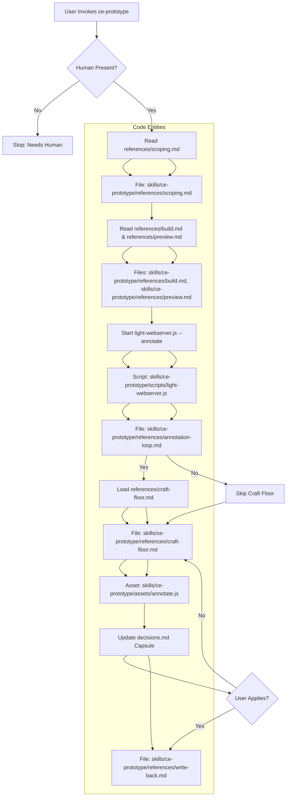
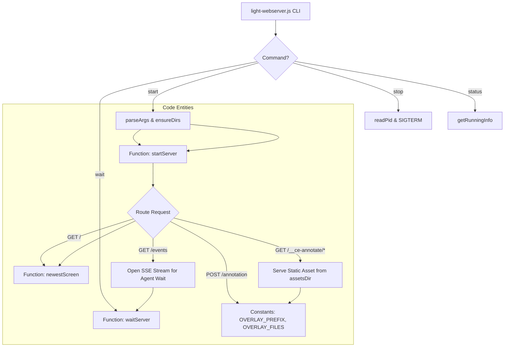
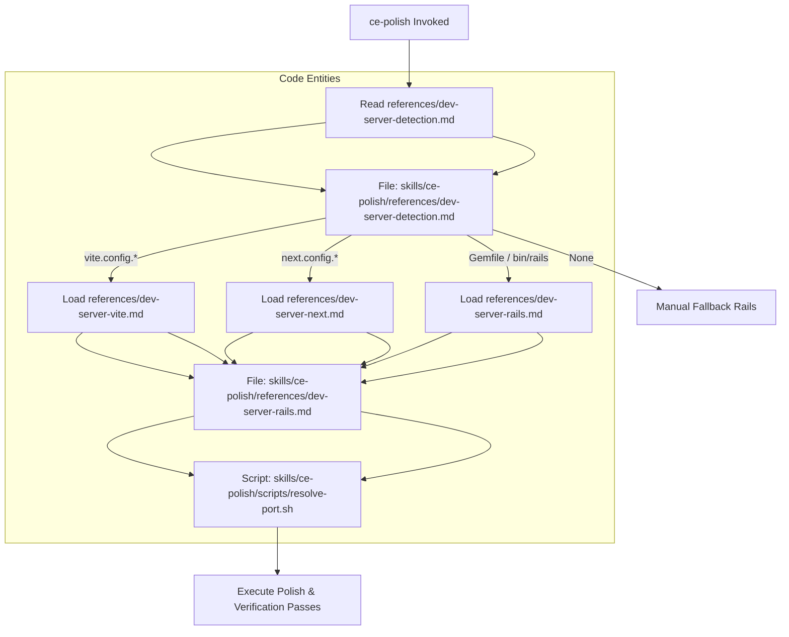

<!-- source: DeepWiki mcp.deepwiki.com · repo EveryInc/compound-engineering-plugin · extra page ce-prototype and ce-polish — UI Craft Loops · fetched 2026-10-30 -->

# ce-prototype and ce-polish — UI Craft Loops

Relevant source files

The following files were used as context for generating this wiki page:

- [docs/guides/ce-prototype.md](docs/guides/ce-prototype.md)
- [docs/plans/2026-09-02-001-feat-prototype-live-annotation-plan.md](docs/plans/2026-09-02-001-feat-prototype-live-annotation-plan.md)
- [skills/ce-brainstorm/scripts/light-webserver.js](skills/ce-brainstorm/scripts/light-webserver.js)
- [skills/ce-polish/SKILL.md](skills/ce-polish/SKILL.md)
- [skills/ce-polish/references/dev-server-detection.md](skills/ce-polish/references/dev-server-detection.md)
- [skills/ce-polish/references/dev-server-next.md](skills/ce-polish/references/dev-server-next.md)
- [skills/ce-polish/references/dev-server-rails.md](skills/ce-polish/references/dev-server-rails.md)
- [skills/ce-polish/references/dev-server-vite.md](skills/ce-polish/references/dev-server-vite.md)
- [skills/ce-polish/references/install-riffrec.md](skills/ce-polish/references/install-riffrec.md)
- [skills/ce-polish/references/live-loop.md](skills/ce-polish/references/live-loop.md)
- [skills/ce-polish/references/live-remote.md](skills/ce-polish/references/live-remote.md)
- [skills/ce-polish/references/live-start.md](skills/ce-polish/references/live-start.md)
- [skills/ce-polish/references/live-stream-contract.md](skills/ce-polish/references/live-stream-contract.md)
- [skills/ce-polish/scripts/detect-riffrec.sh](skills/ce-polish/scripts/detect-riffrec.sh)
- [skills/ce-polish/scripts/live-endpoint.js](skills/ce-polish/scripts/live-endpoint.js)
- [skills/ce-polish/scripts/resolve-port.sh](skills/ce-polish/scripts/resolve-port.sh)
- [skills/ce-prototype/SKILL.md](skills/ce-prototype/SKILL.md)
- [skills/ce-prototype/assets/annotate.css](skills/ce-prototype/assets/annotate.css)
- [skills/ce-prototype/assets/annotate.js](skills/ce-prototype/assets/annotate.js)
- [skills/ce-prototype/references/annotation-loop.md](skills/ce-prototype/references/annotation-loop.md)
- [skills/ce-prototype/references/build.md](skills/ce-prototype/references/build.md)
- [skills/ce-prototype/references/preview.md](skills/ce-prototype/references/preview.md)
- [skills/ce-prototype/references/write-back.md](skills/ce-prototype/references/write-back.md)
- [skills/ce-prototype/scripts/light-webserver.js](skills/ce-prototype/scripts/light-webserver.js)
- [skills/ce-riffrec-feedback-analysis/SKILL.md](skills/ce-riffrec-feedback-analysis/SKILL.md)
- [skills/ce-riffrec-feedback-analysis/references/extensive-analysis.md](skills/ce-riffrec-feedback-analysis/references/extensive-analysis.md)
- [skills/ce-riffrec-feedback-analysis/references/quick-bug-report.md](skills/ce-riffrec-feedback-analysis/references/quick-bug-report.md)
- [tests/fixtures/ce-polish-live/SOURCE.md](tests/fixtures/ce-polish-live/SOURCE.md)
- [tests/fixtures/ce-polish-live/annotation.json](tests/fixtures/ce-polish-live/annotation.json)
- [tests/skills/ce-polish-live-prose.test.ts](tests/skills/ce-polish-live-prose.test.ts)
- [tests/skills/ce-prototype-protocol.test.ts](tests/skills/ce-prototype-protocol.test.ts)
- [tests/skills/ce-prototype-server.test.ts](tests/skills/ce-prototype-server.test.ts)
- [tests/skills/ce-prototype-wait-output.test.js](tests/skills/ce-prototype-wait-output.test.js)
- [tests/skills/ce-prototype-write-back.test.ts](tests/skills/ce-prototype-write-back.test.ts)

This page documents the `ce-prototype` and `ce-polish` skills, which form the core UI craft loops within the compound engineering plugin. `ce-prototype` addresses the creation of throwaway prototypes to resolve design, flow, or visual ambiguities before committing to an architecture. `ce-polish` handles late-stage refinement of working features, leveraging robust development server detection rails for Vite, Next.js, and Rails, along with live-mode extensions.

Sources: [skills/ce-prototype/SKILL.md:1-58](), [skills/ce-polish/SKILL.md]()

## ce-prototype — Iterative UI Prototyping

The `ce-prototype` skill builds throwaway artifacts to answer questions about how an interface should work, feel, or read when committing the wrong approach would be expensive [skills/ce-prototype/SKILL.md:2-3](). Its governing rule is never to fake the dimension being tested: flow and state questions require a functional driver, whereas visual and layout questions require realistic fidelity [skills/ce-prototype/SKILL.md:11]().

The skill operates through distinct structural phases:
1. **Scoping**: The agent reads `references/scoping.md` to establish narrow vs. wide scope, identify touched code domains, and secure user authorization [skills/ce-prototype/SKILL.md:23-25]().
2. **Building**: Guided by `references/build.md` and `references/preview.md`, the agent constructs the prototype using web technologies by default (approximating native flows where necessary) under `.context/compound-engineering/ce-prototype/<date>-<slug>/` or `/tmp/` [skills/ce-prototype/SKILL.md:34-36]().
3. **Preview and Annotation Loop**: Once the web server spins up, `references/annotation-loop.md` takes over, managing asynchronous feedback loops via an injected web overlay [skills/ce-prototype/SKILL.md:28-29]().
4. **Craft Floor**: For visual or layout questions, `references/craft-floor.md` enforces stringent standards regarding typography scales, spacing, contrast, keyboard focus, and state treatments [skills/ce-prototype/SKILL.md:32-33]().

The skill strictly requires an interactive human user. If executed in `mode:pipeline` or any headless context, it halts immediately [skills/ce-prototype/SKILL.md:18]().

### ce-prototype Workflow

Sources: [skills/ce-prototype/SKILL.md:1-58](), [skills/ce-prototype/references/scoping.md](), [skills/ce-prototype/references/build.md](), [skills/ce-prototype/references/preview.md](), [skills/ce-prototype/references/annotation-loop.md](), [skills/ce-prototype/references/craft-floor.md](), [skills/ce-prototype/scripts/light-webserver.js](), [skills/ce-prototype/assets/annotate.js]()

---

## Light Web Server and Live Annotation Assets

The prototype preview relies on `light-webserver.js`, a standalone Node.js server script located in `skills/ce-prototype/scripts/light-webserver.js` [skills/ce-prototype/scripts/light-webserver.js:1-17](). It establishes a secure local control plane supporting background workers, Server-Sent Events (SSE) for annotations, and robust containment checks.

### Key Functions and Control Flow in `light-webserver.js`

* `parseArgs(argv)`: Processes command-line options (`--root`, `--host`, `--port`, `--foreground`, `--owner-pid`, `--annotate`), resolving absolute directories for `screens` and `state` [skills/ce-prototype/scripts/light-webserver.js:38-87]().
* `containedRealPath(rootDir, candidate)`: Prevents path traversal vulnerabilities by enforcing that requested files reside strictly within the real path of `rootDir` [skills/ce-prototype/scripts/light-webserver.js:186-197]().
* `startServer(options)`: Binds an HTTP listener, publishes metadata to `display-info.json`, and records process IDs in `server.pid` [skills/ce-prototype/scripts/light-webserver.js:204-300]().
* `serve(options)`: Handles routing, injecting the annotation overlay assets (`/__ce-annotate/annotate.js` and `/__ce-annotate/annotate.css`) when `--annotate` is active [skills/ce-prototype/scripts/light-webserver.js:20-24]().

Sources: [skills/ce-prototype/scripts/light-webserver.js:1-1251](), [skills/ce-prototype/references/preview.md:1-86]()

### Live Annotation Assets (`annotate.js` & `annotate.css`)

Injected client-side assets (`skills/ce-prototype/assets/annotate.js` [skills/ce-prototype/assets/annotate.js:1-837]()) create a Shadow DOM host attached to `document.documentElement` (`<ce-annotate-host>`) [skills/ce-prototype/assets/annotate.js:10-14](). 
* **Overlay Isolation**: The shadow root prevents style bleeding from or into the tested prototype. A `MutationObserver` ensures the overlay elevates its z-index if modal dialogs (`<dialog open>`) mount [skills/ce-prototype/assets/annotate.js:21-33]().
* **Pinning & Hotkeys**: Users press `Ctrl+A` or click to freeze hover states, drop numbered pins, attach comments, and batch-deliver feedback to the agent via `POST /annotation` [skills/ce-prototype/assets/annotate.js:42-113]().

Sources: [skills/ce-prototype/assets/annotate.js:1-837](), [skills/ce-prototype/assets/annotate.css]()

---

## ce-polish — Dev Server Detection Rails

The `ce-polish` skill provides systematic refactoring, style tuning, and prose adjustments for working features [skills/ce-polish/SKILL.md](). Unlike `ce-prototype`, it operates directly on the project tree and relies on sophisticated detection rails to identify and integrate with active development servers.

### Dev Server Framework Rails

`ce-polish` inspects project structures and configuration files to activate framework-specific integration guides:
* **Vite (`references/dev-server-vite.md`)**: Detects `vite.config.ts`/`js`, parses plugins, and manages HMR ports via `scripts/resolve-port.sh` [skills/ce-polish/scripts/resolve-port.sh]().
* **Next.js (`references/dev-server-next.md`)**: Locates `next.config.js` or `app/`/`pages/` directories, handling Turbopack or Webpack dev instances.
* **Rails (`references/dev-server-rails.md`)**: Identifies `Gemfile` with `rails`, `puma`, or `importmap-rails`, verifying asset pipeline servers.

Sources: [skills/ce-polish/SKILL.md](), [skills/ce-polish/references/dev-server-detection.md](), [skills/ce-polish/references/dev-server-vite.md](), [skills/ce-polish/references/dev-server-next.md](), [skills/ce-polish/references/dev-server-rails.md](), [skills/ce-polish/scripts/resolve-port.sh]()

---

