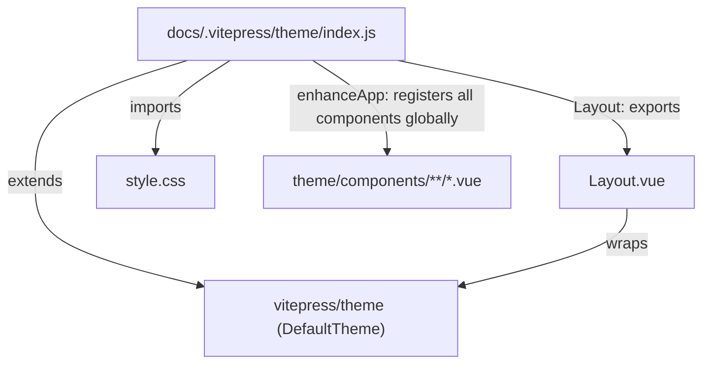
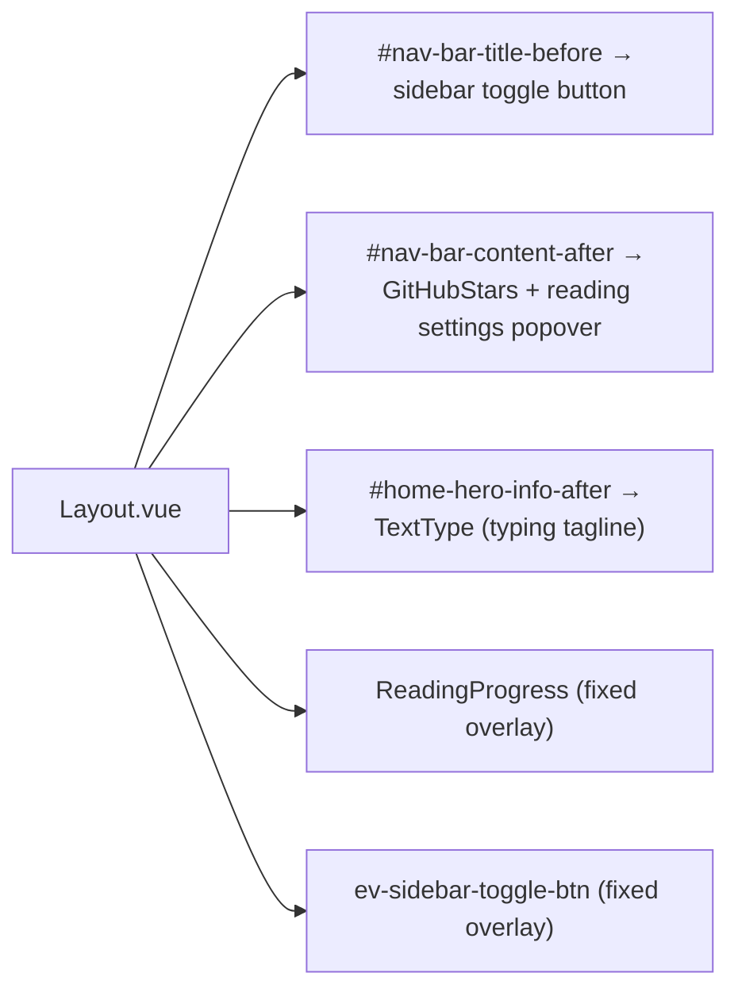
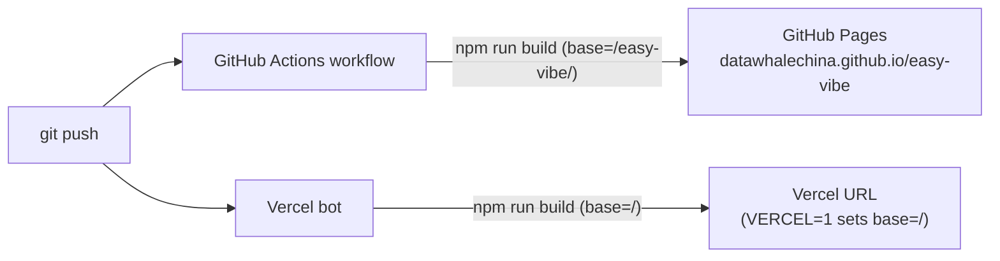

<!-- source: DeepWiki mcp.deepwiki.com · repo datawhalechina/easy-vibe · page 2 Site Architecture · fetched 2026-10-30 -->

# Site Architecture

<details>
<summary>Relevant source files</summary>

The following files were used as context for generating this wiki page:

- [.husky/pre-commit](.husky/pre-commit)
- [README.md](README.md)
- [assets/readme-image1.png](assets/readme-image1.png)
- [docs/.vitepress/config.mjs](docs/.vitepress/config.mjs)
- [docs/.vitepress/theme/Layout.vue](docs/.vitepress/theme/Layout.vue)
- [docs/.vitepress/theme/components/ChapterIntroduction.vue](docs/.vitepress/theme/components/ChapterIntroduction.vue)
- [docs/.vitepress/theme/components/GitHubStars.vue](docs/.vitepress/theme/components/GitHubStars.vue)
- [docs/.vitepress/theme/components/HomeFeatures.vue](docs/.vitepress/theme/components/HomeFeatures.vue)
- [docs/.vitepress/theme/components/appendix/cloud-topology/VpcArchitectureDemo.vue](docs/.vitepress/theme/components/appendix/cloud-topology/VpcArchitectureDemo.vue)
- [docs/.vitepress/theme/index.js](docs/.vitepress/theme/index.js)
- [docs/.vitepress/theme/style.css](docs/.vitepress/theme/style.css)
- [docs/public/robots.txt](docs/public/robots.txt)
- [docs/zh-cn/stage-0/0.1-learning-map/index.md](docs/zh-cn/stage-0/0.1-learning-map/index.md)
- [package-lock.json](package-lock.json)
- [package.json](package.json)
- [vercel.json](vercel.json)

</details>


This page covers how the Easy-Vibe documentation site is structured as a codebase: the static site generator, its configuration, the custom theme layer, and the files that control how the site is built and deployed. For details about what curriculum content is inside the site, see [Learning Curriculum](#3). For the Vue components that power interactive demos embedded in pages, see [Interactive Vue Demo Components](#5).

---

## Repository Layout

The repository has a flat root with all documentation source under `docs/`. The VitePress build system is configured entirely inside `docs/.vitepress/`.

```
easy-vibe/
├── docs/
│   ├── .vitepress/
│   │   ├── config.mjs          # VitePress defineConfig()
│   │   ├── theme/
│   │   │   ├── index.js        # Theme entry: component registration
│   │   │   ├── Layout.vue      # Custom layout wrapper
│   │   │   ├── style.css       # Global CSS overrides
│   │   │   └── components/     # All Vue components
│   ├── zh-cn/                  # Primary locale content
│   ├── en-us/
│   ├── ja-jp/
│   ├── zh-tw/
│   ├── ko-kr/
│   ├── es-es/
│   ├── fr-fr/
│   ├── de-de/
│   ├── ar-sa/
│   ├── vi-vn/
│   └── public/                 # Static assets (robots.txt, logo.png, etc.)
├── package.json
├── vercel.json
└── .husky/
    └── pre-commit
```

Sources: [package.json:1-44](), [vercel.json:1-6](), [docs/.vitepress/config.mjs:1-14]()

---

## VitePress Configuration

The entire site configuration lives in `docs/.vitepress/config.mjs`, exported via `defineConfig()`.

### Base Path

The `base` variable is computed at build time from environment variables to support multiple deployment targets:

[docs/.vitepress/config.mjs:5-13]()

| Condition | `base` value |
|---|---|
| `process.env.BASE` is set | Value of `BASE` |
| `VERCEL=1` or `VERCEL_URL` is present | `/` |
| `EDGEONE=1` is present | `/` |
| None of the above (GitHub Pages) | `/easy-vibe/` |

All asset references in generated HTML — favicon, stylesheet, logo — have this base prepended. The path deduplication `replace('//', '/')` handles the root-base edge case.

### Markdown Extensions

The config registers `markdown-it-katex` to render LaTeX math expressions inside markdown pages:

[docs/.vitepress/config.mjs:282-287]()

```js
markdown: {
  config: (md) => {
    md.use(markdownItKatex)
  }
}
```

The `ignoreDeadLinks: true` flag suppresses broken-link errors during build, which is necessary because many locale pages link to content that is only complete in `zh-cn`.

### Sitemap

A sitemap is generated by VitePress and filtered via `transformItems` to exclude legacy content paths (`/extra/`, `/examples/`, `/project/`):

[docs/.vitepress/config.mjs:291-310]()

### SEO Head Generation

The `getSeoHead(locale, title, description, path)` function is called once per locale inside the `locales` configuration object. It returns an array of `<head>` tag descriptors covering:

- Favicon and stylesheet links
- Open Graph tags (`og:title`, `og:description`, `og:image`, `og:locale`)
- Twitter Card tags
- `<link rel="alternate" hreflang="...">` for all 10 locales plus `x-default`
- A `<script type="application/ld+json">` block with `WebSite` schema

[docs/.vitepress/config.mjs:80-180]()

The `localeMap` constant maps locale keys (e.g., `'zh-cn'`) to their `ogLocale`, `lang`, and `hreflang` values:

[docs/.vitepress/config.mjs:16-77]()

### Locale Configuration

The `locales` key of `defineConfig()` defines 10 locales. Each locale entry follows the same structure:

```js
'zh-cn': {
  label: '简体中文',
  lang: 'zh-CN',
  link: '/zh-cn/',
  title: 'Easy-Vibe 教程',
  description: '...',
  head: getSeoHead(...),
  themeConfig: {
    ...commonThemeConfig,
    nav: [...],
    sidebar: { ... }
  }
}
```

The `commonThemeConfig` object ([docs/.vitepress/config.mjs:187-204]()) is spread into each locale's `themeConfig` to share logo path, local search, outline depth (`level: [1, 6]`), and footer text (ICP beian links and CC BY-NC-SA 4.0 notice).

### Sidebar Configuration

Each locale defines a `sidebar` object keyed by URL prefix. In `zh-cn`, distinct sidebar trees are defined for:

| URL Prefix | Sidebar |
|---|---|
| `/zh-cn/stage-0/` | `productManagerSidebar` |
| `/zh-cn/stage-1/` | `productManagerSidebar` |
| `/zh-cn/stage-2/` | Inline frontend/backend/assignments/AI sections |
| `/zh-cn/stage-3/` | Inline core-skills/cross-platform/personal-brand/AI sections |
| `/zh-cn/appendix/` | 9-category appendix tree |

`productManagerSidebar` is a shared constant defined at [docs/.vitepress/config.mjs:206-280]().

Sources: [docs/.vitepress/config.mjs:282-1400]()

---

## Custom Theme

**VitePress Theme Architecture**



Sources: [docs/.vitepress/theme/index.js:1-10](), [docs/.vitepress/theme/Layout.vue:293-454]()

### Theme Entry Point (`index.js`)

[docs/.vitepress/theme/index.js]() registers every Vue component globally via `app.component(name, component)`. The components fall into these groups:

| Group | Example components |
|---|---|
| Core UI | `Layout`, `HomeFeatures`, `NavGrid`, `NavCard`, `ChapterIntroduction`, `StepBar`, `SummaryCard`, `ReadingProgress`, `GitHubStars` |
| Terminal demos | `WebTerminal`, `ArchitectureDemo`, `EscapeParserDemo`, `TerminalOSDemo`, `CookedRawDemo`, `BufferSwitchDemo` |
| API demos | `ApiConceptDemo`, `ApiPlayground`, `RequestResponseFlow`, `RealWorldApiDemo` |
| Computer fundamentals | `TransistorDemo`, `LogicGateDemo`, `CpuArchitectureDemo`, `ProcessDemo`, `MemoryDemo`, `FilesystemDemo` |
| AI demos | `AiEvolutionDemo`, `NeuralNetworkVisualizationDemo`, `AttentionMechanismDemo`, `GPTEvolutionDemo` |
| Web basics | `WebTechTriad`, `CssBoxModel`, `CssFlexbox`, `DomManipulator`, `NetworkLayers` |
| Engineering demos | `DesignPatternCatalogDemo`, `TDDCycleDemo`, `SecurityChecklistDemo` |

Also registered: `ElementPlus` (UI library), `Viewer` (image zoom via `viewerjs`), and `TypeIt` (typing animations).

[docs/.vitepress/theme/index.js:1-500]()

### Layout.vue

`Layout.vue` wraps `DefaultTheme.Layout` and injects several custom behaviors via named slots:

**Layout slot usage:**



Key reactive state in `Layout.vue`:

| Ref | localStorage key | Default |
|---|---|---|
| `fontSize` | `ev-doc-font-size` | `14` px |
| `lineHeight` | `ev-doc-line-height` | `1.65` |
| `sidebarCollapsed` | `ev-sidebar-collapsed` | `false` |

Font size and line height are applied by setting CSS custom properties `--ev-doc-font-size` and `--ev-doc-line-height` on `document.documentElement`.

Sidebar collapse is toggled by adding the class `ev-sidebar-collapsed` to `document.body`, which triggers CSS rules that hide `.VPSidebar` and expand `.VPContent.has-sidebar`.

`initOutlineAutoScroll()` uses `MutationObserver` to watch for `.active` class changes on outline links and `.is-active` on sidebar items, then smoothly scrolls those containers to keep the active item in view.

[docs/.vitepress/theme/Layout.vue:1-720]()

### style.css

[docs/.vitepress/theme/style.css]() provides global CSS overrides on top of VitePress defaults. Notable rules:

- `.vp-doc` font size and line height driven by `--ev-doc-font-size` and `--ev-doc-line-height` CSS variables, which `Layout.vue` modifies at runtime.
- Sidebar item spacing is tightened significantly (padding-top/bottom reduced to 3px for level-1 through level-4 items).
- `.VPDocAsideOutline` is made independently scrollable with a thin scrollbar.
- `.VPHomeHero` is set to `min-height: 100vh` and centered.
- Hero `.name` gets a green-to-purple gradient text effect.
- Images are centered by default (`margin: auto`); tall images get constrained max-heights via `.img-tall`, `.img-very-tall`, `.img-ultra-tall`, `.img-ultra-tall` classes.

Sources: [docs/.vitepress/theme/style.css:1-420]()

---

## Deployment

The site has two deployment targets.

**Deployment Pipeline Overview**



### GitHub Pages

The GitHub Actions workflow (not shown in the provided files but referenced in `README.md`) deploys to `datawhalechina.github.io/easy-vibe`. When `VERCEL` and `EDGEONE` are not set, `base` resolves to `/easy-vibe/`, which is required for all asset paths to be correct on GitHub Pages.

The `README.md` has a comment `<!-- trigger vercel build -->` at line 1, indicating that pushes to the file intentionally trigger Vercel rebuilds.

### Vercel

[vercel.json:1-6]()

```json
{
  "buildCommand": "npm run build",
  "installCommand": "npm install",
  "framework": "vitepress",
  "outputDirectory": "docs/.vitepress/dist"
}
```

Vercel injects `VERCEL=1` automatically, so `base` resolves to `/` without any manual configuration.

Sources: [vercel.json:1-6](), [docs/.vitepress/config.mjs:5-13](), [README.md:1]()

---

## Development Workflow

### npm Scripts

[package.json:6-15]()

| Script | Command |
|---|---|
| `dev` | `vitepress dev docs` |
| `build` | `npm run lint && vitepress build docs --force` |
| `preview` | `vitepress preview docs` |
| `lint` | `eslint docs/.vitepress/theme` |
| `lint:fix` | `eslint docs/.vitepress/theme --fix` |
| `format` | `prettier --write .` |
| `prepare` | `husky` (installs git hooks) |

The `build` script runs ESLint before the VitePress build. The `--force` flag bypasses the VitePress cache, ensuring a clean output.

Node.js >= 18.0.0 is required ([package.json:28-30]()).

### Pre-commit Hook

[.husky/pre-commit:1-37]()

The Husky pre-commit hook runs two sequential checks on every `git commit`:

1. **ESLint** — runs `npm run lint` (which targets `docs/.vitepress/theme`) and blocks the commit if any `error`-level violations are found. Warnings are allowed.
2. **Build** — runs `npm run build` silently and blocks the commit if it fails.

Commits can bypass both checks with `git commit --no-verify`.

### Code Quality Tools

| Tool | Config file | Scope |
|---|---|---|
| ESLint | `eslint.config.js` (not shown) | `docs/.vitepress/theme/**` |
| Prettier | `.prettierrc` (not shown) | All files |
| Husky | `.husky/pre-commit` | Git pre-commit |

Sources: [package.json:6-15](), [.husky/pre-commit:1-37]()

---

