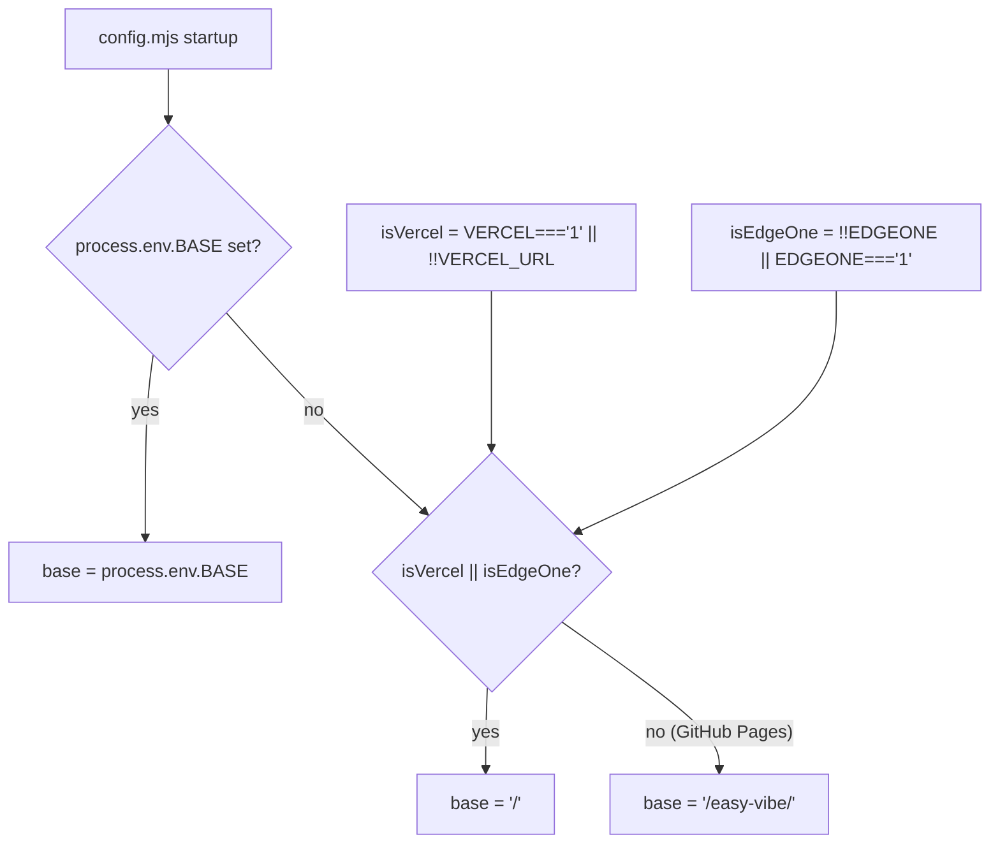
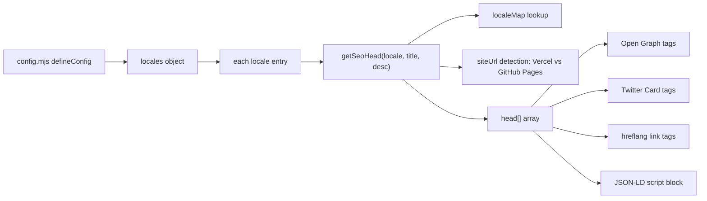
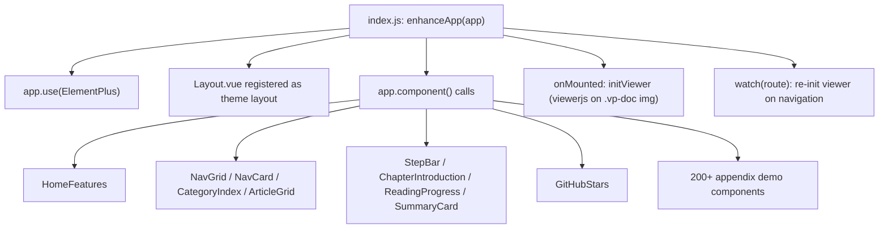
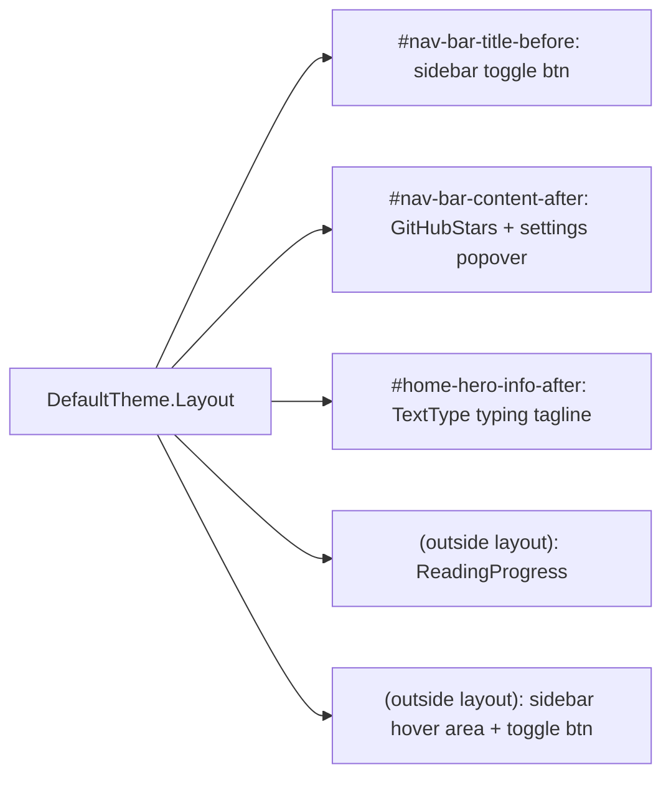

<!-- source: DeepWiki mcp.deepwiki.com · repo datawhalechina/easy-vibe · page 2.1 VitePress Configuration and Theme · fetched 2026-10-30 -->

# VitePress Configuration and Theme

<details>
<summary>Relevant source files</summary>

The following files were used as context for generating this wiki page:

- [.husky/pre-commit](.husky/pre-commit)
- [README.md](README.md)
- [assets/readme-image1.png](assets/readme-image1.png)
- [docs/.vitepress/config.mjs](docs/.vitepress/config.mjs)
- [docs/.vitepress/theme/Layout.vue](docs/.vitepress/theme/Layout.vue)
- [docs/.vitepress/theme/components/ChapterIntroduction.vue](docs/.vitepress/theme/components/ChapterIntroduction.vue)
- [docs/.vitepress/theme/components/GitHubStars.vue](docs/.vitepress/theme/components/GitHubStars.vue)
- [docs/.vitepress/theme/components/HomeFeatures.vue](docs/.vitepress/theme/components/HomeFeatures.vue)
- [docs/.vitepress/theme/components/appendix/cloud-topology/VpcArchitectureDemo.vue](docs/.vitepress/theme/components/appendix/cloud-topology/VpcArchitectureDemo.vue)
- [docs/.vitepress/theme/index.js](docs/.vitepress/theme/index.js)
- [docs/.vitepress/theme/style.css](docs/.vitepress/theme/style.css)
- [docs/public/robots.txt](docs/public/robots.txt)
- [docs/zh-cn/stage-0/0.1-learning-map/index.md](docs/zh-cn/stage-0/0.1-learning-map/index.md)
- [package-lock.json](package-lock.json)
- [package.json](package.json)
- [vercel.json](vercel.json)

</details>


This page covers the VitePress static site generator setup for the Easy-Vibe documentation site: how the build target is determined, how locales and SEO metadata are configured, and how the custom theme layer (components, layout, and CSS) is structured.

For multi-language content organization and the locale routing mechanism, see [Multi-language Support](#2.2). For the CI/CD pipeline that invokes the build, see [Deployment and CI/CD](#2.3). For the individual custom Vue components registered in the theme (e.g. `ChapterIntroduction`, `NavCard`), see [Theme and Navigation Components](#5.1).

---

## Configuration Entry Point

The entire VitePress configuration is defined in a single file: [docs/.vitepress/config.mjs]().

It calls `defineConfig` from VitePress and exports a configuration object with five main concerns:

| Concern | Key Config Property |
|---|---|
| Build base path | `base` |
| Markdown extensions | `markdown.config` |
| Multi-locale routing | `locales` |
| Sitemap generation | `sitemap` |
| Dead link handling | `ignoreDeadLinks: true` |

---

## Base Path Resolution

The `base` property controls the path prefix injected into all asset URLs and internal links. The project supports three deployment targets with different URL structures:

**Base path determination diagram**



Sources: [docs/.vitepress/config.mjs:4-13]()

The `commonHead` array references `base` directly when constructing icon and stylesheet `<link>` tags, using `.replace('//', '/')` to avoid double-slash paths when `base` is `'/'`.

---

## Markdown Extensions

KaTeX math rendering is added via the `markdown-it-katex` plugin:

```
markdown: {
  config: (md) => {
    md.use(markdownItKatex)
  }
}
```

This allows `$…$` and `$$…$$` math expressions in any markdown file. No additional per-page configuration is needed.

Sources: [docs/.vitepress/config.mjs:282-287](), [package.json:27]()

---

## Locale Configuration and SEO

### `localeMap` — The 10 Supported Languages

Each locale key maps to metadata used for SEO head tags:

| Locale key | `lang` | `ogLocale` | `hreflang` |
|---|---|---|---|
| `zh-cn` | `zh-CN` | `zh_CN` | `zh-CN` |
| `en-us` | `en-US` | `en_US` | `en` |
| `ja-jp` | `ja-JP` | `ja_JP` | `ja` |
| `zh-tw` | `zh-TW` | `zh_TW` | `zh-TW` |
| `ko-kr` | `ko-KR` | `ko_KR` | `ko` |
| `es-es` | `es-ES` | `es_ES` | `es` |
| `fr-fr` | `fr-FR` | `fr_FR` | `fr` |
| `de-de` | `de-DE` | `de_DE` | `de` |
| `ar-sa` | `ar-SA` | `ar_SA` | `ar` |
| `vi-vn` | `vi-VN` | `vi_VN` | `vi` |

Sources: [docs/.vitepress/config.mjs:16-77]()

### `getSeoHead()` — SEO Head Tag Generator

`getSeoHead(locale, title, description, path?)` returns a `head` array for VitePress containing:

- Favicon `<link>` pointing to `${base}logo.png`
- Stylesheet `<link>` pointing to `${base}style.css`
- Viewport, theme-color, format-detection `<meta>` tags
- Canonical URL `<link>`
- Open Graph tags: `og:type`, `og:locale`, `og:site_name`, `og:title`, `og:description`, `og:image`
- Twitter Card tags: `twitter:card`, `twitter:site`, `twitter:title`, `twitter:description`, `twitter:image`
- SEO keywords `<meta>` covering tools like Claude Code, Cursor, Trae, Supabase, React, etc.
- `robots`, `googlebot`, `baiduspider` directives (all `index,follow`)
- One `<link rel="alternate">` per locale for hreflang
- A `<link rel="alternate" hreflang="x-default">` pointing to `/zh-cn/` (the primary locale)
- A `<script type="application/ld+json">` block with schema.org `WebSite` structured data including `SearchAction` and publisher info

**SEO head generation flow**



Sources: [docs/.vitepress/config.mjs:80-180]()

---

## `commonThemeConfig` — Shared Theme Settings

A `commonThemeConfig` object is spread into each locale's `themeConfig`:

| Property | Value |
|---|---|
| `logo` | `${base}logo.png` |
| `search.provider` | `'local'` |
| `outline.level` | `[1, 6]` (all heading depths) |
| `footer.message` | ICP registration and public security badge links |
| `footer.copyright` | CC BY-NC-SA 4.0 license text |

The `zh-cn` locale overrides `outline` to add `label: '页面导航'`. The sidebar configuration is locale-specific and defines separate trees for `/zh-cn/stage-0/`, `/zh-cn/stage-1/`, `/zh-cn/stage-2/`, `/zh-cn/stage-3/`, `/zh-cn/appendix/`, and a handful of legacy redirect paths.

Sources: [docs/.vitepress/config.mjs:187-204]()

---

## Sitemap

The `sitemap` block is configured with:
- `hostname: 'https://datawhalechina.github.io/easy-vibe'`
- A `transformItems` filter that excludes URLs containing `/extra/`, `/examples/`, or `/project/` (legacy content directories that have been migrated)

Sources: [docs/.vitepress/config.mjs:291-310]()

---

## Theme Entry Point

[docs/.vitepress/theme/index.js]() is the theme entry. It:

1. Imports `DefaultTheme` from `vitepress/theme` and extends it
2. Registers Element Plus globally (with its CSS)
3. Registers `Viewer` (viewerjs) for image lightboxing
4. Registers `TypeIt` for typing animations
5. Imports and globally registers every custom component

**Theme registration diagram**



Sources: [docs/.vitepress/theme/index.js:1-35]()

The viewer (viewerjs) is initialized inside `onMounted` and re-initialized on route change via `watch(route, ...)`. Images inside `.vp-doc` gain click-to-zoom behaviour automatically with no per-page configuration.

---

## Custom Layout — `Layout.vue`

`Layout.vue` wraps `DefaultTheme.Layout` and adds four independent features:

### 1. Reading Settings Panel

Font size and line height are controlled via a popover in the nav bar (`#nav-bar-content-after` slot). Values are clamped and persisted to `localStorage`:

| Setting | Storage key | Default | Range |
|---|---|---|---|
| Font size | `ev-doc-font-size` | `14` px | 12–18 px |
| Line height | `ev-doc-line-height` | `1.65` | 1.25–1.80 |

The values are applied as CSS custom properties `--ev-doc-font-size` and `--ev-doc-line-height` on `document.documentElement`.

### 2. Sidebar Collapse

A toggle button in `#nav-bar-title-before` (desktop ≥960 px) and a hover-area button on the left edge both trigger `toggleSidebar()`. State persists under `ev-sidebar-collapsed` in `localStorage`. When collapsed, the class `ev-sidebar-collapsed` is added to `document.body`, which CSS rules use to hide `.VPSidebar` and reclaim padding.

### 3. Outline Auto-Scroll

`initOutlineAutoScroll()` creates two `MutationObserver` instances on `.VPDocAsideOutline` and `.VPSidebar` respectively, watching for `class` attribute changes on their children. When an `<a class="active">` appears in the outline, `scrollOutlineToActiveItem()` scrolls the outline container to center it. History API patching ensures the observers restart on client-side navigation.

### 4. Typing Animation Tagline

The home hero's default `.tagline` is hidden via CSS. A `TextType` component is injected via the `#home-hero-info-after` slot and reads `frontmatter.hero.typingTagline` (falling back to `frontmatter.hero.tagline`) for its content.

**Layout.vue template slot usage**



Sources: [docs/.vitepress/theme/Layout.vue:293-454]()

---

## Theme CSS — `style.css`

[docs/.vitepress/theme/style.css]() applies site-wide style overrides. Key areas:

### CSS Custom Properties

```css
:root {
  --ev-doc-font-size: 14px;
  --ev-doc-line-height: 1.65;
}
```

The `.vp-doc` selector consumes these variables and also propagates them into Element Plus size tokens (`--el-font-size-base`, `--el-font-line-height-primary`, etc.).

### Sidebar Compaction

Multiple `.VPSidebarItem` selectors reduce the default padding/margin on sidebar items at every nesting level:
- Level-0 groups: `padding-bottom: 8px`
- Level 1–4 items: `padding-top/bottom: 3px`, `min-height: 26px`
- Link elements: `padding-top/bottom: 2px`

These rules must use `:where(html)` and data-attribute selectors to win specificity against VitePress's scoped component styles.

### Image Utilities

Utility classes control image height for tall-aspect images:

| Class | `max-height` |
|---|---|
| `img-tall` | 380 px |
| `img-very-tall` | 280 px |
| `img-ultra-tall` | 200 px |
| `img-limit-height` | 450 px |
| `img-limit-width` | 320 px (combined with `max-width: 100%`) |

All `.vp-doc img` are centered with `margin: auto` by default.

### Hero Section

`.VPHomeHero` is styled to occupy the full viewport (`min-height: 100dvh`, `display: flex`, `align-items: center`) with a gradient text effect on `.VPHomeHero .name` and pill-shaped action buttons with hover scale transforms.

### Outline Scrollability

`.VPDocAsideOutline` is given `max-height: calc(100vh - nav-height - 32px)` and `overflow-y: auto` with a thin custom scrollbar, enabling it to scroll independently when pages have many headings.

Sources: [docs/.vitepress/theme/style.css:1-420]()

---

## Selected Theme Components

The following are the core UI-layer components (for full detail on all components, see [Theme and Navigation Components](#5.1)):

### `GitHubStars`

[docs/.vitepress/theme/components/GitHubStars.vue]() fetches star count from the GitHub API on mount, caches the result in `localStorage` for 5 minutes (`github-stars-cache`), and displays it as a formatted number (e.g. `2.3k`) next to a GitHub icon link in the nav bar.

### `HomeFeatures`

[docs/.vitepress/theme/components/HomeFeatures.vue]() implements the full single-page marketing layout served on each locale's home page. It contains embedded `i18n` data for `zh-cn` and `en-us` locales as a plain JS object, selected via `useData().lang`. It renders four sections (Stage 1, Stage 2, Stage 3, Appendix) with card grids and an auto-scrolling appendix carousel.

### `ChapterIntroduction`

[docs/.vitepress/theme/components/ChapterIntroduction.vue]() accepts props `duration`, `expectedOutput`, `coreOutput`, `assignment`, and `tags`. It renders a learning-objectives box with optional metric cards (time estimate, expected output, post-chapter assignment). Used at the top of nearly every curriculum chapter.

---

## Dependency Summary

| Package | Role |
|---|---|
| `vitepress@2.0.0-alpha.15` | Static site generator framework |
| `vue@^3.5.0` | Component runtime |
| `element-plus@^2.13.1` | UI component library |
| `@element-plus/icons-vue@^2.3.2` | Icon set (e.g. `Setting` icon in Layout) |
| `markdown-it-katex@^2.0.3` | Math rendering in markdown |
| `typeit@^8.8.7` | Typing animation (consumed by `TextType`) |
| `viewerjs@^1.11.7` | Image lightbox |

Sources: [package.json:1-44]()

---

