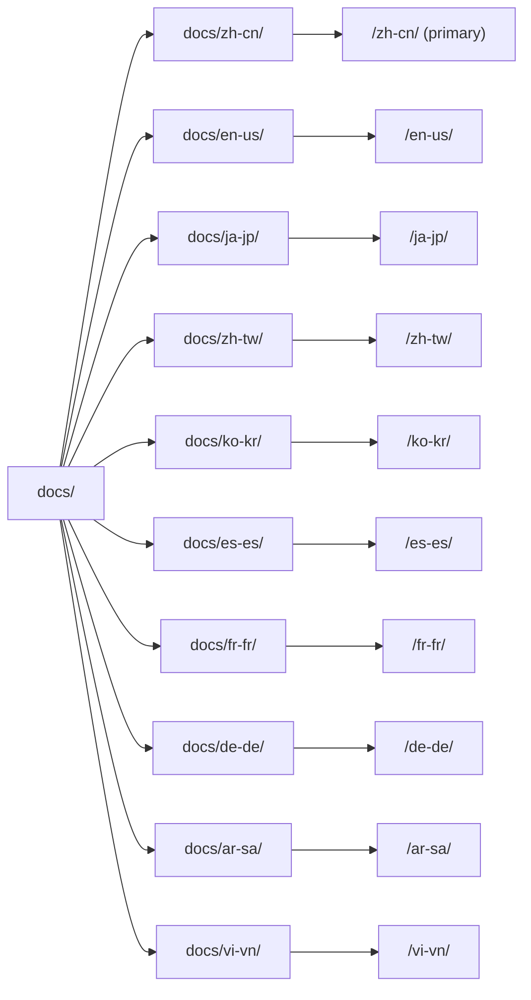
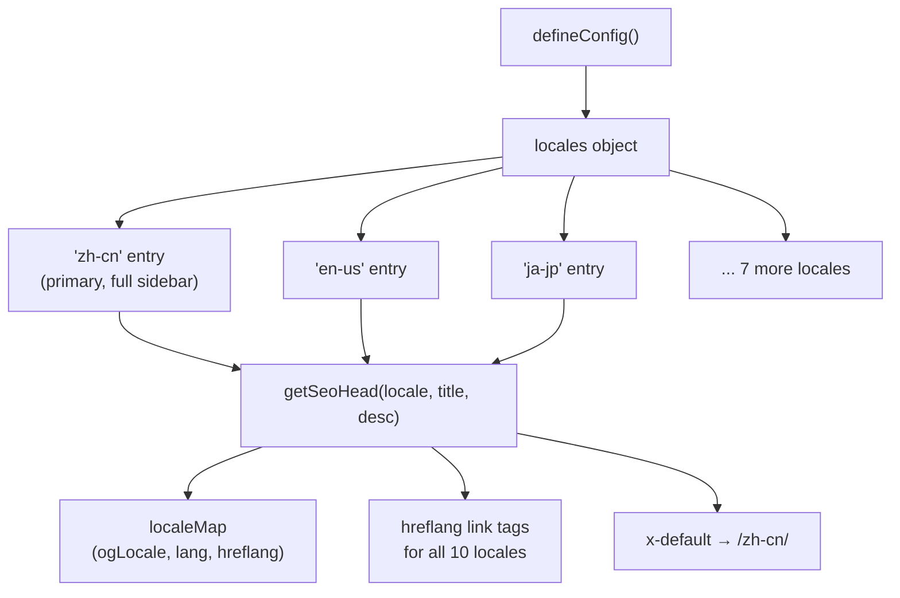
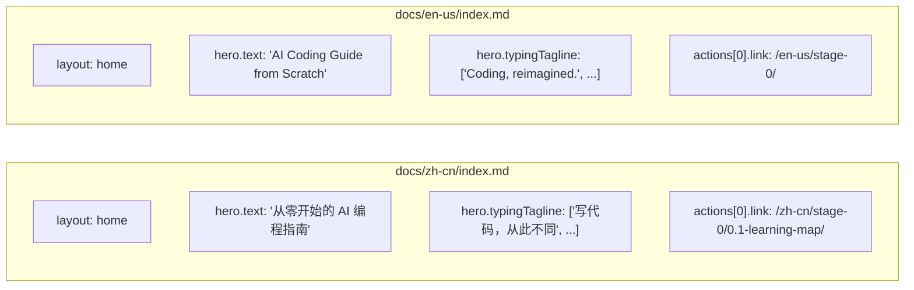
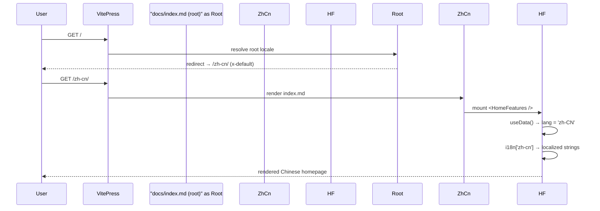
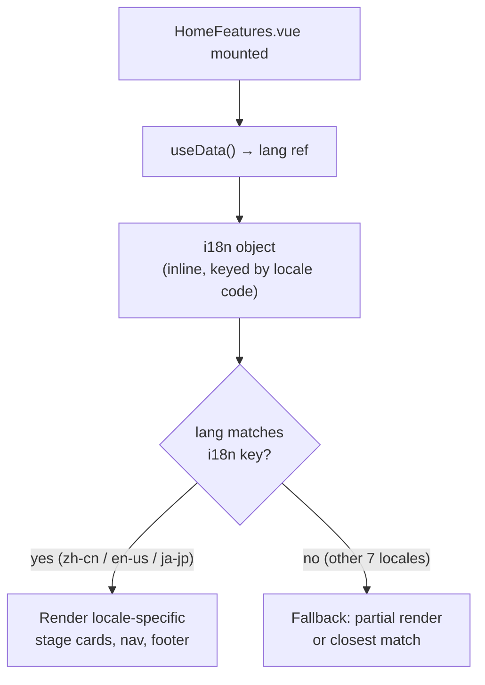

<!-- source: DeepWiki mcp.deepwiki.com · repo datawhalechina/easy-vibe · page 2.2 Multi-language Support · fetched 2026-10-30 -->

# Multi-language Support

<details>
<summary>Relevant source files</summary>

The following files were used as context for generating this wiki page:

- [README.md](README.md)
- [assets/readme-image1.png](assets/readme-image1.png)
- [docs-readme/ar-SA/README.md](docs-readme/ar-SA/README.md)
- [docs-readme/de-DE/README.md](docs-readme/de-DE/README.md)
- [docs-readme/en-US/README.md](docs-readme/en-US/README.md)
- [docs-readme/es-ES/README.md](docs-readme/es-ES/README.md)
- [docs-readme/fr-FR/README.md](docs-readme/fr-FR/README.md)
- [docs-readme/ja-JP/README.md](docs-readme/ja-JP/README.md)
- [docs-readme/ko-KR/README.md](docs-readme/ko-KR/README.md)
- [docs-readme/vi-VN/README.md](docs-readme/vi-VN/README.md)
- [docs-readme/zh-CN/README.md](docs-readme/zh-CN/README.md)
- [docs-readme/zh-TW/README.md](docs-readme/zh-TW/README.md)
- [docs/.vitepress/config.mjs](docs/.vitepress/config.mjs)
- [docs/.vitepress/theme/Layout.vue](docs/.vitepress/theme/Layout.vue)
- [docs/.vitepress/theme/components/ChapterIntroduction.vue](docs/.vitepress/theme/components/ChapterIntroduction.vue)
- [docs/.vitepress/theme/components/GitHubStars.vue](docs/.vitepress/theme/components/GitHubStars.vue)
- [docs/.vitepress/theme/components/HomeFeatures.vue](docs/.vitepress/theme/components/HomeFeatures.vue)
- [docs/.vitepress/theme/index.js](docs/.vitepress/theme/index.js)
- [docs/.vitepress/theme/style.css](docs/.vitepress/theme/style.css)
- [docs/ar-sa/index.md](docs/ar-sa/index.md)
- [docs/de-de/index.md](docs/de-de/index.md)
- [docs/en-us/index.md](docs/en-us/index.md)
- [docs/es-es/index.md](docs/es-es/index.md)
- [docs/fr-fr/index.md](docs/fr-fr/index.md)
- [docs/ja-jp/index.md](docs/ja-jp/index.md)
- [docs/ko-kr/index.md](docs/ko-kr/index.md)
- [docs/public/robots.txt](docs/public/robots.txt)
- [docs/vi-vn/index.md](docs/vi-vn/index.md)
- [docs/zh-cn/index.md](docs/zh-cn/index.md)
- [docs/zh-cn/stage-0/0.1-learning-map/index.md](docs/zh-cn/stage-0/0.1-learning-map/index.md)
- [docs/zh-tw/index.md](docs/zh-tw/index.md)

</details>


This page documents how the Easy-Vibe documentation site supports ten languages: the locale configuration in VitePress, the directory layout for each locale, the shared homepage frontmatter schema, and the inline component-level translations. For how the VitePress config is structured more broadly — including nav, sidebar, and theme settings — see [2.1](#2.1).

---

## Overview

The site supports ten locales. `zh-cn` (Simplified Chinese) is the primary locale: it holds the full curriculum content and is the `x-default` hreflang target. The nine translated locales each have a homepage (`index.md`) and a shallow directory stub, but may not replicate the full content tree of `zh-cn`.

| Locale code | Language | Directory |
|---|---|---|
| `zh-cn` | 简体中文 (Simplified Chinese) | `docs/zh-cn/` |
| `en-us` | English | `docs/en-us/` |
| `ja-jp` | 日本語 | `docs/ja-jp/` |
| `zh-tw` | 繁體中文 | `docs/zh-tw/` |
| `ko-kr` | 한국어 | `docs/ko-kr/` |
| `es-es` | Español | `docs/es-es/` |
| `fr-fr` | Français | `docs/fr-fr/` |
| `de-de` | Deutsch | `docs/de-de/` |
| `ar-sa` | العربية | `docs/ar-sa/` |
| `vi-vn` | Tiếng Việt | `docs/vi-vn/` |

Sources: [docs/.vitepress/config.mjs:16-77](), [docs/.vitepress/config.mjs:313-330]()

---

## Directory and URL Structure

Each locale occupies a subdirectory under `docs/` that matches its locale code. VitePress maps these directly to URL prefixes (e.g., `docs/zh-cn/index.md` → `/zh-cn/`).

**Locale directory to URL mapping:**



Sources: [docs/zh-cn/index.md](), [docs/en-us/index.md](), [docs/ja-jp/index.md](), [docs/vi-vn/index.md](), [docs/ko-kr/index.md](), [docs/zh-tw/index.md](), [docs/es-es/index.md]()

---

## VitePress Locale Configuration

All ten locales are declared in the `locales` object inside `defineConfig()` in [docs/.vitepress/config.mjs:313-330](). Each locale entry follows this shape:

```
'zh-cn': {
  label: '简体中文',
  lang: 'zh-CN',
  link: '/zh-cn/',
  title: 'Easy-Vibe 教程',
  description: '...',
  head: getSeoHead(...),
  themeConfig: { ...commonThemeConfig, nav: [...], sidebar: {...} }
}
```

The `zh-cn` locale is the most complete: it has a fully populated `sidebar` with routes for `stage-0`, `stage-1`, `stage-2`, `stage-3`, `appendix`, and several legacy redirect paths. The translated locales typically have minimal `themeConfig` (no sidebar definitions beyond the homepage).

**Locale configuration flow:**



Sources: [docs/.vitepress/config.mjs:282-330](), [docs/.vitepress/config.mjs:80-180]()

---

## SEO and Hreflang via `localeMap` and `getSeoHead`

The constant `localeMap` at [docs/.vitepress/config.mjs:16-77]() maps each locale code to its SEO metadata:

| Key | `ogLocale` | `lang` | `hreflang` |
|---|---|---|---|
| `zh-cn` | `zh_CN` | `zh-CN` | `zh-CN` |
| `en-us` | `en_US` | `en-US` | `en` |
| `ja-jp` | `ja_JP` | `ja-JP` | `ja` |
| `zh-tw` | `zh_TW` | `zh-TW` | `zh-TW` |
| `ko-kr` | `ko_KR` | `ko-KR` | `ko` |
| `es-es` | `es_ES` | `es-ES` | `es` |
| `fr-fr` | `fr_FR` | `fr-FR` | `fr` |
| `de-de` | `de_DE` | `de-DE` | `de` |
| `ar-sa` | `ar_SA` | `ar-SA` | `ar` |
| `vi-vn` | `vi_VN` | `vi-VN` | `vi` |

The function `getSeoHead(locale, title, description, path)` at [docs/.vitepress/config.mjs:80-180]() runs at build time for each locale. It:

1. Looks up the locale in `localeMap`.
2. Constructs Open Graph, Twitter Card, and canonical `<link>` tags.
3. Iterates over all keys in `localeMap` to emit `<link rel="alternate" hreflang="...">` tags pointing to each locale root URL.
4. Appends an `x-default` hreflang tag pointing to `/zh-cn/`, establishing it as the fallback locale.
5. Injects a JSON-LD `WebSite` structured data block.

Sources: [docs/.vitepress/config.mjs:16-77](), [docs/.vitepress/config.mjs:80-180]()

---

## Locale Homepage Frontmatter Schema

Each locale has a homepage at `docs/<locale>/index.md`. All homepages share the same frontmatter schema.

**Shared frontmatter fields across all locale `index.md` files:**

| Field | Type | Description |
|---|---|---|
| `layout` | `"home"` | Activates VitePress's home layout |
| `navbar` | `false` | Hides the default navbar on the homepage |
| `hero.name` | string | Always `'Easy-Vibe'` |
| `hero.text` | string | Locale-specific subtitle |
| `hero.tagline` | string | Locale-specific one-liner |
| `hero.typingTagline` | string[] | List of strings for the `TextType` typing animation |
| `hero.actions` | array | CTA buttons (`theme`, `text`, `link`) |

The `typingTagline` field is a custom extension — it is not a standard VitePress frontmatter key. It is consumed by `Layout.vue` via [docs/.vitepress/theme/Layout.vue:413-428](), which passes it to the `TextType` component and renders it as an animated typing effect in place of the static tagline.

**Example: zh-cn vs en-us frontmatter comparison:**



> Note: The `zh-cn` action link points to a specific deep path (`/zh-cn/stage-0/0.1-learning-map/`) because that locale has full content. The translated locales' action links point only to their locale root or a shallow stage index.

Sources: [docs/zh-cn/index.md](), [docs/en-us/index.md](), [docs/ja-jp/index.md](), [docs/vi-vn/index.md](), [docs/ko-kr/index.md](), [docs/zh-tw/index.md](), [docs/es-es/index.md]()

---

## Two-Tier Redirect Mechanism

The site has two tiers of locale-based routing:

1. **Site root (`/`)**: VitePress resolves the root via its `locales` config. The `x-default` hreflang in `getSeoHead` points to `/zh-cn/`, declaring it the canonical fallback. The VitePress locale switcher in the navbar also lists all locales via the `label` field of each locale entry.

2. **Locale root (`/zh-cn/`, `/en-us/`, …)**: Each locale root maps to its `docs/<locale>/index.md`, which renders the `HomeFeatures` component. The `HomeFeatures.vue` component reads the current locale using VitePress's `useData()` composable and selects the corresponding entry from its inline `i18n` object.



Sources: [docs/.vitepress/config.mjs:139-152](), [docs/.vitepress/theme/components/HomeFeatures.vue:7-8]()

---

## Component-Level Translations: `HomeFeatures.vue` `i18n` Object

The `HomeFeatures.vue` component at [docs/.vitepress/theme/components/HomeFeatures.vue:61]() contains a hardcoded `i18n` object keyed by locale code. This object holds all visible text for the home page sections: stage descriptions, card titles, nav labels, and footer copy.

The component reads the current locale using:

```js
const { site, page, lang } = useData()
```

It then selects the matching locale entry from `i18n`. Locale codes present in the `i18n` object include `zh-cn`, `en-us`, and `ja-jp` with full content; other locales fall back to whichever key is present or gracefully degrade.

**HomeFeatures locale resolution:**



Sources: [docs/.vitepress/theme/components/HomeFeatures.vue:7-8](), [docs/.vitepress/theme/components/HomeFeatures.vue:61-385]()

---

## Content Coverage by Locale

| Locale | Homepage | Stage content | Appendix | Sidebar config |
|---|---|---|---|---|
| `zh-cn` | ✅ Full | ✅ Full | ✅ Full | ✅ Detailed |
| `en-us` | ✅ | Stub (`/en-us/stage-0/`) | — | — |
| `ja-jp` | ✅ | Stub (`/ja-jp/stage-0/`) | — | — |
| `zh-tw` | ✅ | — | — | — |
| `ko-kr` | ✅ | — | — | — |
| `es-es` | ✅ | — | — | — |
| `fr-fr` | ✅ | — | — | — |
| `de-de` | ✅ | — | — | — |
| `ar-sa` | ✅ | — | — | — |
| `vi-vn` | ✅ | — | — | — |

The full curriculum (stages 0–3, appendix, sidebar navigation) lives exclusively under `docs/zh-cn/`. Translated locales provide localised entry points that link into the shared curriculum or to stage stubs.

Sources: [docs/.vitepress/config.mjs:313-1400](), [README.md:34-44]()

---

