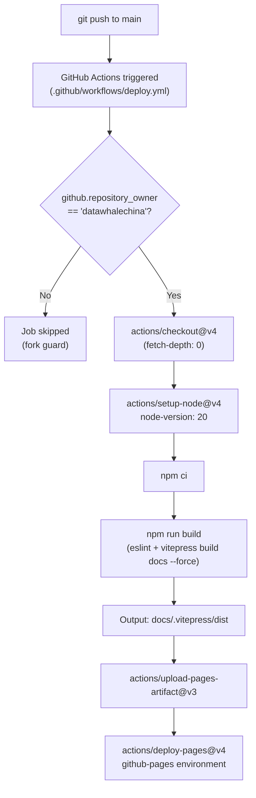
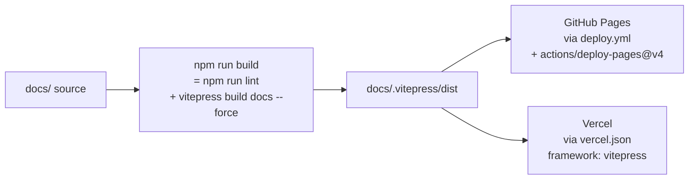
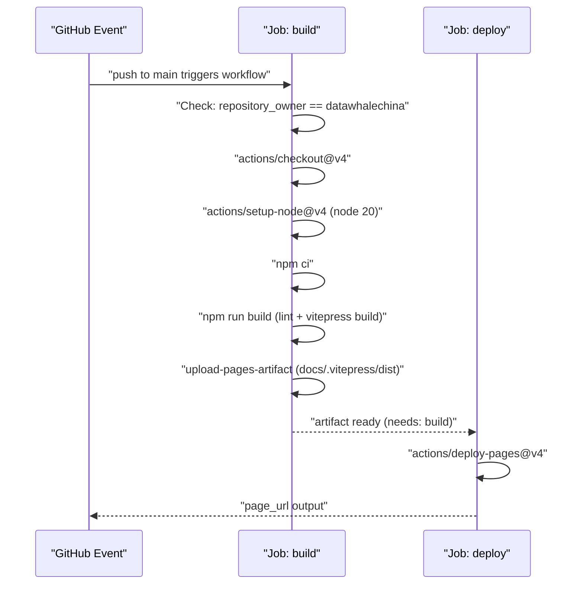

<!-- source: DeepWiki mcp.deepwiki.com · repo datawhalechina/easy-vibe · page 2.3 Deployment and CI/CD · fetched 2026-10-30 -->

# Deployment and CI/CD

<details>
<summary>Relevant source files</summary>

The following files were used as context for generating this wiki page:

- [.github/workflows/deploy.yml](.github/workflows/deploy.yml)
- [.husky/pre-commit](.husky/pre-commit)
- [docs/.vitepress/theme/components/StepBar.vue](docs/.vitepress/theme/components/StepBar.vue)
- [docs/.vitepress/theme/components/TextType.vue](docs/.vitepress/theme/components/TextType.vue)
- [docs/.vitepress/theme/components/appendix/cloud-topology/VpcArchitectureDemo.vue](docs/.vitepress/theme/components/appendix/cloud-topology/VpcArchitectureDemo.vue)
- [docs/index.md](docs/index.md)
- [package-lock.json](package-lock.json)
- [package.json](package.json)
- [vercel.json](vercel.json)

</details>


This page covers how the Easy-Vibe site is built and deployed automatically. There are two deployment targets: **GitHub Pages** (via GitHub Actions) and **Vercel** (via `vercel.json`). Both targets use the same build command and output directory.

For information about the local development loop, npm scripts, and the Husky pre-commit hook, see [Development Workflow](#2.4). For the VitePress configuration that determines the `base` path used during builds, see [VitePress Configuration and Theme](#2.1).

---

## Build Pipeline Overview

The following diagram shows how a push to `main` flows through the CI/CD pipeline to production.

**Diagram: End-to-end deployment flow**



Sources: [.github/workflows/deploy.yml:1-64]()

---

## GitHub Pages Deployment

The workflow file is at [.github/workflows/deploy.yml:1-64]().

### Trigger Conditions

| Trigger | Details |
|---|---|
| `push` to `main` | Automatic on every merge to `main` |
| `workflow_dispatch` | Manual trigger from the GitHub Actions UI |

### Repository Owner Guard

The `build` job includes an `if` condition on [line 28](.github/workflows/deploy.yml:28-28):

```
if: github.repository_owner == 'datawhalechina'
```

This prevents the deployment job from running when the workflow executes on a fork. Only the canonical repository under the `datawhalechina` GitHub organization will deploy to GitHub Pages.

### Concurrency Settings

Defined at [.github/workflows/deploy.yml:21-23]():

```yaml
concurrency:
  group: pages
  cancel-in-progress: false
```

- All deployments share the concurrency group `pages`.
- `cancel-in-progress: false` means a queued run will **not** cancel an already-running deployment. In-progress production deployments are always allowed to finish.

### Required Permissions

The `GITHUB_TOKEN` is granted these permissions [.github/workflows/deploy.yml:14-17]():

| Permission | Value | Purpose |
|---|---|---|
| `contents` | `read` | Checkout the repository |
| `pages` | `write` | Upload to GitHub Pages |
| `id-token` | `write` | OIDC authentication for Pages deployment |

### Jobs

The workflow has two sequential jobs:

**`build` job** [.github/workflows/deploy.yml:26-50]()

| Step | Action | Notes |
|---|---|---|
| Checkout | `actions/checkout@v4` | `fetch-depth: 0` retrieves full history |
| Setup Node | `actions/setup-node@v4` | `node-version: 20`, npm cache enabled |
| Setup Pages | `actions/configure-pages@v4` | Configures Pages environment |
| Install | `npm ci` | Clean install from lockfile |
| Build | `npm run build` | Runs ESLint then `vitepress build docs --force` |
| Upload artifact | `actions/upload-pages-artifact@v3` | Uploads `docs/.vitepress/dist` |

**`deploy` job** [.github/workflows/deploy.yml:52-64]()

- `needs: build` — only runs after the build job succeeds.
- Targets the `github-pages` environment.
- Uses `actions/deploy-pages@v4` to publish the uploaded artifact.

Sources: [.github/workflows/deploy.yml:1-64]()

---

## Vercel Deployment

The Vercel configuration is at [vercel.json:1-6]():

```json
{
  "buildCommand": "npm run build",
  "installCommand": "npm install",
  "framework": "vitepress",
  "outputDirectory": "docs/.vitepress/dist"
}
```

| Field | Value |
|---|---|
| `buildCommand` | `npm run build` (identical to CI) |
| `installCommand` | `npm install` |
| `framework` | `vitepress` |
| `outputDirectory` | `docs/.vitepress/dist` |

Vercel detects the `vitepress` framework and knows how to serve the static output. The `outputDirectory` must match what VitePress writes to, which is configured in the VitePress config (see [VitePress Configuration and Theme](#2.1)).

Sources: [vercel.json:1-6]()

---

## Build Command Details

The `build` script is defined in [package.json:8]():

```
"build": "npm run lint && vitepress build docs --force"
```

This means every deployment (both GitHub Actions and Vercel) runs:

1. `npm run lint` — ESLint check scoped to `docs/.vitepress/theme` ([package.json:12]())
2. `vitepress build docs --force` — Compiles all markdown and Vue components into static HTML/JS/CSS under `docs/.vitepress/dist`

If ESLint reports errors, the build command fails and the deployment is aborted.

### Node.js Version Requirement

Specified in [package.json:22-24]():

```json
"engines": {
  "node": ">=18.0.0"
}
```

The GitHub Actions workflow pins Node 20 [.github/workflows/deploy.yml:38](), which satisfies this requirement.

Sources: [package.json:1-44](), [.github/workflows/deploy.yml:35-39]()

---

## Deployment Targets Comparison

**Diagram: Two deployment targets sharing the same build artifacts**



| Property | GitHub Pages | Vercel |
|---|---|---|
| Config file | `.github/workflows/deploy.yml` | `vercel.json` |
| Trigger | Push to `main` / manual | Git push / Vercel webhook |
| Install command | `npm ci` | `npm install` |
| Build command | `npm run build` | `npm run build` |
| Output directory | `docs/.vitepress/dist` | `docs/.vitepress/dist` |
| Fork guard | Yes (`repository_owner` check) | Not applicable |
| Node version | 20 (pinned in workflow) | Vercel default (≥18 required) |

Sources: [.github/workflows/deploy.yml:1-64](), [vercel.json:1-6](), [package.json:1-44]()

---

## Deployment Sequence (GitHub Actions)

**Diagram: Job dependency and step sequence**



Sources: [.github/workflows/deploy.yml:1-64]()

---

