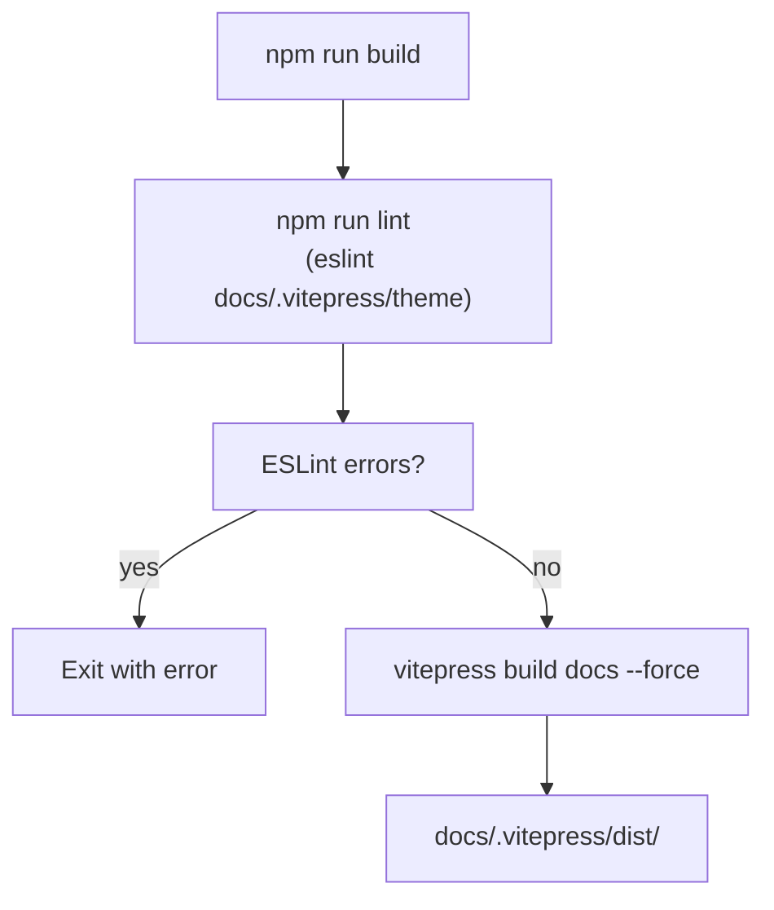
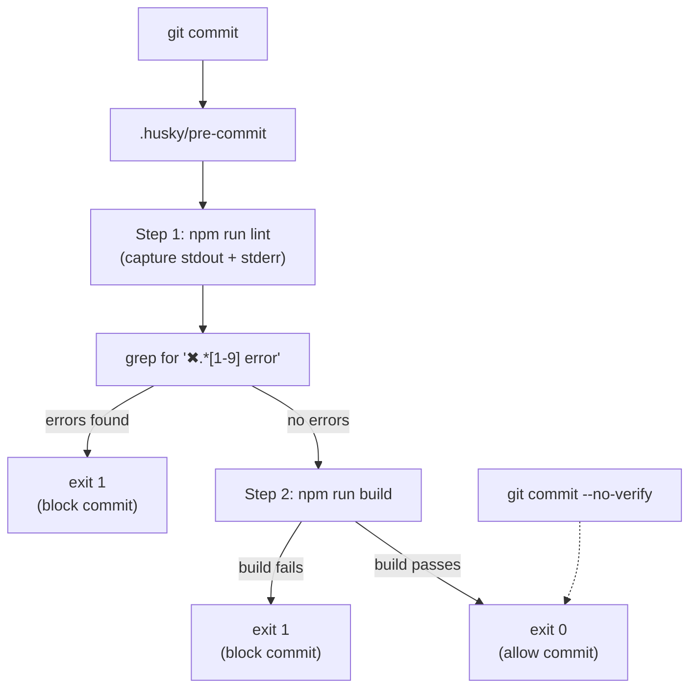
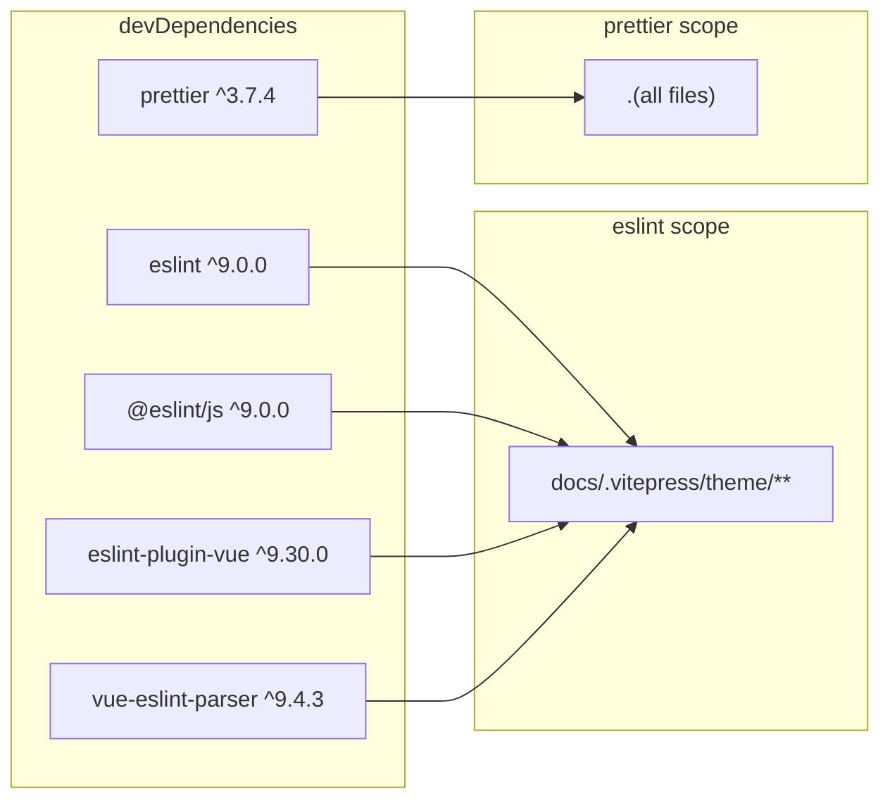
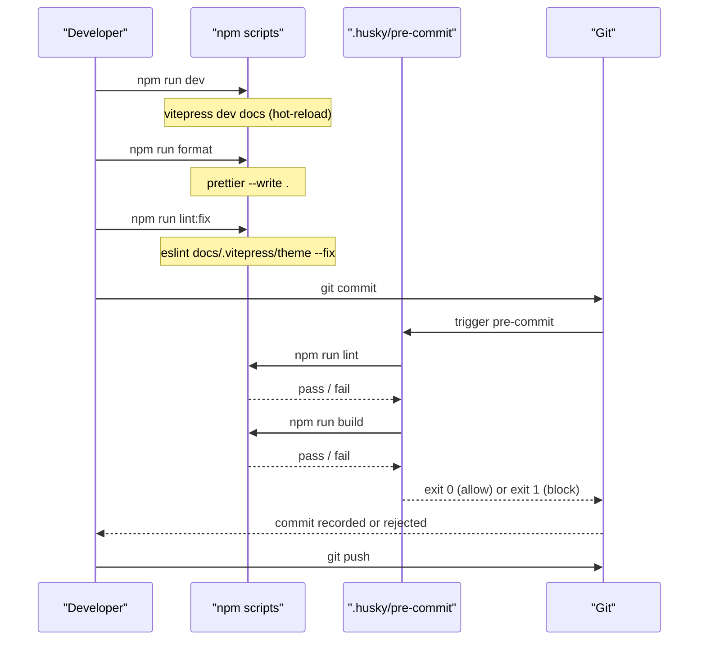

<!-- source: DeepWiki mcp.deepwiki.com · repo datawhalechina/easy-vibe · page 2.4 Development Workflow · fetched 2026-10-30 -->

# Development Workflow

<details>
<summary>Relevant source files</summary>

The following files were used as context for generating this wiki page:

- [.gitignore](.gitignore)
- [.husky/pre-commit](.husky/pre-commit)
- [.vscode/settings.json](.vscode/settings.json)
- [assets/wechat.png](assets/wechat.png)
- [docs/.vitepress/theme/components/appendix/cloud-topology/VpcArchitectureDemo.vue](docs/.vitepress/theme/components/appendix/cloud-topology/VpcArchitectureDemo.vue)
- [docs/.vitepress/theme/components/appendix/engineering-excellence/CodeSmellDemo.vue](docs/.vitepress/theme/components/appendix/engineering-excellence/CodeSmellDemo.vue)
- [docs/.vitepress/theme/components/appendix/engineering-excellence/DecisionMatrixDemo.vue](docs/.vitepress/theme/components/appendix/engineering-excellence/DecisionMatrixDemo.vue)
- [docs/.vitepress/theme/components/appendix/engineering-excellence/DesignPatternCatalogDemo.vue](docs/.vitepress/theme/components/appendix/engineering-excellence/DesignPatternCatalogDemo.vue)
- [docs/.vitepress/theme/components/appendix/engineering-excellence/DocStructureDemo.vue](docs/.vitepress/theme/components/appendix/engineering-excellence/DocStructureDemo.vue)
- [docs/.vitepress/theme/components/appendix/engineering-excellence/LicenseComparisonDemo.vue](docs/.vitepress/theme/components/appendix/engineering-excellence/LicenseComparisonDemo.vue)
- [docs/.vitepress/theme/components/appendix/engineering-excellence/OpenSourceWorkflowDemo.vue](docs/.vitepress/theme/components/appendix/engineering-excellence/OpenSourceWorkflowDemo.vue)
- [docs/.vitepress/theme/components/appendix/engineering-excellence/PatternPlaygroundDemo.vue](docs/.vitepress/theme/components/appendix/engineering-excellence/PatternPlaygroundDemo.vue)
- [docs/.vitepress/theme/components/appendix/engineering-excellence/RefactoringDemo.vue](docs/.vitepress/theme/components/appendix/engineering-excellence/RefactoringDemo.vue)
- [docs/.vitepress/theme/components/appendix/engineering-excellence/SecurityChecklistDemo.vue](docs/.vitepress/theme/components/appendix/engineering-excellence/SecurityChecklistDemo.vue)
- [docs/.vitepress/theme/components/appendix/engineering-excellence/TDDCycleDemo.vue](docs/.vitepress/theme/components/appendix/engineering-excellence/TDDCycleDemo.vue)
- [package-lock.json](package-lock.json)
- [package.json](package.json)
- [vercel.json](vercel.json)

</details>


This page covers the local development setup for the easy-vibe repository: required tooling, available npm scripts, the Husky pre-commit gate, Prettier formatting, `.gitignore` exclusions, and VS Code editor settings. For how the built output is deployed to GitHub Pages and Vercel, see [Deployment and CI/CD](#2.3).

---

## Prerequisites

The repository enforces a minimum Node.js version.

| Requirement | Value |
|---|---|
| Node.js | `>=18.0.0` |
| Package manager | npm (lockfile at `package-lock.json`) |

[package.json:29-31]()

---

## Getting Started

Clone the repository and install dependencies:

```bash
git clone https://github.com/datawhalechina/easy-vibe
cd easy-vibe
npm install          # also runs `husky` via the "prepare" lifecycle script
```

The `prepare` script (`"prepare": "husky"`) installs Husky's Git hooks automatically on `npm install`.

[package.json:14]()

---

## npm Scripts

**Script reference table:**

| Script | Command | Purpose |
|---|---|---|
| `dev` | `vitepress dev docs` | Start local dev server with hot-reload |
| `build` | `npm run lint && vitepress build docs --force` | Lint then produce static output |
| `preview` | `vitepress preview docs` | Serve the built output locally |
| `format` | `prettier --write .` | Auto-format all files with Prettier |
| `lint` | `eslint docs/.vitepress/theme` | Check theme components for ESLint errors |
| `lint:fix` | `eslint docs/.vitepress/theme --fix` | Auto-fix ESLint issues in theme components |
| `verify` | `bash scripts/verify.sh` | Run the external verification script |

[package.json:6-15]()

**Key observations:**

- `npm run build` calls `npm run lint` first. If ESLint reports errors, the VitePress build does not run.
- ESLint scope is scoped to `docs/.vitepress/theme` only — the curriculum markdown content is not linted.
- `scripts/verify.sh` is listed in `.gitignore` and is a local-only helper not tracked in the repository.

---

## Build Pipeline (Local)

**Diagram: Local build flow**



Sources: [package.json:8]()

---

## Pre-commit Hook

Husky installs a `pre-commit` hook at [.husky/pre-commit]() that runs two sequential checks before any commit is allowed to proceed.

**Diagram: pre-commit gate**



Sources: [.husky/pre-commit:1-38]()

### Hook Logic Details

The hook uses a grep pattern rather than the raw exit code to distinguish errors from warnings:

```
if echo "$LINT_OUTPUT" | grep -q "✖.*[1-9] error"; then
```

This means ESLint warnings alone do **not** block a commit — only actual errors do.

[.husky/pre-commit:13-19]()

The build step suppresses all output (`> /dev/null 2>&1`). If the build fails, the hook prints a hint:

```
💡 Run 'npm run build' to see detailed errors
💡 To skip pre-commit checks: git commit --no-verify
```

[.husky/pre-commit:25-31]()

---

## Linting and Formatting

**Diagram: tooling scope**



Sources: [package.json:21-33]()

| Tool | Version | Config scope |
|---|---|---|
| `eslint` | `^9.0.0` | `docs/.vitepress/theme` |
| `@eslint/js` | `^9.0.0` | base JS rules |
| `eslint-plugin-vue` | `^9.30.0` | Vue SFC linting |
| `vue-eslint-parser` | `^9.4.3` | parses `.vue` files |
| `prettier` | `^3.7.4` | all files via `prettier --write .` |
| `husky` | `^9.1.7` | git hook management |

---

## .gitignore Exclusions

The following categories of paths are excluded from version control:

| Category | Paths |
|---|---|
| Build output | `docs/.vitepress/dist`, `docs/.vitepress/cache`, `docs/.vitepress/.temp/*` |
| Temporary files | `temp/*`, `.temp/*` |
| Dependencies | `node_modules` |
| OS artifacts | `.DS_Store` |
| Tooling directories | `tools/*`, `.trae` |
| Local scripts | `scripts/verify.sh`, `scripts/collapse_code_blocks.py` |
| Planning/AI docs | `CLAUDE.md`, `MULTI_LANGUAGE_PLAN.md`, `REFACTORING_PLAN.md`, `REFACTORING_REPORT.md` |
| Backup content | `docs/zh-cn/appendix-old-backup*/`, `docs/zh-cn/appendix-dirs-backup*/` |
| The `.gitignore` itself | `.gitignore` (appears multiple times, deduplicated by Git) |

[.gitignore:1-20]()

Note that `CLAUDE.md` being ignored means AI assistant context files are kept only locally.

---

## VS Code Editor Settings

The workspace settings at [.vscode/settings.json]() configure markdown image pasting behavior. This is relevant for contributors adding images to curriculum pages.

| Setting | Value | Effect |
|---|---|---|
| `pasteImage.path` | `${currentFileDir}/images` | Images pasted via extension go into a sibling `images/` folder |
| `pasteImage.defaultName` | `${currentFileNameWithoutExt}-YYYY-MM-DD-HH-mm-ss` | Timestamped filenames prevent collisions |
| `pasteImage.prefix` | `images/` | Relative path prefix in inserted Markdown |
| `pasteImage.insertPattern` | `` | Plain `` syntax, no alt text |
| `pasteImage.basePath` | `${currentFileDir}/images` | Base for relative resolution |
| `markdown.copyFiles.destination` | `"*.md": "images/${fileName}"` | VS Code built-in copy-on-paste also targets `images/` |
| `markdown.editor.drop.enabled` | `false` | Disables drag-drop file insertion |
| `markdown.editor.pasteUrlAsFormattedLink.enabled` | `false` | Prevents URLs from becoming formatted links |

[.vscode/settings.json:1-13]()

The combined effect is that any image pasted or copied into a `.md` file lands in `<same-directory>/images/` with a timestamped name, and is referenced with a simple `` tag.

---

## Developer Workflow Summary

**Diagram: full contributor loop**



Sources: [package.json:6-14](), [.husky/pre-commit:1-38]()

---

