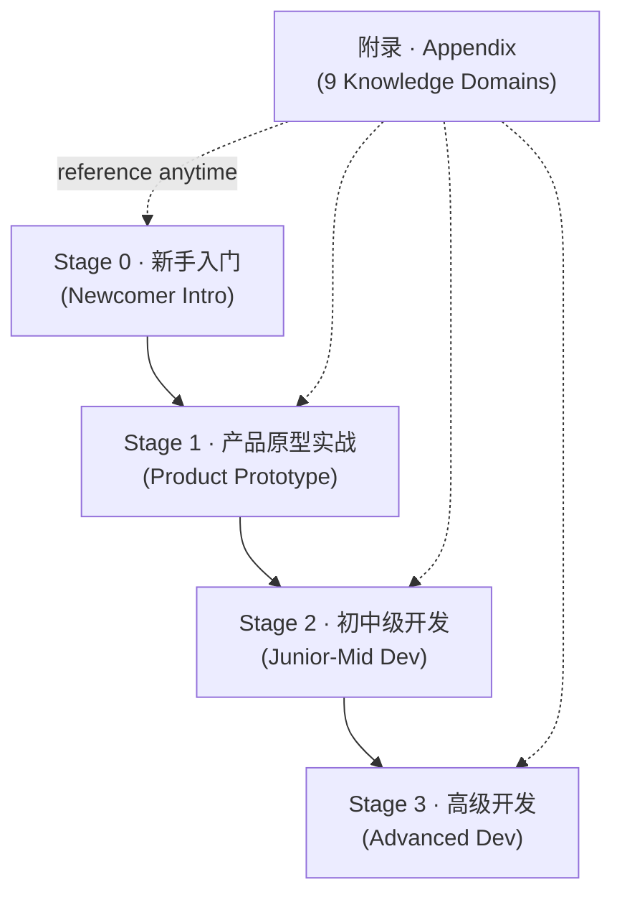
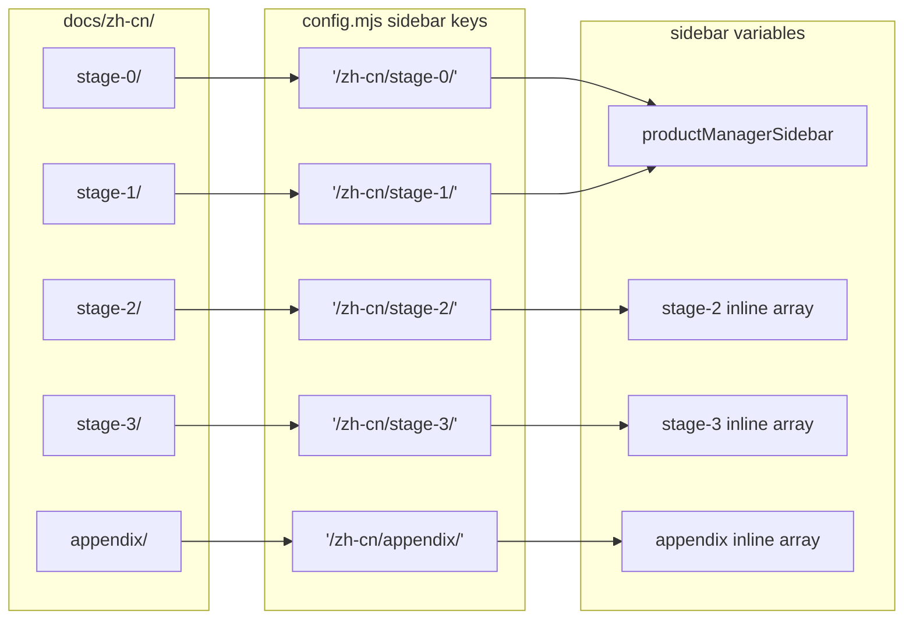
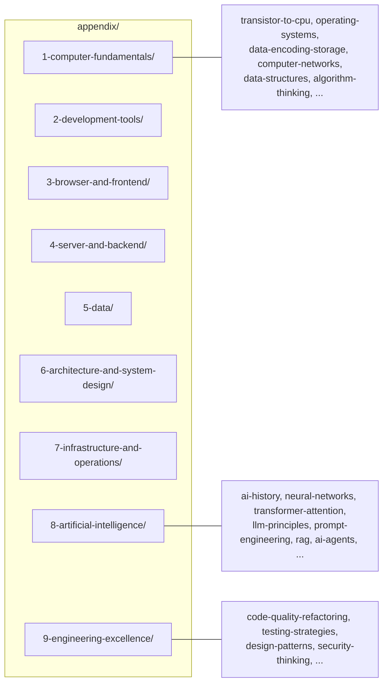
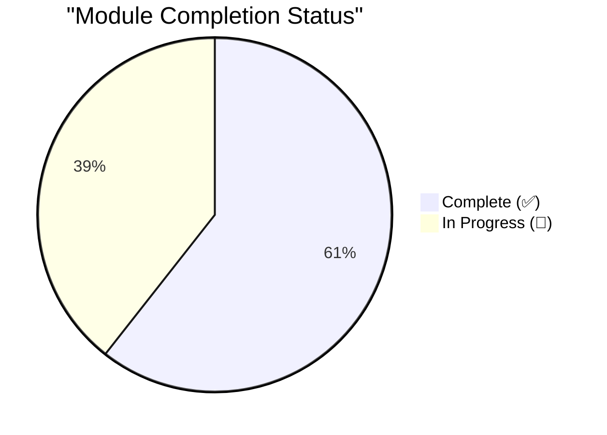

<!-- source: DeepWiki mcp.deepwiki.com · repo datawhalechina/easy-vibe · page 3 Learning Curriculum · fetched 2026-10-30 -->

# Learning Curriculum

<details>
<summary>Relevant source files</summary>

The following files were used as context for generating this wiki page:

- [README.md](README.md)
- [assets/readme-image1.png](assets/readme-image1.png)
- [docs-readme/ar-SA/README.md](docs-readme/ar-SA/README.md)
- [docs-readme/de-DE/README.md](docs-readme/de-DE/README.md)
- [docs-readme/en-US/README.md](docs-readme/en-US/README.md)
- [docs-readme/es-ES/README.md](docs-readme/es-ES/README.md)
- [docs-readme/fr-FR/README.md](docs-readme/fr-FR/README.md)
- [docs-readme/ja-JP/README.md](docs-readme/ja-JP/README.md)
- [docs-readme/ko-KR/README.md](docs-readme/ko-KR/README.md)
- [docs-readme/vi-VN/README.md](docs-readme/vi-VN/README.md)
- [docs-readme/zh-CN/README.md](docs-readme/zh-CN/README.md)
- [docs-readme/zh-TW/README.md](docs-readme/zh-TW/README.md)
- [docs/.vitepress/config.mjs](docs/.vitepress/config.mjs)
- [docs/.vitepress/theme/Layout.vue](docs/.vitepress/theme/Layout.vue)
- [docs/.vitepress/theme/components/ChapterIntroduction.vue](docs/.vitepress/theme/components/ChapterIntroduction.vue)
- [docs/.vitepress/theme/components/GitHubStars.vue](docs/.vitepress/theme/components/GitHubStars.vue)
- [docs/.vitepress/theme/components/HomeFeatures.vue](docs/.vitepress/theme/components/HomeFeatures.vue)
- [docs/.vitepress/theme/components/appendix/computer-fundamentals/BootProcessDemo.vue](docs/.vitepress/theme/components/appendix/computer-fundamentals/BootProcessDemo.vue)
- [docs/.vitepress/theme/index.js](docs/.vitepress/theme/index.js)
- [docs/.vitepress/theme/style.css](docs/.vitepress/theme/style.css)
- [docs/public/robots.txt](docs/public/robots.txt)
- [docs/zh-cn/appendix/1-computer-fundamentals/algorithm-thinking.md](docs/zh-cn/appendix/1-computer-fundamentals/algorithm-thinking.md)
- [docs/zh-cn/appendix/1-computer-fundamentals/data-encoding-storage.md](docs/zh-cn/appendix/1-computer-fundamentals/data-encoding-storage.md)
- [docs/zh-cn/appendix/1-computer-fundamentals/data-structures.md](docs/zh-cn/appendix/1-computer-fundamentals/data-structures.md)
- [docs/zh-cn/appendix/1-computer-fundamentals/power-on-to-web.md](docs/zh-cn/appendix/1-computer-fundamentals/power-on-to-web.md)
- [docs/zh-cn/appendix/1-computer-fundamentals/programming-languages.md](docs/zh-cn/appendix/1-computer-fundamentals/programming-languages.md)
- [docs/zh-cn/appendix/index.md](docs/zh-cn/appendix/index.md)
- [docs/zh-cn/stage-0/0.1-learning-map/index.md](docs/zh-cn/stage-0/0.1-learning-map/index.md)
- [docs/zh-cn/stage-0/index.md](docs/zh-cn/stage-0/index.md)
- [docs/zh-cn/stage-2/index.md](docs/zh-cn/stage-2/index.md)
- [docs/zh-cn/stage-3/index.md](docs/zh-cn/stage-3/index.md)

</details>


This page describes the overall Easy-Vibe curriculum — its educational philosophy, how content is divided into stages, the directory layout for each stage, and which modules are currently complete. It covers the progression model from zero-prerequisites through advanced development. For details on how individual stage pages are navigated via components, see [Curriculum Structure and Learning Map](#3.1). For the nine-category technical appendix, see [Appendix Reference Material](#4).

---

## Philosophy

Easy-Vibe teaches **Vibe Coding**: driving software development through natural-language conversations with an AI IDE rather than writing code by hand. The curriculum assumes no prior programming background. Learning is project-based — each stage ends with a deliverable that functions as a real, demonstrable product rather than a textbook exercise.

The guiding premise from [docs/zh-cn/stage-0/0.1-learning-map/index.md]() is:

> 编程语言正在变成自然语言 — "Programming languages are becoming natural language."

The hardest question is no longer *how to write code* but *what to build*.

Sources: [docs/zh-cn/stage-0/0.1-learning-map/index.md](), [README.md:101-117]()

---

## Three-Stage Progression Model

The curriculum is divided into a zero-prerequisites intro (Stage 0), followed by three capability stages, plus a standalone technical appendix.

**Curriculum Progression Diagram**



| Stage | Chinese Label | Target Audience | Deliverable |
|---|---|---|---|
| **Stage 0** | 新手入门 | Everyone; no prerequisites | First AI-generated game |
| **Stage 1** | 产品原型实战 | PMs, non-technical builders | High-fidelity interactive web prototype |
| **Stage 2** | 初中级开发 | Junior/mid developers | Full-stack web application, deployed |
| **Stage 3** | 高级开发 | Senior developers | Cross-platform or AI-native production app |
| **Appendix** | 附录知识库 | Any learner needing background | 9 domains, 80+ interactive topics |

Sources: [README.md:112-117](), [docs/zh-cn/stage-0/0.1-learning-map/index.md:56-90]()

---

## Directory and Sidebar Structure

Each stage maps directly to a directory under `docs/zh-cn/` and a sidebar configuration in `docs/.vitepress/config.mjs`.

**Stage Directory to Config Mapping**



`productManagerSidebar` is a reusable variable defined at [docs/.vitepress/config.mjs:206-280]() and applied to both `/zh-cn/stage-0/` and `/zh-cn/stage-1/` sidebar keys [docs/.vitepress/config.mjs:350-351](). Stages 2 and 3 each have their own inline sidebar arrays.

**Index Page Component Pattern**

Every stage's `index.md` uses the `NavGrid` + `NavCard` Vue components (registered in [docs/.vitepress/theme/index.js:13-14]()) to render navigable cards:

```
<NavGrid>
  <NavCard href="/zh-cn/stage-N/..." title="..." description="..." />
  ...
</NavGrid>
```

Sources: [docs/.vitepress/config.mjs:206-280](), [docs/.vitepress/config.mjs:349-503](), [docs/zh-cn/stage-0/index.md](), [docs/zh-cn/stage-2/index.md](), [docs/zh-cn/stage-3/index.md](), [docs/.vitepress/theme/index.js:13-14]()

---

## Stage 0: Introduction to AI Programming

**Directory:** `docs/zh-cn/stage-0/`

Stage 0 serves as the on-ramp for complete beginners. Its two modules are covered in the shared `productManagerSidebar` under the section label "新手入门".

| Module | Path | Key Content | Status |
|---|---|---|---|
| 0.1 学习地图 | `stage-0/0.1-learning-map/` | Full curriculum roadmap; explains Vibe Coding | ✅ |
| 0.2 AI 时代，会说话就会编程 | `stage-0/0.2-ai-capabilities-through-games/` | Build snake games on web-based platforms; intro to AI IDEs | ✅ |

The learning map at [docs/zh-cn/stage-0/0.1-learning-map/index.md]() renders stage cards using inline CSS and `div` elements rather than `NavCard`, since it is a standalone orientation page. It includes a persona-to-outcome table mapping roles (students, PMs, doctors, etc.) to what the curriculum delivers.

Sources: [docs/.vitepress/config.mjs:210-216](), [docs/zh-cn/stage-0/0.1-learning-map/index.md](), [docs/zh-cn/stage-0/index.md]()

---

## Stage 1: AI-Assisted Development Fundamentals

**Directory:** `docs/zh-cn/stage-1/`

Stage 1 teaches the core Vibe Coding workflow using local AI IDEs (Trae, Cursor). The sidebar groups content into the main sequence plus business-thinking appendices and technical appendices.

### Main Sequence

| Module | Path | Key Content | Status |
|---|---|---|---|
| 1.0 寻找好想法 | `stage-1/1.0-finding-great-idea/` | Product idea generation and validation | ✅ |
| 1.1 认识 AI IDE 工具 | `stage-1/1.1-introduction-to-ai-ide/` | Trae, Cursor — local game-building | ✅ |
| 1.2 动手做出原型 | `stage-1/1.2-building-prototype/` | Single-page → multi-page prototypes | ✅ |
| 1.3 给原型加上 AI 能力 | `stage-1/1.3-integrating-ai-capabilities/` | DeepSeek, Qwen3 VL API integration | ✅ |
| 1.4 完整项目实战 | `stage-1/1.4-complete-project-practice/` | LocalStorage polish; user feedback iteration | ✅ |

### Appendices (Business Thinking)

| Appendix | Path | Key Content | Status |
|---|---|---|---|
| A 产品思维与方案设计 | `stage-1/appendix-a-product-thinking/` | Product PM frameworks | ✅ |
| B AI 行业应用 (B端) | `stage-1/appendix-industry-scenarios/` | B-side enterprise AI scenarios | ✅ |
| C AI 消费场景 (C端) | `stage-1/appendix-c-consumer-scenarios/` | C-side consumer scenarios | ✅ |

### Appendices (Technical)

| Appendix | Path | Key Content | Status |
|---|---|---|---|
| D 写代码时遇到错误怎么办 | `stage-1/appendix-b-common-errors/` | Common Vibe Coding errors and debugging | ✅ |
| E 七款 AI 编程工具对比 | `stage-1/appendix-articles/example0-1/` | Comparison of 7 AI coding platforms | ✅ |
| F 用设计和编程 Agent 设计网站 | `stage-1/appendix-articles/example0-2/` | Design + coding agent collaboration | ✅ |

Sources: [README.md:236-260](), [docs/.vitepress/config.mjs:206-280](), [docs/zh-cn/stage-0/index.md:26-110]()

---

## Stage 2: Full-Stack Development

**Directory:** `docs/zh-cn/stage-2/`

Stage 2 is organized into four sub-tracks inside the sidebar: frontend, backend/fullstack, AI capabilities, and assignments.

**Stage 2 Module Graph**

```mermaid
flowchart TD
  subgraph "Frontend (stage-2/frontend/)"
    F0["2.0-lovart-assets/"]
    F1["2.1-figma-mastergo/"]
    F2["2.2-ui-design/"]
    F3["2.3-multi-product-ui/"]
    F4["2.4-hogwarts-portraits/"]
  end

  subgraph "Backend (stage-2/backend/)"
    B1["2.1-what-is-api/"]
    B2["2.2-database-supabase/"]
    B3["2.3-ai-interface-code/"]
    B4["2.4-git-workflow/"]
    B5["2.5-zeabur-deployment/"]
    B6["2.6-modern-cli/"]
    B7["2.7-stripe-payment/"]
  end

  subgraph "AI Capabilities (stage-2/ai-capabilities/)"
    AI1["2.1-dify-knowledge-base/"]
    AI2["2.2-multimodal-api/"]
  end

  subgraph "Assignments (stage-2/assignments/)"
    A1["2.1-fullstack-app/"]
    A2["2.2-modern-frontend-trae/"]
  end

  F4 --> A1
  B2 --> A1
  B5 --> A1
  AI1 --> A2
  B4 --> A2
```



### Frontend Modules

| Module | Path | Key Content | Status |
|---|---|---|---|
| 前端零 | `frontend/2.0-lovart-assets/` | Lovart AI visual assets | 🚧 |
| 前端一 | `frontend/2.1-figma-mastergo/` | Figma / MasterGo design tools | 🚧 |
| 前端二 | `frontend/2.2-ui-design/` | Component UI from design files | 🚧 |
| 前端三 | `frontend/2.3-multi-product-ui/` | Multi-product design system | 🚧 |
| 前端四 | `frontend/2.4-hogwarts-portraits/` | Hogwarts portrait AI app (full project) | ✅ |

### Backend & Full-Stack Modules

| Module | Path | Key Content | Status |
|---|---|---|---|
| 后端一 | `backend/2.1-what-is-api/extra2/` | HTTP / request-response model | ✅ |
| 后端二 | `backend/2.2-database-supabase/chapter5/` | Supabase DB + API | ✅ |
| 后端三 | `backend/2.3-ai-interface-code/` | LLM-assisted interface docs/code | 🚧 |
| 后端四 | `backend/2.4-git-workflow/extra1/` | Git workflow | ✅ |
| 后端五 | `backend/2.5-zeabur-deployment/extra6/` | Zeabur deployment | ✅ |
| 后端六 | `backend/2.6-modern-cli/extra7/` | CLI AI tools + TDD | ✅ |
| 后端七 | `backend/2.7-stripe-payment/` | Stripe payment integration | 🚧 |

### AI Capability Modules

| Module | Path | Key Content | Status |
|---|---|---|---|
| AI 一 | `ai-capabilities/2.1-dify-knowledge-base/chapter3/` | Dify Workflow + basic RAG | ✅ |
| AI 二 | `ai-capabilities/2.2-multimodal-api/extra3/` | AI capability dictionary + multimodal APIs | 🚧 |

### Assignments

| Assignment | Path | Key Content | Status |
|---|---|---|---|
| 大作业 1 | `assignments/2.1-fullstack-app/` | Complete full-stack web app | 🚧 |
| 大作业 2 | `assignments/2.2-modern-frontend-trae/` | Frontend component library + Trae | 🚧 |

Sources: [README.md:262-296](), [docs/.vitepress/config.mjs:352-441](), [docs/zh-cn/stage-2/index.md]()

---

## Stage 3: Advanced Development

**Directory:** `docs/zh-cn/stage-3/`

Stage 3 covers cross-platform development (WeChat, Android, iOS), advanced AI patterns (RAG, LangGraph), and MCP/Claude Code capabilities.

### Core Skills

| Module | Path | Key Content | Status |
|---|---|---|---|
| 高级一 | `core-skills/3.1-mcp-claude-code-skills/` | MCP protocol; Claude Code Skills | 🚧 |
| 高级二 | `core-skills/3.2-long-running-tasks/` | Long-running task design | 🚧 |

### Cross-Platform

| Module | Path | Key Content | Status |
|---|---|---|---|
| 高级三 | `cross-platform/3.3-wechat-miniprogram/` | WeChat miniprogram frontend | ✅ |
| 高级四 | `cross-platform/3.4-wechat-miniprogram-backend/` | WeChat miniprogram + backend | 🚧 |
| 高级五 | `cross-platform/3.5-android-app/` | Android (Expo) | ✅ |
| 高级六 | `cross-platform/3.6-ios-app/` | iOS SwiftUI | ✅ |

### Personal Brand

| Module | Path | Key Content | Status |
|---|---|---|---|
| 高级七 | `personal-brand/3.7-personal-website-blog/` | Personal site + academic blog | 🚧 |

### AI Advanced Appendices

| Module | Path | Key Content | Status |
|---|---|---|---|
| 高级 AI 一 | `ai-advanced/3.a1-rag-introduction/` | RAG: Naive → Advanced → Modular | ✅ |
| 高级 AI 二 | `ai-advanced/3.a2-langgraph-advanced-rag/` | LangGraph multi-step workflows | 🚧 |

Sources: [README.md:299-317](), [docs/.vitepress/config.mjs:442-503](), [docs/zh-cn/stage-3/index.md]()

---

## Appendix Knowledge Base

**Directory:** `docs/zh-cn/appendix/`

The appendix is a standalone reference library organized into nine numbered domain categories. It is independent of the stage progression and can be consulted at any point. The appendix index page at [docs/zh-cn/appendix/index.md]() renders all topics using the same `NavGrid` / `NavCard` pattern as the stage index pages.



| # | Domain | Notable Topics |
|---|---|---|
| 1 | 计算机是怎么回事 | `transistor-to-cpu`, `operating-systems`, `computer-networks`, `data-structures`, `algorithm-thinking` |
| 2 | 开发环境与工具 | `git-version-control`, `command-line-shell`, `debugging-art`, `package-managers` |
| 3 | 浏览器与前端 | `javascript-deep-dive`, `browser-as-os-rendering`, `frontend-frameworks`, `html-css-layout` |
| 4 | 服务器与后端 | `http-protocol`, `api-design`, `auth-authorization`, `backend-layered-architecture` |
| 5 | 数据 | `sql`, `database-fundamentals`, `data-analysis`, `ab-testing` |
| 6 | 架构与系统设计 | `monolith-to-microservices`, `distributed-systems`, `high-availability` |
| 7 | 基础设施与运维 | `docker-containers`, `kubernetes`, `ci-cd`, `monitoring-logging` |
| 8 | 人工智能 | `ai-history`, `transformer-attention`, `llm-principles`, `rag`, `ai-agents`, `prompt-engineering` |
| 9 | 工程素养 | `code-quality-refactoring`, `testing-strategies`, `design-patterns`, `security-thinking` |

The sidebar for `/zh-cn/appendix/` is defined as a long inline array in [docs/.vitepress/config.mjs:571-1067]() with one top-level group per domain.

Sources: [docs/zh-cn/appendix/index.md](), [docs/.vitepress/config.mjs:571-1067](), [README.md:140-232]()

---

## Completion Status Summary



| Stage | Complete | In Progress |
|---|---|---|
| Stage 0 | 2 | 0 |
| Stage 1 (main + appendices) | 8 | 0 |
| Stage 2 | 8 | 7 |
| Stage 3 | 5 | 6 |

Sources: [README.md:236-317]()

---

## Related Pages

- For the `NavGrid`, `NavCard`, `ChapterIntroduction`, and `StepBar` components used on index pages, see [Curriculum Structure and Learning Map](#3.1).
- For Stage 0 and Stage 1 details, see [Stage 0: Introduction to AI Programming](#3.2) and [Stage 1: AI-Assisted Development Fundamentals](#3.3).
- For Stage 2 and Stage 3 details, see [Stage 2 and Stage 3: Intermediate and Advanced Development](#3.4).
- For the full appendix breakdown with interactive Vue demos, see [Appendix Reference Material](#4) and its subsections.
- For how the VitePress sidebar config and nav bar are set up, see [VitePress Configuration and Theme](#2.1).

---

