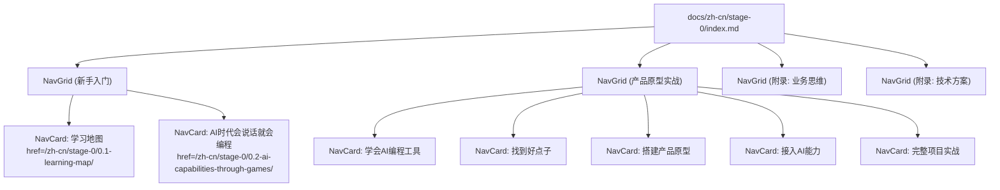
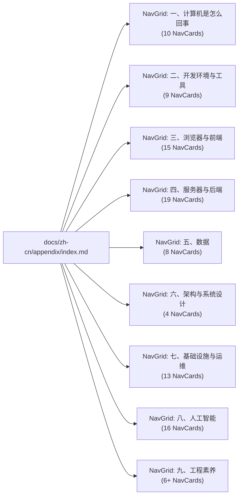
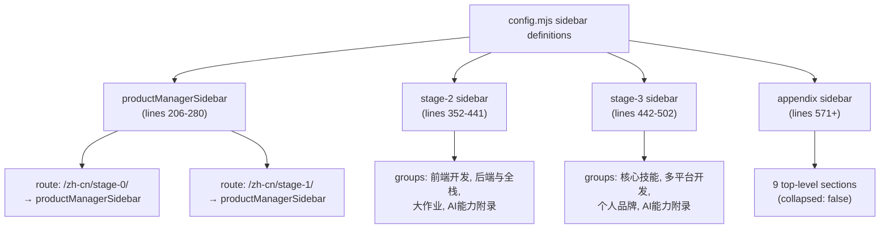

<!-- source: DeepWiki mcp.deepwiki.com · repo datawhalechina/easy-vibe · page 3.1 Curriculum Structure and Learning Map · fetched 2026-10-30 -->

# Curriculum Structure and Learning Map

<details>
<summary>Relevant source files</summary>

The following files were used as context for generating this wiki page:

- [README.md](README.md)
- [assets/readme-image1.png](assets/readme-image1.png)
- [docs-readme/ar-SA/README.md](docs-readme/ar-SA/README.md)
- [docs-readme/de-DE/README.md](docs-readme/de-DE/README.md)
- [docs-readme/en-US/README.md](docs-readme/en-US/README.md)
- [docs-readme/es-ES/README.md](docs-readme/es-ES/README.md)
- [docs-readme/fr-FR/README.md](docs-readme/fr-FR/README.md)
- [docs-readme/ja-JP/README.md](docs-readme/ja-JP/README.md)
- [docs-readme/ko-KR/README.md](docs-readme/ko-KR/README.md)
- [docs-readme/vi-VN/README.md](docs-readme/vi-VN/README.md)
- [docs-readme/zh-CN/README.md](docs-readme/zh-CN/README.md)
- [docs-readme/zh-TW/README.md](docs-readme/zh-TW/README.md)
- [docs/.vitepress/config.mjs](docs/.vitepress/config.mjs)
- [docs/.vitepress/theme/Layout.vue](docs/.vitepress/theme/Layout.vue)
- [docs/.vitepress/theme/components/ChapterIntroduction.vue](docs/.vitepress/theme/components/ChapterIntroduction.vue)
- [docs/.vitepress/theme/components/GitHubStars.vue](docs/.vitepress/theme/components/GitHubStars.vue)
- [docs/.vitepress/theme/components/HomeFeatures.vue](docs/.vitepress/theme/components/HomeFeatures.vue)
- [docs/.vitepress/theme/components/appendix/computer-fundamentals/BootProcessDemo.vue](docs/.vitepress/theme/components/appendix/computer-fundamentals/BootProcessDemo.vue)
- [docs/.vitepress/theme/index.js](docs/.vitepress/theme/index.js)
- [docs/.vitepress/theme/style.css](docs/.vitepress/theme/style.css)
- [docs/public/robots.txt](docs/public/robots.txt)
- [docs/zh-cn/appendix/1-computer-fundamentals/algorithm-thinking.md](docs/zh-cn/appendix/1-computer-fundamentals/algorithm-thinking.md)
- [docs/zh-cn/appendix/1-computer-fundamentals/data-encoding-storage.md](docs/zh-cn/appendix/1-computer-fundamentals/data-encoding-storage.md)
- [docs/zh-cn/appendix/1-computer-fundamentals/data-structures.md](docs/zh-cn/appendix/1-computer-fundamentals/data-structures.md)
- [docs/zh-cn/appendix/1-computer-fundamentals/power-on-to-web.md](docs/zh-cn/appendix/1-computer-fundamentals/power-on-to-web.md)
- [docs/zh-cn/appendix/1-computer-fundamentals/programming-languages.md](docs/zh-cn/appendix/1-computer-fundamentals/programming-languages.md)
- [docs/zh-cn/appendix/index.md](docs/zh-cn/appendix/index.md)
- [docs/zh-cn/stage-0/0.1-learning-map/index.md](docs/zh-cn/stage-0/0.1-learning-map/index.md)
- [docs/zh-cn/stage-0/index.md](docs/zh-cn/stage-0/index.md)
- [docs/zh-cn/stage-2/index.md](docs/zh-cn/stage-2/index.md)
- [docs/zh-cn/stage-3/index.md](docs/zh-cn/stage-3/index.md)

</details>


## Purpose and Scope

This page documents the overall Easy-Vibe learning curriculum: how it is structured into stages, how the learning map orients new learners, how stage-level index pages are built using `NavGrid` and `NavCard` navigation components, and how the `ChapterIntroduction` component is used inside individual chapter pages.

For details on the custom Vue components mentioned here (their props, reactive state, and full implementation), see [Theme and Navigation Components](#5.1). For details on specific stage content, see [Stage 0](#3.2), [Stage 1](#3.3), and [Stage 2 / Stage 3](#3.4).

---

## Curriculum Overview

The curriculum is divided into three numbered stages and an appendix. In the repository's directory layout, **Stage 0** and **Stage 1** together form what the README calls "第一阶段" (First Stage), sharing the same sidebar configuration in VitePress.

### Stage-to-directory mapping

| Curriculum Stage | Directory | Audience | Core Output |
|---|---|---|---|
| Stage 0 (Intro) | `docs/zh-cn/stage-0/` | Zero-background | Learning map, first game via AI |
| Stage 1 (Prototyping) | `docs/zh-cn/stage-1/` | PMs, beginners | Interactive web prototypes |
| Stage 2 (Full-stack) | `docs/zh-cn/stage-2/` | Junior/mid devs | Deployed full-stack apps |
| Stage 3 (Advanced) | `docs/zh-cn/stage-3/` | Senior devs | Cross-platform, RAG, agents |
| Appendix | `docs/zh-cn/appendix/` | All levels | 9 knowledge domains, 80+ topics |

Sources: [README.md:112-117](), [docs/.vitepress/config.mjs:206-280]()

---

## Curriculum Progression

The following diagram maps curriculum stages to their VitePress sidebar definitions and primary file paths.

**Curriculum Stage to Code Entity Map**

```mermaid
graph TD
    A["productManagerSidebar (config.mjs:206)"] --> B["stage-0/0.1-learning-map/index.md"]
    A --> C["stage-0/0.2-ai-capabilities-through-games/index.md"]
    A --> D["stage-1/1.0-finding-great-idea/index.md"]
    A --> E["stage-1/1.1-introduction-to-ai-ide/index.md"]
    A --> F["stage-1/1.2-building-prototype/index.md"]
    A --> G["stage-1/1.3-integrating-ai-capabilities/index.md"]
    A --> H["stage-1/1.4-complete-project-practice/index.md"]

    I["stage-2 sidebar (config.mjs:352)"] --> J["stage-2/frontend/*"]
    I --> K["stage-2/backend/*"]
    I --> L["stage-2/ai-capabilities/*"]
    I --> M["stage-2/assignments/*"]

    N["stage-3 sidebar (config.mjs:442)"] --> O["stage-3/core-skills/*"]
    N --> P["stage-3/cross-platform/*"]
    N --> Q["stage-3/ai-advanced/*"]
    N --> R["stage-3/personal-brand/*"]

    S["appendix sidebar (config.mjs:571)"] --> T["appendix/1-computer-fundamentals/*"]
    S --> U["appendix/2-development-tools/*"]
    S --> V["appendix/3-browser-and-frontend/*"]
    S --> W["appendix/4-9-*"]
```



Sources: [docs/.vitepress/config.mjs:206-503](), [docs/.vitepress/config.mjs:571-1000]()

---

## The Learning Map

The learning map is the entry point for new learners. It lives at `docs/zh-cn/stage-0/0.1-learning-map/index.md` and is linked from the sidebar as "学习地图".

### What it contains

- **A Vibe Coding definition**: explains the methodology ("coding by talking to AI").
- **Audience table**: maps reader backgrounds (student, PM, doctor, etc.) to course outcomes.
- **Growth path cards** (`stage-intro` / `stage-grid` HTML blocks): inline CSS-styled `div.stage-card` blocks describing each stage visually. These are **not** using the `NavCard` Vue component — they use raw HTML with embedded `<style>` for the card layout.
- **Stage skill summaries**: prose sections for each stage describing what learners will be able to do after completion.
- **Prompting guidance**: techniques for effective AI-assisted development.

The learning map page does **not** use `NavGrid`/`NavCard`. Instead it uses inline HTML `div` elements with custom CSS classes:

```html
<div class="stage-grid">
  <div class="stage-card">
    <div class="stage-icon">🛠️</div>
    <h3>第一阶段</h3>
    ...
  </div>
</div>
```

Sources: [docs/zh-cn/stage-0/0.1-learning-map/index.md:42-166]()

---

## Stage Index Pages

Each stage has an `index.md` at the stage root that serves as a **stage landing page**. These pages use the `NavGrid` and `NavCard` components registered in the VitePress theme to present navigable cards for each chapter.

### Index page locations

| File | Role |
|---|---|
| `docs/zh-cn/stage-0/index.md` | Stage 0 landing page |
| `docs/zh-cn/stage-2/index.md` | Stage 2 landing page |
| `docs/zh-cn/stage-3/index.md` | Stage 3 landing page |
| `docs/zh-cn/appendix/index.md` | Appendix landing page |

### Index page pattern

Every stage index page follows this consistent structure:

1. A heading naming the stage.
2. A brief "You will learn" paragraph.
3. One or more `<NavGrid>` blocks, each containing multiple `<NavCard>` elements.
4. Contextual advice on when to consult appendix sections.

**Stage index page anatomy (Stage 0 example)**



Sources: [docs/zh-cn/stage-0/index.md:1-130](), [docs/zh-cn/stage-2/index.md:1-100](), [docs/zh-cn/stage-3/index.md:1-70]()

---

## NavGrid and NavCard Components

`NavGrid` and `NavCard` are custom Vue components registered globally in the VitePress theme and available in all markdown pages without any import statement.

### Component registration

Both components are registered in `docs/.vitepress/theme/index.js`:

| Symbol | Source file | Registration line |
|---|---|---|
| `NavGrid` | `docs/.vitepress/theme/components/NavGrid.vue` | [docs/.vitepress/theme/index.js:12]() |
| `NavCard` | `docs/.vitepress/theme/components/NavCard.vue` | [docs/.vitepress/theme/index.js:13]() |

### Usage pattern

`NavCard` is always used as a direct child of `NavGrid`. The `NavGrid` component wraps cards in a responsive grid layout. `NavCard` accepts at minimum an `href`, `title`, and `description` prop:

```markdown
<NavGrid>
  <NavCard
    href="/zh-cn/stage-0/0.1-learning-map/"
    title="1. 学习地图"
    description="了解整个学习路径，明确每个阶段的目标和收获。"
  />
</NavGrid>
```

The `href` values are relative to the VitePress base path (`/easy-vibe/` on GitHub Pages, `/` on Vercel). See [VitePress Configuration and Theme](#2.1) for base path details.

### NavGrid and NavCard in the appendix

The appendix index (`docs/zh-cn/appendix/index.md`) is the most extensive use of these components in the codebase. It organizes 80+ topics across 9 domain sections, each wrapped in a `<NavGrid>` block with multiple `<NavCard>` entries.

**Appendix NavGrid structure**



Sources: [docs/zh-cn/appendix/index.md:1-580]()

---

## ChapterIntroduction Component

`ChapterIntroduction` is a Vue component registered globally at [docs/.vitepress/theme/index.js:17](). It appears at the top of individual chapter pages to provide structured intro metadata (learning goals, prerequisites, or summary text) before the chapter body.

The component follows this usage pattern across chapter files:

```markdown
<ChapterIntroduction ... />

# Chapter Title
...
```

For full documentation of `ChapterIntroduction` props and behavior, see [Theme and Navigation Components](#5.1).

Sources: [docs/.vitepress/theme/index.js:17]()

---

## Sidebar Configuration vs. Content Directory

The VitePress sidebar configuration in `config.mjs` mirrors the directory structure but makes editorial choices about which pages to surface and how to group them.

**Sidebar config to file path binding**



Note that Stage 0 and Stage 1 **share** the same `productManagerSidebar` object — both paths resolve to the same sidebar. This is defined at [docs/.vitepress/config.mjs:349-351]():

```js
sidebar: {
  '/zh-cn/stage-0/': productManagerSidebar,
  '/zh-cn/stage-1/': productManagerSidebar,
  ...
}
```

Sources: [docs/.vitepress/config.mjs:282-310](), [docs/.vitepress/config.mjs:349-503]()

---

## Summary of Key Relationships

| Concept | Implementation | File(s) |
|---|---|---|
| Learning map orientation | Inline HTML stage cards in `index.md` | `docs/zh-cn/stage-0/0.1-learning-map/index.md` |
| Stage landing pages | `index.md` files using `NavGrid` / `NavCard` | `docs/zh-cn/stage-{0,2,3}/index.md`, `docs/zh-cn/appendix/index.md` |
| Navigation card grid | `NavGrid.vue` + `NavCard.vue` globally registered | `docs/.vitepress/theme/index.js:12-13` |
| Chapter intro pattern | `ChapterIntroduction.vue` globally registered | `docs/.vitepress/theme/index.js:17` |
| Sidebar grouping | `productManagerSidebar`, per-stage sidebar arrays | `docs/.vitepress/config.mjs:206-503` |
| Appendix organization | 9 `NavGrid` sections in `appendix/index.md` | `docs/zh-cn/appendix/index.md` |

---

