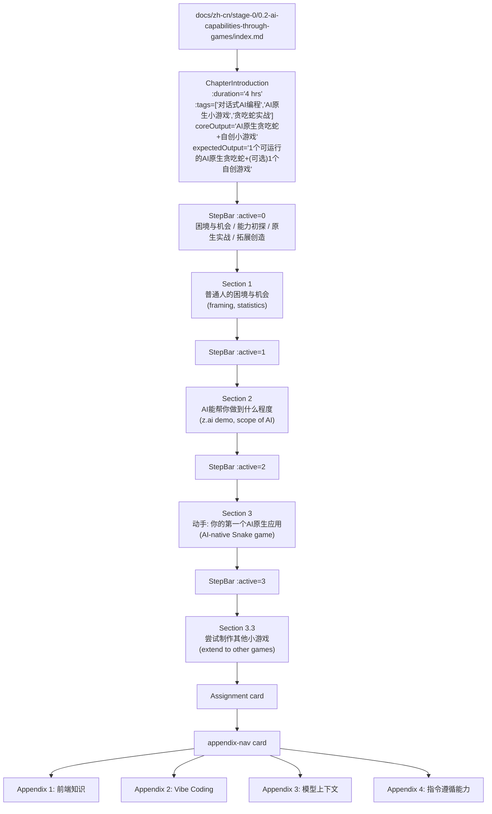
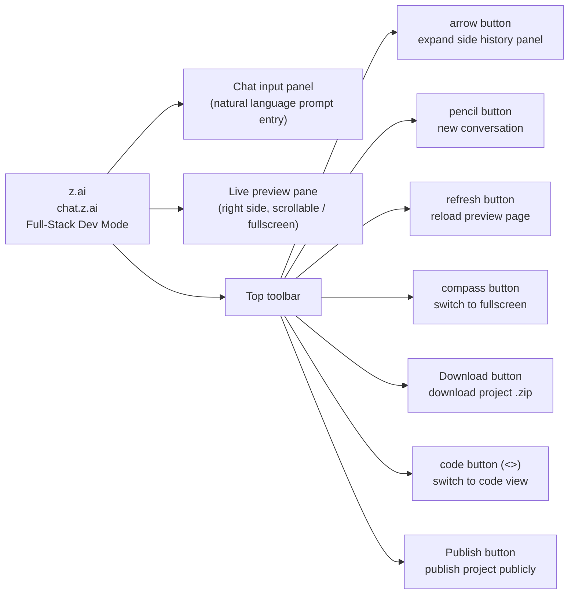
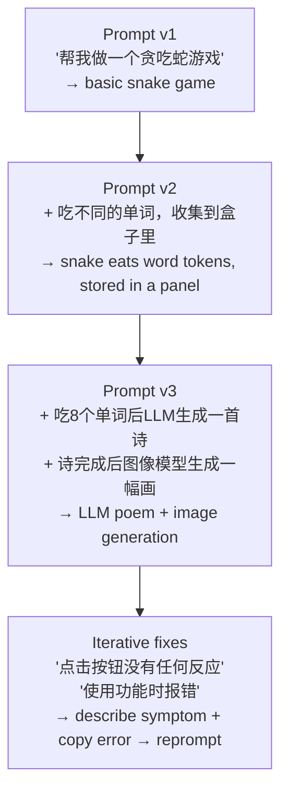
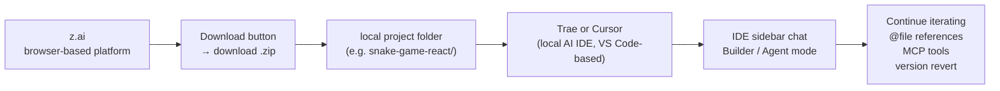

<!-- source: DeepWiki mcp.deepwiki.com · repo datawhalechina/easy-vibe · page 3.2 Stage 0: Introduction to AI Programming · fetched 2026-10-30 -->

# Stage 0: Introduction to AI Programming

<details>
<summary>Relevant source files</summary>

The following files were used as context for generating this wiki page:

- [.github/workflows/deploy.yml](.github/workflows/deploy.yml)
- [docs/.vitepress/theme/components/StepBar.vue](docs/.vitepress/theme/components/StepBar.vue)
- [docs/.vitepress/theme/components/TextType.vue](docs/.vitepress/theme/components/TextType.vue)
- [docs/index.md](docs/index.md)
- [docs/zh-cn/stage-0/0.2-ai-capabilities-through-games/index.md](docs/zh-cn/stage-0/0.2-ai-capabilities-through-games/index.md)
- [docs/zh-cn/stage-1/1.1-introduction-to-ai-ide/index.md](docs/zh-cn/stage-1/1.1-introduction-to-ai-ide/index.md)
- [docs/zh-cn/stage-1/1.2-building-prototype/index.md](docs/zh-cn/stage-1/1.2-building-prototype/index.md)
- [docs/zh-cn/stage-1/1.3-integrating-ai-capabilities/index.md](docs/zh-cn/stage-1/1.3-integrating-ai-capabilities/index.md)
- [docs/zh-cn/stage-1/1.4-complete-project-practice/index.md](docs/zh-cn/stage-1/1.4-complete-project-practice/index.md)

</details>


This page documents **Stage 0** of the Easy-Vibe curriculum: the entry point for learners with no prior programming background. Stage 0 teaches AI programming through game building on the web-based z.ai platform, introduces the Vibe Coding methodology, and bridges to local AI IDE usage. For Stage 1 content (local IDEs, prototypes, API integration), see [Stage 1: AI-Assisted Development Fundamentals](#3.3). For curriculum navigation components and the learning map, see [Curriculum Structure and Learning Map](#3.1).

---

## Stage 0 Overview

Stage 0 consists of two parts:

- **Chapter 0.1** — Learning map orientation. Helps learners understand where they are in the curriculum, what stages exist, and what skills they will acquire.
- **Chapter 0.2** — Hands-on AI capability introduction via game building on z.ai. This is the substantive technical content of Stage 0.

The primary source file for chapter 0.2 is [docs/zh-cn/stage-0/0.2-ai-capabilities-through-games/index.md:1-727]().

| Property | Value |
|---|---|
| **Estimated duration** | ~4 hours (can be split across sessions) |
| **Core output** | One runnable AI-native Snake game |
| **Optional output** | One self-created AI-native game or demo |
| **Tags** | 对话式 AI 编程, AI 原生小游戏, 贪吃蛇实战 |
| **Next chapter** | Stage 1, Chapter 1.1 — AI IDE (Trae/Cursor) |

Sources: [docs/zh-cn/stage-0/0.2-ai-capabilities-through-games/index.md:12-26]()

---

## Chapter 0.2: Content Structure

The chapter is divided into four major sections, each corresponding to one step in the `StepBar` component. The `StepBar` `:active` prop is incremented at each transition to show progress.

**Chapter 0.2 structure mapped to components and file sections**



Sources: [docs/zh-cn/stage-0/0.2-ai-capabilities-through-games/index.md:1-50](), [docs/zh-cn/stage-0/0.2-ai-capabilities-through-games/index.md:473-503]()

---

## Section 1: Challenges and Opportunities

This section frames the motivation for non-programmer learners. It cites GitHub Copilot usage data to establish that AI-assisted programming is mainstream and that natural language is a viable entry point for building software.

Key statistics presented in the `el-card` component:

| Metric | Value |
|---|---|
| Speed increase | 55% |
| Task time reduction | 9.6 days → 2.4 days |
| Install-on-day-one rate | 81% |
| Suggestion acceptance rate | 96% |

The section ends with the framing premise: if professional programmers rely heavily on AI for code generation, non-programmers should be able to interact with AI directly to build applications.

Sources: [docs/zh-cn/stage-0/0.2-ai-capabilities-through-games/index.md:39-98]()

---

## Section 2: What AI Can Do — The z.ai Platform

This section sets scope expectations and introduces the z.ai web platform as the development environment for Stage 0.

### AI Capability Scope

| Scenario | AI Reliability |
|---|---|
| Small, well-scoped tools (games, dashboards, internal tools) | High — ~90% success on first iteration |
| Large systems with auth, backend, DB | Requires human to structure and integrate |
| Safety-critical / compliance systems (payments, medical) | Must not deploy without rigorous review |

### z.ai Interface

z.ai is a browser-based full-stack development platform by Zhipu AI, requiring no local installation. Its development mode exposes a chat input panel on the left and a live preview pane on the right.

**z.ai interface components and toolbar actions**



Sources: [docs/zh-cn/stage-0/0.2-ai-capabilities-through-games/index.md:130-152]()

The chapter also lists alternative Vibe Coding platforms for learners who want to compare tools:

| Platform | Key Characteristic |
|---|---|
| Google AI Studio | Gemini-based, rapid prototyping |
| Figma Make | Design tool integration |
| Coze | ByteDance bot/workflow focus |
| v0.dev | React component generation (Vercel) |
| Bolt.new | StackBlitz full-stack |
| Lovable | React + GitHub integration |
| Replit Agent | Online IDE with live collaboration |

Sources: [docs/zh-cn/stage-0/0.2-ai-capabilities-through-games/index.md:153-168]()

---

## Section 3: Building the AI-Native Snake Game

This is the hands-on core of Stage 0. The target is not a standard Snake game, but an "AI-native" version that integrates an LLM and an image generation model as first-class features.

### Baseline Snake Prompt

The chapter starts with a five-requirement prompt submitted to z.ai's full-stack development mode:

```
帮我做一个贪吃蛇游戏：
1. 用方向键控制蛇的移动
2. 吃到食物后蛇会变长，分数增加
3. 撞到墙壁或自己的身体就游戏结束
4. 要有开始和重新开始按钮
5. 界面要简洁好看
```

### Iterative Prompt Development — AI-Native Features

The chapter teaches prompt refinement through three progressive iterations, each adding an AI-integrated feature:

**AI-native Snake: prompt iteration sequence**



Sources: [docs/zh-cn/stage-0/0.2-ai-capabilities-through-games/index.md:226-260]()

### AI Systems Integrated in the Final Game

| Feature | AI System | Trigger Condition |
|---|---|---|
| Word token collection | None (game mechanic) | Snake eats a word on the grid |
| Poem generation | LLM (via z.ai backend) | 8 words have been collected |
| Image generation | Image model (via z.ai backend) | Poem generation completes |

### Using AI to Generate Prompts

The chapter demonstrates a meta-technique: feeding a natural language game idea to z.ai's regular chat mode to produce a more structured full-stack development prompt.

Example meta-prompt:
```
我想让 AI 生成一个网页贪吃蛇游戏，需要一个更完整的提示词，
让生成结果更令人印象深刻和有趣。请生成相应的提示词。
当前目标是：生成一个贪吃蛇游戏，需要实现吃不同单词生成诗歌的功能，
并且应该包含图像生成模块。
```

Sources: [docs/zh-cn/stage-0/0.2-ai-capabilities-through-games/index.md:297-316]()

### Fixing Errors on z.ai

When problems arise, the chapter prescribes a simple feedback loop: describe the symptom or copy the error message, then paste it into the z.ai chat to request a fix. The platform supports image input for screenshots of broken UI states.

---

## Section 4: Extending to Other Games

After completing the Snake game, learners are encouraged to apply the same Vibe Coding loop to their own ideas. The chapter provides two reference lists:

- **10 web application ideas** — AI art gallery, sustainable living tracker, virtual kitchen assistant, knowledge graph builder, retro game archive, etc.
- **10 game ideas** — 3D open-world RPG, FPS arena, chess AI, mahjong multiplayer, card battle game, rhythm game, etc.

These are not prescriptive — their purpose is to prompt learners to pick any goal and exercise the "describe → generate → iterate → fix" loop without guidance.

Sources: [docs/zh-cn/stage-0/0.2-ai-capabilities-through-games/index.md:328-438]()

---

## Chapter Assignment

Defined in an `el-card` block at the end of chapter 0.2:

1. **Required** — Reproduce the AI-native Snake game with: snake movement, eating mechanic (length + score change), and death detection (wall collision or self-collision). Practice the error submission pattern: symptoms + full code + error text in one prompt, using "小白模式" framing.

2. **Optional** — Create one original AI-native game or demo using a different concept. The expected reflection: identify specifically what the AI handled vs. what would have been difficult or tedious to do manually.

Sources: [docs/zh-cn/stage-0/0.2-ai-capabilities-through-games/index.md:440-471]()

---

## In-Chapter Appendices

The chapter includes four inline appendices linked from an `appendix-nav` card. They use named anchor IDs and are intended as reference material, not required reading.

| Anchor ID | Title | Key Content |
|---|---|---|
| `#appendix-1` | 我们需要前端开发知识吗？ | HTML/CSS/JS triad; React/Vue overview; browser rendering pipeline; how to describe layout to AI |
| `#appendix-2` | 到底什么是 Vibe Coding | Andrej Karpathy's original definition (Feb 2025); characteristic prompt patterns ("代码里有个bug，请修复") |
| `#appendix-3` | 模型上下文 | Context window (context window) concept; what happens when it fills up; balancing context length vs. cost |
| `#appendix-4` | 指令遵循能力 | Why models drift from instructions across turns; how training data style affects output style |

Sources: [docs/zh-cn/stage-0/0.2-ai-capabilities-through-games/index.md:473-727]()

---

## Transition to Stage 1

Stage 0 operates entirely within z.ai's browser environment. Chapter 1.1 of Stage 1 explicitly bridges from z.ai to a local AI IDE, explaining the limitations of the web platform:

> "前面我们在 z.ai 上体验了 AI 编程，但网页版有很多限制——**不能随时保存**、**不好管理文件**、也**没法做复杂项目**。"

The transition workflow taught in Chapter 1.1 is:

**Stage 0 → Stage 1 platform transition**



Sources: [docs/zh-cn/stage-1/1.1-introduction-to-ai-ide/index.md:221-228]()

After this transition, Stage 1 introduces local development workflows: AI IDEs (Trae, Cursor), multi-file project management, and real API integration. For full Stage 1 coverage, see [Stage 1: AI-Assisted Development Fundamentals](#3.3).

---

## Key Vue Components Used in Stage 0

### `ChapterIntroduction`

Used at the top of [docs/zh-cn/stage-0/0.2-ai-capabilities-through-games/index.md:18-26]() with props:

| Prop | Stage 0 Value |
|---|---|
| `:duration` | `'约 <strong>4 小时</strong>，可分多次完成'` |
| `:tags` | `['对话式 AI 编程', 'AI 原生小游戏', '贪吃蛇实战']` |
| `coreOutput` | `"AI 原生贪吃蛇 + 自创小游戏"` |
| `expectedOutput` | `"1 个可运行的 AI 原生贪吃蛇 + （可选）1 个你自创的 AI 原生小游戏或 Demo"` |

For component implementation details, see [Interactive Vue Demo Components](#5) and [Theme and Navigation Components](#5.1).

### `StepBar`

Rendered four times in chapter 0.2 with `:active` values 0–3. The default `items` array in [docs/.vitepress/theme/components/StepBar.vue:22-30]() was authored specifically for this chapter:

| `:active` Value | Step Title | Step Description |
|---|---|---|
| 0 | 困境与机会 | 普通人的编程新可能 |
| 1 | 能力初探 | 60秒极速开发体验 |
| 2 | 原生实战 | 打造AI原生贪吃蛇 |
| 3 | 拓展创造 | 举一反三做游戏 |

Sources: [docs/.vitepress/theme/components/StepBar.vue:1-31](), [docs/zh-cn/stage-0/0.2-ai-capabilities-through-games/index.md:28-37](), [docs/zh-cn/stage-0/0.2-ai-capabilities-through-games/index.md:89-98](), [docs/zh-cn/stage-0/0.2-ai-capabilities-through-games/index.md:215-224](), [docs/zh-cn/stage-0/0.2-ai-capabilities-through-games/index.md:317-326]()

---

