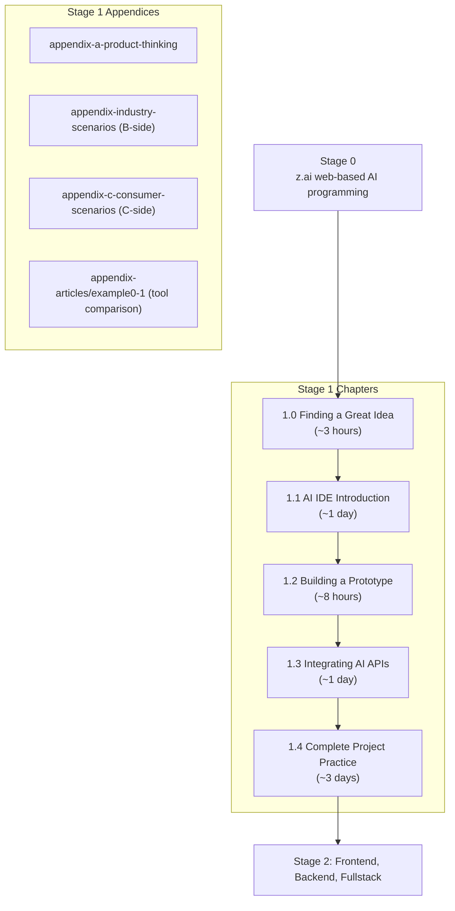
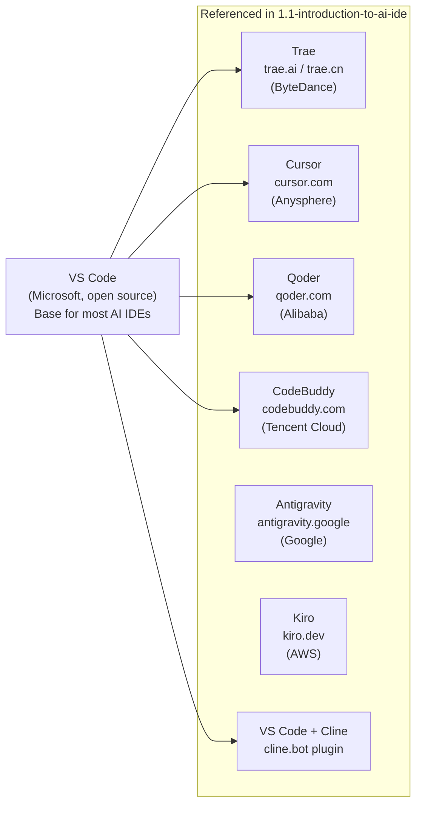
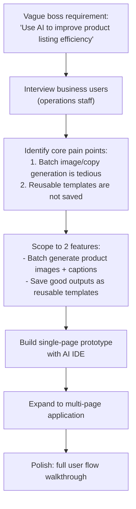
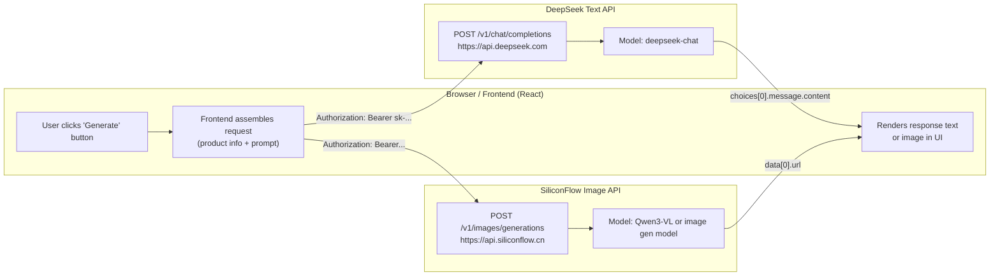
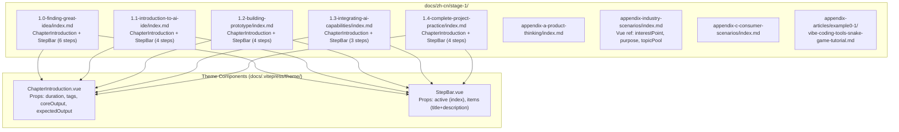
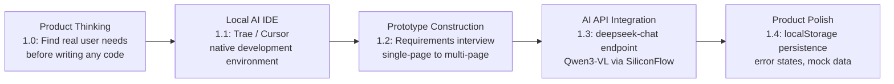

<!-- source: DeepWiki mcp.deepwiki.com · repo datawhalechina/easy-vibe · page 3.3 Stage 1: AI-Assisted Development Fundamentals · fetched 2026-10-30 -->

# Stage 1: AI-Assisted Development Fundamentals

<details>
<summary>Relevant source files</summary>

The following files were used as context for generating this wiki page:

- [docs/.vitepress/theme/components/SummaryCard.vue](docs/.vitepress/theme/components/SummaryCard.vue)
- [docs/.vitepress/theme/components/appendix/frontend-engineering/AssetFingerprintDemo.vue](docs/.vitepress/theme/components/appendix/frontend-engineering/AssetFingerprintDemo.vue)
- [docs/.vitepress/theme/components/appendix/frontend-engineering/BuildPipelineDemo.vue](docs/.vitepress/theme/components/appendix/frontend-engineering/BuildPipelineDemo.vue)
- [docs/.vitepress/theme/components/appendix/frontend-engineering/DependencyGraphDemo.vue](docs/.vitepress/theme/components/appendix/frontend-engineering/DependencyGraphDemo.vue)
- [docs/zh-cn/stage-0/0.2-ai-capabilities-through-games/index.md](docs/zh-cn/stage-0/0.2-ai-capabilities-through-games/index.md)
- [docs/zh-cn/stage-1/1.0-finding-great-idea/index.md](docs/zh-cn/stage-1/1.0-finding-great-idea/index.md)
- [docs/zh-cn/stage-1/1.1-introduction-to-ai-ide/index.md](docs/zh-cn/stage-1/1.1-introduction-to-ai-ide/index.md)
- [docs/zh-cn/stage-1/1.2-building-prototype/index.md](docs/zh-cn/stage-1/1.2-building-prototype/index.md)
- [docs/zh-cn/stage-1/1.3-integrating-ai-capabilities/index.md](docs/zh-cn/stage-1/1.3-integrating-ai-capabilities/index.md)
- [docs/zh-cn/stage-1/1.4-complete-project-practice/index.md](docs/zh-cn/stage-1/1.4-complete-project-practice/index.md)
- [docs/zh-cn/stage-1/appendix-a-product-thinking/index.md](docs/zh-cn/stage-1/appendix-a-product-thinking/index.md)
- [docs/zh-cn/stage-1/appendix-articles/example0-1/vibe-coding-tools-snake-game-tutorial.md](docs/zh-cn/stage-1/appendix-articles/example0-1/vibe-coding-tools-snake-game-tutorial.md)
- [docs/zh-cn/stage-1/appendix-b-common-errors/index.md](docs/zh-cn/stage-1/appendix-b-common-errors/index.md)
- [docs/zh-cn/stage-1/appendix-c-consumer-scenarios/index.md](docs/zh-cn/stage-1/appendix-c-consumer-scenarios/index.md)
- [docs/zh-cn/stage-1/appendix-industry-scenarios/index.md](docs/zh-cn/stage-1/appendix-industry-scenarios/index.md)

</details>


Stage 1 is the first development-facing stage of the Easy-Vibe curriculum. It transitions learners from web-based AI programming (Stage 0) into local AI IDE development, product ideation, third-party API integration, and delivering a polished, interactive prototype. This page documents the content structure, technical concepts, and key patterns across Stage 1's five main chapters and four appendices.

For Stage 0's introduction to AI programming via web-based platforms, see [3.2](#3.2). For Stage 2 and Stage 3 (fullstack, backend, cross-platform), see [3.4](#3.4). For the curriculum's navigation components (`ChapterIntroduction`, `StepBar`, `NavCard`), see [5.1](#5.1).

---

## Stage 1 Overview

Stage 1 is numbered as chapters `1.0` through `1.4` plus four appendices. Each chapter is a standalone `index.md` under `docs/zh-cn/stage-1/`. All chapters use the `ChapterIntroduction` component with consistent props and a `StepBar` component indicating progress within the chapter.

**Stage 1 Chapter Map**



Sources: [docs/zh-cn/stage-1/1.0-finding-great-idea/index.md:1-30](), [docs/zh-cn/stage-1/1.1-introduction-to-ai-ide/index.md:1-30](), [docs/zh-cn/stage-1/1.2-building-prototype/index.md:1-30](), [docs/zh-cn/stage-1/1.3-integrating-ai-capabilities/index.md:1-30](), [docs/zh-cn/stage-1/1.4-complete-project-practice/index.md:1-30]()

---

## Chapter Metadata Summary

Each chapter uses the `ChapterIntroduction` component. The following table captures the key metadata declared in each chapter's `<script setup>` and `ChapterIntroduction` props.

| Chapter | File | Duration | `coreOutput` | `tags` |
|---|---|---|---|---|
| 1.0 Finding a Great Idea | `1.0-finding-great-idea/index.md` | ~3 hours | 3 validated product concepts | 需求挖掘, 产品思维, 用户分析, 商业模式 |
| 1.1 AI IDE Introduction | `1.1-introduction-to-ai-ide/index.md` | ~1 day | 1 custom game | 本地开发环境搭建, IDE 与 AI IDE, 高效开发技巧 |
| 1.2 Building a Prototype | `1.2-building-prototype/index.md` | ~8 hours | E-commerce material workbench prototype | 业务分析, 原型设计, AI 辅助编程, 多页面应用 |
| 1.3 Integrating AI APIs | `1.3-integrating-ai-capabilities/index.md` | ~1 day | Prototype with 1 text model + 1 image model | API, 文本模型, 文生图, 原型集成 |
| 1.4 Complete Project Practice | `1.4-complete-project-practice/index.md` | ~3 days | 1 complete AI product prototype | 产品思维, 模拟数据, 交互完善, LocalStorage |

Sources: [docs/zh-cn/stage-1/1.0-finding-great-idea/index.md:6-14](), [docs/zh-cn/stage-1/1.1-introduction-to-ai-ide/index.md:6-11](), [docs/zh-cn/stage-1/1.2-building-prototype/index.md:6-14](), [docs/zh-cn/stage-1/1.3-integrating-ai-capabilities/index.md:6-14](), [docs/zh-cn/stage-1/1.4-complete-project-practice/index.md:6-14]()

---

## Chapter 1.0 — Finding a Great Idea

**File:** `docs/zh-cn/stage-1/1.0-finding-great-idea/index.md`

This chapter covers product ideation methodology before any code is written. It frames the risk of building without validating user need and teaches a six-step framework using the `StepBar` component.

**Step progression** (declared in `StepBar :items`):

| Step | Title | Description |
|---|---|---|
| 1 | 建立判断标准 | Establish evaluation criteria |
| 2 | 挖掘日常痛点 | Extract daily pain points |
| 3 | 横向切分人群 | Segment user groups |
| 4 | 纵向深挖场景 | Drill into specific scenarios |
| 5 | 验证需求真伪 | Validate whether the need is real |
| 6 | 打磨产品概念 | Refine the product concept |

The chapter uses a narrative device ("小明's failed fitness app") to illustrate why building without identifying genuine need leads to failure. It categorizes user needs into three types: **痛点** (pain point — fear-driven), **爽点** (delight point — instant satisfaction), and **痒点** (itch point — aspiration-driven).

Sources: [docs/zh-cn/stage-1/1.0-finding-great-idea/index.md:26-116]()

---

## Chapter 1.1 — AI IDE Introduction

**File:** `docs/zh-cn/stage-1/1.1-introduction-to-ai-ide/index.md`

This chapter moves development from the browser-based `z.ai` platform onto the learner's local machine. It introduces the distinction between a conventional IDE and an AI IDE, surveys available tools, and walks through building a snake game using **Trae** as the reference IDE.

### IDE Landscape Covered

**AI IDE Ecosystem (file path → tool name → provider)**



Sources: [docs/zh-cn/stage-1/1.1-introduction-to-ai-ide/index.md:141-205]()

### Trae Interface Components

The chapter maps Trae's UI to VS Code's layout, which learners already understand from Stage 0. It explicitly labels each panel.

| UI Area | Description |
|---|---|
| Title Bar | File name + window controls |
| Activity Bar | Switch between file explorer, search, etc. |
| Side Bar (Right) | AI Agent / Copilot chat panel (`Builder` mode) |
| Editor Groups | Primary code editing area |
| Breadcrumbs | File path navigation |
| Minimap | Code scroll overview |
| Panel (bottom) | Terminal, Problems, Output, Debug Console |
| Status Bar | Current language, git branch, error count |

Sources: [docs/zh-cn/stage-1/1.1-introduction-to-ai-ide/index.md:489-506]()

### Trae Modes

Inside Trae's right sidebar, two modes exist:

- **Chat mode**: Conversation scoped to the current open folder; files are created/modified inside that directory only.
- **Builder with MCP mode**: Agent can call external tools (e.g., weather APIs, other software) via the Model Context Protocol in addition to editing files.

Sources: [docs/zh-cn/stage-1/1.1-introduction-to-ai-ide/index.md:279-292]()

### Practical Exercise: Snake Game in React

The chapter's main exercise creates a snake game using Trae's Builder agent. The workflow:

1. Create an empty local folder (e.g., `snake-game-react`)
2. Open the folder in Trae
3. Post a natural-language prompt to the right-side Builder panel
4. Agent scaffolds files, installs dependencies, launches the dev server (`npm run dev`)
5. Access the game at `http://localhost:PORT`
6. Iteratively refine UI and behavior through follow-up prompts

The chapter also documents the agent interaction patterns: confirming commands with `y` or `Run`, pressing `Skip` when a local server is started and the agent blocks, and using the `Revert` button to roll back unsatisfactory agent changes.

Sources: [docs/zh-cn/stage-1/1.1-introduction-to-ai-ide/index.md:363-405]()

### Prompt Technique Guide

Section 6 of chapter 1.1 codifies effective prompt patterns. Key rules:

1. **Be specific**: Replace vague requests ("make it look nice") with enumerated concrete requirements
2. **Incremental steps**: Get a minimal working version before requesting additional features
3. **Use screenshots**: For layout problems, paste a screenshot alongside the current code
4. **Error reporting**: Copy the full error text and ask for a "novice-mode" explanation plus fix

Sources: [docs/zh-cn/stage-1/1.1-introduction-to-ai-ide/index.md:519-694]()

### Custom Model Setup

Trae supports adding third-party model API keys. The chapter recommends:

- **OpenRouter** as a provider with `stepfun/step-3.5-flash:free` (free tier, as of the doc timestamp)
- **DeepSeek** with a charged API key (`platform.deepseek.com`)
- Cloud-provider "Coding Plans" (智谱AI `bigmodel.cn/glm-coding`, Volcengine `volcengine.com/activity/codingplan`)

Custom models are configured via `Add Model → Custom Model` in Trae, entering the model ID and API key from the provider.

Sources: [docs/zh-cn/stage-1/1.1-introduction-to-ai-ide/index.md:301-361]()

---

## Chapter 1.2 — Building a Prototype

**File:** `docs/zh-cn/stage-1/1.2-building-prototype/index.md`

This chapter teaches the difference between "toy projects" and real product development. The running example is an **e-commerce content workbench** for a retail operations team.

### Requirements Discovery Flow



Sources: [docs/zh-cn/stage-1/1.2-building-prototype/index.md:46-241]()

### Prompt Workflow for Code Generation

The chapter presents three approaches to producing the initial AI IDE prompt:

| Approach | Description |
|---|---|
| Oral description first | Describe in plain language, then ask AI to formalize it into a structured prompt |
| Direct business doc paste | Paste an already-structured requirements doc with `帮我参考业务逻辑实现一个单页面应用` |
| Meta-prompt generation | Ask a chat AI to write a coding-agent prompt from your requirements, specifying stack (React + Tailwind) |

The initial single-page prototype is generated by pasting the structured prompt into the AI IDE builder sidebar and confirming terminal prompts (e.g., pressing `y` for `npm create vite@latest`, pressing Enter for template selection, clicking `Skip` when the dev server starts).

Sources: [docs/zh-cn/stage-1/1.2-building-prototype/index.md:261-395]()

### Multi-Page Expansion

After the single-page prototype runs, the chapter instructs learners to prompt the agent to implement remaining pages and interactive flows. The process is:

1. Identify non-functional buttons/nav items
2. Ask the agent to implement them based on the original requirements doc
3. Manually click through each interactive path to verify
4. Fix broken interactions via follow-up prompts

Sources: [docs/zh-cn/stage-1/1.2-building-prototype/index.md:437-460]()

---

## Chapter 1.3 — Integrating AI APIs

**File:** `docs/zh-cn/stage-1/1.3-integrating-ai-capabilities/index.md`

This chapter converts a static prototype into one that calls real AI services. It covers API fundamentals and two concrete integrations.

### API Core Concepts

| Concept | Description |
|---|---|
| API Key | Auth token and billing identity; never commit to public repos |
| Endpoint | Full URL = base URL + path (e.g., `https://api.deepseek.com` + `/v1/chat/completions`) |
| Request | Structured payload sent to the endpoint (model, messages, parameters) |
| Response | Returned data: generated text, image URL, or structured JSON |
| Error handling | HTTP status codes; 200 = success, 401 = bad key, 429 = rate limit, 500 = server error |

Sources: [docs/zh-cn/stage-1/1.3-integrating-ai-capabilities/index.md:37-69]()

### API Integration Architecture



Sources: [docs/zh-cn/stage-1/1.3-integrating-ai-capabilities/index.md:82-215]()

### DeepSeek Text Integration

Integration steps:

1. Register at `platform.deepseek.com`, create an API key
2. Copy the `curl` example from the DeepSeek API docs (`api-docs.deepseek.com`)
3. Paste the curl example + API key into the AI IDE builder prompt:

```
参考这个调用方法，帮我支持文案生成功能
api key：sk-...
api 请求参考：
curl -H "Content-Type: application/json" \
  -H "Authorization: Bearer ${DEEPSEEK_API_KEY}" \
  -d '{"model": "deepseek-chat", "messages": [...], "stream": false}'
```

4. Agent integrates the API call into the frontend, wiring it to the relevant button

Sources: [docs/zh-cn/stage-1/1.3-integrating-ai-capabilities/index.md:106-162]()

### Qwen3 VL Image-to-Text Integration

When the prototype involves uploading product images, a Vision-Language Model (VLM) is needed to extract image content before generating text copy. The chapter uses **Qwen3 VL** served via **SiliconFlow** (`cloud.siliconflow.cn`).

Qwen3 VL capabilities relevant to the e-commerce use case:

- Image description and feature extraction
- OCR (text from image)
- Visual question answering
- Multi-image comparison

The integration pattern is identical to the text API: obtain an API key from SiliconFlow, copy their API example, paste into the AI IDE prompt requesting that the image upload flow call the VLM endpoint before generating copy.

Sources: [docs/zh-cn/stage-1/1.3-integrating-ai-capabilities/index.md:164-215]()

### API Security Note

The chapter explicitly notes that hardcoding API keys directly in frontend code is acceptable only for learning exercises. In production, keys must be placed in environment variables (e.g., `.env`) that are excluded from source control. The recommended pattern is to let the AI IDE generate a config file and reference the key from there.

Sources: [docs/zh-cn/stage-1/1.3-integrating-ai-capabilities/index.md:59-69]()

---

## Chapter 1.4 — Complete Project Practice

**File:** `docs/zh-cn/stage-1/1.4-complete-project-practice/index.md`

This is the final chapter of Stage 1. It transforms the functional but rough prototype from chapters 1.2–1.3 into a product-grade deliverable.

### Polish Patterns

| Gap | Technique | Example Prompt Skeleton |
|---|---|---|
| No loading feedback | Add loading state to button and display spinner | `"When button is clicked, show 'Generating...' and a loading animation until API responds"` |
| Silent failures | Add error toast notifications | `"If API request fails, show a red toast at the top: 'Generation failed, please retry'"` |
| Data lost on refresh | Use `localStorage` for persistence | `"Save conversation history to localStorage; restore on page load"` |
| Fake placeholder data | Generate realistic mock data via AI | `"Generate 20 realistic e-commerce product records as JSON mock data"` |

Sources: [docs/zh-cn/stage-1/1.4-complete-project-practice/index.md:36-80]()

### Storage Strategy Comparison

The chapter compares three lightweight storage options (no database required):

| Approach | Use Case | Characteristics |
|---|---|---|
| `localStorage` | Pure frontend, browser-stored | Simple, survives refresh, device-local only |
| JSON file | Local prototype, file-based storage | Human-readable, manually editable |
| TXT file | Minimal text logging | Fastest to implement |

`localStorage` is the default recommendation for Stage 1 prototypes.

Sources: [docs/zh-cn/stage-1/1.4-complete-project-practice/index.md:56-66]()

### Final Project Assignment

The chapter culminates in a graduation project that requires the learner to complete:

1. A full user flow (new user → input → AI generation → view result → save)
2. Realistic mock data replacing all placeholder text
3. Loading and error states across all async operations
4. `localStorage` data persistence surviving page refresh

Sources: [docs/zh-cn/stage-1/1.4-complete-project-practice/index.md:80-120]()

---

## Stage 1 Appendices

Stage 1 has four supplementary appendices that do not follow the main chapter sequence but are linked from the chapter indices.

### Appendix A: Product Thinking

**File:** `docs/zh-cn/stage-1/appendix-a-product-thinking/index.md`

Covers the transition from "building AI tools" to "thinking about AI applications as products." Topics include:
- User journey mapping
- Feature prioritization frameworks
- Product-market fit indicators
- How to iterate based on user feedback

### Appendix B: B-Side Industry Scenarios

**File:** `docs/zh-cn/stage-1/appendix-industry-scenarios/index.md`

A reference catalog of LLM application directions for enterprise (B-side) clients, organized by industry vertical.

**Industry verticals covered:**

| Vertical | Example Scenario |
|---|---|
| Manufacturing (`manufacturing`) | AI-assisted drawing review, equipment fault diagnosis Q&A |
| Customer Service (`customer-service`) | Multi-channel intelligent auto-reply, potential client mining |
| Education (`education`) | Personalized learning path planning, auto homework grading |
| Coding (`coding`) | AI code review, automated test generation |
| Healthcare (`healthcare`) | Medical record structuring, clinical decision support |
| Cybersecurity (`security`) | Threat intelligence summarization, log anomaly detection |
| Finance (`finance`) | Investment research report generation, risk monitoring |
| Enterprise Services (`enterprise`) | Contract review, internal knowledge base Q&A |

The appendix also contains an interactive topic generator component (Vue reactive `ref`s `interestPoint` and `purpose`) that dynamically suggests project directions based on learner input.

Sources: [docs/zh-cn/stage-1/appendix-industry-scenarios/index.md:1-50]()

### Appendix C: C-Side Consumer Scenarios

**File:** `docs/zh-cn/stage-1/appendix-c-consumer-scenarios/index.md`

A reference catalog of LLM application directions targeting individual consumers (C-side). Covers lifestyle, entertainment, productivity, and creative applications.

### Appendix D: Vibe Coding Tools Comparison

**File:** `docs/zh-cn/stage-1/appendix-articles/example0-1/vibe-coding-tools-snake-game-tutorial.md`

A lateral comparison of seven web-based Vibe Coding platforms evaluated against a uniform task (snake game + AI poetry generation). Dimensions evaluated:

- Beginner friendliness
- Code visibility and control
- Deployment convenience
- Integration with UI/UX tools (Figma, Mastergo)

Platforms compared include Lovable, Replit, z.ai, v0.dev, Bolt.new, Google AI Studio, and Coze.

Sources: [docs/zh-cn/stage-1/appendix-articles/example0-1/vibe-coding-tools-snake-game-tutorial.md:1-25]()

---

## Stage 1 File and Component Map

**Mapping chapter content to file paths and key framework components**



Sources: [docs/zh-cn/stage-1/1.1-introduction-to-ai-ide/index.md:6-33](), [docs/zh-cn/stage-1/1.2-building-prototype/index.md:6-44](), [docs/zh-cn/stage-1/1.3-integrating-ai-capabilities/index.md:26-34](), [docs/zh-cn/stage-1/1.4-complete-project-practice/index.md:24-33]()

---

## Learning Progression Summary

The five chapters form a sequential skill stack:



Sources: [docs/zh-cn/stage-1/1.0-finding-great-idea/index.md:102-115](), [docs/zh-cn/stage-1/1.1-introduction-to-ai-ide/index.md:696-702](), [docs/zh-cn/stage-1/1.2-building-prototype/index.md:220-241](), [docs/zh-cn/stage-1/1.3-integrating-ai-capabilities/index.md:82-92](), [docs/zh-cn/stage-1/1.4-complete-project-practice/index.md:14-22]()

---

