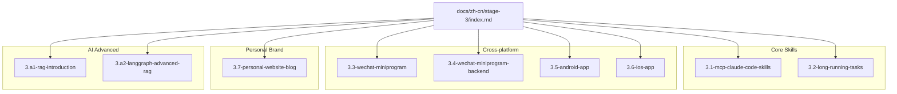
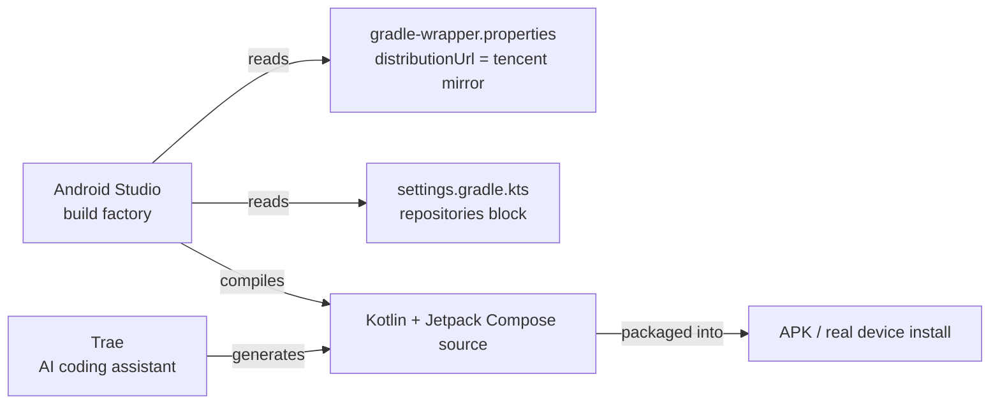
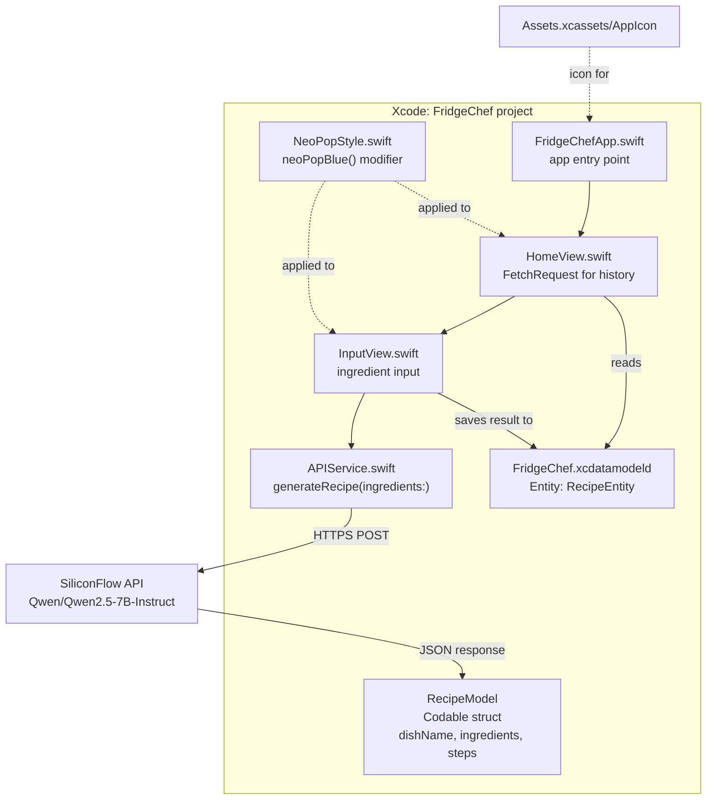
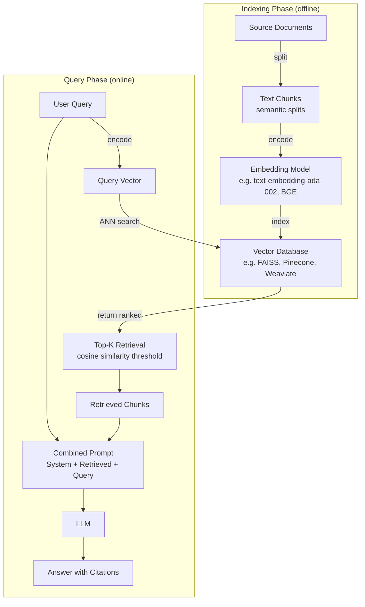
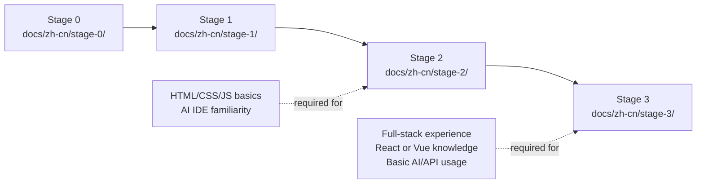

<!-- source: DeepWiki mcp.deepwiki.com · repo datawhalechina/easy-vibe · page 3.4 Stage 2 and Stage 3: Intermediate and Advanced Development · fetched 2026-10-30 -->

# Stage 2 and Stage 3: Intermediate and Advanced Development

Relevant source files

The following files were used as context for generating this wiki page:

- [docs/.vitepress/theme/components/appendix/computer-fundamentals/BootProcessDemo.vue](docs/.vitepress/theme/components/appendix/computer-fundamentals/BootProcessDemo.vue)
- [docs/zh-cn/appendix/1-computer-fundamentals/algorithm-thinking.md](docs/zh-cn/appendix/1-computer-fundamentals/algorithm-thinking.md)
- [docs/zh-cn/appendix/1-computer-fundamentals/data-encoding-storage.md](docs/zh-cn/appendix/1-computer-fundamentals/data-encoding-storage.md)
- [docs/zh-cn/appendix/1-computer-fundamentals/data-structures.md](docs/zh-cn/appendix/1-computer-fundamentals/data-structures.md)
- [docs/zh-cn/appendix/1-computer-fundamentals/power-on-to-web.md](docs/zh-cn/appendix/1-computer-fundamentals/power-on-to-web.md)
- [docs/zh-cn/appendix/1-computer-fundamentals/programming-languages.md](docs/zh-cn/appendix/1-computer-fundamentals/programming-languages.md)
- [docs/zh-cn/appendix/index.md](docs/zh-cn/appendix/index.md)
- [docs/zh-cn/stage-0/index.md](docs/zh-cn/stage-0/index.md)
- [docs/zh-cn/stage-1/appendix-articles/example0-2/vibe-coding-tools-build-website-with-ai-coding-and-design-agents.md](docs/zh-cn/stage-1/appendix-articles/example0-2/vibe-coding-tools-build-website-with-ai-coding-and-design-agents.md)
- [docs/zh-cn/stage-2/ai-capabilities/2.1-dify-knowledge-base/chapter3/index.md](docs/zh-cn/stage-2/ai-capabilities/2.1-dify-knowledge-base/chapter3/index.md)
- [docs/zh-cn/stage-2/backend/2.2-database-supabase/chapter5/index.md](docs/zh-cn/stage-2/backend/2.2-database-supabase/chapter5/index.md)
- [docs/zh-cn/stage-2/backend/2.4-git-workflow/extra1/index.md](docs/zh-cn/stage-2/backend/2.4-git-workflow/extra1/index.md)
- [docs/zh-cn/stage-2/backend/2.6-modern-cli/extra7/index.md](docs/zh-cn/stage-2/backend/2.6-modern-cli/extra7/index.md)
- [docs/zh-cn/stage-2/frontend/2.4-hogwarts-portraits/index.md](docs/zh-cn/stage-2/frontend/2.4-hogwarts-portraits/index.md)
- [docs/zh-cn/stage-2/index.md](docs/zh-cn/stage-2/index.md)
- [docs/zh-cn/stage-3/ai-advanced/3.a1-rag-introduction/index.md](docs/zh-cn/stage-3/ai-advanced/3.a1-rag-introduction/index.md)
- [docs/zh-cn/stage-3/cross-platform/3.5-android-app/index.md](docs/zh-cn/stage-3/cross-platform/3.5-android-app/index.md)
- [docs/zh-cn/stage-3/cross-platform/3.6-ios-app/index.md](docs/zh-cn/stage-3/cross-platform/3.6-ios-app/index.md)
- [docs/zh-cn/stage-3/index.md](docs/zh-cn/stage-3/index.md)
- [docs/zh-cn/stage-3/personal-brand/3.7-personal-website-blog/index.md](docs/zh-cn/stage-3/personal-brand/3.7-personal-website-blog/index.md)

## Purpose and Scope

This page documents the curriculum modules of **Stage 2 (Intermediate Development)** and **Stage 3 (Advanced Development)** in the Easy-Vibe learning path. Stage 2 covers full-stack development: frontend design tools, backend APIs, Supabase database integration, Zeabur deployment, Git workflow, Stripe payment, and Dify AI capabilities. Stage 3 covers cross-platform mobile development (WeChat Mini Programs, Android, iOS), advanced AI techniques (RAG, LangGraph), and personal website creation.

For the overall three-stage curriculum model and navigation components, see [3.1](). For Stage 0 and Stage 1 content, see [3.2]() and [3.3](). For the technical appendices referenced throughout these stages, see [4]().

---

## Stage 2: Intermediate Development

The index page at `docs/zh-cn/stage-2/index.md` defines Stage 2 through four sub-tracks and two assignments, all exposed via `NavGrid`/`NavCard` components.

**Module overview diagram:**

```mermaid
graph TD
    S2["docs/zh-cn/stage-2/index.md"]

    subgraph "Frontend Track"
        F0["2.0-lovart-assets"]
        F1["2.1-figma-mastergo"]
        F2["2.2-ui-design"]
        F3["2.3-multi-product-ui"]
        F4["2.4-hogwarts-portraits"]
    end

    subgraph "Backend Track"
        B1["2.1-what-is-api"]
        B2["2.2-database-supabase"]
        B3["2.3-ai-interface-code"]
        B4["2.4-git-workflow"]
        B5["2.5-zeabur-deployment"]
        B6["2.6-modern-cli"]
        B7["2.7-stripe-payment"]
    end

    subgraph "AI Capabilities Track"
        A1["2.1-dify-knowledge-base"]
        A2["2.2-multimodal-api"]
    end

    subgraph "Assignments"
        HW1["2.1-fullstack-app"]
        HW2["2.2-modern-frontend-trae"]
    end

    S2 --> F0 & F1 & F2 & F3 & F4
    S2 --> B1 & B2 & B3 & B4 & B5 & B6 & B7
    S2 --> A1 & A2
    S2 --> HW1 & HW2
```

Sources: [docs/zh-cn/stage-2/index.md:1-127]()

---

### Frontend Track

The five frontend modules progress from AI asset generation to production-grade UI systems.

| Module | Directory | Description |
|--------|-----------|-------------|
| Frontend 0 | `stage-2/frontend/2.0-lovart-assets/` | Generating game assets and UI resources with Lovart |
| Frontend 1 | `stage-2/frontend/2.1-figma-mastergo/` | Figma and MasterGo basics; design-to-code handoff |
| Frontend 2 | `stage-2/frontend/2.2-ui-design/` | Building a modern web app UI from scratch |
| Frontend 3 | `stage-2/frontend/2.3-multi-product-ui/` | Design systems and multi-product UI consistency |
| Frontend 4 | `stage-2/frontend/2.4-hogwarts-portraits/` | Hands-on project combining AI-generated images with interactive UI |

Sources: [docs/zh-cn/stage-2/index.md:7-37]()

---

### Backend & Fullstack Track

Seven sequential backend modules build from API concepts to production deployment.

| Module | Directory | Key Skill |
|--------|-----------|-----------|
| Backend 1 | `2.1-what-is-api/extra2/` | API as the bridge between frontend and backend |
| Backend 2 | `2.2-database-supabase/chapter5/` | Relational DB design; Supabase BaaS integration |
| Backend 3 | `2.3-ai-interface-code/` | LLM-assisted generation of interface code and API docs |
| Backend 4 | `2.4-git-workflow/extra1/` | Git branching, merging, team collaboration |
| Backend 5 | `2.5-zeabur-deployment/extra6/` | Full-stack cloud deployment via Zeabur |
| Backend 6 | `2.6-modern-cli/extra7/` | CLI-based AI coding agents |
| Backend 7 | `2.7-stripe-payment/` | Stripe payment integration and monetization |

#### Supabase Integration (`2.2-database-supabase/chapter5/`)

The Supabase module at `docs/zh-cn/stage-2/backend/2.2-database-supabase/chapter5/index.md` covers relational database fundamentals and Supabase as a Backend-as-a-Service platform. Topics include schema design, SQL queries, and use of Supabase client libraries to replace a hand-rolled backend.

#### Modern CLI AI Tools (`2.6-modern-cli/extra7/`)

Content at `docs/zh-cn/stage-2/backend/2.6-modern-cli/extra7/index.md` introduces CLI-based AI coding agents as an alternative to IDE-embedded agents (Trae, Cursor). Differences are:

| Dimension | IDE Agent (Trae, Cursor) | CLI Agent |
|-----------|--------------------------|-----------|
| Interface | GUI editor | Terminal |
| Context window | Smaller | Typically larger |
| Tool invocation | IDE-mediated | Direct |
| Model compatibility | Platform-specific | Broader |

The recommendation in the content is to prefer CLI AI tools for production-grade Vibe Coding workflows.

Sources: [docs/zh-cn/stage-2/backend/2.6-modern-cli/extra7/index.md:1-10](), [docs/zh-cn/stage-2/index.md:39-79]()

---

### AI Capabilities Track

| Module | Directory | Description |
|--------|-----------|-------------|
| AI 1 | `2.1-dify-knowledge-base/chapter3/` | Building AI applications in Dify with private knowledge base integration |
| AI 2 | `2.2-multimodal-api/extra3/` | AI capability taxonomy lookup; vision and speech multimodal API integration |

Sources: [docs/zh-cn/stage-2/index.md:98-111]()

---

### Assignments

| Assignment | Directory | Scope |
|-----------|-----------|-------|
| Assignment 1 | `2.1-fullstack-app/` | End-to-end fullstack application combining all backend track skills |
| Assignment 2 | `2.2-modern-frontend-trae/` | Complex frontend using a modern component library with Trae |

---

## Stage 3: Advanced Development

The index page at `docs/zh-cn/stage-3/index.md` defines four sub-tracks.

**Module overview diagram:**

Sources: [docs/zh-cn/stage-3/index.md:1-93]()

---

### Core Skills

**MCP and Claude Code (`3.1-mcp-claude-code-skills/`)** — Model Context Protocol (MCP) configuration and advanced prompting patterns to extend AI coding tool capabilities beyond their defaults.

**Long-running Tasks (`3.2-long-running-tasks/`)** — Strategies for keeping AI coding sessions productive on complex, multi-hour tasks without context loss.

---

### Cross-platform Development

#### WeChat Mini Programs

Two modules cover WeChat Mini Program development at increasing complexity:

- **`3.3-wechat-miniprogram/`** — Frontend-only Mini Program: the core WXML/WXSS/JS development cycle using the WeChat DevTools.
- **`3.4-wechat-miniprogram-backend/`** — Full Mini Program with backend: integrates a server-side API (or cloud functions) with the Mini Program frontend.

#### Android App Development (`3.5-android-app/`)

Content at `docs/zh-cn/stage-3/cross-platform/3.5-android-app/index.md` builds an "Electronic Wooden Fish" (电子木鱼) app using native Kotlin + Jetpack Compose, with Trae as the AI coding assistant.

**Toolchain roles:**

| Tool | Role in Workflow |
|------|-----------------|
| Trae | Primary AI coding environment; generates and modifies Kotlin/Compose code via natural language |
| Android Studio | SDK management, Gradle builds, emulator, device deployment |
| Physical Android device | Real-device testing for haptic feedback and hardware integration (optional) |

**Development flow:**

**Configuration for domestic network access:**
- `gradle/wrapper/gradle-wrapper.properties`: `distributionUrl` is replaced with `https://mirrors.cloud.tencent.com/gradle/gradle-8.7-bin.zip` ([docs/zh-cn/stage-3/cross-platform/3.5-android-app/index.md:130-136]())
- `settings.gradle.kts`: `repositories` block is replaced with Alibaba Cloud mirrors (`maven.aliyun.com`) for `public`, `google`, `jcenter`, and `gradle-plugin` repositories ([docs/zh-cn/stage-3/cross-platform/3.5-android-app/index.md:142-154]())

**Project template settings:**

| Field | Value |
|-------|-------|
| Template | Empty Activity (Jetpack Compose) |
| Language | Kotlin |
| Minimum SDK | API 30 |
| Build system | Gradle (Kotlin DSL) |

Sources: [docs/zh-cn/stage-3/cross-platform/3.5-android-app/index.md:1-55](), [docs/zh-cn/stage-3/cross-platform/3.5-android-app/index.md:57-154]()

---

#### iOS App Development (`3.6-ios-app/`)

Content at `docs/zh-cn/stage-3/cross-platform/3.6-ios-app/index.md` builds "FridgeChef" (冰箱大厨), an AI recipe-generation app, using SwiftUI + Xcode with Trae as the AI coding assistant.

**Prerequisites:** macOS, Xcode, iPhone (developer mode enabled), Trae, personal Apple ID.

**Toolchain:**

| Tool | Role |
|------|------|
| Xcode | Project creation, Swift compilation, simulator, device signing via Apple ID |
| Trae | AI coding assistant — generates and modifies SwiftUI code via conversation |
| SiliconFlow API | OpenAI-compatible LLM inference (`https://api.siliconflow.cn/v1`) |
| Lovart | AI image generation for app icon creation |

**Seven development phases:**

| Phase | Key Activity | Primary Output |
|-------|-------------|----------------|
| 1. Requirements | AI generates requirements doc | `REQUIREMENTS.md` |
| 2. Visual Prototype | AI generates HTML+Tailwind prototype | `index.html` (browser-viewable) |
| 3. Native Replication | AI converts HTML prototype to SwiftUI | `HomeView.swift`, `InputView.swift`, `NeoPopStyle` modifier |
| 4. AI API Integration | AI generates API service layer | `APIService.swift` with `generateRecipe(ingredients:)` |
| 5. Core Data | Manual Entity config + AI business logic | `RecipeEntity` with `id`, `name`, `difficulty`, `timestamp`, `colorIndex`, `cookTime`, `desc` |
| 6. App Icon | Lovart-generated 1024×1024 PNG | `Assets.xcassets/AppIcon` |
| 7. UX Polish | Revised HTML design → new SwiftUI port | `design_v2.html`, `neoPopBlue()` modifier in `NeoPopStyle.swift` |

**FridgeChef code architecture:**

**SiliconFlow API configuration (in `APIService.swift`):**
- `base_url`: `https://api.siliconflow.cn/v1`
- `model`: `Qwen/Qwen2.5-7B-Instruct`
- System prompt forces the model to return pure JSON with fields `dishName`, `ingredients`, `steps`

**Real-device deployment path:**

1. Enable Developer Mode on iPhone: Settings → Privacy & Security → Developer Mode
2. Connect via USB; trust the Mac when prompted
3. In Xcode project settings, assign a unique `Bundle Identifier` (e.g., `com.yourname.FridgeChef`)
4. Select the iPhone as the run target; Xcode registers the device automatically
5. After installation, trust the developer certificate: Settings → General → VPN & Device Management → trust Apple ID

**App Store publishing** requires Apple Developer Program ($99/year), App Store Connect entry, and passing Apple review (covers functionality, privacy compliance, metadata accuracy, and IP).

Sources: [docs/zh-cn/stage-3/cross-platform/3.6-ios-app/index.md:1-726]()

---

### Personal Brand

**Personal Website and Blog (`3.7-personal-website-blog/`)** — Building a personal portfolio site and technical blog using a modern, high-performance tech stack.

---

### AI Advanced Modules

#### RAG Introduction (`3.a1-rag-introduction/`)

Content at `docs/zh-cn/stage-3/ai-advanced/3.a1-rag-introduction/index.md` covers Retrieval-Augmented Generation from first principles through enterprise system design.

**Why RAG is needed — three failure modes of pure LLM reliance:**

| Problem | Root Cause | Impact |
|---------|-----------|--------|
| Cost & efficiency | Inference cost scales (near-)linearly with context token count | Long-context calls are orders of magnitude more expensive |
| Attention degradation | Models lose focus on early-context tokens; irrelevant content drowns key evidence | Accuracy degrades even if answer is present in context |
| Knowledge staleness | Retraining required for updates; no citation trail | Poor auditability; high maintenance cost |

**Core RAG pipeline:**

**Three generations of RAG:**

| Generation | Name | Distinguishing Characteristics |
|-----------|------|-------------------------------|
| 1st | Naive RAG | Fixed-length chunking; single-signal vector retrieval; raw concatenation into prompt |
| 2nd | Advanced RAG | Semantic chunking; metadata-enriched index; query rewrite/expansion; Rerank model; deduplication and compression |
| 3rd | Modular RAG | Pluggable pipeline; query routing; multi-source retrieval fusion; session memory; task-specific output governance |

**Advanced RAG — pre-retrieval query transformation techniques:**

| Technique | Mechanism |
|-----------|-----------|
| Query Rewrite | Standardize vague or colloquial input into retrieval-friendly form |
| Multi-Query | Generate multiple queries covering different semantic angles |
| Sub-Query | Decompose composite questions into independent atomic queries |
| Step-back Prompting | First generate a broader abstract question, then derive specific retrieval targets |

**Modular RAG — four core module types:**

| Module | Responsibility |
|--------|---------------|
| Query Understanding & Routing | Intent detection, query rewrite, sub-task decomposition, path selection (internal KB vs. web vs. structured DB) |
| Multi-source Retrieval & Fusion | Connects vector DB + full-text search + relational DB + knowledge graph; unified result merging and ranking |
| Memory & Personalization | Persistent user profiles, short-term session context, domain-knowledge caching |
| Task Adaptation & Governance | Format/style constraints per task type; fact verification; risk filtering; mandatory citation alignment |

Sources: [docs/zh-cn/stage-3/ai-advanced/3.a1-rag-introduction/index.md:1-400]()

#### LangGraph Advanced RAG (`3.a2-langgraph-advanced-rag/`)

Covers AI workflow orchestration using LangGraph, including stateful agent graphs, conditional branching (e.g., iterative retrieval loops that re-query when evidence is insufficient), and multi-step reasoning pipelines built on top of Advanced and Modular RAG patterns.

---

## Stage Prerequisites and Progression

| Stage | Target Learner |
|-------|---------------|
| Stage 2 | Has Stage 1 background or equivalent; knows basic HTML/CSS/JS; has used an AI IDE |
| Stage 3 | Has Stage 2 background or equivalent full-stack experience; familiar with a frontend framework and backend development |

Sources: [docs/zh-cn/stage-2/index.md:113-127](), [docs/zh-cn/stage-3/index.md:81-93]()

---

