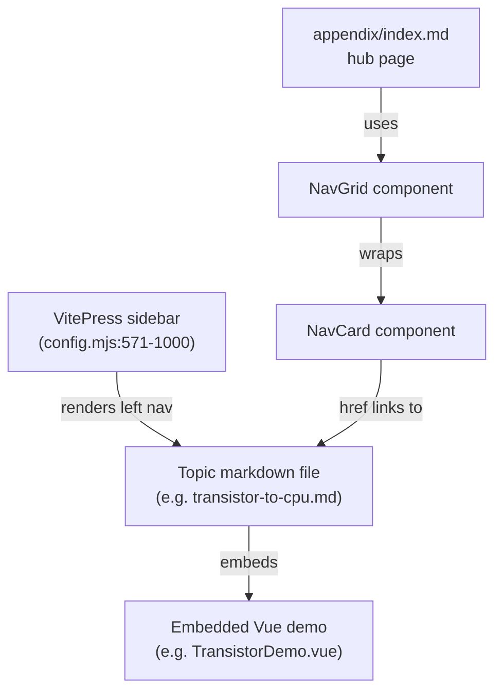
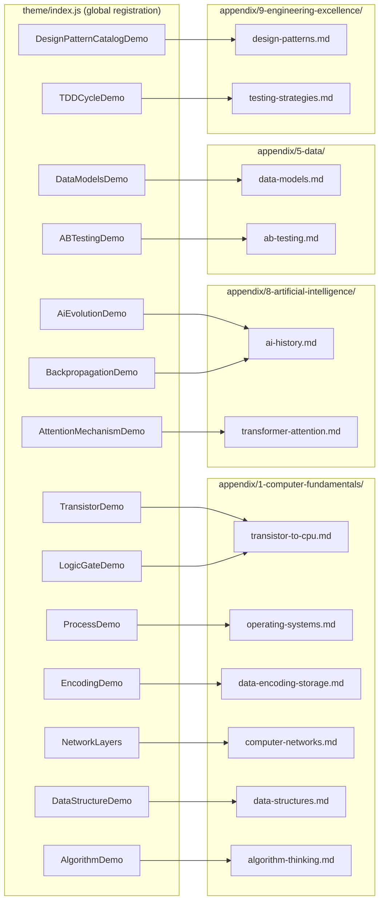
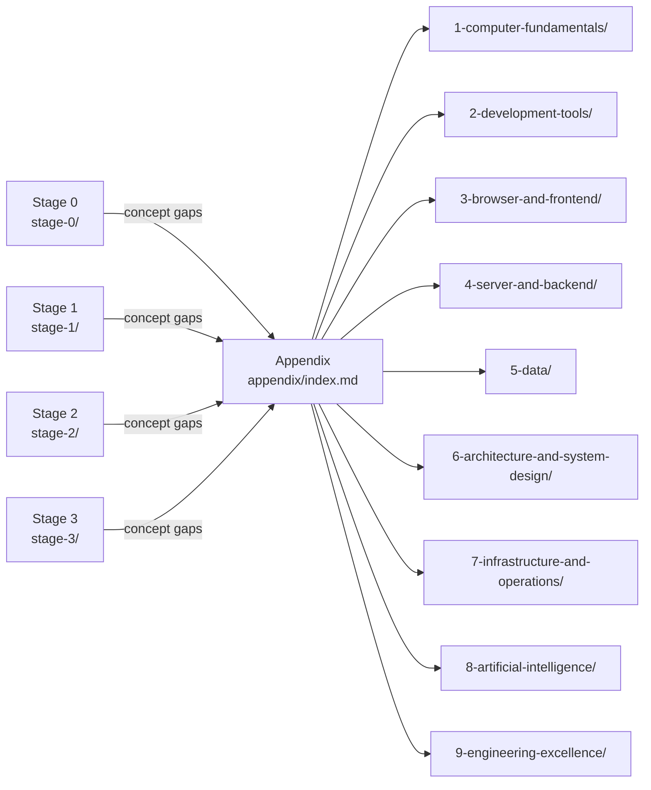

<!-- source: DeepWiki mcp.deepwiki.com · repo datawhalechina/easy-vibe · page 4 Appendix Reference Material · fetched 2026-10-30 -->

# Appendix Reference Material

<details>
<summary>Relevant source files</summary>

The following files were used as context for generating this wiki page:

- [README.md](README.md)
- [assets/readme-image1.png](assets/readme-image1.png)
- [docs/.vitepress/config.mjs](docs/.vitepress/config.mjs)
- [docs/.vitepress/theme/Layout.vue](docs/.vitepress/theme/Layout.vue)
- [docs/.vitepress/theme/components/ChapterIntroduction.vue](docs/.vitepress/theme/components/ChapterIntroduction.vue)
- [docs/.vitepress/theme/components/GitHubStars.vue](docs/.vitepress/theme/components/GitHubStars.vue)
- [docs/.vitepress/theme/components/HomeFeatures.vue](docs/.vitepress/theme/components/HomeFeatures.vue)
- [docs/.vitepress/theme/components/appendix/computer-fundamentals/BootProcessDemo.vue](docs/.vitepress/theme/components/appendix/computer-fundamentals/BootProcessDemo.vue)
- [docs/.vitepress/theme/index.js](docs/.vitepress/theme/index.js)
- [docs/.vitepress/theme/style.css](docs/.vitepress/theme/style.css)
- [docs/public/robots.txt](docs/public/robots.txt)
- [docs/zh-cn/appendix/1-computer-fundamentals/algorithm-thinking.md](docs/zh-cn/appendix/1-computer-fundamentals/algorithm-thinking.md)
- [docs/zh-cn/appendix/1-computer-fundamentals/data-encoding-storage.md](docs/zh-cn/appendix/1-computer-fundamentals/data-encoding-storage.md)
- [docs/zh-cn/appendix/1-computer-fundamentals/data-structures.md](docs/zh-cn/appendix/1-computer-fundamentals/data-structures.md)
- [docs/zh-cn/appendix/1-computer-fundamentals/power-on-to-web.md](docs/zh-cn/appendix/1-computer-fundamentals/power-on-to-web.md)
- [docs/zh-cn/appendix/1-computer-fundamentals/programming-languages.md](docs/zh-cn/appendix/1-computer-fundamentals/programming-languages.md)
- [docs/zh-cn/appendix/index.md](docs/zh-cn/appendix/index.md)
- [docs/zh-cn/stage-0/0.1-learning-map/index.md](docs/zh-cn/stage-0/0.1-learning-map/index.md)
- [docs/zh-cn/stage-0/index.md](docs/zh-cn/stage-0/index.md)
- [docs/zh-cn/stage-2/index.md](docs/zh-cn/stage-2/index.md)
- [docs/zh-cn/stage-3/index.md](docs/zh-cn/stage-3/index.md)

</details>


The **Appendix** is a standalone knowledge base embedded within the Easy-Vibe site that provides deep-dive reference material on topics that supplement — but are independent of — the stage-based curriculum (Stages 0–3). It covers 9 knowledge domains with 80+ interactive topics, each combining explanatory prose with embedded Vue demo components.

This page describes the appendix as a system: its file layout, navigation model, category structure, and how it integrates with the VitePress site. For the interactive Vue components that power its demos, see [Interactive Vue Demo Components](#5). For the stage-based curriculum the appendix supplements, see [Learning Curriculum](#3).

---

## Role in the Curriculum

The appendix is described in [`README.md:117`]() as:

> 帮你理解计算机、人工智能基础概念 — 9 大知识领域、80+ 交互式专题

Unlike stage chapters, appendix content has no prerequisites and no fixed order. Readers are expected to dip in when they encounter unfamiliar concepts during stage work or when they want to deepen understanding of a topic already introduced.

The `zh-cn` top navigation bar in [`docs/.vitepress/config.mjs:347`]() includes a direct **附录** link pointing to `/zh-cn/appendix/index`, making it accessible from every page in the documentation.

---

## File Layout

All appendix markdown content lives under `docs/zh-cn/appendix/`, divided into nine numbered subdirectories.

```
docs/zh-cn/appendix/
├── index.md                              ← Category hub page
├── 1-computer-fundamentals/
│   ├── transistor-to-cpu.md
│   ├── operating-systems.md
│   ├── data-encoding-storage.md
│   ├── computer-networks.md
│   ├── data-structures.md
│   ├── algorithm-thinking.md
│   ├── programming-languages.md
│   ├── compilers.md
│   ├── type-systems.md
│   ├── vibe-coding-fullstack.md
│   ├── power-on-to-web.md
│   └── computer-organization.md
├── 2-development-tools/
├── 3-browser-and-frontend/
├── 4-server-and-backend/
├── 5-data/
├── 6-architecture-and-system-design/
├── 7-infrastructure-and-operations/
├── 8-artificial-intelligence/
└── 9-engineering-excellence/
```

Sources: [`docs/zh-cn/appendix/index.md`](), [`docs/.vitepress/config.mjs:571-1000`]()

---

## Navigation Model

The appendix uses a two-level navigation model:

1. **Left sidebar** — defined in the `'/zh-cn/appendix/'` key of the VitePress `sidebar` config, enumerating all nine categories as collapsed groups, each listing individual topic links.
2. **Hub page** (`index.md`) — renders a visual card grid for each category using `NavGrid` + `NavCard` components.

**Appendix Navigation Architecture**



Sources: [`docs/zh-cn/appendix/index.md:10-61`](), [`docs/.vitepress/config.mjs:571-980`](), [`docs/.vitepress/theme/index.js:12-14`]()

Each `NavCard` receives three props:

| Prop | Type | Example |
|---|---|---|
| `href` | String | `/zh-cn/appendix/1-computer-fundamentals/transistor-to-cpu` |
| `title` | String | `从晶体管到 CPU` |
| `description` | String | Brief one-line summary |

---

## The Nine Categories

The sidebar config in [`docs/.vitepress/config.mjs:571-980`]() defines the complete topic list. The table below maps each category directory to its domain and selected topic pages.

| # | Directory | Domain | Selected Topics |
|---|---|---|---|
| 1 | `1-computer-fundamentals/` | Computer Fundamentals | transistor-to-cpu, operating-systems, data-structures, algorithm-thinking, programming-languages, compilers, type-systems |
| 2 | `2-development-tools/` | Dev Tools | git-version-control, command-line-shell, debugging-art, package-managers, ssh-authentication, regex |
| 3 | `3-browser-and-frontend/` | Browser & Frontend | javascript-deep-dive, frontend-frameworks, browser-as-os-rendering, html-css-layout, state-management, web-performance |
| 4 | `4-server-and-backend/` | Server & Backend | http-protocol, api-design, auth-authorization, concurrency-async, message-queues, backend-layered-architecture |
| 5 | `5-data/` | Data | database-fundamentals, data-models, ab-testing, data-analysis, data-tracking, data-visualization |
| 6 | `6-architecture-and-system-design/` | Architecture | monolith-to-microservices, distributed-systems, high-availability, system-design-methodology |
| 7 | `7-infrastructure-and-operations/` | Infra & Ops | docker-containers, kubernetes, ci-cd, dns-https, monitoring-logging, infrastructure-as-code |
| 8 | `8-artificial-intelligence/` | AI | ai-history, llm-principles, transformer-attention, rag, ai-agents, prompt-engineering, image-generation |
| 9 | `9-engineering-excellence/` | Engineering Excellence | code-quality-refactoring, testing-strategies, design-patterns, security-thinking, technical-writing, open-source-collaboration |

Sources: [`docs/.vitepress/config.mjs:571-980`](), [`docs/zh-cn/appendix/index.md`](), [`README.md:146-232`]()

---

## Interactive Component Integration

Each topic page embeds one or more Vue demo components directly in the markdown. These components are globally registered in [`docs/.vitepress/theme/index.js`]() and require no import statement in the markdown itself.

**Component Registration to Appendix Page Mapping**



Sources: [`docs/.vitepress/theme/index.js:112-700`]()

The components are concentrated under several subdirectories within `docs/.vitepress/theme/components/appendix/`:

| Subdirectory | Component Group | Count (approx.) |
|---|---|---|
| `computer-fundamentals/` | CPU, OS, networks, encoding, algorithms | 60+ |
| `ai-history/` | AI evolution, neural nets, attention | 10 |
| `transformer-attention/` | Self-attention, QKV, multi-head | 8 |
| `llm-intro/` | Tokenization, next-token prediction, MoE | 10 |
| `image-gen-intro/` | Diffusion, latent space, flow matching | 6 |
| `terminal-intro/` | Shell, escape sequences, buffer switching | 12 |
| `api-intro/` | REST concepts, request/response flow | 10 |
| `web-basics/` | CSS box model, Flexbox, DOM, DNS | 20+ |
| `engineering-excellence/` (implied) | Design patterns, TDD, refactoring | 10 |

---

## Relationship to the Stage Curriculum

The appendix is cross-linked from stage content. For example:
- Stage 2 backend sections point to `api-intro` and `auth-authorization` for foundational context.
- Stage 3 AI sections point to `rag` and `transformer-attention`.
- The README [`README.md:140-144`]() links directly to the appendix hub and the AI capability dictionary.

**Appendix Position in Curriculum Flow**



Sources: [`README.md:110-117`](), [`docs/.vitepress/config.mjs:334-347`]()

---

## Hub Page Structure (`index.md`)

The file [`docs/zh-cn/appendix/index.md`]() is a single long markdown file that acts as the visual index for all nine categories. Its structure follows this pattern for each category:

```markdown
### 一、<Category Title>

<brief description>
<NavGrid>
  <NavCard href="..." title="..." description="..." />
  <NavCard href="..." title="..." description="..." />
  ...
</NavGrid>
```

The `NavGrid` component arranges `NavCard` elements in a responsive CSS grid. Both are globally registered via [`docs/.vitepress/theme/index.js:12-14`]().

The full hub page is referenced from:
- The top nav bar item `{ text: '附录', link: '/zh-cn/appendix/index' }` — [`docs/.vitepress/config.mjs:347`]()
- The `HomeFeatures.vue` appendix section — [`docs/.vitepress/theme/components/HomeFeatures.vue:150-215`]()

---

## Sub-pages Within Each Category

Individual topic pages follow a consistent structure:

1. **`::: tip` frontmatter block** — motivation and "what you'll learn" summary.
2. **Prose sections** with conceptual explanations.
3. **Inline Vue demo components** — invoked as XML-style tags (e.g., `<TransistorDemo />`).
4. **Code snippets** — illustrating key concepts.
5. **Summary tables** — comparing options or listing properties.

For example, [`docs/zh-cn/appendix/1-computer-fundamentals/data-structures.md:1-15`]() opens with a `::: tip` block describing the motivation, then proceeds through sections, each ending with an interactive `DataStructureDemo` component call.

Similarly, [`docs/zh-cn/appendix/1-computer-fundamentals/power-on-to-web.md`]() embeds six separate demo components (`PowerOnDemo`, `BiosUefiInteractiveDemo`, `OSBootInteractiveDemo`, `BrowserArchitectureDemo`, `URLRequestDemo`, `RenderingDemo`) to animate each stage of the boot-to-browser journey.

---

## Child Pages

Detailed documentation for each category's content and components is covered in the following sub-pages:

- [Computer Fundamentals Appendix](#4.1)
- [Web Development and Frontend Appendix](#4.2)
- [Backend, APIs, and Data Appendix](#4.3)
- [Artificial Intelligence Appendix](#4.4)
- [Engineering Excellence Appendix](#4.5)

The corresponding Vue demo components for these appendix pages are documented in [Interactive Vue Demo Components](#5), specifically:
- [Computer Science Demo Components](#5.2)
- [Web, Terminal, and API Demo Components](#5.3)
- [AI, Data, and JavaScript Demo Components](#5.4)
- [Engineering Excellence Demo Components](#5.5)

---

