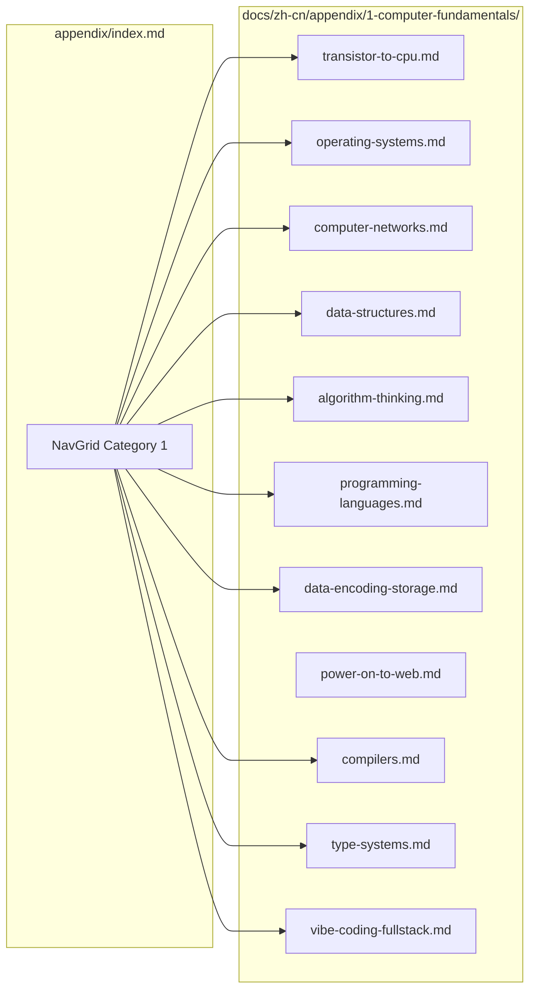
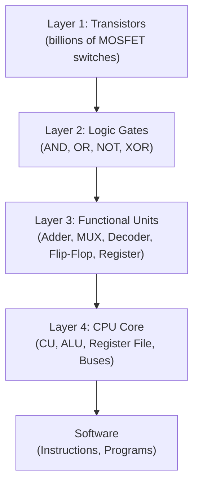
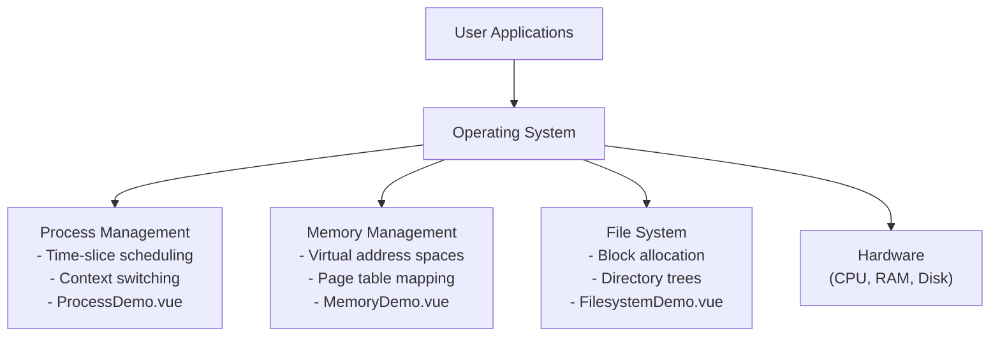
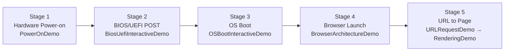
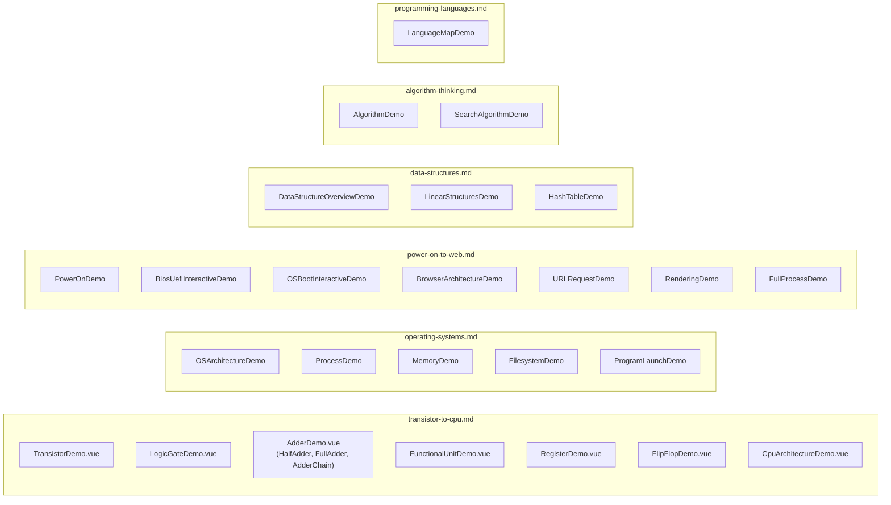

<!-- source: DeepWiki mcp.deepwiki.com · repo datawhalechina/easy-vibe · page 4.1 Computer Fundamentals Appendix · fetched 2026-10-30 -->

# Computer Fundamentals Appendix

<details>
<summary>Relevant source files</summary>

The following files were used as context for generating this wiki page:

- [docs/.vitepress/theme/components/appendix/api-design/DataFieldDesignDemo.vue](docs/.vitepress/theme/components/appendix/api-design/DataFieldDesignDemo.vue)
- [docs/.vitepress/theme/components/appendix/api-design/ErrorResponseDesignDemo.vue](docs/.vitepress/theme/components/appendix/api-design/ErrorResponseDesignDemo.vue)
- [docs/.vitepress/theme/components/appendix/api-design/ResponseStructureDemo.vue](docs/.vitepress/theme/components/appendix/api-design/ResponseStructureDemo.vue)
- [docs/.vitepress/theme/components/appendix/api-design/RestfulApiFlow.vue](docs/.vitepress/theme/components/appendix/api-design/RestfulApiFlow.vue)
- [docs/.vitepress/theme/components/appendix/computer-fundamentals/AdderDemo.vue](docs/.vitepress/theme/components/appendix/computer-fundamentals/AdderDemo.vue)
- [docs/.vitepress/theme/components/appendix/computer-fundamentals/BootProcessDemo.vue](docs/.vitepress/theme/components/appendix/computer-fundamentals/BootProcessDemo.vue)
- [docs/.vitepress/theme/components/appendix/computer-fundamentals/CpuArchitectureDemo.vue](docs/.vitepress/theme/components/appendix/computer-fundamentals/CpuArchitectureDemo.vue)
- [docs/.vitepress/theme/components/appendix/computer-fundamentals/FunctionalUnitDemo.vue](docs/.vitepress/theme/components/appendix/computer-fundamentals/FunctionalUnitDemo.vue)
- [docs/.vitepress/theme/components/appendix/computer-fundamentals/LogicGateDemo.vue](docs/.vitepress/theme/components/appendix/computer-fundamentals/LogicGateDemo.vue)
- [docs/.vitepress/theme/components/appendix/computer-fundamentals/RegisterDemo.vue](docs/.vitepress/theme/components/appendix/computer-fundamentals/RegisterDemo.vue)
- [docs/.vitepress/theme/components/appendix/computer-fundamentals/TransistorDemo.vue](docs/.vitepress/theme/components/appendix/computer-fundamentals/TransistorDemo.vue)
- [docs/zh-cn/appendix/1-computer-fundamentals/algorithm-thinking.md](docs/zh-cn/appendix/1-computer-fundamentals/algorithm-thinking.md)
- [docs/zh-cn/appendix/1-computer-fundamentals/data-encoding-storage.md](docs/zh-cn/appendix/1-computer-fundamentals/data-encoding-storage.md)
- [docs/zh-cn/appendix/1-computer-fundamentals/data-structures.md](docs/zh-cn/appendix/1-computer-fundamentals/data-structures.md)
- [docs/zh-cn/appendix/1-computer-fundamentals/operating-systems.md](docs/zh-cn/appendix/1-computer-fundamentals/operating-systems.md)
- [docs/zh-cn/appendix/1-computer-fundamentals/power-on-to-web.md](docs/zh-cn/appendix/1-computer-fundamentals/power-on-to-web.md)
- [docs/zh-cn/appendix/1-computer-fundamentals/programming-languages.md](docs/zh-cn/appendix/1-computer-fundamentals/programming-languages.md)
- [docs/zh-cn/appendix/1-computer-fundamentals/transistor-to-cpu.md](docs/zh-cn/appendix/1-computer-fundamentals/transistor-to-cpu.md)
- [docs/zh-cn/appendix/index.md](docs/zh-cn/appendix/index.md)
- [docs/zh-cn/stage-0/index.md](docs/zh-cn/stage-0/index.md)
- [docs/zh-cn/stage-2/index.md](docs/zh-cn/stage-2/index.md)
- [docs/zh-cn/stage-3/index.md](docs/zh-cn/stage-3/index.md)

</details>


This page documents the **Computer Fundamentals** subsection of the Easy-Vibe technical appendix — specifically, the ten articles under Category 1 ("一、计算机是怎么回事") that cover how computers work from the hardware level up through networks, data, and algorithms. Each article is a standalone reference document embedded with interactive Vue demos. For the interactive Vue components that power those demos, see [5.2](#5.2). For the broader nine-category appendix index and its navigation structure, see [4](#4).

---

## Content Structure

The computer fundamentals category is defined in [docs/zh-cn/appendix/index.md:7-61]() via `NavGrid`/`NavCard` components. It contains ten articles organized under the path `docs/zh-cn/appendix/1-computer-fundamentals/`.

**Ten articles and their scope:**

| Article file | Title | Primary Topics |
|---|---|---|
| `vibe-coding-fullstack.md` | Vibe Coding 时代下的全栈开发 | Frontend/backend roles, AI-era career paths |
| `transistor-to-cpu.md` | 从晶体管到 CPU | Transistors, logic gates, adders, registers, CPU pipeline |
| `operating-systems.md` | 操作系统 | Process scheduling, virtual memory, file systems |
| `data-encoding-storage.md` | 数据的编码、存储与传输 | Binary, character encoding, compression, transmission |
| `computer-networks.md` | 网络：两台电脑如何对话 | Network layers, TCP/UDP, routing, protocols |
| `data-structures.md` | 数据结构 | Arrays, linked lists, hash tables, trees, graphs |
| `algorithm-thinking.md` | 算法思维入门 | Binary search, sorting, Big-O complexity |
| `programming-languages.md` | 编程语言图谱 | Language evolution, paradigms, type systems |
| `compilers.md` | 编译原理入门 | Lexing, parsing, AST |
| `type-systems.md` | 类型系统入门 | Static vs dynamic, type inference |

There is also a companion article `power-on-to-web.md` which stitches hardware startup, OS boot, browser launch, and the full HTTP request cycle into a single end-to-end walkthrough — bridging several of the above topics.

**Article-to-file mapping diagram:**



Sources: [docs/zh-cn/appendix/index.md:7-61]()

---

## Transistor-to-CPU: Layered Abstraction Model

`transistor-to-cpu.md` is the most technically detailed article. It presents a four-layer abstraction model that builds from physical switches up to a full CPU instruction cycle.

**Abstraction layers:**



Sources: [docs/zh-cn/appendix/1-computer-fundamentals/transistor-to-cpu.md:35-47]()

### Layer 1 — Transistors

The article describes MOSFET transistors as voltage-controlled switches. Gate voltage high → source-drain channel conducts (logic `1`); gate voltage low → channel off (logic `0`). This is the physical implementation of the digital abstraction.

Moore's Law timeline from the article:

| Year | Processor | Transistors | Process Node |
|---|---|---|---|
| 1971 | Intel 4004 | 2,300 | 10 µm |
| 1993 | Intel Pentium | 3.1 million | 800 nm |
| 2006 | Intel Core 2 Duo | 291 million | 65 nm |
| 2020 | Apple M1 | 16 billion | 5 nm |
| 2023 | Apple M3 Max | 92 billion | 3 nm |

Sources: [docs/zh-cn/appendix/1-computer-fundamentals/transistor-to-cpu.md:84-94]()

### Layer 2 — Logic Gates

Four fundamental gates are introduced with truth tables:

| Gate | Symbol | Rule |
|---|---|---|
| AND | `A ∧ B` | Output `1` only when both inputs are `1` |
| OR | `A ∨ B` | Output `1` when at least one input is `1` |
| NOT | `¬A` | Inverts the input |
| XOR | `A ⊕ B` | Output `1` when inputs differ |

From AND+XOR combinations, the article builds adder circuits: a **Half Adder** (two inputs, no carry-in) and a **Full Adder** (three inputs including carry-in). Multiple Full Adders chained together form a **Ripple Carry Adder** for multi-bit arithmetic.

Sources: [docs/zh-cn/appendix/1-computer-fundamentals/transistor-to-cpu.md:97-163]()

### Layer 3 — Functional Units

| Unit | Purpose | Analogy |
|---|---|---|
| Adder | Arithmetic operations | Abacus |
| MUX (Multiplexer) | Routes data between units | Railway switch |
| Decoder | Translates binary opcodes to control signals | Telegram translator |
| Flip-Flop | Stores a single bit of state (bistable loop) | A latch |
| Register | 32 or 64 flip-flops clocked together; CPU's fast scratchpad | Working notepad |

The `RegisterDemo.vue` component ([docs/.vitepress/theme/components/appendix/computer-fundamentals/RegisterDemo.vue:1-133]()) renders an interactive CPU register bank showing special registers (`PC`, `IR`, `MAR`, `MDR`, `ACC`), general-purpose registers (`RAX`–`RSP`), and status flags (`CF`, `ZF`, `SF`, `OF`, etc.) with a register-vs-RAM comparison table.

Sources: [docs/zh-cn/appendix/1-computer-fundamentals/transistor-to-cpu.md:166-203](), [docs/.vitepress/theme/components/appendix/computer-fundamentals/RegisterDemo.vue:101-127]()

### Layer 4 — CPU Core: Fetch-Decode-Execute-Writeback

The CPU instruction cycle is the top-level abstraction:

```mermaid
sequenceDiagram
  participant "PC" as "PC Register"
  participant "CU" as "Control Unit"
  participant "MEM" as "Main Memory"
  participant "IR" as "IR Register"
  participant "ALU" as "ALU"
  participant "RF" as "Register File"

  "PC"->>+"CU": "Address of next instruction"
  "CU"->>+"MEM": "MAR ← PC; READ"
  "MEM"-->-"CU": "MDR ← MEM[MAR]"
  "CU"->>+"IR": "IR ← MDR; PC++"
  Note over "IR": "Fetch complete"
  "IR"->>+"CU": "Decode opcode & operands"
  "CU"->>+"ALU": "Execute: e.g. ADD R0, R1"
  "ALU"-->-"CU": "Result → ACC"
  "CU"->>+"RF": "Write-back: R0 ← ACC"
```

Sources: [docs/zh-cn/appendix/1-computer-fundamentals/transistor-to-cpu.md:209-239](), [docs/.vitepress/theme/components/appendix/computer-fundamentals/CpuArchitectureDemo.vue:196-382]()

The `CpuArchitectureDemo.vue` component simulates a four-instruction program (`LOAD`, `LOADI`, `ADD`, `STORE`) with per-clock-step visualization of which registers, buses, and units are active. It models three bus types — address bus, data bus, control bus — and tracks `PC`, `IR`, `MAR`, `MDR`, `ACC`, and general registers `R0`–`R3`.

---

## Operating Systems

`operating-systems.md` covers three core OS responsibilities via the "factory manager" metaphor.

**Three-module architecture:**



Sources: [docs/zh-cn/appendix/1-computer-fundamentals/operating-systems.md:28-97]()

### Process Management

- Each running program is a **process** with its own code and memory region.
- The OS divides CPU time into slices (~10 ms) and rotates them among processes — giving the appearance of parallelism on a single core.
- Interactive component: `ProcessDemo` (referenced in [docs/zh-cn/appendix/1-computer-fundamentals/operating-systems.md:48]()).

### Memory Management

- The OS presents each process a **contiguous virtual address space** ("you have all the memory") while secretly scattering data across physical RAM via a **page table**.
- Benefits: isolation (no cross-process memory corruption) and fragmentation tolerance.
- Interactive component: `MemoryDemo` (referenced in [docs/zh-cn/appendix/1-computer-fundamentals/operating-systems.md:62]()).

### File System

- Raw disk hardware is block-addressed. The file system:
  1. Divides disk into fixed-size blocks (typically 4 KB).
  2. Maintains an allocation ledger (which blocks are used/free).
  3. Translates human-readable paths (`/photos/cat.jpg`) to block addresses.
- Rename is instant (only the ledger entry changes); copy is slow (actual block I/O).
- Interactive component: `FilesystemDemo` (referenced in [docs/zh-cn/appendix/1-computer-fundamentals/operating-systems.md:80]()).

---

## Computer Networks: URL to Rendered Page

`power-on-to-web.md` covers the complete chain from pressing the power button to a web page rendering in the browser — a five-stage relay:



Sources: [docs/zh-cn/appendix/1-computer-fundamentals/power-on-to-web.md:1-23]()

### Stage 5 Detail — HTTP Request Lifecycle

The URL access flow covers:

| Step | What Happens |
|---|---|
| URL Parsing | Protocol, domain, path extraction |
| DNS Resolution | Browser cache → OS cache → DNS server → IP address |
| TCP Handshake | 3-way SYN / SYN-ACK / ACK |
| TLS Handshake | Encryption channel negotiation (HTTPS) |
| HTTP Request | `GET /index.html HTTP/1.1` with headers |
| Server Processing | Web server → backend → database → response assembly |
| HTTP Response | Status code + headers + body |
| Browser Rendering | HTML → DOM tree; CSS → CSSOM; DOM+CSS → Render tree → layout → paint |

Common HTTP methods referenced:

| Method | Semantics |
|---|---|
| `GET` | Retrieve a resource |
| `POST` | Submit data |
| `PUT` | Upload/replace a resource |
| `DELETE` | Remove a resource |

Common status codes:

| Code | Meaning |
|---|---|
| `200` | OK |
| `301`/`302` | Redirect |
| `404` | Not Found |
| `500` | Server Error |

Sources: [docs/zh-cn/appendix/1-computer-fundamentals/power-on-to-web.md:124-295]()

---

## Data Structures

`data-structures.md` organizes all data structures into four categories with a consistent pattern: concept introduction → complexity table → interactive demo.

**Four categories:**

| Category | Data Relationship | Examples |
|---|---|---|
| Linear | One-to-one sequence | Array, Linked List, Stack, Queue |
| Hash | Key→value mapping | Hash Table, Dictionary, Set |
| Tree | One-to-many hierarchy | Binary Tree, B-Tree, Heap |
| Graph | Many-to-many network | Directed Graph, Undirected Graph |

**Array vs Linked List comparison** (from [docs/zh-cn/appendix/1-computer-fundamentals/data-structures.md:67-73]()):

| Dimension | Array | Linked List |
|---|---|---|
| Memory | Contiguous block | Scattered, pointer-linked |
| Random access (index) | O(1) | O(n) |
| Middle insert/delete | O(n) — must shift elements | O(1) — change two pointers |
| Size | Fixed at creation | Dynamic |

**Stack vs Queue:**

| Structure | Rule | Use Cases |
|---|---|---|
| Stack | LIFO — `push`/`pop` | Call stack, browser back button, undo |
| Queue | FIFO — `enqueue`/`dequeue` | Task scheduling, message queues, print queue |

**Hash Table complexity:**

| Operation | Average | Worst (all collisions) |
|---|---|---|
| Lookup | O(1) | O(n) |
| Insert | O(1) | O(n) |
| Delete | O(1) | O(n) |

Sources: [docs/zh-cn/appendix/1-computer-fundamentals/data-structures.md:1-141]()

---

## Algorithm Thinking

`algorithm-thinking.md` focuses on three core algorithm patterns, all framed through Big-O complexity analysis.

**Binary search efficiency (from article):**

| Data Size | Linear Search | Binary Search |
|---|---|---|
| 100 | 100 steps | 7 steps |
| 1,000 | 1,000 steps | 10 steps |
| 1,000,000 | 1,000,000 steps | 20 steps |
| 1,000,000,000 | 1,000,000,000 steps | 30 steps |

**Prerequisite**: data must be sorted. Algorithm: compare target to midpoint → recurse on left or right half.

The article defines the three core algorithm metrics:

| Metric | Description |
|---|---|
| Time Complexity | How runtime grows with input size (Big-O notation) |
| Space Complexity | How memory usage grows with input size |
| Correctness | Must produce correct output for all valid inputs, including edge cases |

Key complexity classes referenced: O(1), O(log n), O(n), O(n log n), O(n²).

Sources: [docs/zh-cn/appendix/1-computer-fundamentals/algorithm-thinking.md:1-49]()

---

## Additional Topics

The category also includes three supplementary articles that extend the core hardware/software stack into language-level concepts:

| Article | Key Topics |
|---|---|
| `programming-languages.md` | Language evolution (machine code → assembly → high-level); paradigms (imperative, OOP, functional, declarative); static vs dynamic typing; compiled vs interpreted vs JIT; language selection by use case |
| `compilers.md` | Lexical analysis, syntax parsing, AST construction — how source code is understood |
| `type-systems.md` | Static/dynamic type checking, type inference, type safety trade-offs |

`programming-languages.md` uses an interactive `LanguageMapDemo` component (referenced in [docs/zh-cn/appendix/1-computer-fundamentals/programming-languages.md:40]()) to visualize language evolution from the 1940s to today.

Sources: [docs/zh-cn/appendix/1-computer-fundamentals/programming-languages.md:1-154](), [docs/zh-cn/appendix/index.md:44-60]()

---

## Interactive Vue Components

Each article embeds one or more Vue demo components. These are registered globally in the VitePress theme and referenced directly in markdown by tag name. For full component documentation, see [5.2](#5.2).

**Component-to-article mapping:**



Sources: [docs/.vitepress/theme/components/appendix/computer-fundamentals/TransistorDemo.vue:1-5](), [docs/.vitepress/theme/components/appendix/computer-fundamentals/LogicGateDemo.vue:1-8](), [docs/.vitepress/theme/components/appendix/computer-fundamentals/AdderDemo.vue:1-8](), [docs/.vitepress/theme/components/appendix/computer-fundamentals/RegisterDemo.vue:1-10](), [docs/.vitepress/theme/components/appendix/computer-fundamentals/CpuArchitectureDemo.vue:1-10](), [docs/.vitepress/theme/components/appendix/computer-fundamentals/FunctionalUnitDemo.vue:1-8](), [docs/.vitepress/theme/components/appendix/computer-fundamentals/BootProcessDemo.vue:1-10]()

**Key component behaviors:**

| Component File | Key Reactive State | What It Demonstrates |
|---|---|---|
| `TransistorDemo.vue` | `gateOn` (boolean) | Gate voltage → channel conduction |
| `LogicGateDemo.vue` | Static truth table render | AND/OR/NOT/XOR outputs for all input combinations |
| `AdderDemo.vue` | `inputA`, `inputB`, `stages` (computed) | Per-bit half/full adder with carry propagation |
| `RegisterDemo.vue` | `activeReg`, `selectedReg` | Special vs general-purpose registers; register-vs-RAM table |
| `CpuArchitectureDemo.vue` | `stepIndex`, `regs`, `busActive`, `currentPhase` | Clock-step-by-step fetch/decode/execute/writeback |
| `FunctionalUnitDemo.vue` | `currentTab` | MUX select logic; decoder truth table |
| `BootProcessDemo.vue` | `stage` (0–4) | Animated boot sequence from power-off to desktop |

Sources: [docs/.vitepress/theme/components/appendix/computer-fundamentals/TransistorDemo.vue:4-6](), [docs/.vitepress/theme/components/appendix/computer-fundamentals/AdderDemo.vue:112-178](), [docs/.vitepress/theme/components/appendix/computer-fundamentals/CpuArchitectureDemo.vue:386-401](), [docs/.vitepress/theme/components/appendix/computer-fundamentals/BootProcessDemo.vue:133-170]()

---

