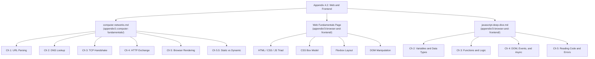
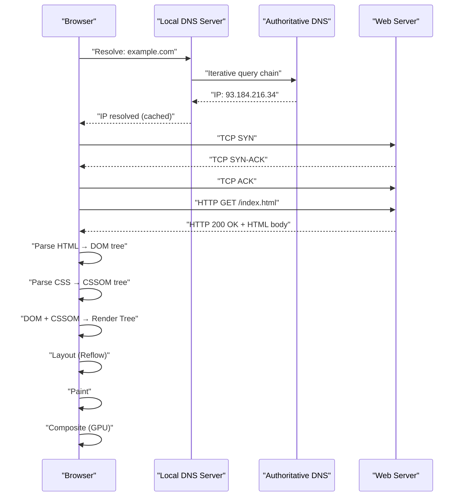
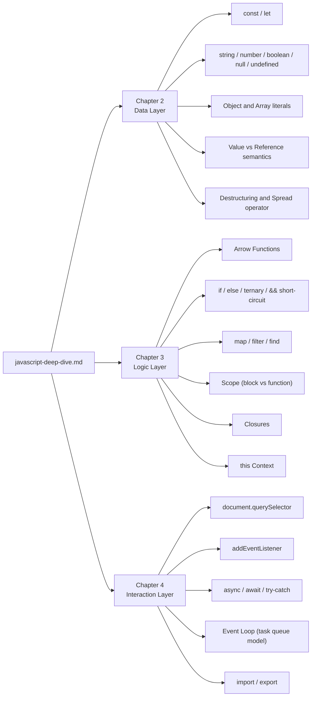
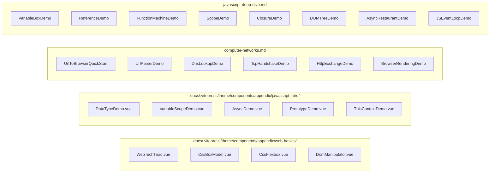

<!-- source: DeepWiki mcp.deepwiki.com · repo datawhalechina/easy-vibe · page 4.2 Web Development and Frontend Appendix · fetched 2026-10-30 -->

# Web Development and Frontend Appendix

<details>
<summary>Relevant source files</summary>

The following files were used as context for generating this wiki page:

- [docs/.vitepress/theme/components/appendix/javascript-intro/AsyncDemo.vue](docs/.vitepress/theme/components/appendix/javascript-intro/AsyncDemo.vue)
- [docs/.vitepress/theme/components/appendix/javascript-intro/ClosureDemo.vue](docs/.vitepress/theme/components/appendix/javascript-intro/ClosureDemo.vue)
- [docs/.vitepress/theme/components/appendix/javascript-intro/DataTypeDemo.vue](docs/.vitepress/theme/components/appendix/javascript-intro/DataTypeDemo.vue)
- [docs/.vitepress/theme/components/appendix/javascript-intro/PrototypeDemo.vue](docs/.vitepress/theme/components/appendix/javascript-intro/PrototypeDemo.vue)
- [docs/.vitepress/theme/components/appendix/javascript-intro/ThisContextDemo.vue](docs/.vitepress/theme/components/appendix/javascript-intro/ThisContextDemo.vue)
- [docs/.vitepress/theme/components/appendix/javascript-intro/VariableScopeDemo.vue](docs/.vitepress/theme/components/appendix/javascript-intro/VariableScopeDemo.vue)
- [docs/.vitepress/theme/components/appendix/web-basics/CssBoxModel.vue](docs/.vitepress/theme/components/appendix/web-basics/CssBoxModel.vue)
- [docs/.vitepress/theme/components/appendix/web-basics/CssFlexbox.vue](docs/.vitepress/theme/components/appendix/web-basics/CssFlexbox.vue)
- [docs/.vitepress/theme/components/appendix/web-basics/DomManipulator.vue](docs/.vitepress/theme/components/appendix/web-basics/DomManipulator.vue)
- [docs/.vitepress/theme/components/appendix/web-basics/WebTechTriad.vue](docs/.vitepress/theme/components/appendix/web-basics/WebTechTriad.vue)
- [docs/zh-cn/appendix/1-computer-fundamentals/computer-networks.md](docs/zh-cn/appendix/1-computer-fundamentals/computer-networks.md)
- [docs/zh-cn/appendix/3-browser-and-frontend/javascript-deep-dive.md](docs/zh-cn/appendix/3-browser-and-frontend/javascript-deep-dive.md)
- [docs/zh-cn/appendix/9-engineering-excellence/code-quality-refactoring.md](docs/zh-cn/appendix/9-engineering-excellence/code-quality-refactoring.md)
- [docs/zh-cn/appendix/9-engineering-excellence/design-patterns.md](docs/zh-cn/appendix/9-engineering-excellence/design-patterns.md)
- [docs/zh-cn/appendix/9-engineering-excellence/open-source-collaboration.md](docs/zh-cn/appendix/9-engineering-excellence/open-source-collaboration.md)
- [docs/zh-cn/appendix/9-engineering-excellence/security-thinking.md](docs/zh-cn/appendix/9-engineering-excellence/security-thinking.md)
- [docs/zh-cn/appendix/9-engineering-excellence/technical-writing.md](docs/zh-cn/appendix/9-engineering-excellence/technical-writing.md)
- [docs/zh-cn/appendix/9-engineering-excellence/technology-selection.md](docs/zh-cn/appendix/9-engineering-excellence/technology-selection.md)
- [docs/zh-cn/appendix/9-engineering-excellence/testing-strategies.md](docs/zh-cn/appendix/9-engineering-excellence/testing-strategies.md)

</details>


## Purpose and Scope

This page documents the content, structure, and embedded components of the **Web Development and Frontend** appendix section. It covers three knowledge areas: a browser-and-networking walkthrough (how a URL becomes a rendered page), a web fundamentals section (the HTML/CSS/JS triad, box model, Flexbox, and DOM), and a JavaScript deep-dive guide (variables, scope, closures, async/await, the event loop, and prototype chains).

For the computer fundamentals material that logically precedes this section (transistors, OS, data encoding, data structures), see [Computer Fundamentals Appendix](#4.1). For backend, API design, and database topics, see [Backend, APIs, and Data Appendix](#4.3). For documentation of the interactive Vue demo components embedded in these pages, see [Web, Terminal, and API Demo Components](#5.3) and [AI, Data, and JavaScript Demo Components](#5.4).

---

## Content Organization

The appendix spans two source directories:

| Directory | Content |
|-----------|---------|
| `docs/zh-cn/appendix/1-computer-fundamentals/` | Browser and networking walkthrough (`computer-networks.md`) |
| `docs/zh-cn/appendix/3-browser-and-frontend/` | Web fundamentals page and `javascript-deep-dive.md` |

**Appendix 4.2 — File and Section Structure**



Sources: [docs/zh-cn/appendix/1-computer-fundamentals/computer-networks.md:1-30](), [docs/zh-cn/appendix/3-browser-and-frontend/javascript-deep-dive.md:15-25]()

---

## Browser and Networking Walkthrough

**Source file:** `docs/zh-cn/appendix/1-computer-fundamentals/computer-networks.md`

The page is titled **"浏览器是一个操作系统"** (Browser is an Operating System). It frames the browser as an OS-level environment that manages networking, rendering, and execution — and uses a **shopping analogy** (buyer → warehouse → delivery → unboxing) to map the five technical stages of a browser request onto a familiar process.

### Chapter Overview

| Chapter | Topic | Core Concepts |
|---------|-------|---------------|
| 0 | Introduction | Shopping metaphor; five-stage model |
| 1 | URL Parsing | Protocol, domain, port, path, query params, anchor |
| 2 | DNS Lookup | Recursive vs iterative queries, caching, root/TLD/authoritative servers |
| 3 | TCP Handshake | SYN, SYN-ACK, ACK; reliability guarantees; HTTPS TLS extension |
| 4 | HTTP Exchange | Request methods, status codes, headers, Cookie, Content-Type |
| 5 | Browser Rendering | DOM, CSSOM, render tree, layout/reflow, paint, GPU composite |
| 5.5 | Static vs Dynamic | Pre-built HTML vs server-generated HTML; serverless and hybrid approaches |
| 6 | Summary | Full stage-to-technique reference table |
| 7 | Glossary | URL, DNS, IP, TCP, HTTP, HTTPS, HTML, CSS, DOM, CSSOM, RTT |

Sources: [docs/zh-cn/appendix/1-computer-fundamentals/computer-networks.md:20-30]()

### Full Request Lifecycle

**URL to Rendered Page — Sequence of Technical Events**



Sources: [docs/zh-cn/appendix/1-computer-fundamentals/computer-networks.md:130-390]()

### Browser Rendering Pipeline Steps

The rendering section describes a six-step pipeline [docs/zh-cn/appendix/1-computer-fundamentals/computer-networks.md:322-390]():

1. **Parse HTML → DOM tree** — byte stream parsed into a node hierarchy; `display: none` elements are included.
2. **Parse CSS → CSSOM tree** — inline, external, and inherited styles merged into a parallel tree.
3. **Build Render Tree** — DOM ∩ CSSOM; nodes with `display: none` are excluded from the render tree.
4. **Layout (Reflow)** — exact pixel coordinates and dimensions computed for every visible node.
5. **Paint** — pixels filled: background, text color, borders, shadows.
6. **Composite** — GPU merges independent layers (e.g., `transform` elements, fixed-position overlays) into the final frame.

### HTTP Status Codes Reference

| Code | Category | Plain Meaning |
|------|----------|---------------|
| 200 | Success | Request completed |
| 301 / 302 | Redirect | Resource moved permanently / temporarily |
| 304 | Not Modified | Cached response still valid |
| 400 | Client Error | Malformed request |
| 401 | Unauthorized | Authentication required |
| 403 | Forbidden | Authenticated but no permission |
| 404 | Not Found | Resource does not exist |
| 500 | Server Error | Unhandled internal failure |
| 502 | Bad Gateway | Upstream service unreachable |
| 503 | Service Unavailable | Overloaded or under maintenance |

Sources: [docs/zh-cn/appendix/1-computer-fundamentals/computer-networks.md:294-307]()

### Embedded Interactive Components

| Component Tag | Demonstrated Concept |
|--------------|----------------------|
| `<UrlToBrowserQuickStart />` | Five-stage request overview animation |
| `<UrlParserDemo />` | Live URL decomposition into protocol/domain/port/path/params/anchor |
| `<DnsLookupDemo />` | Animated DNS resolution chain |
| `<TcpHandshakeDemo />` | SYN → SYN-ACK → ACK three-step animation |
| `<HttpExchangeDemo />` | Interactive HTTP request/response pair inspection |
| `<BrowserRenderingDemo />` | Step-through rendering pipeline animation |

Sources: [docs/zh-cn/appendix/1-computer-fundamentals/computer-networks.md:82-390]()

---

## Web Fundamentals

The web fundamentals section covers the cooperative structure of HTML, CSS, and JavaScript, the CSS layout model, and programmatic DOM operations. Its interactive components are implemented in `docs/.vitepress/theme/components/appendix/web-basics/`.

### HTML / CSS / JavaScript Triad (`WebTechTriad.vue`)

`WebTechTriad.vue` renders a three-button mode selector (`html`, `css`, `js`) and a live preview panel. Selecting a mode highlights corresponding code lines and shows execution steps for that layer.

| Technology | Role | Component Analogy in Code |
|-----------|------|--------------------------|
| HTML | Structure / content | `current = 'html'` mode |
| CSS | Appearance / style | `current = 'css'` mode |
| JavaScript | Behavior / interactivity | `current = 'js'` mode; `clicks` counter increments |

The `codeLines` computed property at [docs/.vitepress/theme/components/appendix/web-basics/WebTechTriad.vue:107-131]() returns different code line arrays depending on `current.value`.

Sources: [docs/.vitepress/theme/components/appendix/web-basics/WebTechTriad.vue:88-159]()

### CSS Box Model (`CssBoxModel.vue`)

`CssBoxModel.vue` provides range sliders for `width`, `padding`, `border`, and `margin`, driving a nested layer visualization (`margin > border > padding > content`). A `box-sizing` toggle switches between `content-box` and `border-box` modes.

The `total` computed property implements both formulas [docs/.vitepress/theme/components/appendix/web-basics/CssBoxModel.vue:185-190]():

| `box-sizing` | Total Width Formula |
|-------------|---------------------|
| `content-box` (default) | `width + padding×2 + border×2 + margin×2` |
| `border-box` | `width + margin×2` (padding and border absorbed into width) |

A conditional warning triggers when `total × 3 > 900`, illustrating why a three-card layout at `width: 200px` with padding and border overflows a 900px container.

Sources: [docs/.vitepress/theme/components/appendix/web-basics/CssBoxModel.vue:1-192]()

### CSS Flexbox (`CssFlexbox.vue`)

`CssFlexbox.vue` exposes chip-button groups for four Flexbox properties. A canvas of six numbered `<div>` items reflects all changes live.

| Property | Available Options |
|----------|-----------------|
| `flex-direction` | `row`, `column` |
| `justify-content` | `flex-start`, `center`, `flex-end`, `space-between`, `space-around` |
| `align-items` | `stretch`, `flex-start`, `center`, `flex-end` |
| `flex-wrap` | `nowrap`, `wrap` |

The `boxStyle` computed property at [docs/.vitepress/theme/components/appendix/web-basics/CssFlexbox.vue:156-164]() applies all four properties as inline styles. The `cssCode` computed property at [docs/.vitepress/theme/components/appendix/web-basics/CssFlexbox.vue:166-173]() generates a minimal CSS declaration omitting default values.

Sources: [docs/.vitepress/theme/components/appendix/web-basics/CssFlexbox.vue:1-174]()

### DOM Manipulation (`DomManipulator.vue`)

`DomManipulator.vue` lets users perform four DOM operations against a live card, displaying the corresponding JavaScript code on the right panel. State variable `lastOp` controls which code block is displayed.

| Operation | `lastOp` Value | JavaScript Shown |
|-----------|---------------|-----------------|
| Update title | `'title'` | `el.textContent = '...'` |
| Switch CSS class | `'style'` | `card.className = 'preview-card ...'` |
| Add list item | `'add'` | `list.appendChild(li)` |
| Remove last item | `'remove'` | `last.remove()` |

Sources: [docs/.vitepress/theme/components/appendix/web-basics/DomManipulator.vue:94-157]()

---

## JavaScript Deep Dive

**Source file:** `docs/zh-cn/appendix/3-browser-and-frontend/javascript-deep-dive.md`

The guide explicitly targets Vibe Coding practitioners: the goal is **reading and understanding AI-generated code**, not writing from scratch. Each chapter begins with recognition patterns (what to look for in code) and ends with how to describe problems precisely to an AI.

### Chapter Structure and Embedded Components

| Chapter | Topic | Embedded Components |
|---------|-------|---------------------|
| 1 | What is JavaScript; HTML/CSS/JS roles | — |
| 2 | Variables, data types, objects, arrays, destructuring | `<VariableBoxDemo />`, `<ReferenceDemo />` |
| 3 | Functions, conditions, array methods, scope, closures, `this` | `<FunctionMachineDemo />`, `<ScopeDemo />`, `<ClosureDemo />` |
| 4 | DOM tree, element queries, events, async/await, event loop, modules | `<DOMTreeDemo />`, `<AsyncRestaurantDemo />`, `<JSEventLoopDemo />` |
| 5 | Reading AI code (four-step method), error reference, precise problem descriptions | — |

Sources: [docs/zh-cn/appendix/3-browser-and-frontend/javascript-deep-dive.md:16-24]()

### JavaScript Concept Coverage Map

**`javascript-deep-dive.md` — Concepts to Chapter Mapping**



Sources: [docs/zh-cn/appendix/3-browser-and-frontend/javascript-deep-dive.md:127-753]()

### Variables and Data

The guide opens Chapter 2 with `const`/`let` as the primary mental model:

| Keyword | Reassignable | Canonical Use |
|---------|-------------|---------------|
| `const` | No | Color lists, config values, API URLs |
| `let` | Yes | Counters, current index, user input state |

**Value vs. Reference** is flagged as the most common trap for beginners. Primitive types are copied by value; objects and arrays are copied by reference. The spread operator creates shallow copies:

```js
const arr2 = [...arr1]    // new array, not a shared reference
const obj2 = { ...obj1 }  // new object
```

Sources: [docs/zh-cn/appendix/3-browser-and-frontend/javascript-deep-dive.md:129-283]()

### Scope and Closures

**Scope** uses a room analogy: inner-scope variables are invisible from the outside; inner scope can read outer-scope variables. The `<ScopeDemo />` component provides a step-through visualization.

**Closure** is framed as a function "remembering" its surrounding variables at creation time, even after the enclosing function has returned. The canonical counter example [docs/zh-cn/appendix/3-browser-and-frontend/javascript-deep-dive.md:486-504]() shows two returned methods (`add`, `getCount`) both closing over the same `count` variable.

Sources: [docs/zh-cn/appendix/3-browser-and-frontend/javascript-deep-dive.md:458-505]()

### `this` Context

Two primary scenarios are covered without introducing full binding-rule theory:

1. **Object method** — `this` points to the object that owns the method.
2. **Event listener** — `function` keyword binds `this` to the triggering element; arrow functions do not rebind `this` and inherit it from the enclosing scope.

The `ThisContextDemo.vue` component provides separate scenario tabs for method calls, standalone function calls, arrow functions, and explicit binding. Its `activeScenario` ref controls which panel is visible [docs/.vitepress/theme/components/appendix/javascript-intro/ThisContextDemo.vue:15-25]().

Sources: [docs/zh-cn/appendix/3-browser-and-frontend/javascript-deep-dive.md:507-538](), [docs/.vitepress/theme/components/appendix/javascript-intro/ThisContextDemo.vue:1-110]()

### Async/Await and the Event Loop

**Event loop model:** JavaScript is a single-threaded worker with a task queue. When a waiting operation (network request, timer) is encountered, the continuation callback is deferred to the queue; synchronous code continues uninterrupted.

```js
console.log("1")
setTimeout(() => console.log("2"), 0)  // deferred even at 0 ms
console.log("3")
// Output: 1, 3, 2
```

**Recommended async/await pattern** for network requests:

```js
async function loadData() {
  try {
    const response = await fetch('/api/data')
    const data = await response.json()
    console.log(data)
  } catch (error) {
    console.error('Error:', error)
  }
}
```

The `AsyncDemo.vue` component covers three async patterns in tabs: callbacks (and the callback-hell problem), Promises (`.then`/`.catch`), and async/await [docs/.vitepress/theme/components/appendix/javascript-intro/AsyncDemo.vue:1-130]().

Sources: [docs/zh-cn/appendix/3-browser-and-frontend/javascript-deep-dive.md:637-705]()

### Prototype-Based Inheritance

`PrototypeDemo.vue` provides a clickable prototype-chain visualization with three levels: the object instance, `Constructor.prototype`, and `Object.prototype`. Clicking a node shows which properties are resolved at that level.

The chain search order is: **own properties → `Constructor.prototype` → `Object.prototype` → `null`**.

Sources: [docs/.vitepress/theme/components/appendix/javascript-intro/PrototypeDemo.vue:69-115]()

---

## Interactive Component Inventory

**Component Files — Location and Hosting Page**



The `web-basics/` and `javascript-intro/` component files are registered globally through the VitePress theme (see [Theme and Navigation Components](#5.1)) and are used inline in their respective appendix markdown pages. The components in `javascript-intro/` also appear as standalone demos in their own appendix pages (covered in [AI, Data, and JavaScript Demo Components](#5.4)).

Sources: [docs/.vitepress/theme/components/appendix/web-basics/WebTechTriad.vue:1-5](), [docs/.vitepress/theme/components/appendix/web-basics/CssBoxModel.vue:1-5](), [docs/.vitepress/theme/components/appendix/web-basics/CssFlexbox.vue:1-5](), [docs/.vitepress/theme/components/appendix/web-basics/DomManipulator.vue:1-5](), [docs/.vitepress/theme/components/appendix/javascript-intro/DataTypeDemo.vue:1-5](), [docs/.vitepress/theme/components/appendix/javascript-intro/VariableScopeDemo.vue:1-5](), [docs/.vitepress/theme/components/appendix/javascript-intro/AsyncDemo.vue:1-5](), [docs/.vitepress/theme/components/appendix/javascript-intro/PrototypeDemo.vue:1-5](), [docs/.vitepress/theme/components/appendix/javascript-intro/ThisContextDemo.vue:1-5]()

---

## Error Recognition Quick Reference

Chapter 5 of `javascript-deep-dive.md` provides a table for quickly categorizing browser console errors:

| Error | Root Cause | Precise Description to Give AI |
|-------|-----------|-------------------------------|
| `TypeError: Cannot read properties of undefined` | Property access on `undefined` | "Line X: variable is `undefined`, check its assignment or async timing" |
| `ReferenceError: xxx is not defined` | Variable used before declaration or misspelled | "Variable `xxx` not defined — check spelling or missing `import`" |
| `TypeError: xxx is not a function` | Non-function value called as a function | "Check type and source of `xxx`" |
| `SyntaxError: Unexpected token` | Missing bracket, comma, or semicolon | "Syntax error at line X, check brackets and punctuation" |
| CORS error | Browser blocked cross-origin request | "Need to configure CORS on the server or use a proxy" |
| `404 Not Found` | Requested API URL does not exist | "Verify the endpoint path is correct" |

Sources: [docs/zh-cn/appendix/3-browser-and-frontend/javascript-deep-dive.md:792-801]()

---

