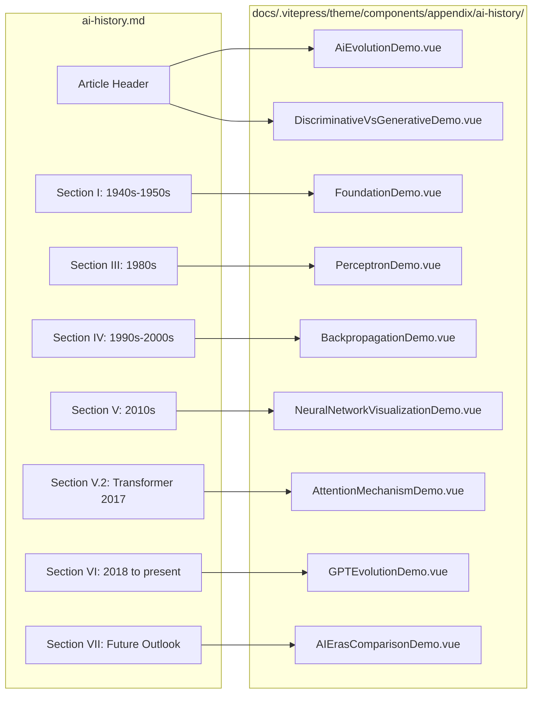
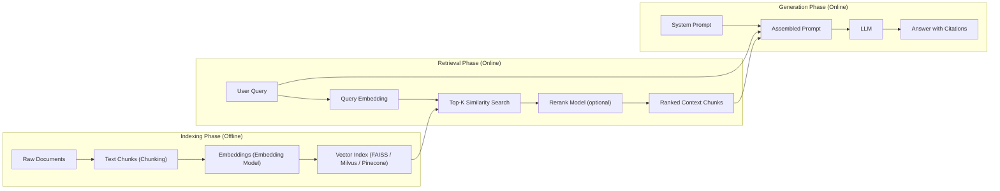
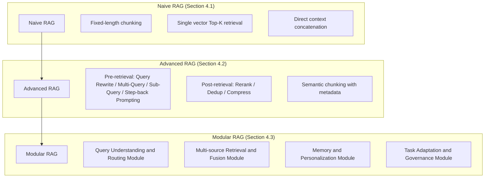

<!-- source: DeepWiki mcp.deepwiki.com · repo datawhalechina/easy-vibe · page 4.4 Artificial Intelligence Appendix · fetched 2026-10-30 -->

# Artificial Intelligence Appendix

Relevant source files

The following files were used as context for generating this wiki page:

- [docs/.vitepress/theme/components/appendix/ai-history/AiEvolutionDemo.vue](docs/.vitepress/theme/components/appendix/ai-history/AiEvolutionDemo.vue)
- [docs/.vitepress/theme/components/appendix/ai-history/AttentionMechanismDemo.vue](docs/.vitepress/theme/components/appendix/ai-history/AttentionMechanismDemo.vue)
- [docs/.vitepress/theme/components/appendix/ai-history/BackpropagationDemo.vue](docs/.vitepress/theme/components/appendix/ai-history/BackpropagationDemo.vue)
- [docs/.vitepress/theme/components/appendix/ai-history/DiscriminativeVsGenerativeDemo.vue](docs/.vitepress/theme/components/appendix/ai-history/DiscriminativeVsGenerativeDemo.vue)
- [docs/.vitepress/theme/components/appendix/ai-history/FoundationDemo.vue](docs/.vitepress/theme/components/appendix/ai-history/FoundationDemo.vue)
- [docs/.vitepress/theme/components/appendix/ai-history/GPTEvolutionDemo.vue](docs/.vitepress/theme/components/appendix/ai-history/GPTEvolutionDemo.vue)
- [docs/.vitepress/theme/components/appendix/ai-history/NeuralNetworkVisualizationDemo.vue](docs/.vitepress/theme/components/appendix/ai-history/NeuralNetworkVisualizationDemo.vue)
- [docs/.vitepress/theme/components/appendix/ai-history/PerceptronDemo.vue](docs/.vitepress/theme/components/appendix/ai-history/PerceptronDemo.vue)
- [docs/.vitepress/theme/components/appendix/ai-history/RuleBasedVsLearningDemo.vue](docs/.vitepress/theme/components/appendix/ai-history/RuleBasedVsLearningDemo.vue)
- [docs/zh-cn/appendix/4-server-and-backend/api-design.md](docs/zh-cn/appendix/4-server-and-backend/api-design.md)
- [docs/zh-cn/appendix/8-artificial-intelligence/ai-history.md](docs/zh-cn/appendix/8-artificial-intelligence/ai-history.md)
- [docs/zh-cn/stage-1/appendix-articles/example0-2/vibe-coding-tools-build-website-with-ai-coding-and-design-agents.md](docs/zh-cn/stage-1/appendix-articles/example0-2/vibe-coding-tools-build-website-with-ai-coding-and-design-agents.md)
- [docs/zh-cn/stage-2/ai-capabilities/2.1-dify-knowledge-base/chapter3/index.md](docs/zh-cn/stage-2/ai-capabilities/2.1-dify-knowledge-base/chapter3/index.md)
- [docs/zh-cn/stage-2/backend/2.2-database-supabase/chapter5/index.md](docs/zh-cn/stage-2/backend/2.2-database-supabase/chapter5/index.md)
- [docs/zh-cn/stage-2/backend/2.4-git-workflow/extra1/index.md](docs/zh-cn/stage-2/backend/2.4-git-workflow/extra1/index.md)
- [docs/zh-cn/stage-2/backend/2.6-modern-cli/extra7/index.md](docs/zh-cn/stage-2/backend/2.6-modern-cli/extra7/index.md)
- [docs/zh-cn/stage-2/frontend/2.4-hogwarts-portraits/index.md](docs/zh-cn/stage-2/frontend/2.4-hogwarts-portraits/index.md)
- [docs/zh-cn/stage-3/ai-advanced/3.a1-rag-introduction/index.md](docs/zh-cn/stage-3/ai-advanced/3.a1-rag-introduction/index.md)
- [docs/zh-cn/stage-3/cross-platform/3.5-android-app/index.md](docs/zh-cn/stage-3/cross-platform/3.5-android-app/index.md)
- [docs/zh-cn/stage-3/cross-platform/3.6-ios-app/index.md](docs/zh-cn/stage-3/cross-platform/3.6-ios-app/index.md)
- [docs/zh-cn/stage-3/personal-brand/3.7-personal-website-blog/index.md](docs/zh-cn/stage-3/personal-brand/3.7-personal-website-blog/index.md)

## Purpose and Scope

This page documents the artificial intelligence educational content in Easy-Vibe. It covers two distinct bodies of content:

1. **AI History article** at `docs/zh-cn/appendix/8-artificial-intelligence/ai-history.md` — a seven-era chronological narrative paired with interactive Vue demo components.
2. **RAG Introduction** at `docs/zh-cn/stage-3/ai-advanced/3.a1-rag-introduction/index.md` — a technical walkthrough of Retrieval-Augmented Generation covering motivation, mechanics, and architectural evolution.

Note: the RAG introduction lives under Stage 3 curriculum content (`stage-3/ai-advanced/`), not under the `/appendix/` directory, though it is treated as appendix-level reference material in the curriculum design.

For full documentation of the Vue demo components embedded in these articles (props, reactive state, behavior), see [section 5.4](#5.4). For the Backend, APIs, and Data appendix, see [section 4.3](#4.3).

---

## Content Overview

| Document | File Path | Primary Topics |
| --- | --- | --- |
| AI History | `docs/zh-cn/appendix/8-artificial-intelligence/ai-history.md` | Symbolism, Connectionism, Expert Systems, ML, Deep Learning, Transformer, GPT |
| RAG Introduction | `docs/zh-cn/stage-3/ai-advanced/3.a1-rag-introduction/index.md` | Why RAG, RAG pipeline, Naive/Advanced/Modular RAG, enterprise construction, model selection |

---

## AI History Article

The article at [docs/zh-cn/appendix/8-artificial-intelligence/ai-history.md]() is structured as a seven-era chronological narrative. Each era is paired with one or more interactive Vue components rendered inline via custom tags such as `<AiEvolutionDemo />`.

### Seven-Era Structure

| # | Section Header | Time Period | Key Events |
| --- | --- | --- | --- |
| I | Theoretical Foundations and Symbolism | 1940s–1950s | MP Neuron model (1943), Turing Test (1950), Dartmouth Conference (1956) |
| II | Symbolism Golden Age — First AI Wave | 1960s–1970s | Expert systems: Dendral (1965), MYCIN (1977), XCON (1980); First AI Winter (1974–80) |
| III | Expert Systems — Second AI Wave | 1980s | Commercial expert system boom; Perceptron re-examined; Second AI Winter (1987–93) |
| IV | Machine Learning Rise and Connectionism Revival | 1990s–2000s | SVM, Decision Trees, Random Forests; Backpropagation validated; Deep Blue (1997) |
| V | Deep Learning Revolution | 2010s | AlexNet (2012), GAN (2014), ResNet (2015), AlphaGo (2016) |
| V.2 | Transformer Architecture | 2017 | "Attention Is All You Need"; Self-Attention mechanism |
| VI | Large Model Era | 2018–present | GPT-1 through GPT-4, BERT, RLHF, ChatGPT (2022), multimodal expansion |
| VII | Three Schools Fusion and Future Outlook | Present | AGI directions: multimodal, embodied AI, agentic AI |

Sources: [docs/zh-cn/appendix/8-artificial-intelligence/ai-history.md:15-190]()

### Three AI Schools of Thought

The article frames AI history around three philosophical lineages that converge in modern LLMs:

| School | Chinese Term | Core Belief | Representative Technique |
| --- | --- | --- | --- |
| Symbolism | 符号主义 | Intelligence = symbol manipulation via rules | Expert systems, IF-THEN logic |
| Connectionism | 连接主义 | Intelligence = learned weights in a neural network | Deep learning, Transformer |
| Behaviorism | 行为主义 | Intelligence = agent-environment interaction and reward | Reinforcement learning, AlphaGo |

Sources: [docs/zh-cn/appendix/8-artificial-intelligence/ai-history.md:27-30](), [docs/zh-cn/appendix/8-artificial-intelligence/ai-history.md:132-134]()

---

### Article-to-Component Mapping

Each section of `ai-history.md` embeds one or more Vue components. All components reside in `docs/.vitepress/theme/components/appendix/ai-history/`.

**AI History Article Sections to Vue Component Files**

Sources: [docs/zh-cn/appendix/8-artificial-intelligence/ai-history.md:10-192]()

---

### Component Roles

| Component File | What It Renders |
| --- | --- |
| `AiEvolutionDemo.vue` | Horizontal flex-bar timeline spanning eight eras; each era is a colored segment with label and year range |
| `DiscriminativeVsGenerativeDemo.vue` | Card grid comparing the three AI schools (symbolism, connectionism, behaviorism) |
| `FoundationDemo.vue` | Styled code block showing an IF-THEN expert system rule (MYCIN-style, 450+ rule note) |
| `PerceptronDemo.vue` | Static diagram: three input nodes with values and weights → summation → threshold → output |
| `BackpropagationDemo.vue` | Four step-cards (forward pass → loss → backprop → weight update) + SVG loss-vs-epoch curve |
| `NeuralNetworkVisualizationDemo.vue` | SVG of a three-layer fully-connected network (3 inputs, 4 hidden, 2 outputs) with connection lines |
| `AttentionMechanismDemo.vue` | Token-row visualization with per-token attention weight bars for a sample sentence |
| `GPTEvolutionDemo.vue` | Grid of model cards: GPT-1 through GPT-4 with year, parameter count, and key capability note |
| `AIErasComparisonDemo.vue` | Side-by-side comparison table of AI eras (source not provided; referenced at line 192) |
| `RuleBasedVsLearningDemo.vue` | Vertical flow of five AI development phases with color-coded cards and descriptions |

Sources: [docs/.vitepress/theme/components/appendix/ai-history/AiEvolutionDemo.vue:1-41](), [docs/.vitepress/theme/components/appendix/ai-history/FoundationDemo.vue:1-55](), [docs/.vitepress/theme/components/appendix/ai-history/NeuralNetworkVisualizationDemo.vue:1-55](), [docs/.vitepress/theme/components/appendix/ai-history/BackpropagationDemo.vue:1-100](), [docs/.vitepress/theme/components/appendix/ai-history/PerceptronDemo.vue:1-70](), [docs/.vitepress/theme/components/appendix/ai-history/GPTEvolutionDemo.vue:1-50](), [docs/.vitepress/theme/components/appendix/ai-history/AttentionMechanismDemo.vue:1-50](), [docs/.vitepress/theme/components/appendix/ai-history/DiscriminativeVsGenerativeDemo.vue:1-50](), [docs/.vitepress/theme/components/appendix/ai-history/RuleBasedVsLearningDemo.vue:1-55]()

---

### Key Technical Concepts Covered

**Symbolism / Expert Systems**  
`FoundationDemo.vue` renders a MYCIN-style rule block showing the IF-THEN structure: body temperature threshold AND white blood cell count → diagnosis → treatment plan. A comment notes that the real MYCIN system contained 450+ such rules.

Sources: [docs/.vitepress/theme/components/appendix/ai-history/FoundationDemo.vue:5-12]()

**Perceptron**  
The article introduces the perceptron as proposed by Frank Rosenblatt (1958). `PerceptronDemo.vue` shows three hardcoded inputs (values 1, 0, 1) with weights (0.8, –0.5, 0.6) flowing into a summation node and a threshold activation.

Sources: [docs/zh-cn/appendix/8-artificial-intelligence/ai-history.md:80-82](), [docs/.vitepress/theme/components/appendix/ai-history/PerceptronDemo.vue:1-70]()

**Backpropagation**  
Covered in Section IV. `BackpropagationDemo.vue` renders a four-step horizontal card flow and an SVG curve demonstrating loss decreasing over training epochs. The article credits Geoffrey Hinton for formalizing backprop's role in multi-layer networks.

Sources: [docs/zh-cn/appendix/8-artificial-intelligence/ai-history.md:100-108](), [docs/.vitepress/theme/components/appendix/ai-history/BackpropagationDemo.vue:11-40]()

**Self-Attention / Transformer**  
Section V.2 describes the 2017 paper "Attention Is All You Need." `AttentionMechanismDemo.vue` shows per-token attention weights for a sample sentence, illustrating how the model attends to all tokens simultaneously rather than sequentially.

Sources: [docs/zh-cn/appendix/8-artificial-intelligence/ai-history.md:136-144](), [docs/.vitepress/theme/components/appendix/ai-history/AttentionMechanismDemo.vue:1-50]()

**GPT Evolution**  
Section VI covers the "pre-training + fine-tuning" paradigm shift starting with GPT-1 (2018) and BERT. `GPTEvolutionDemo.vue` displays a card grid tracking GPT-1 through GPT-4, with parameter counts and emergent capabilities noted for GPT-3 (175B parameters).

Sources: [docs/zh-cn/appendix/8-artificial-intelligence/ai-history.md:148-162](), [docs/.vitepress/theme/components/appendix/ai-history/GPTEvolutionDemo.vue:1-50]()

---

## RAG Introduction

### Why RAG Exists

The document opens by identifying three failure modes that motivate RAG over pure long-context LLM approaches:

| Problem Category | Root Cause | Consequence |
| --- | --- | --- |
| Cost and efficiency | Inference cost scales strongly with context length | Filling context with all documents is cost-prohibitive at scale |
| Attention drift | Models exhibit attention degradation on middle-context tokens | Irrelevant context noise degrades answer accuracy even with long context |
| Knowledge currency and auditability | Retraining/fine-tuning to update knowledge is slow and expensive | No citation trail; cannot audit which source drove a specific answer |

Sources: [docs/zh-cn/stage-3/ai-advanced/3.a1-rag-introduction/index.md:34-69]()

---

### RAG Pipeline

A RAG system operates in two phases: **Indexing** (offline document preparation) and **Retrieval + Generation** (online query handling).

**RAG Pipeline: From Raw Documents to Cited Answer**

Sources: [docs/zh-cn/stage-3/ai-advanced/3.a1-rag-introduction/index.md:74-149]()

The document walks through a concrete worked example using a three-document "apple" knowledge base. Each chunk is assigned a vector (768+ dimensions), and three test queries demonstrate different retrieval outcomes:

| Query | Top Retrieved Chunk | Similarity Score | LLM Behavior |
| --- | --- | --- | --- |
| "苹果公司是什么时候创立的？" | Apple Inc. founding date chunk | 0.97 | Answers with citation |
| "吃苹果有什么好处？" | Fruit nutrition chunk | 0.95 | Answers with citation |
| "今天天气怎么样" | Best match: fruit chunk | 0.18 (below threshold) | Declines to answer |

Sources: [docs/zh-cn/stage-3/ai-advanced/3.a1-rag-introduction/index.md:153-285]()

---

### RAG Architecture Evolution

The document defines three generations of RAG, each addressing limitations of the previous.

**RAG Architectural Generations**

| Generation | Core Characteristic | Primary Limitation Addressed |
| --- | --- | --- |
| Naive RAG | Fixed-size chunks, single-pass cosine similarity search, direct prompt concat | Proof-of-concept; no quality control on chunks or retrieved context |
| Advanced RAG | Pre/post-retrieval optimization; semantic chunking; reranking pipeline | Chunk boundary quality; single-signal retrieval noise; irrelevant context injection |
| Modular RAG | Pluggable, composable modules; multi-source fusion; iterative retrieve-generate loops | Complex multi-domain enterprise requirements; single knowledge source limits |

Sources: [docs/zh-cn/stage-3/ai-advanced/3.a1-rag-introduction/index.md:287-385]()

#### Advanced RAG: Pre-Retrieval Query Enhancement Techniques

| Technique | What It Does |
| --- | --- |
| Query Rewrite | Normalizes informal/ambiguous queries into structured retrieval-ready form |
| Multi-Query | Generates multiple semantic variations of the original query to broaden recall coverage |
| Sub-Query Decomposition | Splits composite questions into independent sub-queries for separate retrieval passes |
| Step-back Prompting | Generates an abstract parent question first, then derives specific retrieval queries from it |

Sources: [docs/zh-cn/stage-3/ai-advanced/3.a1-rag-introduction/index.md:315-346]()

---

### Enterprise RAG Construction

The document describes a three-module production architecture:

1. **Layout Analysis and Knowledge Ingestion** — Parses PDFs, HTML, Word, images (OCR), audio (ASR) into clean text with metadata (source filename, chapter, page number, timestamp).
2. **Knowledge Base Construction** — Applies semantic chunking → runs the **Embedding Model** to produce vectors → indexes into a vector store (FAISS, Milvus, or a managed service).
3. **Knowledge Q&A Service** — Online path: embed query → Top-N coarse retrieval from vector index → **Rerank Model** re-scores to Top-K → assemble prompt (system prompt + retrieved chunks + user query) → **LLM** generates answer with citations.

Sources: [docs/zh-cn/stage-3/ai-advanced/3.a1-rag-introduction/index.md:387-410]()

---

### Model Selection

Three model classes are required and evaluated independently.

#### Embedding Models

Evaluated via the **MTEB** (Massive Text Embedding Benchmark) leaderboard at `huggingface.co/spaces/mteb/leaderboard`. Two critical parameters guide selection:

- **Dimension**: Higher dimension = finer semantic discrimination, higher storage and compute cost.
- **Context Length** (tokens): Determines whether long documents are truncated before embedding. Insufficient context length causes information loss and degrades retrieval accuracy.

| Model | Dimension / Context | Key Strength | Typical Use Case |
| --- | --- | --- | --- |
| `OpenAI text-embedding-3-large` | Closed API | Strong MTEB performance; stable | High-budget cloud API; latency-insensitive |
| `Qwen/Qwen2-Embedding-8B` | Up to 4096-dim; 4096 ctx | Top multilingual MTEB; strong Chinese + code | High-accuracy Chinese RAG, long-document analysis |
| `Qwen/Qwen2-Embedding-0.6B` | Small | Edge deployment | Resource-constrained; speed-priority |
| `BAAI/bge-m3` | Hybrid (dense + sparse + multi-vector) | MIRACL multilingual leader | Complex multilingual retrieval |
| `BAAI/bge-large-zh-v1.5` | Large | Stable Chinese baseline; community-validated | Pure Chinese, short documents |

Sources: [docs/zh-cn/stage-3/ai-advanced/3.a1-rag-introduction/index.md:415-445]()

#### Rerank Models

Evaluated via the **Agentset Reranker Leaderboard**. The benchmark tests each model by reranking the top-50 FAISS candidates for each query. Key metrics:

- **ELO**: Pairwise win rate using GPT-5 as arbiter; measures overall ranking quality.
- **nDCG@10**: Ranking precision for the top 10 results.
- **Latency (ms)**: End-to-end response time.

| Model | ELO | nDCG@10 | Latency | License |
| --- | --- | --- | --- | --- |
| `Cohere Rerank 4 Pro` | 1627 | 0.219 | 614 ms | Proprietary |
| `Zerank 2` | 1644 | 0.195 | 265 ms | cc-by-nc-4.0 |
| `Voyage AI Rerank 2.5` | 1547 | 0.235 | 613 ms | Proprietary |
| `Voyage AI Rerank 2.5 Lite` | 1528 | 0.226 | 616 ms | Proprietary |
| `Zerank 1 Small` | 1541 | 0.202 | 248 ms | Apache 2.0 |
| `BAAI/BGE Reranker v2 M3` | 1314 | 0.201 | 2383 ms | Apache 2.0 |

The document recommends using vendor-recommended rerank APIs (e.g., Qwen's rerank model) over leaderboard-only selection, since benchmark scores do not always correlate with real-world production utility.

Sources: [docs/zh-cn/stage-3/ai-advanced/3.a1-rag-introduction/index.md:447-478]()

#### LLM for Generation

Two deployment strategies are described:

| Strategy | When to Use | Example Models |
| --- | --- | --- |
| Private deployment | Data privacy, cost control, deep customization | Qwen2.5-7B/14B, Llama series, GLM series |
| Cloud API | Fast iteration, elastic scaling, no infra management | GPT-4, Claude (Anthropic), Gemini (Google), Qwen API, DeepSeek |

For benchmarking LLM quality in conversational and QA tasks, the document references **LMSYS Chatbot Arena (LMArena)**, which uses a blind pairwise comparison mechanism to produce ELO-style rankings. The document includes a sample leaderboard snapshot showing models from Google, xAI, and Anthropic at the top positions.

The document recommends a "small/large model pairing" cost strategy: route simple queries to cheaper small models and complex queries to powerful large models.

Sources: [docs/zh-cn/stage-3/ai-advanced/3.a1-rag-introduction/index.md:480-490]()

---

## Interactive Component Reference Summary

All AI demo components reside under `docs/.vitepress/theme/components/appendix/ai-history/`. The table below cross-references each component to its embedding location and visual content.

| Component File | Embedded In | Visual Content |
| --- | --- | --- |
| `AiEvolutionDemo.vue` | `ai-history.md` header | 8-segment horizontal timeline; era labels with year ranges |
| `DiscriminativeVsGenerativeDemo.vue` | `ai-history.md` header | Card comparison of three AI schools |
| `FoundationDemo.vue` | Section I | IF-THEN expert system rule code block |
| `PerceptronDemo.vue` | Section III | Perceptron input-weight-sum-threshold-output diagram |
| `BackpropagationDemo.vue` | Section IV | 4-step flow + SVG loss curve |
| `NeuralNetworkVisualizationDemo.vue` | Section V | SVG 3-layer fully-connected network |
| `AttentionMechanismDemo.vue` | Section V.2 | Per-token attention weight visualization |
| `GPTEvolutionDemo.vue` | Section VI | GPT-1 through GPT-4 model card grid |
| `AIErasComparisonDemo.vue` | Section VII | Era comparison (source file not in repository snapshot) |
| `RuleBasedVsLearningDemo.vue` | Not embedded (standalone) | Vertical 5-phase AI development path summary |

For full props, reactive state, and component behavior documentation, see [section 5.4](#5.4).

---

