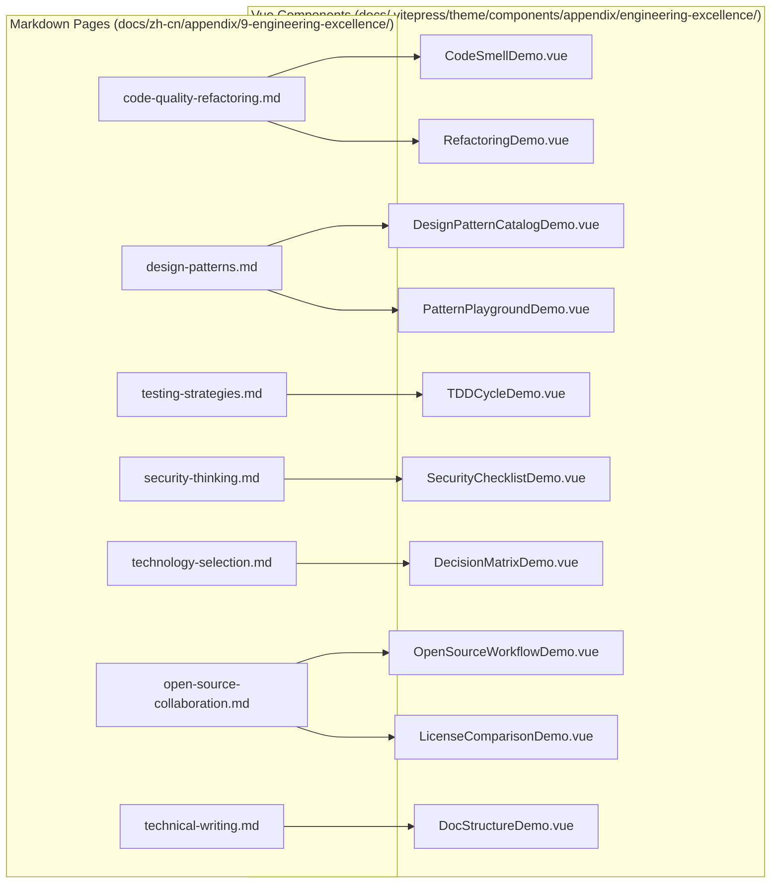
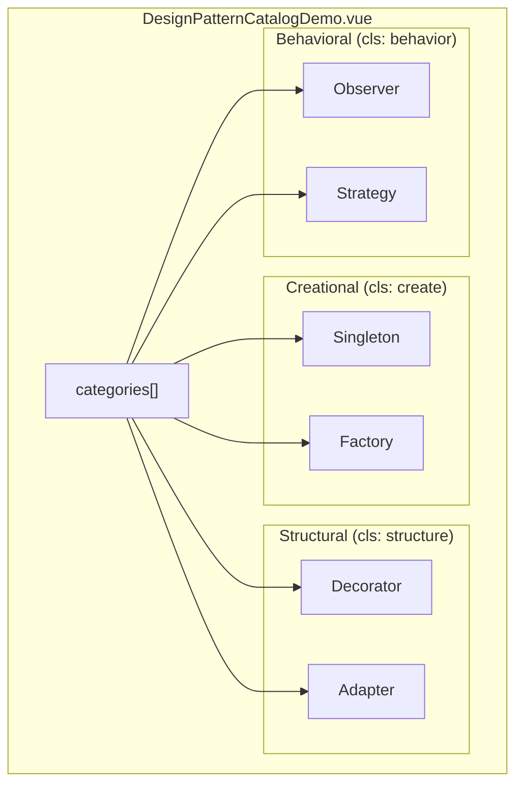
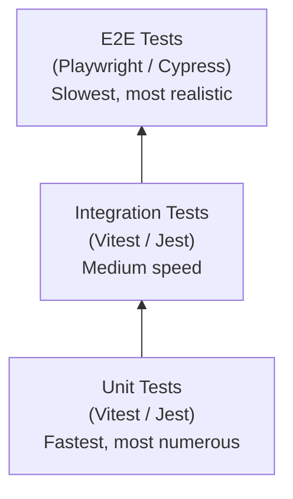
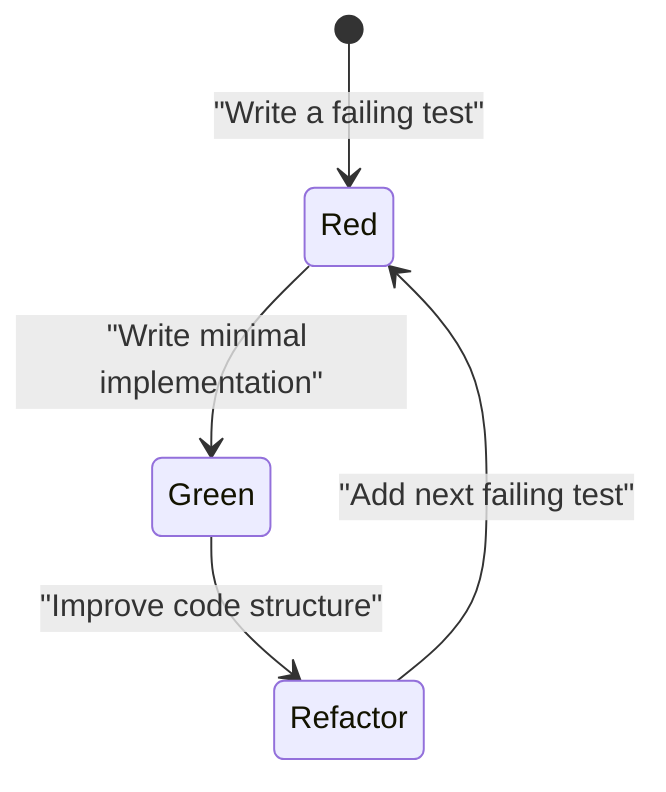
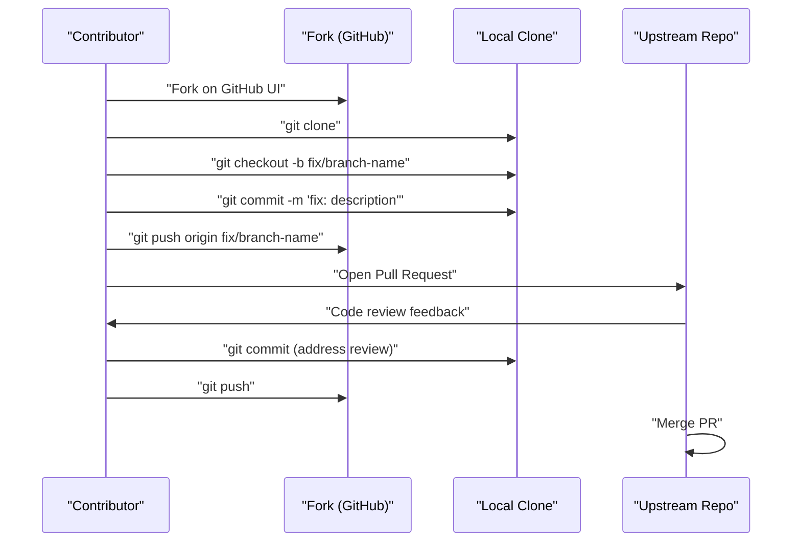

<!-- source: DeepWiki mcp.deepwiki.com · repo datawhalechina/easy-vibe · page 4.5 Engineering Excellence Appendix · fetched 2026-10-30 -->

# Engineering Excellence Appendix

<details>
<summary>Relevant source files</summary>

The following files were used as context for generating this wiki page:

- [.gitignore](.gitignore)
- [docs/.vitepress/theme/components/appendix/engineering-excellence/CodeSmellDemo.vue](docs/.vitepress/theme/components/appendix/engineering-excellence/CodeSmellDemo.vue)
- [docs/.vitepress/theme/components/appendix/engineering-excellence/DecisionMatrixDemo.vue](docs/.vitepress/theme/components/appendix/engineering-excellence/DecisionMatrixDemo.vue)
- [docs/.vitepress/theme/components/appendix/engineering-excellence/DesignPatternCatalogDemo.vue](docs/.vitepress/theme/components/appendix/engineering-excellence/DesignPatternCatalogDemo.vue)
- [docs/.vitepress/theme/components/appendix/engineering-excellence/DocStructureDemo.vue](docs/.vitepress/theme/components/appendix/engineering-excellence/DocStructureDemo.vue)
- [docs/.vitepress/theme/components/appendix/engineering-excellence/LicenseComparisonDemo.vue](docs/.vitepress/theme/components/appendix/engineering-excellence/LicenseComparisonDemo.vue)
- [docs/.vitepress/theme/components/appendix/engineering-excellence/OpenSourceWorkflowDemo.vue](docs/.vitepress/theme/components/appendix/engineering-excellence/OpenSourceWorkflowDemo.vue)
- [docs/.vitepress/theme/components/appendix/engineering-excellence/PatternPlaygroundDemo.vue](docs/.vitepress/theme/components/appendix/engineering-excellence/PatternPlaygroundDemo.vue)
- [docs/.vitepress/theme/components/appendix/engineering-excellence/RefactoringDemo.vue](docs/.vitepress/theme/components/appendix/engineering-excellence/RefactoringDemo.vue)
- [docs/.vitepress/theme/components/appendix/engineering-excellence/SecurityChecklistDemo.vue](docs/.vitepress/theme/components/appendix/engineering-excellence/SecurityChecklistDemo.vue)
- [docs/.vitepress/theme/components/appendix/engineering-excellence/TDDCycleDemo.vue](docs/.vitepress/theme/components/appendix/engineering-excellence/TDDCycleDemo.vue)
- [docs/zh-cn/appendix/1-computer-fundamentals/computer-networks.md](docs/zh-cn/appendix/1-computer-fundamentals/computer-networks.md)
- [docs/zh-cn/appendix/9-engineering-excellence/code-quality-refactoring.md](docs/zh-cn/appendix/9-engineering-excellence/code-quality-refactoring.md)
- [docs/zh-cn/appendix/9-engineering-excellence/design-patterns.md](docs/zh-cn/appendix/9-engineering-excellence/design-patterns.md)
- [docs/zh-cn/appendix/9-engineering-excellence/open-source-collaboration.md](docs/zh-cn/appendix/9-engineering-excellence/open-source-collaboration.md)
- [docs/zh-cn/appendix/9-engineering-excellence/security-thinking.md](docs/zh-cn/appendix/9-engineering-excellence/security-thinking.md)
- [docs/zh-cn/appendix/9-engineering-excellence/technical-writing.md](docs/zh-cn/appendix/9-engineering-excellence/technical-writing.md)
- [docs/zh-cn/appendix/9-engineering-excellence/technology-selection.md](docs/zh-cn/appendix/9-engineering-excellence/technology-selection.md)
- [docs/zh-cn/appendix/9-engineering-excellence/testing-strategies.md](docs/zh-cn/appendix/9-engineering-excellence/testing-strategies.md)

</details>


This page documents the Engineering Excellence appendix of the Easy-Vibe curriculum, located at `docs/zh-cn/appendix/9-engineering-excellence/`. This appendix is reference material for software engineering practices — code quality, design patterns, testing, security, technology selection, open-source workflow, and technical writing — supplementing the stage-based curriculum. It is not a tutorial track; learners are expected to consult it on demand.

For documentation of the interactive Vue components embedded in these pages, see [5.5](#5.5). For the other eight appendix categories (computer fundamentals, web dev, AI, etc.), see [4.1](#4.1) through [4.4](#4.4).

---

## Appendix Structure Overview

The appendix consists of seven standalone markdown documents, each containing prose explanations, code examples, reference tables, AI prompt templates, and embedded Vue demo components.

**Appendix files and their embedded components:**

| File | Topic | Embedded Vue Components |
|---|---|---|
| `code-quality-refactoring.md` | Code smells, refactoring, code review, metrics | `CodeSmellDemo`, `RefactoringDemo` |
| `design-patterns.md` | Creational, structural, behavioral patterns | `DesignPatternCatalogDemo`, `PatternPlaygroundDemo` |
| `testing-strategies.md` | Test pyramid, unit tests, TDD | `TDDCycleDemo` |
| `security-thinking.md` | XSS, SQL injection, CSRF, security headers | `SecurityChecklistDemo` |
| `technology-selection.md` | Decision matrix, tech radar, selection traps | `DecisionMatrixDemo` |
| `open-source-collaboration.md` | Fork→PR workflow, licenses | `OpenSourceWorkflowDemo`, `LicenseComparisonDemo` |
| `technical-writing.md` | README, API docs, architecture docs | `DocStructureDemo` |

Sources: `docs/zh-cn/appendix/9-engineering-excellence/code-quality-refactoring.md`, `docs/zh-cn/appendix/9-engineering-excellence/design-patterns.md`, `docs/zh-cn/appendix/9-engineering-excellence/testing-strategies.md`, `docs/zh-cn/appendix/9-engineering-excellence/security-thinking.md`, `docs/zh-cn/appendix/9-engineering-excellence/technology-selection.md`, `docs/zh-cn/appendix/9-engineering-excellence/open-source-collaboration.md`, `docs/zh-cn/appendix/9-engineering-excellence/technical-writing.md`

---

## Content Map: Files and Components

The diagram below maps each markdown page to its embedded Vue components and the underlying component file paths.

**Appendix page-to-component mapping:**



Sources: `docs/zh-cn/appendix/9-engineering-excellence/code-quality-refactoring.md:46-48`, `docs/zh-cn/appendix/9-engineering-excellence/design-patterns.md:33-34`, `docs/zh-cn/appendix/9-engineering-excellence/testing-strategies.md:40-41`, `docs/zh-cn/appendix/9-engineering-excellence/security-thinking.md:38-39`, `docs/zh-cn/appendix/9-engineering-excellence/technology-selection.md:34-35`, `docs/zh-cn/appendix/9-engineering-excellence/open-source-collaboration.md:38-39`, `docs/zh-cn/appendix/9-engineering-excellence/technical-writing.md:38-39`

---

## Code Quality and Refactoring

**File:** `docs/zh-cn/appendix/9-engineering-excellence/code-quality-refactoring.md`

This page covers the identification of problematic code patterns ("code smells") and systematic techniques to improve them safely.

### Code Smells

The page catalogues six primary code smells with symptoms and impacts:

| Smell | Symptom | Danger |
|---|---|---|
| Long Function | Function exceeds ~50 lines | Hard to read, test, or reuse |
| Magic Numbers | Literal `86400000` in code | Meaning opaque, easy to miss in updates |
| Duplicate Code | Same logic in multiple locations | Changes must be synchronized everywhere |
| Deep Nesting | More than 3 levels of `if`/`for` | Logic flow is maze-like |
| Long Parameter List | Function takes more than 4 arguments | Easy to pass arguments in wrong order |
| God Class | One class/module does everything | Unclear responsibility, high coupling |

The `CodeSmellDemo` component [docs/.vitepress/theme/components/appendix/engineering-excellence/CodeSmellDemo.vue:38-96]() provides tab-based examples of four smells: long function, magic numbers, duplicate code, and deep nesting. Each tab shows a bad code sample alongside a color-coded info panel with a fix suggestion.

### Refactoring Techniques

The `RefactoringDemo` component [docs/.vitepress/theme/components/appendix/engineering-excellence/RefactoringDemo.vue:65-132]() demonstrates four techniques with before/after diff-style code panels:

| Technique | Mechanism |
|---|---|
| Extract Function | Pull a named block out of a large function |
| Rename Variable | Replace opaque names (`d`, `arr`) with intent-revealing ones (`elapsedMs`, `activeUsers`) |
| Remove Duplication | Extract shared logic into a reusable function (DRY principle) |
| Simplify Conditional | Replace nested `if`/`else` with guard clauses (`if (!x) return`) |

### Code Review and Quality Metrics

The page establishes that code review should assess five dimensions: **correctness**, **readability**, **security**, **performance**, and **test coverage**. It also defines two quantitative metrics:

- **Cyclomatic complexity**: counts decision paths (`if`, `for`, `&&`, etc.). Values above 20 require refactoring.
- **Code coverage**: line coverage and branch coverage. The page warns that high coverage does not imply meaningful tests.

**Toolchain for code quality:**

| Tool | Role |
|---|---|
| `ESLint` | Static analysis for JS/TS |
| `Prettier` | Auto-formatting, style normalization |
| `SonarQube` | Comprehensive quality platform |
| `Husky` | Git hooks to gate commits (also used in the repo's own dev workflow — see [2.4](#2.4)) |

Sources: `docs/zh-cn/appendix/9-engineering-excellence/code-quality-refactoring.md`

---

## Design Patterns

**File:** `docs/zh-cn/appendix/9-engineering-excellence/design-patterns.md`

This page groups the Gang of Four patterns into three categories and demonstrates the most practically useful ones in JavaScript.

### Pattern Categories and the `DesignPatternCatalogDemo`

The `DesignPatternCatalogDemo` component [docs/.vitepress/theme/components/appendix/engineering-excellence/DesignPatternCatalogDemo.vue:52-151]() organizes patterns into three clickable category cards. Clicking a card expands a list; clicking a pattern expands a detail panel with "when to use" guidance and a code snippet.



### Pattern Usage Guide

| Problem | Recommended Pattern | Core Idea |
|---|---|---|
| Only one global instance needed | Singleton | Control instance count via `static getInstance()` |
| Create different objects by condition | Factory | Encapsulate creation logic with `switch/case` |
| Incompatible interfaces | Adapter | Wrap old API, expose new interface |
| Add functionality without modifying original | Decorator | Layer wrapper functions |
| State change must notify multiple parties | Observer | `EventEmitter` with `on()`/`emit()` |
| Multiple interchangeable algorithms | Strategy | Dictionary of functions keyed by strategy name |

### `PatternPlaygroundDemo` Interaction Model

The `PatternPlaygroundDemo` component [docs/.vitepress/theme/components/appendix/engineering-excellence/PatternPlaygroundDemo.vue:113-242]() provides two live runtime modes:

- **Observer mode**: Users add named subscribers (`subNames[]`), type a message, and click "publish". Each subscriber card animates with the `.notified` CSS class as notifications propagate with staggered `setTimeout` delays (150ms per subscriber).
- **Strategy mode**: Three sort algorithms (bubble, selection, insertion) are selectable. Clicking "execute" runs the chosen algorithm on `strategyData` and animates bar heights with 200ms per step via `async/await`.

Sources: `docs/zh-cn/appendix/9-engineering-excellence/design-patterns.md`, `docs/.vitepress/theme/components/appendix/engineering-excellence/DesignPatternCatalogDemo.vue`, `docs/.vitepress/theme/components/appendix/engineering-excellence/PatternPlaygroundDemo.vue`

---

## Testing Strategies

**File:** `docs/zh-cn/appendix/9-engineering-excellence/testing-strategies.md`

### Test Pyramid

The page uses Mike Cohn's test pyramid model with the following distribution guidance:



The anti-pattern — an "ice cream cone" shape with too many E2E tests and too few unit tests — is explicitly called out, as it leads to slow and fragile test suites.

### Unit Test Structure: AAA Pattern

Every unit test should follow Arrange–Act–Assert:

```
Arrange  → set up test data
Act      → call the function under test
Assert   → verify the result with expect()
```

**FIRST principles for unit tests:**

| Letter | Principle | Meaning |
|---|---|---|
| F | Fast | Runs in milliseconds |
| I | Independent | Tests do not depend on each other |
| R | Repeatable | Same result in any environment |
| S | Self-validating | Pass/fail is unambiguous |
| T | Timely | Written at the same time as (or before) the code |

### TDD Cycle and `TDDCycleDemo`

The `TDDCycleDemo` component [docs/.vitepress/theme/components/appendix/engineering-excellence/TDDCycleDemo.vue:55-102]() walks through a five-step interactive sequence:

**TDD Red → Green → Refactor cycle:**



The component uses a `steps[]` array where each step has a `cls` property (`red`, `green`, or `blue`), and a `computed` property `current` that maps `cls` → index in `phases[]` to drive the highlighted phase node.

### Tool Selection by Project Type

| Project Type | Testing Priority | Ratio |
|---|---|---|
| Library / SDK | Unit tests dominate | 90% unit + 10% integration |
| API service | Integration tests dominate | 30% unit + 60% integration + 10% E2E |
| Web application | Balanced | 50% unit + 30% integration + 20% E2E |
| MVP / Prototype | Critical path only | Minimal |

Sources: `docs/zh-cn/appendix/9-engineering-excellence/testing-strategies.md`, `docs/.vitepress/theme/components/appendix/engineering-excellence/TDDCycleDemo.vue`

---

## Security Thinking

**File:** `docs/zh-cn/appendix/9-engineering-excellence/security-thinking.md`

### Core Security Principles

The page establishes four foundational principles:

1. **Least privilege** — grant only required permissions
2. **Defense in depth** — multiple independent layers, not a single perimeter
3. **Never trust input** — all external data is potentially malicious
4. **Secure by default** — default configuration must be the safe configuration

### Common Web Attack Patterns

| Attack | Mechanism | Primary Defense |
|---|---|---|
| XSS (Cross-Site Scripting) | Malicious script injected into page HTML | `element.textContent` instead of `innerHTML`; framework auto-escaping (`{{ }}` in Vue); `Content-Security-Policy` header |
| SQL Injection | User input breaks SQL query logic | Parameterized queries; ORM (Prisma, Sequelize); minimal DB account permissions |
| CSRF (Cross-Site Request Forgery) | Attacker exploits user's browser session state | CSRF Token; check `Origin`/`Referer`; `SameSite` cookie attribute |

### HTTP Security Headers

The page specifies four headers for deployment:

```
Content-Security-Policy: default-src 'self'
X-Content-Type-Options: nosniff
X-Frame-Options: DENY
Strict-Transport-Security: max-age=31536000
```

### `SecurityChecklistDemo`

The `SecurityChecklistDemo` component [docs/.vitepress/theme/components/appendix/engineering-excellence/SecurityChecklistDemo.vue:66-108]() provides a reactive checklist across four categories: input validation, authentication/authorization, data protection, and communication security. Each category is collapsible. Checking items updates a computed `score` (0–100) that drives a progress bar with color transitions (`#e74c3c` → `#f39c12` → `#27ae60`).

**Sensitive data protection guidance:**

| Data Type | Protection Measure |
|---|---|
| Passwords | `bcrypt`/`argon2` hash — never plaintext |
| API keys | Environment variables, never committed to repo |
| User data | HTTPS in transit, encrypted at rest |
| Session tokens | `HttpOnly` + `Secure` + `SameSite` cookies |

Sources: `docs/zh-cn/appendix/9-engineering-excellence/security-thinking.md`, `docs/.vitepress/theme/components/appendix/engineering-excellence/SecurityChecklistDemo.vue`

---

## Technology Selection

**File:** `docs/zh-cn/appendix/9-engineering-excellence/technology-selection.md`

### Selection Dimensions

The page defines six evaluation axes, weighted by typical importance:

| Dimension | Priority | Key Questions |
|---|---|---|
| Team capability | High | Familiarity? Learning cost? |
| Community ecosystem | High | Documentation quality? Library coverage? Stack Overflow answers? |
| Performance requirements | Medium–High | Does it meet the performance target? |
| Maintenance status | Medium | Active releases? Last release date? |
| License compatibility | Medium | Compatible with the project's commercial model? |
| Hiring market | Medium | Can you recruit people who know this? |

### Decision Matrix: `DecisionMatrixDemo`

The `DecisionMatrixDemo` component [docs/.vitepress/theme/components/appendix/engineering-excellence/DecisionMatrixDemo.vue:126-211]() implements a fully interactive weighted scoring tool:

- `options` (reactive array): the competing technologies (default: React, Vue, Svelte)
- `weights` (reactive object): 1–5 slider per dimension (`learning`, `ecosystem`, `performance`, `community`, `hiring`)
- `scores` (reactive object): nested by `option → dimension → score (1–5)`
- `ranked` (computed): sorts options by `Σ(score[dim] × weight[dim])`, rendered as an animated bar chart

The matrix formula used:

```
weighted_score(option) = Σ over dimensions: score[option][dim] × weight[dim]
```

**Example decision matrix output (React vs Vue vs Svelte, default scores):**

| Dimension | Weight | React | Vue | Svelte |
|---|---|---|---|---|
| Team capability | 3 | 3 | 5 | 1 |
| Ecosystem | 4 | 5 | 4 | 2 |
| Performance | 3 | 4 | 4 | 5 |
| Community | 3 | 5 | 4 | 3 |
| Hiring | 2 | 4 | 3 | 1 |
| **Weighted total** | | **75** | **87** | **49** |

### Common Selection Traps

| Trap | Description |
|---|---|
| Résumé-driven development | Choosing a technology to add it to a CV, not to solve the problem |
| Blindly following trends | "Newest = best" or "Big tech uses it = we should too" — ignoring different context |
| Ignoring migration cost | Evaluate vendor lock-in and exit path, not only onboarding ease |

Sources: `docs/zh-cn/appendix/9-engineering-excellence/technology-selection.md`, `docs/.vitepress/theme/components/appendix/engineering-excellence/DecisionMatrixDemo.vue`

---

## Open-Source Collaboration

**File:** `docs/zh-cn/appendix/9-engineering-excellence/open-source-collaboration.md`

### Contribution Workflow

The `OpenSourceWorkflowDemo` component [docs/.vitepress/theme/components/appendix/engineering-excellence/OpenSourceWorkflowDemo.vue:38-48]() models the contribution lifecycle as an 8-step sequence with corresponding git commands.

**Fork-to-merge workflow:**



### License Comparison: `LicenseComparisonDemo`

The `LicenseComparisonDemo` component [docs/.vitepress/theme/components/appendix/engineering-excellence/LicenseComparisonDemo.vue:63-99]() provides a filterable comparison table. Each license has a `tags[]` array; selecting need-based filters highlights the best-scoring license.

| License | Commercial | Patent Grant | Copyleft Required | Typical Projects |
|---|---|---|---|---|
| MIT | ✓ | ✗ | ✗ | React, Vue, jQuery |
| Apache 2.0 | ✓ | ✓ | ✗ | Android, Kubernetes |
| GPL 3.0 | ✓ | ✓ | ✓ | Linux, WordPress |
| BSD 2-Clause | ✓ | ✗ | ✗ | Flask, FreeBSD |
| MPL 2.0 | ✓ | ✓ | Conditional (file-level) | Firefox |

### Contribution Entry Points for Beginners

| Contribution Type | Difficulty | Notes |
|---|---|---|
| Fix documentation errors | Low | Typos, stale links, unclear phrasing |
| Translation | Low | Requires language skill, not deep code knowledge |
| Add missing tests | Medium | Requires understanding existing code |
| `good first issue` bug fixes | Medium | Maintainer-labeled, well-scoped |
| New features | High | Discuss in Issue first before coding |

Sources: `docs/zh-cn/appendix/9-engineering-excellence/open-source-collaboration.md`, `docs/.vitepress/theme/components/appendix/engineering-excellence/OpenSourceWorkflowDemo.vue`, `docs/.vitepress/theme/components/appendix/engineering-excellence/LicenseComparisonDemo.vue`

---

## Technical Writing

**File:** `docs/zh-cn/appendix/9-engineering-excellence/technical-writing.md`

### Document Types

The `DocStructureDemo` component [docs/.vitepress/theme/components/appendix/engineering-excellence/DocStructureDemo.vue:47-79]() provides a tabbed interface for three document type templates: README, API documentation, and architecture documentation.

| Document Type | Target Audience | Core Sections |
|---|---|---|
| README | Everyone | One-sentence description, quick start, features, install, examples, contributing, license |
| API Documentation | Integration engineers | Base URL + auth, request parameters table, response format examples, error code table |
| Architecture Documentation | Development team | System overview, architecture diagram, technology selection rationale, deployment architecture |

### Writing Principles

**Clarity over verbosity:**

```
Bad:  "This function handles data."
Good: "Converts raw order data to invoice format, including tax calculation and currency conversion."
```

**Comment philosophy:** Comments should explain *why*, not *what*:

```
Bad:  // iterate array
Good: // Reverse iteration: forward iteration skips the next element when deleting
```

**Commit message conventions (Conventional Commits):**

```
fix: description of what was fixed
feat: description of new capability
docs: documentation update
```

### Documentation Maintenance Practices

| Problem | Solution |
|---|---|
| Docs become outdated | Require doc changes in the same PR as code changes |
| No ownership | Assign a doc owner per module |
| Content duplication | Single source of truth; other locations link to it |

The page advocates treating documentation as code: same repository, same review workflow, same CI validation.

Sources: `docs/zh-cn/appendix/9-engineering-excellence/technical-writing.md`, `docs/.vitepress/theme/components/appendix/engineering-excellence/DocStructureDemo.vue`

---

## AI Prompt Templates

Each of the seven pages includes a dedicated section with ready-to-use AI prompt templates for the topic it covers. These are structured as verbatim prompt templates with placeholder slots.

**Coverage by page:**

| Page | Prompt Use Cases |
|---|---|
| `code-quality-refactoring.md` | Identify code smells, auto-refactor, simulate code review |
| `design-patterns.md` | Identify applicable patterns, learn via scenario, check for over-engineering |
| `testing-strategies.md` | Generate unit tests (Vitest), find boundary conditions, TDD from requirements |
| `security-thinking.md` | Security audit, generate security config, explain vulnerability |
| `technology-selection.md` | Compare tech options, generate ADR (Architecture Decision Record), research new tech |
| `open-source-collaboration.md` | Understand unfamiliar codebase, write PR description, translate documentation |
| `technical-writing.md` | Generate API docs from route code, improve technical writing, generate README |

Sources: `docs/zh-cn/appendix/9-engineering-excellence/code-quality-refactoring.md:219-261`, `docs/zh-cn/appendix/9-engineering-excellence/design-patterns.md:213-254`, `docs/zh-cn/appendix/9-engineering-excellence/testing-strategies.md:153-194`, `docs/zh-cn/appendix/9-engineering-excellence/security-thinking.md:151-192`, `docs/zh-cn/appendix/9-engineering-excellence/technology-selection.md:126-166`, `docs/zh-cn/appendix/9-engineering-excellence/open-source-collaboration.md:148-185`, `docs/zh-cn/appendix/9-engineering-excellence/technical-writing.md:154-197`

---

