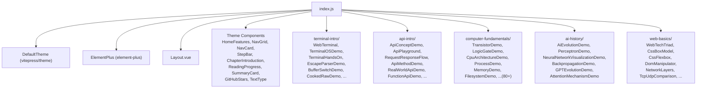

<!-- source: DeepWiki mcp.deepwiki.com · repo datawhalechina/easy-vibe · page 5 Interactive Vue Demo Components · fetched 2026-10-30 -->

# Interactive Vue Demo Components

<details>
<summary>Relevant source files</summary>

The following files were used as context for generating this wiki page:

- [README.md](README.md)
- [assets/readme-image1.png](assets/readme-image1.png)
- [docs/.vitepress/config.mjs](docs/.vitepress/config.mjs)
- [docs/.vitepress/theme/Layout.vue](docs/.vitepress/theme/Layout.vue)
- [docs/.vitepress/theme/components/ChapterIntroduction.vue](docs/.vitepress/theme/components/ChapterIntroduction.vue)
- [docs/.vitepress/theme/components/GitHubStars.vue](docs/.vitepress/theme/components/GitHubStars.vue)
- [docs/.vitepress/theme/components/HomeFeatures.vue](docs/.vitepress/theme/components/HomeFeatures.vue)
- [docs/.vitepress/theme/components/ReadingProgress.vue](docs/.vitepress/theme/components/ReadingProgress.vue)
- [docs/.vitepress/theme/components/appendix/computer-fundamentals/NetworkLayersSimple.vue](docs/.vitepress/theme/components/appendix/computer-fundamentals/NetworkLayersSimple.vue)
- [docs/.vitepress/theme/components/appendix/computer-fundamentals/TcpUdpSimple.vue](docs/.vitepress/theme/components/appendix/computer-fundamentals/TcpUdpSimple.vue)
- [docs/.vitepress/theme/components/appendix/terminal-intro/TerminalHandsOn.vue](docs/.vitepress/theme/components/appendix/terminal-intro/TerminalHandsOn.vue)
- [docs/.vitepress/theme/index.js](docs/.vitepress/theme/index.js)
- [docs/.vitepress/theme/style.css](docs/.vitepress/theme/style.css)
- [docs/public/robots.txt](docs/public/robots.txt)
- [docs/zh-cn/stage-0/0.1-learning-map/index.md](docs/zh-cn/stage-0/0.1-learning-map/index.md)

</details>


This page documents the system of custom Vue components embedded throughout the Easy-Vibe documentation site. It covers the registration mechanism, directory organization, structural conventions shared by all components, and how they are embedded in VitePress markdown pages.

For details on specific component groups, see the sub-pages:
- Theme and navigation UI: see [Theme and Navigation Components](#5.1)
- Computer science demos: see [Computer Science Demo Components](#5.2)
- Web, terminal, and API demos: see [Web, Terminal, and API Demo Components](#5.3)
- AI, data, and JavaScript demos: see [AI, Data, and JavaScript Demo Components](#5.4)
- Engineering excellence demos: see [Engineering Excellence Demo Components](#5.5)

For how the VitePress site is structured and built, see [Site Architecture](#2).

---

## Role and Purpose

The Easy-Vibe documentation uses over 200 custom Vue components to render interactive, animated, and stateful demos directly inside markdown pages. These components replace static diagrams and code listings with live simulations: terminal emulators, CPU step-throughs, neural network visualizers, API playgrounds, and more.

All components are registered globally in the VitePress theme entry point, which makes them available as HTML tags in any `.md` file across all locales without any per-page import.

---

## Registration Architecture

All component wiring happens in a single file: `docs/.vitepress/theme/index.js`.

The file:
1. Imports `DefaultTheme` from VitePress, which this theme extends.
2. Imports `ElementPlus` (used for UI widgets like sliders and popovers) and registers it via `app.use()`.
3. Imports every component file and registers each one globally via `app.component()`.
4. Exports the `Layout` component from `./Layout.vue` as the custom page layout.

Third-party libraries loaded alongside the component system:

| Library | Import | Purpose |
|---|---|---|
| `element-plus` | `ElementPlus` | Sliders, popovers, icons in `Layout.vue` and demos |
| `viewerjs` | `Viewer` | Image zoom/viewer overlay |
| `typeit` | `TypeIt` | Typewriter animation used by `TextType.vue` |

Sources: [docs/.vitepress/theme/index.js:1-10]()

---

**Diagram: Component Registration Flow**

```mermaid
flowchart LR
  vuefiles["".vue files\n(appendix/* and components/)""]
  indexjs["docs/.vitepress/theme/index.js\nimport statements + app.component()"]
  vitepress["VitePress global component registry"]
  markdown["Markdown .md files\n<ComponentName /> usage"]

  vuefiles --> indexjs
  indexjs --> vitepress
  vitepress --> markdown
```

Sources: [docs/.vitepress/theme/index.js:1-35]()

---

**Diagram: Key Entities in the Registration Module**



Sources: [docs/.vitepress/theme/index.js:11-330]()

---

## Directory Structure

All components live under `docs/.vitepress/theme/`. Theme-level components are directly inside `components/`. Demo components are organized by topic under `components/appendix/`.

```
docs/.vitepress/theme/
├── index.js                        ← global registration entry point
├── Layout.vue                      ← custom page layout (extends DefaultTheme.Layout)
├── style.css                       ← global CSS overrides and custom properties
└── components/
    ├── HomeFeatures.vue
    ├── NavGrid.vue
    ├── NavCard.vue
    ├── ChapterIntroduction.vue
    ├── ReadingProgress.vue
    ├── StepBar.vue
    ├── SummaryCard.vue
    ├── GitHubStars.vue
    ├── TextType.vue
    └── appendix/
        ├── terminal-intro/         ← TerminalHandsOn, EscapeParserDemo, ...
        ├── api-intro/              ← ApiConceptDemo, ApiPlayground, ...
        ├── llm-intro/              ← TokenizationDemo, EmbeddingDemo, ...
        ├── vlm-intro/              ← PatchifyDemo, VLMInferenceDemo, ...
        ├── image-gen-intro/        ← DiffusionProcessDemo, LatentSpaceViz, ...
        ├── audio-intro/            ← AudioWaveformDemo, TTSPipelineDemo, ...
        ├── web-basics/             ← CssBoxModel, DomManipulator, SubnetCalculator, ...
        ├── git-intro/              ← GitCommitFlow, GitBranchVisual, ...
        ├── computer-fundamentals/  ← TransistorDemo, CpuArchitectureDemo, ... (80+ files)
        ├── data-encoding/          ← GarbledTextDemo, CharacterEncodingExplorer, ...
        ├── deployment/             ← DeploymentOverviewDemo, DeploymentCicdDemo, ...
        ├── ai-history/             ← AiEvolutionDemo, PerceptronDemo, ...
        ├── transformer-attention/  ← SelfAttentionDemo, QKVMechanismDemo, ...
        ├── ai-protocols/           ← McpVisualDemo, A2AVisualDemo, ...
        ├── frontend-evolution/     ← FrontendEvolutionTimelineDemo, ...
        ├── framework-nature/       ← VirtualDomDiffDemo, ReactivityMechanismDemo, ...
        └── backend-evolution/      ← BackendEvolutionDemo, MicroservicesDemo, ...
```

Sources: [docs/.vitepress/theme/index.js:11-330]()

---

## Component Categories

The following table maps each category to its subdirectory, approximate component count, and the wiki sub-page that covers it in detail.

| Category | Subdirectory | Approx. Count | Wiki Page |
|---|---|---|---|
| Theme / Navigation UI | `components/` (root) | ~10 | [5.1](#5.1) |
| Terminal concepts | `appendix/terminal-intro/` | ~15 | [5.3](#5.3) |
| API introduction | `appendix/api-intro/` | ~13 | [5.3](#5.3) |
| Web basics (HTML/CSS/DOM) | `appendix/web-basics/` | ~25 | [5.3](#5.3) |
| Computer fundamentals | `appendix/computer-fundamentals/` | 80+ | [5.2](#5.2) |
| Data encoding | `appendix/data-encoding/` | ~7 | [5.2](#5.2) |
| AI history | `appendix/ai-history/` | ~13 | [5.4](#5.4) |
| Transformer & attention | `appendix/transformer-attention/` | ~8 | [5.4](#5.4) |
| LLM internals | `appendix/llm-intro/` | ~10 | [5.4](#5.4) |
| VLM internals | `appendix/vlm-intro/` | ~11 | [5.4](#5.4) |
| Image generation | `appendix/image-gen-intro/` | ~6 | [5.4](#5.4) |
| Audio models | `appendix/audio-intro/` | ~10 | [5.4](#5.4) |
| AI protocols (MCP/A2A) | `appendix/ai-protocols/` | ~6 | [5.4](#5.4) |
| JavaScript deep-dive | `appendix/` (inline per topic) | ~6 | [5.4](#5.4) |
| Engineering excellence | `appendix/` (inline per topic) | ~10 | [5.5](#5.5) |
| Frontend evolution | `appendix/frontend-evolution/` | ~10 | [5.3](#5.3) |
| Framework internals | `appendix/framework-nature/` | ~11 | [5.3](#5.3) |
| Backend evolution | `appendix/backend-evolution/` | ~8 | [5.3](#5.3) |
| Deployment | `appendix/deployment/` | ~7 | [5.3](#5.3) |
| Git internals | `appendix/git-intro/` | ~4 | [5.3](#5.3) |

Sources: [docs/.vitepress/theme/index.js:11-330]()

---

## Shared Structural Patterns

Despite the large number of components, all demo components follow the same conventions.

### Vue 3 Composition API

Every component uses `<script setup>` with Vue 3 Composition API primitives. A typical small demo component has this shape:

- `ref()` for mutable local state (selected tab, input values, simulation step)
- `computed()` for derived display values
- `onMounted()` / `onUnmounted()` for side effects such as scroll listeners or timers

For example, `ReadingProgress.vue` tracks scroll position with `const progress = ref(0)` and attaches a passive scroll listener in `onMounted`, removing it in `onUnmounted`. See [docs/.vitepress/theme/components/ReadingProgress.vue:38-182]().

For example, `TerminalHandsOn.vue` maintains `const history = ref([])`, `const inputCmd = ref('')`, and `const currentOS = ref('win-cmd')` as the core simulation state. See [docs/.vitepress/theme/components/appendix/terminal-intro/TerminalHandsOn.vue:171-188]().

### Self-Contained Data

Demo components store all their data inline (arrays of task objects, layer definitions, comparison data). They do not fetch external data at runtime. The one exception is `GitHubStars.vue`, which fetches the GitHub API and caches the result in `localStorage`. See [docs/.vitepress/theme/components/GitHubStars.vue:14-48]().

### VitePress CSS Custom Properties

All components use the VitePress CSS token system for colors and spacing, ensuring automatic light/dark mode support. Common tokens used:

| Token | Meaning |
|---|---|
| `--vp-c-bg` | Page background |
| `--vp-c-bg-soft` | Soft surface background |
| `--vp-c-divider` | Border / divider color |
| `--vp-c-text-1` | Primary text |
| `--vp-c-text-2` | Secondary / muted text |
| `--vp-c-brand-1` | Brand accent color |
| `--ev-doc-font-size` | Custom font size (set by `Layout.vue`) |
| `--ev-doc-line-height` | Custom line height (set by `Layout.vue`) |

The `--ev-doc-font-size` and `--ev-doc-line-height` variables are defined and controlled by the reading settings panel in `Layout.vue` and applied globally via `document.documentElement.style.setProperty()`. See [docs/.vitepress/theme/Layout.vue:50-60]() and [docs/.vitepress/theme/style.css:1-19]().

### Scoped Styles

All components use `<style scoped>` so their CSS does not leak into the global VitePress stylesheet or other components.

### `ClientOnly` Wrapper

Components that interact with browser APIs (`window`, `document`, `localStorage`) must be wrapped in `<ClientOnly>` when embedded in markdown, because VitePress performs server-side rendering during the build. `ReadingProgress` and the reading-settings popover in `Layout.vue` demonstrate this pattern. See [docs/.vitepress/theme/Layout.vue:431-453]().

---

## Using Components in Markdown

Because all components are globally registered in `enhanceApp`, any markdown file can use them as HTML tags without any import:

```markdown
<ChapterIntroduction
  duration="30 分钟"
  coreOutput="可运行的原型"
  :tags="['概念理解', '动手实践']"
>
  本章讲解 ...
</ChapterIntroduction>

<TransistorDemo />
```

Props are passed as HTML attributes; Vue's `:prop` binding syntax for JavaScript expressions also works inside VitePress markdown.

The `ChapterIntroduction` component accepts structured props (`duration`, `expectedOutput`, `coreOutput`, `assignment`, `tags`) and a default slot for free-form description text. See [docs/.vitepress/theme/components/ChapterIntroduction.vue:1-35]().

Most demo components take no props at all. They are fully self-contained simulations embedded by dropping `<ComponentName />` into the markdown body.

---

## Layout Integration

`Layout.vue` is the custom VitePress layout that wraps every page. It extends `DefaultTheme.Layout` using Vue's named slot system and adds:

- A sidebar collapse button (`ev-sidebar-nav-btn`) injected into `#nav-bar-title-before`
- The `GitHubStars` component and reading-settings popover injected into `#nav-bar-content-after`
- A `TextType` typewriter animation injected into `#home-hero-info-after` (visible only on home pages)
- A `ReadingProgress` ring indicator rendered outside the layout as a fixed overlay
- A hover area and toggle button for collapsing the sidebar, with state persisted in `localStorage`

See [docs/.vitepress/theme/Layout.vue:293-454]().

Sources: [docs/.vitepress/theme/Layout.vue:1-100](), [docs/.vitepress/theme/index.js:1-20]()

---

