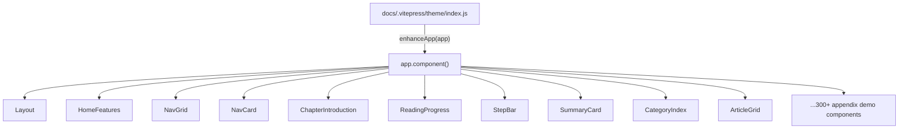
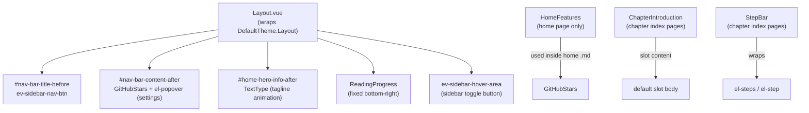
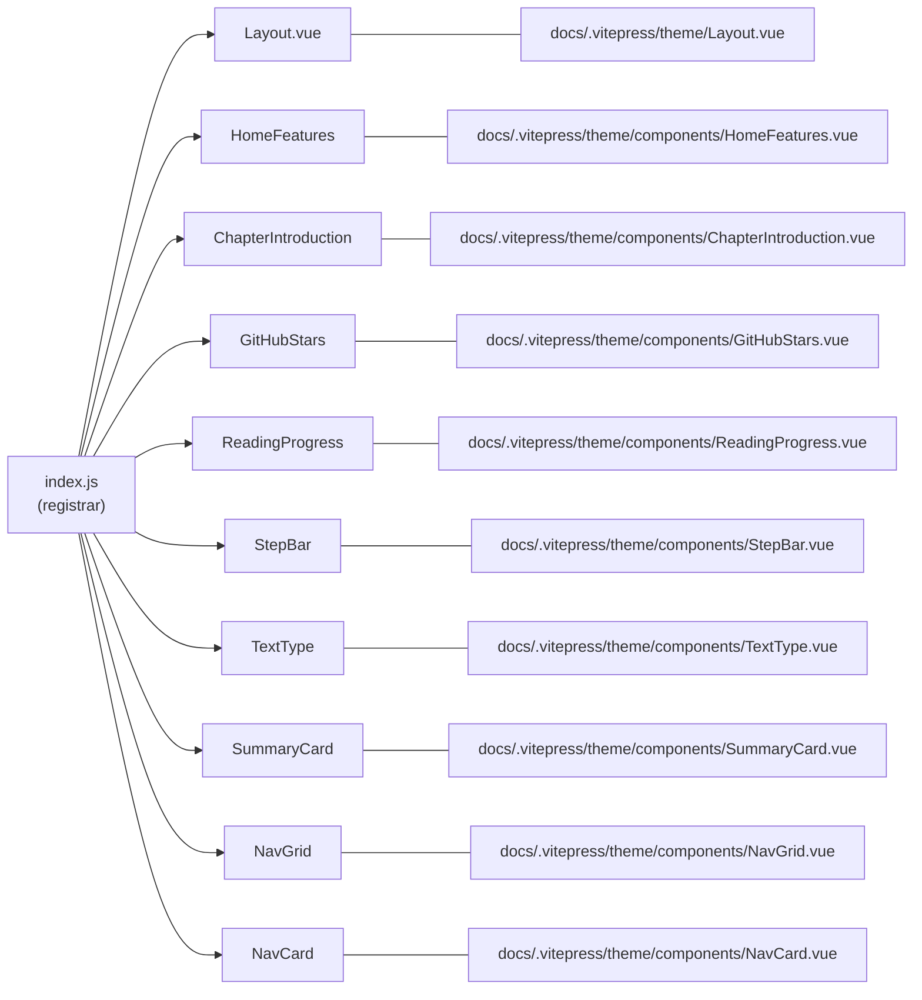

<!-- source: DeepWiki mcp.deepwiki.com · repo datawhalechina/easy-vibe · page 5.1 Theme and Navigation Components · fetched 2026-10-30 -->

# Theme and Navigation Components

<details>
<summary>Relevant source files</summary>

The following files were used as context for generating this wiki page:

- [.github/workflows/deploy.yml](.github/workflows/deploy.yml)
- [README.md](README.md)
- [assets/readme-image1.png](assets/readme-image1.png)
- [docs/.vitepress/config.mjs](docs/.vitepress/config.mjs)
- [docs/.vitepress/theme/Layout.vue](docs/.vitepress/theme/Layout.vue)
- [docs/.vitepress/theme/components/ChapterIntroduction.vue](docs/.vitepress/theme/components/ChapterIntroduction.vue)
- [docs/.vitepress/theme/components/GitHubStars.vue](docs/.vitepress/theme/components/GitHubStars.vue)
- [docs/.vitepress/theme/components/HomeFeatures.vue](docs/.vitepress/theme/components/HomeFeatures.vue)
- [docs/.vitepress/theme/components/ReadingProgress.vue](docs/.vitepress/theme/components/ReadingProgress.vue)
- [docs/.vitepress/theme/components/StepBar.vue](docs/.vitepress/theme/components/StepBar.vue)
- [docs/.vitepress/theme/components/SummaryCard.vue](docs/.vitepress/theme/components/SummaryCard.vue)
- [docs/.vitepress/theme/components/TextType.vue](docs/.vitepress/theme/components/TextType.vue)
- [docs/.vitepress/theme/components/appendix/computer-fundamentals/NetworkLayersSimple.vue](docs/.vitepress/theme/components/appendix/computer-fundamentals/NetworkLayersSimple.vue)
- [docs/.vitepress/theme/components/appendix/computer-fundamentals/TcpUdpSimple.vue](docs/.vitepress/theme/components/appendix/computer-fundamentals/TcpUdpSimple.vue)
- [docs/.vitepress/theme/components/appendix/frontend-engineering/AssetFingerprintDemo.vue](docs/.vitepress/theme/components/appendix/frontend-engineering/AssetFingerprintDemo.vue)
- [docs/.vitepress/theme/components/appendix/frontend-engineering/BuildPipelineDemo.vue](docs/.vitepress/theme/components/appendix/frontend-engineering/BuildPipelineDemo.vue)
- [docs/.vitepress/theme/components/appendix/frontend-engineering/DependencyGraphDemo.vue](docs/.vitepress/theme/components/appendix/frontend-engineering/DependencyGraphDemo.vue)
- [docs/.vitepress/theme/components/appendix/terminal-intro/TerminalHandsOn.vue](docs/.vitepress/theme/components/appendix/terminal-intro/TerminalHandsOn.vue)
- [docs/.vitepress/theme/index.js](docs/.vitepress/theme/index.js)
- [docs/.vitepress/theme/style.css](docs/.vitepress/theme/style.css)
- [docs/index.md](docs/index.md)
- [docs/public/robots.txt](docs/public/robots.txt)
- [docs/zh-cn/stage-0/0.1-learning-map/index.md](docs/zh-cn/stage-0/0.1-learning-map/index.md)
- [docs/zh-cn/stage-1/1.0-finding-great-idea/index.md](docs/zh-cn/stage-1/1.0-finding-great-idea/index.md)

</details>


This page documents the custom VitePress theme UI components used across the Easy-Vibe documentation site. These components live under `docs/.vitepress/theme/` and handle the site's visual identity, layout chrome, reading experience utilities, and structural navigation patterns embedded within Markdown pages.

For the interactive demo components embedded in curriculum content (transistors, AI history, JavaScript concepts, etc.), see pages [5.2](), [5.3](), [5.4](), and [5.5](). For VitePress configuration details (base paths, locales, sidebar config), see [2.1]().

---

## Component Registration

All theme components are registered globally in `docs/.vitepress/theme/index.js`. This means any `.md` page in the site can use them as custom HTML elements without any per-page import.

**Theme entry point → global component registration**



Sources: [docs/.vitepress/theme/index.js:1-22]()

The theme also imports `DefaultTheme` from `vitepress/theme`, `ElementPlus` (for UI widgets like `el-steps`, `el-popover`, `el-slider`), `viewerjs` (for image zoom), and a global `style.css`.

---

## Component Hierarchy at Runtime

**Runtime component tree for a documentation page**



Sources: [docs/.vitepress/theme/Layout.vue:293-454](), [docs/.vitepress/theme/index.js:1-22]()

---

## `Layout.vue`

**File:** `docs/.vitepress/theme/Layout.vue`

`Layout.vue` is the root layout wrapper that replaces VitePress's default `Layout`. It is set as the `layout` export in `index.js`.

### Slots Used

| VitePress Slot | Content Injected |
|---|---|
| `#nav-bar-title-before` | Hamburger button (`ev-sidebar-nav-btn`) to collapse/expand sidebar (desktop only) |
| `#nav-bar-content-after` | `GitHubStars` widget + reading settings popover (`el-popover`) |
| `#home-hero-info-after` | `TextType` typing animation (only when `frontmatter.layout === 'home'`) |

### Reading Settings Panel

Triggered by an `el-popover` button in the nav bar. Controls two CSS custom properties on `document.documentElement`:

| Setting | CSS Variable | Default | Range | Storage Key |
|---|---|---|---|---|
| Font size | `--ev-doc-font-size` | `14px` | 12–18px | `ev-doc-font-size` |
| Line height | `--ev-doc-line-height` | `1.65` | 1.25–1.80 | `ev-doc-line-height` |

Both values are persisted to `localStorage` via watchers on `fontSize` and `lineHeight` refs. The `clampFontSize` and `clampLineHeight` helpers [docs/.vitepress/theme/Layout.vue:33-47]() sanitize values on load (guarding against `NaN` or out-of-range values from corrupted storage).

### Sidebar Collapse

The `sidebarCollapsed` ref is toggled by `toggleSidebar()`. When true, the class `ev-sidebar-collapsed` is added to `document.body`, which hides `.VPSidebar` via CSS (desktop only, ≥ 960px). State is stored under `ev-sidebar-collapsed` in `localStorage`.

**Sidebar collapse state machine**

```mermaid
stateDiagram-v2
    [*] --> "Expanded"
    "Expanded" --> "Collapsed": "toggleSidebar()"
    "Collapsed" --> "Expanded": "toggleSidebar()"
    "Expanded" --> "Expanded": "page navigation"
    "Collapsed" --> "Collapsed": "page navigation"
    note right of "Collapsed"
        body.classList has ev-sidebar-collapsed
        localStorage: ev-sidebar-collapsed = true
    end note
```

Sources: [docs/.vitepress/theme/Layout.vue:80-110](), [docs/.vitepress/theme/Layout.vue:286-290](), [docs/.vitepress/theme/Layout.vue:582-720]()

### Outline Auto-Scroll

`initOutlineAutoScroll()` sets up a `MutationObserver` on `.VPDocAsideOutline` and `.VPSidebar`. When an item gains the `active` (outline) or `is-active` (sidebar) class, `scrollOutlineToActiveItem()` or `scrollSidebarToActiveItem()` smoothly scrolls the respective panel so the active item stays centered in its container.

Sources: [docs/.vitepress/theme/Layout.vue:115-270]()

---

## `HomeFeatures.vue`

**File:** `docs/.vitepress/theme/components/HomeFeatures.vue`

`HomeFeatures.vue` is the large, self-contained home page body component embedded in each locale's `index.md`. It is not injected by `Layout.vue` — it is placed directly in the Markdown.

### Key Reactive State

| Ref | Type | Purpose |
|---|---|---|
| `activeTab` | `String` | Which section tab is active (`'home'` default) |
| `showLangMenu` | `Boolean` | Language picker dropdown visibility |
| `appendixWrapper` | `Ref<HTMLElement>` | DOM reference for the scrollable appendix card strip |
| `totalPages` | `Number` | Appendix carousel page count |
| `currentPage` | `Number` | Current appendix carousel page |

### Appendix Carousel

The appendix section renders a horizontally scrollable strip of topic cards. Three functions manage it:

- `updatePagination()` — reads `scrollLeft`, `clientWidth`, `scrollWidth` to compute `totalPages` and `currentPage`
- `scrollToPage(pageIndex)` — smooth-scrolls to a target page
- `autoScroll()` — advances one page; wraps to 0 when at the end

Sources: [docs/.vitepress/theme/components/HomeFeatures.vue:16-59]()

### i18n

The `i18n` object contains inline translations for all 10 supported locales (`zh-cn`, `en-us`, `ja-jp`, `zh-tw`, `ko-kr`, `es-es`, `fr-fr`, `de-de`, `ar-sa`, `vi-vn`). The active locale is detected via `lang` from `useData()`. This avoids any runtime locale file loading.

Sources: [docs/.vitepress/theme/components/HomeFeatures.vue:61-330+]()

---

## `ChapterIntroduction.vue`

**File:** `docs/.vitepress/theme/components/ChapterIntroduction.vue`

Renders a styled info box at the top of each chapter `index.md`. Provides a consistent chapter preamble with metadata badges and an overview slot.

### Props

| Prop | Type | Default | Purpose |
|---|---|---|---|
| `duration` | `String` | `''` | Reading/exercise time estimate (may include HTML) |
| `coreOutput` | `String` | `''` | Primary deliverable of the chapter |
| `expectedOutput` | `String` | `''` | Secondary outcome description |
| `assignment` | — | — | (additional prop, visible in prop list) |
| `tags` | `Array` | — | Skill/topic tags rendered as badges |

The component accepts a default slot for the descriptive body text.

### Usage Pattern

```html
<ChapterIntroduction
  :duration="duration"
  :tags="['需求挖掘', '产品思维']"
  coreOutput="3 个经过验证的产品概念"
  expectedOutput="可落地的创业/产品方向"
>
  Chapter description text here...
</ChapterIntroduction>
```

Sources: [docs/.vitepress/theme/components/ChapterIntroduction.vue:1-50+](), [docs/zh-cn/stage-1/1.0-finding-great-idea/index.md:14-26]()

---

## `GitHubStars.vue`

**File:** `docs/.vitepress/theme/components/GitHubStars.vue`

A small widget that fetches and displays the GitHub star count for `datawhalechina/easy-vibe`. It is rendered inside the nav bar (via `Layout.vue`'s `#nav-bar-content-after` slot) and also embedded directly within `HomeFeatures.vue`.

Fetches from the GitHub API on `onMounted`. The star count is displayed as a formatted number badge.

Sources: [docs/.vitepress/theme/components/GitHubStars.vue:1-50+](), [docs/.vitepress/theme/Layout.vue:310]()

---

## `ReadingProgress.vue`

**File:** `docs/.vitepress/theme/components/ReadingProgress.vue`

A fixed circular SVG progress indicator positioned at `bottom: 32px; right: 32px`. Rendered by `Layout.vue` (wrapped in `<ClientOnly>`) on all non-home pages.

### Visual Structure

The SVG is a 56×56 circle ring with:
- `progress-ring-bg`: static background circle (stroke: `--vp-c-divider`)
- `progress-ring-circle`: animated arc (stroke: `--vp-c-brand-1`), driven by `strokeDashoffset`
- `circumference = 2 * Math.PI * 24 ≈ 150.796`

**Behavior state machine**

```mermaid
stateDiagram-v2
    [*] --> "Hidden": "scrollY == 0"
    "Hidden" --> "Visible_Percent": "scroll starts"
    "Visible_Percent" --> "Visible_Arrow": "no scroll for 1500ms"
    "Visible_Arrow" --> "Visible_Percent": "scroll resumes"
    "Visible_Percent" --> "Dragging": "mousedown / touchstart"
    "Visible_Arrow" --> "Dragging": "mousedown / touchstart"
    "Dragging" --> "Visible_Arrow": "mouseup / touchend"
    "Visible_Arrow" --> "Hidden": "click (scrollTo top)"
```

### Drag-to-Scroll

`startDrag` captures the initial `clientY` and `progress.value`. While dragging (`onDrag`), a delta of 3 px maps to 1% of scroll progress. `requestAnimationFrame` throttles DOM writes. On `endDrag`, scroll events are unregistered and `showArrow` is restored.

Sources: [docs/.vitepress/theme/components/ReadingProgress.vue:1-182]()

---

## `StepBar.vue`

**File:** `docs/.vitepress/theme/components/StepBar.vue`

A thin wrapper around Element Plus `el-steps` / `el-step`. Renders a horizontal step progress indicator used in chapter index pages to visualise the learning flow.

### Props

| Prop | Type | Purpose |
|---|---|---|
| `active` | `Number` | Index of the currently active step (0-based) |
| `items` | `Array<{title, description}>` | Step definitions |

### Usage Pattern

```html
<StepBar :active="0" :items="[
  { title: 'Step 1', description: '建立判断标准' },
  { title: 'Step 2', description: '挖掘日常痛点' }
]" />
```

Sources: [docs/.vitepress/theme/components/StepBar.vue:1-20+](), [docs/zh-cn/stage-1/1.0-finding-great-idea/index.md:31-40]()

---

## `TextType.vue`

**File:** `docs/.vitepress/theme/components/TextType.vue`

Implements a typewriter animation loop. Used exclusively by `Layout.vue` in the `#home-hero-info-after` slot to animate the home page tagline. The original VitePress `.tagline` element is hidden via CSS (`display: none !important`), replaced by this component's output inside `.vp-typed-tagline`.

### Props (as configured in `Layout.vue`)

| Prop | Value in Layout | Description |
|---|---|---|
| `text` | `frontmatter.hero.typingTagline \|\| frontmatter.hero.tagline` | Text to animate |
| `typingSpeed` | `45` | ms per character typed |
| `initialDelay` | `0` | ms before first character |
| `pauseDuration` | `2500` | ms pause at end of typed string |
| `postDeletingDelay` | `500` | ms pause after full deletion |
| `deletingSpeed` | `18` | ms per character deleted |
| `loop` | `true` | Loop indefinitely |

The frontmatter key `hero.typingTagline` enables per-page typing text distinct from the SEO-visible `hero.tagline`.

Sources: [docs/.vitepress/theme/components/TextType.vue:1-50+](), [docs/.vitepress/theme/Layout.vue:12-18](), [docs/.vitepress/theme/Layout.vue:413-429](), [docs/.vitepress/theme/Layout.vue:456-476]()

---

## `SummaryCard.vue`

**File:** `docs/.vitepress/theme/components/SummaryCard.vue`

Renders a structured summary panel (📚 icon header) used at the end of curriculum sections to recap key takeaways.

### Props

| Prop | Type | Default | Description |
|---|---|---|---|
| `title` | `String` | `'本幕小结'` | Card heading text |
| `sections` | `Array` | `[]` | Array of `{ number, title, items[] }` objects |
| `outputs` | `Array` | `[]` | Array of output/deliverable strings |

Sources: [docs/.vitepress/theme/components/SummaryCard.vue:1-16]()

---

## `NavGrid` and `NavCard`

**Files:** `docs/.vitepress/theme/components/NavGrid.vue`, `docs/.vitepress/theme/components/NavCard.vue`

These two components are registered globally and used in curriculum stage index pages (see [3.1]()) to render a grid of navigation cards linking to sub-sections. `NavGrid` provides the grid container; `NavCard` is the individual card item, typically accepting a title, description, icon, and link.

Sources: [docs/.vitepress/theme/index.js:13-14]()

---

## Global Styles (`style.css`)

**File:** `docs/.vitepress/theme/style.css`

Defines CSS custom properties and overrides applied across the entire site.

### CSS Custom Properties (`:root`)

| Variable | Default | Set by |
|---|---|---|
| `--ev-doc-font-size` | `14px` | `Layout.vue` via `applyFontSize()` |
| `--ev-doc-line-height` | `1.65` | `Layout.vue` via `applyLineHeight()` |
| `--vp-sidebar-nav-section-gap` | `8px` | Static (compact sidebar) |

The `.vp-doc` class applies these variables to `font-size` and `line-height`, cascading to Element Plus variables (`--el-font-size-base`, etc.).

### Image Sizing Utilities

CSS classes for constraining tall images:

| Class | Max Height | Use Case |
|---|---|---|
| `img-tall` | 380px | Moderately tall images |
| `img-very-tall` | 280px | Very tall images |
| `img-ultra-tall` | 200px | Extremely tall images |
| `img-limit-width` | 320px | Wide images needing height cap |
| `img-limit-height` | 450px | General height limit |

All images default to `display: block; margin: auto` (horizontally centered).

### Sidebar Compaction

Multiple overrides target VitePress's scoped sidebar classes (e.g. `.VPSidebarItem.level-0[data-v-d81de50c]`) with `!important` to enforce compact padding. This is necessary because scoped styles have higher specificity than unscoped class selectors.

### Hero Styles

- `.VPHomeHero` is set to `min-height: 100vh` with flex centering
- `.VPHomeHero .name` uses a gradient fill (`#42d392` → `#647eff`) with `drop-shadow`
- `.VPHomeHero .action .VPButton.brand` uses `border-radius: 20px` and a gradient background

Sources: [docs/.vitepress/theme/style.css:1-420]()

---

## Component–to–File Reference



Sources: [docs/.vitepress/theme/index.js:1-22]()

---

