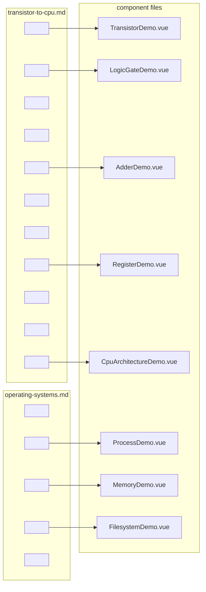
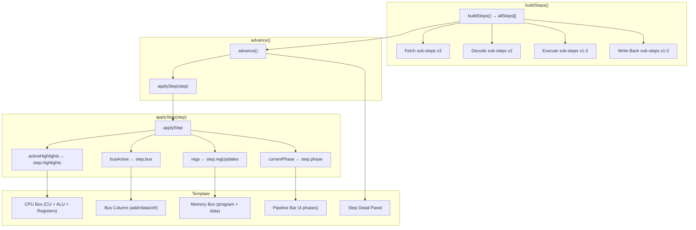
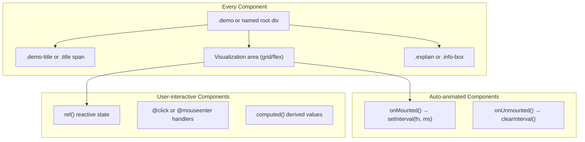

<!-- source: DeepWiki mcp.deepwiki.com · repo datawhalechina/easy-vibe · page 5.2 Computer Science Demo Components · fetched 2026-10-30 -->

# Computer Science Demo Components

<details>
<summary>Relevant source files</summary>

The following files were used as context for generating this wiki page:

- [docs/.vitepress/theme/components/appendix/api-design/DataFieldDesignDemo.vue](docs/.vitepress/theme/components/appendix/api-design/DataFieldDesignDemo.vue)
- [docs/.vitepress/theme/components/appendix/api-design/ErrorResponseDesignDemo.vue](docs/.vitepress/theme/components/appendix/api-design/ErrorResponseDesignDemo.vue)
- [docs/.vitepress/theme/components/appendix/api-design/ResponseStructureDemo.vue](docs/.vitepress/theme/components/appendix/api-design/ResponseStructureDemo.vue)
- [docs/.vitepress/theme/components/appendix/api-design/RestfulApiFlow.vue](docs/.vitepress/theme/components/appendix/api-design/RestfulApiFlow.vue)
- [docs/.vitepress/theme/components/appendix/computer-fundamentals/AIvsTraditionalDemo.vue](docs/.vitepress/theme/components/appendix/computer-fundamentals/AIvsTraditionalDemo.vue)
- [docs/.vitepress/theme/components/appendix/computer-fundamentals/AdderDemo.vue](docs/.vitepress/theme/components/appendix/computer-fundamentals/AdderDemo.vue)
- [docs/.vitepress/theme/components/appendix/computer-fundamentals/AlgorithmDemo.vue](docs/.vitepress/theme/components/appendix/computer-fundamentals/AlgorithmDemo.vue)
- [docs/.vitepress/theme/components/appendix/computer-fundamentals/BrowserArchitectureDemo.vue](docs/.vitepress/theme/components/appendix/computer-fundamentals/BrowserArchitectureDemo.vue)
- [docs/.vitepress/theme/components/appendix/computer-fundamentals/CareerPathDemo.vue](docs/.vitepress/theme/components/appendix/computer-fundamentals/CareerPathDemo.vue)
- [docs/.vitepress/theme/components/appendix/computer-fundamentals/ComputerFieldMapDemo.vue](docs/.vitepress/theme/components/appendix/computer-fundamentals/ComputerFieldMapDemo.vue)
- [docs/.vitepress/theme/components/appendix/computer-fundamentals/CpuArchitectureDemo.vue](docs/.vitepress/theme/components/appendix/computer-fundamentals/CpuArchitectureDemo.vue)
- [docs/.vitepress/theme/components/appendix/computer-fundamentals/DataLifecycleDemo.vue](docs/.vitepress/theme/components/appendix/computer-fundamentals/DataLifecycleDemo.vue)
- [docs/.vitepress/theme/components/appendix/computer-fundamentals/DataLinkLayerDemo.vue](docs/.vitepress/theme/components/appendix/computer-fundamentals/DataLinkLayerDemo.vue)
- [docs/.vitepress/theme/components/appendix/computer-fundamentals/DataStructureDemo.vue](docs/.vitepress/theme/components/appendix/computer-fundamentals/DataStructureDemo.vue)
- [docs/.vitepress/theme/components/appendix/computer-fundamentals/DataStructureSelectorDemo.vue](docs/.vitepress/theme/components/appendix/computer-fundamentals/DataStructureSelectorDemo.vue)
- [docs/.vitepress/theme/components/appendix/computer-fundamentals/DesktopDemo.vue](docs/.vitepress/theme/components/appendix/computer-fundamentals/DesktopDemo.vue)
- [docs/.vitepress/theme/components/appendix/computer-fundamentals/EncodingDemo.vue](docs/.vitepress/theme/components/appendix/computer-fundamentals/EncodingDemo.vue)
- [docs/.vitepress/theme/components/appendix/computer-fundamentals/EncodingStorageTransmissionDemo.vue](docs/.vitepress/theme/components/appendix/computer-fundamentals/EncodingStorageTransmissionDemo.vue)
- [docs/.vitepress/theme/components/appendix/computer-fundamentals/FilesystemDemo.vue](docs/.vitepress/theme/components/appendix/computer-fundamentals/FilesystemDemo.vue)
- [docs/.vitepress/theme/components/appendix/computer-fundamentals/FrontendFrameworkDemo.vue](docs/.vitepress/theme/components/appendix/computer-fundamentals/FrontendFrameworkDemo.vue)
- [docs/.vitepress/theme/components/appendix/computer-fundamentals/FrontendTriadDemo.vue](docs/.vitepress/theme/components/appendix/computer-fundamentals/FrontendTriadDemo.vue)
- [docs/.vitepress/theme/components/appendix/computer-fundamentals/FullProcessDemo.vue](docs/.vitepress/theme/components/appendix/computer-fundamentals/FullProcessDemo.vue)
- [docs/.vitepress/theme/components/appendix/computer-fundamentals/FunctionalUnitDemo.vue](docs/.vitepress/theme/components/appendix/computer-fundamentals/FunctionalUnitDemo.vue)
- [docs/.vitepress/theme/components/appendix/computer-fundamentals/GreedyThinkingDemo.vue](docs/.vitepress/theme/components/appendix/computer-fundamentals/GreedyThinkingDemo.vue)
- [docs/.vitepress/theme/components/appendix/computer-fundamentals/HashTableDemo.vue](docs/.vitepress/theme/components/appendix/computer-fundamentals/HashTableDemo.vue)
- [docs/.vitepress/theme/components/appendix/computer-fundamentals/LogicGateDemo.vue](docs/.vitepress/theme/components/appendix/computer-fundamentals/LogicGateDemo.vue)
- [docs/.vitepress/theme/components/appendix/computer-fundamentals/MemoryDemo.vue](docs/.vitepress/theme/components/appendix/computer-fundamentals/MemoryDemo.vue)
- [docs/.vitepress/theme/components/appendix/computer-fundamentals/NetworkLayers.vue](docs/.vitepress/theme/components/appendix/computer-fundamentals/NetworkLayers.vue)
- [docs/.vitepress/theme/components/appendix/computer-fundamentals/PowerOnDemo.vue](docs/.vitepress/theme/components/appendix/computer-fundamentals/PowerOnDemo.vue)
- [docs/.vitepress/theme/components/appendix/computer-fundamentals/ProcessDemo.vue](docs/.vitepress/theme/components/appendix/computer-fundamentals/ProcessDemo.vue)
- [docs/.vitepress/theme/components/appendix/computer-fundamentals/RecursiveThinkingDemo.vue](docs/.vitepress/theme/components/appendix/computer-fundamentals/RecursiveThinkingDemo.vue)
- [docs/.vitepress/theme/components/appendix/computer-fundamentals/RegisterDemo.vue](docs/.vitepress/theme/components/appendix/computer-fundamentals/RegisterDemo.vue)
- [docs/.vitepress/theme/components/appendix/computer-fundamentals/SearchAlgorithmDemo.vue](docs/.vitepress/theme/components/appendix/computer-fundamentals/SearchAlgorithmDemo.vue)
- [docs/.vitepress/theme/components/appendix/computer-fundamentals/SortingAlgorithmDemo.vue](docs/.vitepress/theme/components/appendix/computer-fundamentals/SortingAlgorithmDemo.vue)
- [docs/.vitepress/theme/components/appendix/computer-fundamentals/StorageDemo.vue](docs/.vitepress/theme/components/appendix/computer-fundamentals/StorageDemo.vue)
- [docs/.vitepress/theme/components/appendix/computer-fundamentals/SubnetCalculator.vue](docs/.vitepress/theme/components/appendix/computer-fundamentals/SubnetCalculator.vue)
- [docs/.vitepress/theme/components/appendix/computer-fundamentals/TcpUdpComparison.vue](docs/.vitepress/theme/components/appendix/computer-fundamentals/TcpUdpComparison.vue)
- [docs/.vitepress/theme/components/appendix/computer-fundamentals/TransistorDemo.vue](docs/.vitepress/theme/components/appendix/computer-fundamentals/TransistorDemo.vue)
- [docs/zh-cn/appendix/1-computer-fundamentals/operating-systems.md](docs/zh-cn/appendix/1-computer-fundamentals/operating-systems.md)
- [docs/zh-cn/appendix/1-computer-fundamentals/transistor-to-cpu.md](docs/zh-cn/appendix/1-computer-fundamentals/transistor-to-cpu.md)

</details>


This page documents the interactive Vue components embedded throughout the computer fundamentals appendix (`docs/zh-cn/appendix/1-computer-fundamentals/`). These components make abstract hardware and OS concepts tangible through animation and user interaction. For the theme-level navigation components, see [Theme and Navigation Components](#5.1). For web, terminal, and API demo components, see [Web, Terminal, and API Demo Components](#5.3).

All components described here live under `docs/.vitepress/theme/components/appendix/computer-fundamentals/`. They are registered globally in the VitePress custom theme and used as bare tags inside markdown files.

---

## Component Inventory

The following table lists every component in scope, the markdown file that embeds it, and the concept it demonstrates.

| Component File | Tag Used in Markdown | Topic |
|---|---|---|
| `TransistorDemo.vue` | `<TransistorDemo />` | MOSFET transistor switch |
| `LogicGateDemo.vue` | `<LogicGateDemo />` | AND / OR / NOT / XOR gates |
| `AdderDemo.vue` | `<AdderChainDemo />` (mapped) | 4-bit ripple-carry adder |
| `RegisterDemo.vue` | `<RegisterDemo />` | CPU register file |
| `CpuArchitectureDemo.vue` | `<CpuArchitectureDemo />` | Instruction fetch-decode-execute-writeback |
| `ProcessDemo.vue` | `<ProcessDemo />` | CPU time-slice round-robin |
| `MemoryDemo.vue` | `<MemoryDemo />` | Virtual memory page mapping |
| `FilesystemDemo.vue` | `<FilesystemDemo />` | Filesystem block layout |
| `BrowserArchitectureDemo.vue` | `<BrowserArchitectureDemo />` | Browser subsystem modules |
| `DesktopDemo.vue` | *(standalone)* | Boot sequence phases |
| `EncodingStorageTransmissionDemo.vue` | *(standalone)* | Data encoding and transmission |
| `DataLinkLayerDemo.vue` | *(standalone)* | MAC-layer frame delivery |
| `DataStructureSelectorDemo.vue` | *(standalone)* | Data structure selection guide |
| `SortingAlgorithmDemo.vue` | *(standalone)* | Sorting algorithm visualization |
| `SearchAlgorithmDemo.vue` | *(standalone)* | Linear vs. binary search |
| `RecursiveThinkingDemo.vue` | *(standalone)* | Recursive decomposition |
| `GreedyThinkingDemo.vue` | *(standalone)* | Greedy algorithm pattern |
| `ComputerFieldMapDemo.vue` | *(standalone)* | CS career field overview |
| `CareerPathDemo.vue` | *(standalone)* | Engineer growth stages |
| `AIvsTraditionalDemo.vue` | *(standalone)* | AI vs. traditional developer workflow |
| `FrontendTriadDemo.vue` | *(standalone)* | HTML / CSS / JS roles |
| `FrontendFrameworkDemo.vue` | *(standalone)* | Frontend framework evolution timeline |
| `FullProcessDemo.vue` | *(standalone)* | End-to-end power-on to webpage chain |
| `PowerOnDemo.vue` | *(standalone)* | Hardware startup chain |
| `DataLifecycleDemo.vue` | *(standalone)* | Data lifecycle stages |

Sources: [docs/zh-cn/appendix/1-computer-fundamentals/transistor-to-cpu.md:55-233](), [docs/zh-cn/appendix/1-computer-fundamentals/operating-systems.md:36-96]()

---

## Component Placement Map

The following diagram maps markdown source files to the component tags they embed.

**Diagram: Markdown Pages and Their Embedded Components**



Sources: [docs/zh-cn/appendix/1-computer-fundamentals/transistor-to-cpu.md:55-233](), [docs/zh-cn/appendix/1-computer-fundamentals/operating-systems.md:36-96]()

---

## Transistor and Logic Gate Components

### `TransistorDemo.vue`

**Purpose:** Teaches the MOSFET switch abstraction — high gate voltage = conducting, low = blocked.

**Behavior:** The entire `.schematic` div is a click target that toggles the single reactive ref `gateOn`. When `true`, animated `.electron` spans (`.e1`, `.e2`, `.e3`) flow left-to-right through the channel via a CSS `@keyframes flow` animation with staggered `animation-delay`. When `false`, a block mark (`✕`) is shown and the channel bar has a neutral background.

| Reactive State | Type | Initial |
|---|---|---|
| `gateOn` | `ref<boolean>` | `false` |

Sources: [docs/.vitepress/theme/components/appendix/computer-fundamentals/TransistorDemo.vue:1-45]()

---

### `LogicGateDemo.vue`

**Purpose:** Presents the four fundamental logic gates — AND, OR, NOT, XOR — each with its Boolean formula, a plain-language rule, an intuitive analogy, and a complete truth table.

**Behavior:** Fully static — no reactive state. A `gates` constant array drives a `v-for` over `.gate-card` elements in a 4-column grid. Truth table cells where the output equals `1` receive the `.one` CSS class, rendered in the brand accent color.

**Data shape for each gate entry:**

```
{ name, nameCn, formula, rule, intuition, rows: number[][] }
```

The NOT gate is detected via `gate.name !== 'NOT'` to conditionally render the second column header in the truth table.

Sources: [docs/.vitepress/theme/components/appendix/computer-fundamentals/LogicGateDemo.vue:55-108]()

---

### `AdderDemo.vue`

**Purpose:** Shows a 4-bit ripple-carry adder, illustrating the difference between a half adder (first bit position) and a full adder (positions 1–3).

**Behavior:**

- `inputA` and `inputB` are user-editable number inputs, clamped to `[0, 15]` by the `clamp()` function.
- The `stages` computed property runs a loop from bit 0 to bit 3. Bit 0 uses half-adder logic (`sum = a ^ b`, `carryOut = a & b`); subsequent bits use full-adder logic that incorporates `carryIn`.
- Hovering over a stage card sets `activeBit`, which highlights the corresponding column in the binary display rows above.
- Overflow is detected when `clampedA + clampedB > 15` and appended as `（溢出）` to the result.

| Reactive State | Type | Role |
|---|---|---|
| `inputA` | `ref<number>` | First operand (0–15) |
| `inputB` | `ref<number>` | Second operand (0–15) |
| `activeBit` | `ref<number\|null>` | Currently hovered bit position |

**Stage object shape:**

```
{ bitPos, a, b, carryIn: number|null, sum, carryOut }
```

`carryIn === null` signals a half adder; otherwise it is a full adder.

Sources: [docs/.vitepress/theme/components/appendix/computer-fundamentals/AdderDemo.vue:112-178]()

---

## CPU Register and Architecture Components

### `RegisterDemo.vue`

**Purpose:** Displays the CPU register file divided into special-purpose registers, general-purpose registers, and the status flags word (PSW/FLAGS).

**Behavior:**

- Clicking any `.reg-card` calls `selectReg(reg)`, setting `selectedReg` and `activeReg`. A detail panel with a left blue border renders below the register groups.
- Status flags (CF, PF, AF, ZF, SF, OF) are displayed as non-interactive `.flag-bit` cells; the `.set` class applies when `flag.value === 1`.
- A comparison table at the bottom statically compares registers versus RAM on access speed, location, capacity, and purpose.

| Reactive State | Type | Role |
|---|---|---|
| `activeReg` | `ref<string>` | Name of highlighted register |
| `selectedReg` | `ref<object\|null>` | Full register object shown in detail panel |

**Special registers defined:** `PC`, `IR`, `MAR`, `MDR`, `ACC`

**General registers defined:** `RAX`, `RBX`, `RCX`, `RDX`, `RSI`, `RDI`, `RBP`, `RSP`

Sources: [docs/.vitepress/theme/components/appendix/computer-fundamentals/RegisterDemo.vue:95-133]()

---

### `CpuArchitectureDemo.vue`

**Purpose:** Animates a simplified CPU executing a 4-instruction program one micro-step at a time, showing data movement across registers, buses, and memory.

This is the most complex component in this section. Its behavior is described below.

**Program:** Four instructions starting at `BASE_ADDR = 0x100`:

| Address | Instruction | Operation |
|---|---|---|
| `0x100` | `LOAD R0, [0x200]` | Read memory into R0 |
| `0x101` | `LOAD R1, #7` | Load immediate into R1 |
| `0x102` | `ADD R0, R1` | ALU addition |
| `0x103` | `STORE [0x201], R0` | Write R0 back to memory |

**Step generation:** `buildSteps()` [docs/.vitepress/theme/components/appendix/computer-fundamentals/CpuArchitectureDemo.vue:197-382]() produces an array of micro-step objects. Each step specifies:

```
{ phase, highlights, bus, ctrlSignal, aluOp, regUpdates, msg, signal, fetchedAddr? }
```

Each instruction generates 3 (Fetch) + 2 (Decode) + 1–2 (Execute) + 1–2 (Write Back) steps.

**Special sentinel values in `regUpdates`:**

| Sentinel | Meaning |
|---|---|
| `'__ADD_RESULT__'` | Compute `R0 + R1` at step application time |
| `'__ACC__'` | Copy `ACC` into target register |
| `'__FROM_R0__'` | Copy `R0` into `MDR` |
| `'__MEM__'` | Write `MDR` to the memory address given as value |

**Controls:**

- **Clock pulse button**: calls `advance()`, applies the next step, increments `stepIndex`.
- **Auto run button**: starts a `setInterval` at 900 ms calling `advance()` repeatedly.
- **Reset button**: calls `reset()`, which also calls `stopAuto()` and zeroes all state.

**Key reactive state:**

| State | Type | Role |
|---|---|---|
| `regs` | `ref<object>` | All CPU registers (PC, IR, MAR, MDR, ACC, R0–R3) |
| `busActive` | `ref<string\|null>` | `'addr'`, `'data'`, or `'ctrl'` |
| `currentPhase` | `ref<number>` | 0=Fetch, 1=Decode, 2=Execute, 3=Write Back |
| `activeHighlights` | `ref<string[]>` | Register names to highlight in yellow |
| `dataMemory` | `ref<object>` | Simulated data memory, initially `{0x200: 42, 0x201: 0}` |
| `stepIndex` | `ref<number>` | Current position in `allSteps` |
| `done` | `ref<boolean>` | True after last step |

Sources: [docs/.vitepress/theme/components/appendix/computer-fundamentals/CpuArchitectureDemo.vue:172-479]()

**Diagram: CpuArchitectureDemo Internal Data Flow**



Sources: [docs/.vitepress/theme/components/appendix/computer-fundamentals/CpuArchitectureDemo.vue:197-446]()

---

## Operating System Components

### `ProcessDemo.vue`

**Purpose:** Visualizes CPU time-slice round-robin scheduling among three processes (微信, 音乐, 浏览器).

**Behavior:** Uses `setInterval(tick, 10)` mounted at component creation. Every 10 ms:
1. The currently active process's `progress` increments by 5 (capped at 100).
2. `timeLeft` decrements by 10.
3. When `timeLeft ≤ 0`, `switchTask()` sets `isSwitching = true` for 200 ms (CSS transition), then advances `currentIdx` round-robin.
4. When all processes reach 100%, the demo resets after a 2-second pause.

| Reactive State | Type | Role |
|---|---|---|
| `processes` | `ref<array>` | Array of `{id, name, icon, progress}` |
| `currentIdx` | `ref<number>` | Index of running process |
| `timeLeft` | `ref<number>` | ms remaining in current time slice |
| `isSwitching` | `ref<boolean>` | Triggers `.switching` CSS class on CPU display |

`sliceTime = 100` (ms, constant).

Sources: [docs/.vitepress/theme/components/appendix/computer-fundamentals/ProcessDemo.vue:43-107]()

---

### `MemoryDemo.vue`

**Purpose:** Illustrates virtual-to-physical memory mapping, showing that each process sees a contiguous virtual address space while physical memory is scattered.

**Behavior:** Auto-animated at `setInterval(runDemo, 2000)`. The `phase` local variable cycles through four states:

| Phase | Action |
|---|---|
| 0 | WeChat allocates virtual blocks 1–2; physical blocks 2, 3 marked as `wechat`; mapping lines `visibleMappings` shows 2 entries |
| 1 | Game allocates virtual blocks 1–2; physical blocks 5, 6 marked as `game`; mapping lines shows 4 entries |
| 2 | All `active` highlights cleared |
| 3 | Full reset to empty state |

`physicalBlocks` has 8 entries, 3 pre-marked as `os` (blocks 1, 4, 8). The `visibleMappings` computed property slices `mappings` up to `currentMapping`.

Sources: [docs/.vitepress/theme/components/appendix/computer-fundamentals/MemoryDemo.vue:76-150]()

---

### `FilesystemDemo.vue`

**Purpose:** Shows the contrast between a user-facing file tree and the scattered disk blocks that actually hold the data.

**Behavior:** Auto-animated at `setInterval(runDemo, 800)`. A local `phase` counter drives 6 states:

| Phase | Description |
|---|---|
| 0 | Select `pet` file, set `currentBlocks = [3, 7, 11]`, start reading |
| 1 | Increment `readProgress` until all pet blocks are read |
| 2 | `isReading = false` |
| 3 | Select `trip` file, `currentBlocks = [5, 6]` |
| 4 | Increment `readProgress` for trip blocks |
| 5 | Full reset |

The 12-block disk grid assigns class `pet` to blocks 3, 7, 11 and `trip` to blocks 5, 6 via `getBlockType(n)`. The `.reading` class on the currently active block triggers a CSS `glow` keyframe animation.

`fileLocations` and `blockContents` are plain object constants, not reactive.

Sources: [docs/.vitepress/theme/components/appendix/computer-fundamentals/FilesystemDemo.vue:81-169]()

---

## Network and Browser Components

### `BrowserArchitectureDemo.vue`

**Purpose:** Explains the six subsystems inside a browser by letting the user click a card to expand its description and associated technology tags.

**Behavior:** Single reactive ref `active` (string). Clicking a `.mod-card` sets `active` to that module's name, or clears it if already active (toggle). The expanded detail uses a `<transition name="expand">` with CSS `max-height` transition.

**Modules defined (static array):**

| Name | Icon | Tags |
|---|---|---|
| 用户界面 | 🎨 | 地址栏, 标签页, 书签栏 |
| 浏览器引擎 | 🔗 | Blink, Gecko, WebKit |
| 渲染引擎 | 📄 | HTML 解析, CSS 计算, 布局绘制 |
| JavaScript 引擎 | ⚡ | V8, SpiderMonkey, JavaScriptCore |
| 网络模块 | 🌐 | HTTP/2, HTTP/3, WebSocket |
| 数据存储 | 💾 | Cookie, LocalStorage, Cache |

Rendered in a 2-column CSS grid.

Sources: [docs/.vitepress/theme/components/appendix/computer-fundamentals/BrowserArchitectureDemo.vue:1-90]()

---

### `DesktopDemo.vue`

**Purpose:** Animates the four boot phases from power-on to desktop, helping readers understand the OS startup sequence.

**Behavior:** `runSequence()` advances `phase` (ref) through values 0–3 using chained `setTimeout` calls with delays `[1500, 1500, 1800]` ms.

| Phase Value | Visual Shown |
|---|---|
| 0 | Blinking green `POST 自检中...` text on black screen |
| 1 | Spinner + `正在加载内核...` |
| 2 | Animated progress bar + `启动系统服务...` |
| 3 | Simulated desktop with icons and taskbar |

Phase labels at the bottom are highlighted with `.active` class once `phase >= i`.

Sources: [docs/.vitepress/theme/components/appendix/computer-fundamentals/DesktopDemo.vue:43-83]()

---

## Algorithm and Data Structure Components

### `DataStructureSelectorDemo.vue`

**Purpose:** A decision-guide that recommends a data structure based on the user's stated scenario (access pattern, order requirement, uniqueness, etc.).

**Behavior:** User selects scenario criteria via buttons; the component computes and displays the recommended structure. Fully interactive with no auto-animation.

Sources: [docs/.vitepress/theme/components/appendix/computer-fundamentals/DataStructureSelectorDemo.vue:1-30]()

---

### `SortingAlgorithmDemo.vue`

**Purpose:** Visualizes sorting steps with animated bar/element comparisons. Supports multiple algorithm selections.

Sources: [docs/.vitepress/theme/components/appendix/computer-fundamentals/SortingAlgorithmDemo.vue:1-30]()

---

### `SearchAlgorithmDemo.vue`

**Purpose:** Compares linear search and binary search step counts on the same array, showing why binary search is faster.

**Behavior:** User selects between `'linear'` and `'binary'` via tab buttons (`activeAlgo` ref). Each mode renders its own step-by-step visualization.

Sources: [docs/.vitepress/theme/components/appendix/computer-fundamentals/SearchAlgorithmDemo.vue:1-30]()

---

### `RecursiveThinkingDemo.vue`

**Purpose:** Demonstrates recursive problem decomposition using selectable examples (e.g., factorial, Fibonacci, directory traversal).

**Behavior:** `activeExample` ref tracks the selected example. A `examples` array provides call-tree data rendered as a tree diagram.

Sources: [docs/.vitepress/theme/components/appendix/computer-fundamentals/RecursiveThinkingDemo.vue:1-30]()

---

### `GreedyThinkingDemo.vue`

**Purpose:** Illustrates the greedy algorithm pattern (local optimum at each step) with interactive examples.

Sources: [docs/.vitepress/theme/components/appendix/computer-fundamentals/GreedyThinkingDemo.vue:1-30]()

---

## Encoding and Networking Components

### `EncodingStorageTransmissionDemo.vue`

**Purpose:** Covers how data is encoded (binary/hex/ASCII), stored, and transmitted across a network.

Sources: [docs/.vitepress/theme/components/appendix/computer-fundamentals/EncodingStorageTransmissionDemo.vue:1-30]()

---

### `DataLinkLayerDemo.vue`

**Purpose:** Demonstrates how MAC addresses identify devices on a LAN and how a frame is constructed and delivered.

**Behavior:** Devices are shown in a LAN scene. Clicking a device sets `activeDevice`. Frame transmission is animated step by step.

Sources: [docs/.vitepress/theme/components/appendix/computer-fundamentals/DataLinkLayerDemo.vue:1-30]()

---

## Miscellaneous Overview Components

These are purely presentational (no user-driven simulation) and serve as visual reference cards.

| Component | Description | Interactivity |
|---|---|---|
| `ComputerFieldMapDemo.vue` | 6-cell grid of CS career directions (Frontend, Backend, Mobile, AI, DevOps, Data) with tech stacks | None |
| `CareerPathDemo.vue` | 5-stage engineer growth timeline (入门 → 专家) with skill tags and typical outputs | None |
| `AIvsTraditionalDemo.vue` | Side-by-side comparison of AI-assisted vs. traditional developer workflow and time allocation | None |
| `FrontendTriadDemo.vue` | 3-card grid: HTML (structure), CSS (presentation), JS (behavior) with analogies | None |
| `FrontendFrameworkDemo.vue` | Vertical timeline from native JS → jQuery → MVVM → React/Vue → Svelte | None |
| `FullProcessDemo.vue` | 5-phase horizontal chain: hardware boot → firmware → OS → browser → HTTP render | None |
| `PowerOnDemo.vue` | 4-step hardware startup: PSU → motherboard chipset → CPU reset → BIOS | None |
| `DataLifecycleDemo.vue` | Data lifecycle from collection to archival | None |

Sources: [docs/.vitepress/theme/components/appendix/computer-fundamentals/ComputerFieldMapDemo.vue:1-60](), [docs/.vitepress/theme/components/appendix/computer-fundamentals/CareerPathDemo.vue:44-86](), [docs/.vitepress/theme/components/appendix/computer-fundamentals/FrontendTriadDemo.vue:29-50](), [docs/.vitepress/theme/components/appendix/computer-fundamentals/FullProcessDemo.vue:25-32](), [docs/.vitepress/theme/components/appendix/computer-fundamentals/PowerOnDemo.vue:21-27]()

---

## Shared Structural Patterns

All components in this directory follow common conventions.

**Diagram: Common Component Structure Pattern**



| Pattern | Components |
|---|---|
| `setInterval` auto-animation | `ProcessDemo`, `MemoryDemo`, `FilesystemDemo`, `DesktopDemo` |
| User click / hover events | `TransistorDemo`, `LogicGateDemo`, `AdderDemo`, `RegisterDemo`, `BrowserArchitectureDemo` |
| Stepped playback with controls | `CpuArchitectureDemo` |
| Purely static render | `ComputerFieldMapDemo`, `FrontendTriadDemo`, `CareerPathDemo`, `FullProcessDemo`, `PowerOnDemo` |

All auto-animated components pair `onMounted` with `onUnmounted` to clear timers and prevent memory leaks.

Sources: [docs/.vitepress/theme/components/appendix/computer-fundamentals/ProcessDemo.vue:96-104](), [docs/.vitepress/theme/components/appendix/computer-fundamentals/MemoryDemo.vue:143-149](), [docs/.vitepress/theme/components/appendix/computer-fundamentals/FilesystemDemo.vue:163-169](), [docs/.vitepress/theme/components/appendix/computer-fundamentals/CpuArchitectureDemo.vue:466-479]()

---

## Styling Conventions

All components use scoped CSS and reference VitePress CSS custom properties exclusively (no hardcoded palette), ensuring correct light/dark mode behavior:

| CSS Variable | Typical Role in These Components |
|---|---|
| `--vp-c-divider` | Card and table borders |
| `--vp-c-bg-soft` | Component root background |
| `--vp-c-bg` | Inner card backgrounds |
| `--vp-c-bg-alt` | Alternate section backgrounds (e.g., memory view) |
| `--vp-c-brand-1` | Active state color, highlighted values, bits equal to 1 |
| `--vp-c-brand-soft` | Light tinted backgrounds for active cards |
| `--vp-c-text-1` / `--vp-c-text-2` / `--vp-c-text-3` | Text hierarchy |

`CpuArchitectureDemo` is the only component with explicit dark-mode overrides using `.dark` class selectors for bus highlight colors.

Sources: [docs/.vitepress/theme/components/appendix/computer-fundamentals/CpuArchitectureDemo.vue:636-639](), [docs/.vitepress/theme/components/appendix/computer-fundamentals/AdderDemo.vue:181-418]()

---

