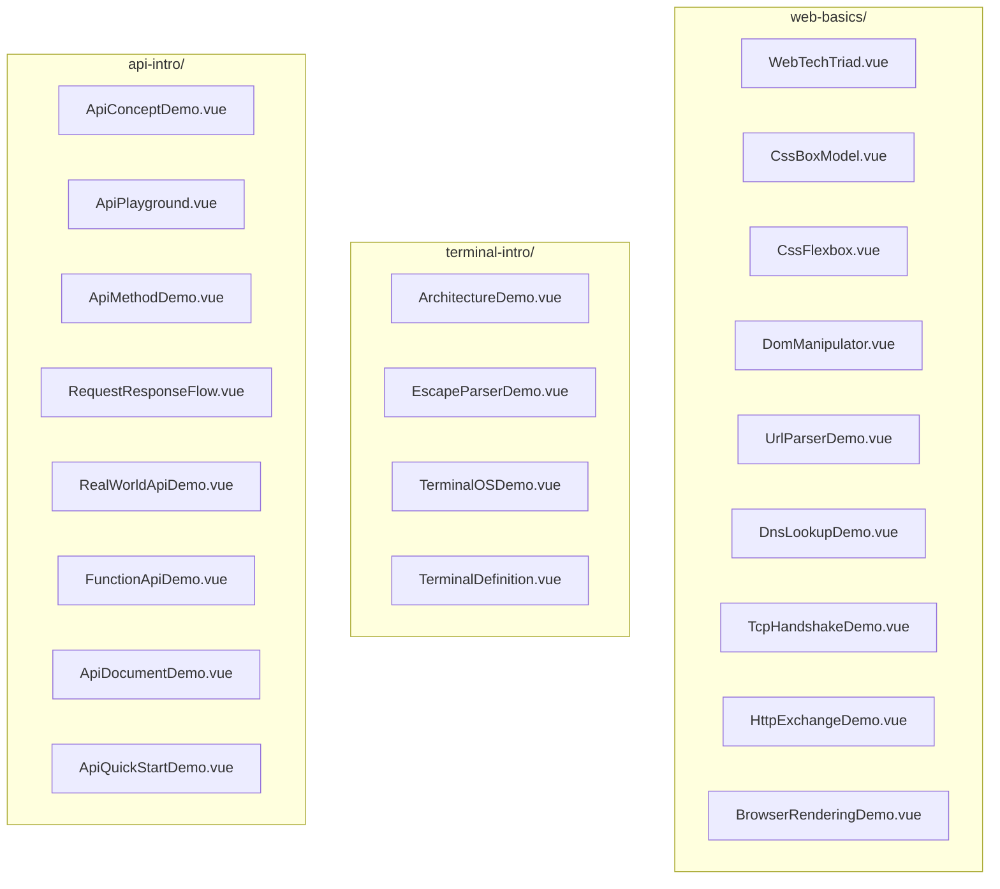
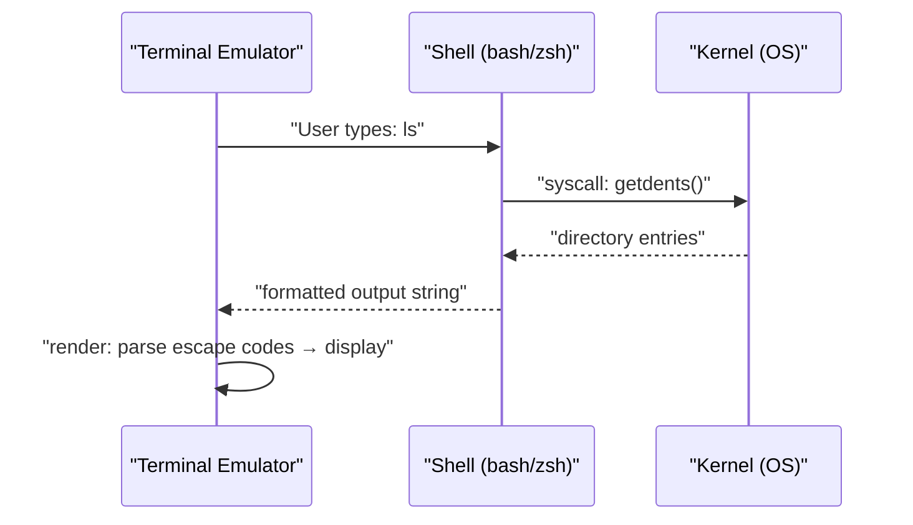
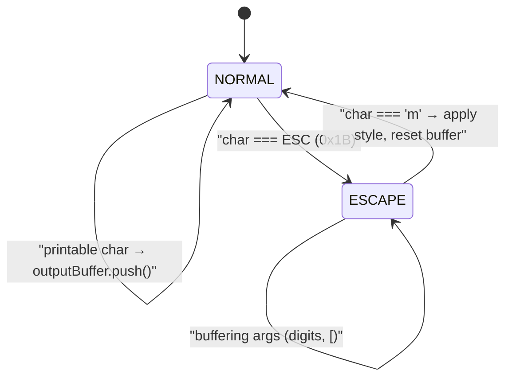
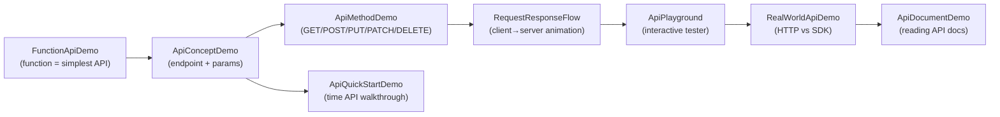

<!-- source: DeepWiki mcp.deepwiki.com · repo datawhalechina/easy-vibe · page 5.3 Web, Terminal, and API Demo Components · fetched 2026-10-30 -->

# Web, Terminal, and API Demo Components

<details>
<summary>Relevant source files</summary>

The following files were used as context for generating this wiki page:

- [docs/.vitepress/theme/components/appendix/api-intro/ApiConceptDemo.vue](docs/.vitepress/theme/components/appendix/api-intro/ApiConceptDemo.vue)
- [docs/.vitepress/theme/components/appendix/api-intro/ApiDocumentDemo.vue](docs/.vitepress/theme/components/appendix/api-intro/ApiDocumentDemo.vue)
- [docs/.vitepress/theme/components/appendix/api-intro/ApiMethodDemo.vue](docs/.vitepress/theme/components/appendix/api-intro/ApiMethodDemo.vue)
- [docs/.vitepress/theme/components/appendix/api-intro/ApiPlayground.vue](docs/.vitepress/theme/components/appendix/api-intro/ApiPlayground.vue)
- [docs/.vitepress/theme/components/appendix/api-intro/ApiQuickStartDemo.vue](docs/.vitepress/theme/components/appendix/api-intro/ApiQuickStartDemo.vue)
- [docs/.vitepress/theme/components/appendix/api-intro/FunctionApiDemo.vue](docs/.vitepress/theme/components/appendix/api-intro/FunctionApiDemo.vue)
- [docs/.vitepress/theme/components/appendix/api-intro/RealWorldApiDemo.vue](docs/.vitepress/theme/components/appendix/api-intro/RealWorldApiDemo.vue)
- [docs/.vitepress/theme/components/appendix/api-intro/RequestResponseFlow.vue](docs/.vitepress/theme/components/appendix/api-intro/RequestResponseFlow.vue)
- [docs/.vitepress/theme/components/appendix/data/ABTestingDemo.vue](docs/.vitepress/theme/components/appendix/data/ABTestingDemo.vue)
- [docs/.vitepress/theme/components/appendix/data/DataAnalysisDemo.vue](docs/.vitepress/theme/components/appendix/data/DataAnalysisDemo.vue)
- [docs/.vitepress/theme/components/appendix/data/DataModelsDemo.vue](docs/.vitepress/theme/components/appendix/data/DataModelsDemo.vue)
- [docs/.vitepress/theme/components/appendix/terminal-intro/ArchitectureDemo.vue](docs/.vitepress/theme/components/appendix/terminal-intro/ArchitectureDemo.vue)
- [docs/.vitepress/theme/components/appendix/terminal-intro/BufferSwitchDemo.vue](docs/.vitepress/theme/components/appendix/terminal-intro/BufferSwitchDemo.vue)
- [docs/.vitepress/theme/components/appendix/terminal-intro/CookedRawDemo.vue](docs/.vitepress/theme/components/appendix/terminal-intro/CookedRawDemo.vue)
- [docs/.vitepress/theme/components/appendix/terminal-intro/EscapeParserDemo.vue](docs/.vitepress/theme/components/appendix/terminal-intro/EscapeParserDemo.vue)
- [docs/.vitepress/theme/components/appendix/terminal-intro/TerminalDefinition.vue](docs/.vitepress/theme/components/appendix/terminal-intro/TerminalDefinition.vue)
- [docs/.vitepress/theme/components/appendix/terminal-intro/TerminalOSDemo.vue](docs/.vitepress/theme/components/appendix/terminal-intro/TerminalOSDemo.vue)
- [docs/.vitepress/theme/components/appendix/web-basics/BrowserRenderingDemo.vue](docs/.vitepress/theme/components/appendix/web-basics/BrowserRenderingDemo.vue)
- [docs/.vitepress/theme/components/appendix/web-basics/CssBoxModel.vue](docs/.vitepress/theme/components/appendix/web-basics/CssBoxModel.vue)
- [docs/.vitepress/theme/components/appendix/web-basics/CssFlexbox.vue](docs/.vitepress/theme/components/appendix/web-basics/CssFlexbox.vue)
- [docs/.vitepress/theme/components/appendix/web-basics/DnsLookupDemo.vue](docs/.vitepress/theme/components/appendix/web-basics/DnsLookupDemo.vue)
- [docs/.vitepress/theme/components/appendix/web-basics/DomManipulator.vue](docs/.vitepress/theme/components/appendix/web-basics/DomManipulator.vue)
- [docs/.vitepress/theme/components/appendix/web-basics/HttpExchangeDemo.vue](docs/.vitepress/theme/components/appendix/web-basics/HttpExchangeDemo.vue)
- [docs/.vitepress/theme/components/appendix/web-basics/TcpHandshakeDemo.vue](docs/.vitepress/theme/components/appendix/web-basics/TcpHandshakeDemo.vue)
- [docs/.vitepress/theme/components/appendix/web-basics/UrlParserDemo.vue](docs/.vitepress/theme/components/appendix/web-basics/UrlParserDemo.vue)
- [docs/.vitepress/theme/components/appendix/web-basics/WebTechTriad.vue](docs/.vitepress/theme/components/appendix/web-basics/WebTechTriad.vue)
- [docs/zh-cn/appendix/5-data/ab-testing.md](docs/zh-cn/appendix/5-data/ab-testing.md)
- [docs/zh-cn/appendix/5-data/data-analysis.md](docs/zh-cn/appendix/5-data/data-analysis.md)
- [docs/zh-cn/appendix/5-data/data-models.md](docs/zh-cn/appendix/5-data/data-models.md)

</details>


This page documents the interactive Vue components embedded in the web/frontend basics, terminal introduction, and API introduction sections of the Easy-Vibe appendix. All components reside under `docs/.vitepress/theme/components/appendix/` and are embedded directly into markdown pages via custom element tags.

- **Web basics components** support the HTML/CSS/JS and DOM content in appendix section 4.2.
- **Terminal components** support the terminal introduction content also in appendix section 4.2.
- **API intro components** support the backend and API appendix content in section 4.3.

For components covering computer science fundamentals (network layers, TCP simulation, CPU, memory), see [Computer Science Demo Components](#5.2). For AI history, data analysis, and JavaScript concept demos, see [AI, Data, and JavaScript Demo Components](#5.4).

---

## Component Inventory

The following diagram maps component names to their source files. All paths are relative to `docs/.vitepress/theme/components/appendix/`.

**Component-to-File Map**



Sources: [docs/.vitepress/theme/components/appendix/web-basics/WebTechTriad.vue:1-1](), [docs/.vitepress/theme/components/appendix/terminal-intro/ArchitectureDemo.vue:1-14](), [docs/.vitepress/theme/components/appendix/api-intro/ApiConceptDemo.vue:1-5]()

---

## Shared Structural Patterns

All components in this group follow common conventions:

| Pattern | Description |
|---|---|
| CSS variables | All styling uses `--vp-c-brand`, `--vp-c-divider`, `--vp-c-bg-soft`, etc. for theme compatibility |
| `tab` prop | Several components accept a `tab: String` prop to lock the display to a specific sub-section (e.g., `<ABTestingDemo tab="traffic" />`) |
| Simulated responses | API demos use `setTimeout` to simulate network latency rather than making real HTTP calls |
| Responsive layout | All use `@media (max-width: 640px)` breakpoints to stack panels vertically on mobile |
| Info box footer | Most components end with an `.info-box` or `.tips` section summarizing the key takeaway |

---

## Web Basics Components

These four components are embedded in the web/frontend appendix (section 4.2) to make the HTML/CSS/JS triad tangible.

### `WebTechTriad`

**File:** `docs/.vitepress/theme/components/appendix/web-basics/WebTechTriad.vue`

Demonstrates how HTML, CSS, and JavaScript each contribute to a single rendered page element. The user switches between three modes and clicks individual elements in the preview to see the corresponding code highlighted.

**Key reactive state:**

| Ref | Type | Purpose |
|---|---|---|
| `current` | `String` | Active mode: `'html'`, `'css'`, or `'js'` |
| `selectedPart` | `String` | Which preview element is selected: `'h1'`, `'p'`, `'btn'` |
| `clicks` | `Number` | Click counter shown on the interactive button |

The `modes` array defines the three tabs, and the computed `codeLines` array returns the appropriate annotated code lines for the current mode. The `handleBtnClick` function increments `clicks` only when `current === 'js'`, making the button non-interactive in HTML/CSS mode to reinforce what each layer controls.

[docs/.vitepress/theme/components/appendix/web-basics/WebTechTriad.vue:1-80]()

---

### `CssBoxModel`

**File:** `docs/.vitepress/theme/components/appendix/web-basics/CssBoxModel.vue`

Shows how `content`, `padding`, `border`, and `margin` layers accumulate into total element width. The opening scenario describes why three cards with `width: 200px` in a 900px container overflow — because padding and border are additive in `content-box` sizing.

**Key reactive state:**

| Ref | Default | Range |
|---|---|---|
| `contentW` | — | 60–150 px |
| `padding` | — | 0–30 px |
| `border` | — | 0–10 px |

The component computes and displays the total width as `contentW + 2 * padding + 2 * border`.

[docs/.vitepress/theme/components/appendix/web-basics/CssBoxModel.vue:1-50]()

---

### `CssFlexbox`

**File:** `docs/.vitepress/theme/components/appendix/web-basics/CssFlexbox.vue`

Visualizes the Flexbox layout model with a main axis / cross axis concept diagram followed by an interactive property sandbox. Users adjust `flex-direction`, `justify-content`, `align-items`, and other properties and observe live changes in a flex container.

[docs/.vitepress/theme/components/appendix/web-basics/CssFlexbox.vue:1-30]()

---

### `DomManipulator`

**File:** `docs/.vitepress/theme/components/appendix/web-basics/DomManipulator.vue`

Demonstrates JavaScript DOM manipulation through three operation categories: **content modification** (via `titleText` ref), **style changes**, and **structural operations** (adding/removing nodes). A live preview panel reflects all changes immediately, showing that JavaScript modifies the in-memory DOM tree rather than the source HTML.

[docs/.vitepress/theme/components/appendix/web-basics/DomManipulator.vue:1-30]()

---

### Additional Web/Network Components

The `web-basics/` folder also contains components that visualize the end-to-end journey from URL to rendered page:

| Component | Purpose |
|---|---|
| `UrlParserDemo.vue` | Hover-to-highlight decomposition of a URL into protocol, host, and path |
| `DnsLookupDemo.vue` | Animated DNS resolution: browser → DNS resolver → IP address returned |
| `TcpHandshakeDemo.vue` | Three-step TCP handshake sequence diagram (SYN / SYN-ACK / ACK) |
| `HttpExchangeDemo.vue` | Request/response pair — shows HTTP request headers on the left, response headers and HTML body on the right |
| `BrowserRenderingDemo.vue` | Five-step rendering pipeline: source code → DOM parsing → CSS merge → Layout → Paint |

Sources: [docs/.vitepress/theme/components/appendix/web-basics/UrlParserDemo.vue:1-68](), [docs/.vitepress/theme/components/appendix/web-basics/DnsLookupDemo.vue:1-74](), [docs/.vitepress/theme/components/appendix/web-basics/TcpHandshakeDemo.vue:1-106](), [docs/.vitepress/theme/components/appendix/web-basics/HttpExchangeDemo.vue:1-77](), [docs/.vitepress/theme/components/appendix/web-basics/BrowserRenderingDemo.vue:1-101]()

---

## Terminal Concepts Components

These components are embedded in the terminal introduction content and illustrate the layered architecture of a terminal, how escape sequences work, and how terminals differ across operating systems.

### `ArchitectureDemo`

**File:** `docs/.vitepress/theme/components/appendix/terminal-intro/ArchitectureDemo.vue`

Visualizes the three-layer terminal stack: **Terminal Emulator → Shell → Kernel**. It simulates executing an `ls` command step by step, showing data packets flowing downward from terminal to shell to kernel and results flowing back up.

The component supports step-by-step advancement and displays bilingual (Chinese/English) explanations at each stage. The state of each component (idle / busy) is reflected in real time.

[docs/.vitepress/theme/components/appendix/terminal-intro/ArchitectureDemo.vue:1-14]()

**Terminal Architecture Data Flow**



Sources: [docs/.vitepress/theme/components/appendix/terminal-intro/ArchitectureDemo.vue:1-14]()

---

### `EscapeParserDemo`

**File:** `docs/.vitepress/theme/components/appendix/terminal-intro/EscapeParserDemo.vue`

Animates the ANSI escape sequence parsing state machine. It streams the byte sequence for `Hi \x1B[31mVibe\x1B[0m!` character by character across a "conveyor belt" visualization, while the parser transitions between `NORMAL` and `ESCAPE` states.

**Key reactive state:**

| Ref | Type | Values |
|---|---|---|
| `parserState` | `String` | `'NORMAL'` or `'ESCAPE'` |
| `currentIndex` | `Number` | Position in `charStream` |
| `outputBuffer` | `Array` | Characters rendered to the screen with their current style |
| `lastAction` | `String` | Most recent parser action description |
| `isPlaying` / `isFinished` | `Boolean` | Animation control flags |

The `RAW_DATA` constant defines the input: characters are annotated with `isSpecial` (ESC, `[`, `m`) and `isArg` (numeric parameters) flags to color-code them on the conveyor belt.

The `play()` async function advances `currentIndex` one step at a time with a 600 ms delay between characters. When a `m` terminator is encountered in `ESCAPE` state, it inspects the preceding argument byte (`31` → red, `0` → reset) and updates `currentStyle`.

[docs/.vitepress/theme/components/appendix/terminal-intro/EscapeParserDemo.vue:128-241]()

**EscapeParserDemo State Machine**



Sources: [docs/.vitepress/theme/components/appendix/terminal-intro/EscapeParserDemo.vue:128-241]()

---

### `TerminalOSDemo`

**File:** `docs/.vitepress/theme/components/appendix/terminal-intro/TerminalOSDemo.vue`

Provides a side-by-side click-to-advance terminal simulation for four operating systems. Each OS has its own visual styling and command set.

**OS configurations** (`configs` object):

| Key | OS | Example Commands |
|---|---|---|
| `win-cmd` | Windows Command Prompt | `dir` |
| `win-ps` | Windows PowerShell | `Get-Date`, `echo "Hello World"` |
| `mac` | macOS Terminal (zsh) | `ls -G`, `sw_vers` |
| `linux` | Linux Terminal | `ls -la`, `whoami` |

Each configuration has a `demo` array of steps typed as `'explanation'`, `'command'`, or `'output'`. The `nextStep()` function processes consecutive `'output'` steps automatically but pauses at each `'command'` step so the user triggers the typing animation by clicking. The typing effect uses a random delay of `30–70 ms` per character.

[docs/.vitepress/theme/components/appendix/terminal-intro/TerminalOSDemo.vue:122-350]()

---

### `TerminalDefinition`

**File:** `docs/.vitepress/theme/components/appendix/terminal-intro/TerminalDefinition.vue`

A CLI vs. GUI comparison component with a two-button mode switch. Displays either a simulated command-line interface or a graphical file manager interface to illustrate the distinction.

---

### `TerminalHandsOn`, `CookedRawDemo`, `BufferSwitchDemo`

These three components are referenced in the appendix content but were not part of the analyzed source set. Based on their names:

- **`TerminalHandsOn`** — likely a hands-on practice component for common terminal commands.
- **`CookedRawDemo`** — likely demonstrates cooked vs. raw terminal input modes (line buffering vs. character-at-a-time).
- **`BufferSwitchDemo`** — likely demonstrates the alternate screen buffer used by programs like `vim` and `less`.

---

## API Introduction Components

These components are embedded in the API introduction section of the appendix (section 4.3). They form a progression from basic API concept → HTTP methods → interactive testing → real-world usage patterns.

**API Component Progression**



Sources: [docs/.vitepress/theme/components/appendix/api-intro/ApiConceptDemo.vue:1-10](), [docs/.vitepress/theme/components/appendix/api-intro/ApiPlayground.vue:1-10](), [docs/.vitepress/theme/components/appendix/api-intro/ApiMethodDemo.vue:1-10]()

---

### `FunctionApiDemo`

**File:** `docs/.vitepress/theme/components/appendix/api-intro/FunctionApiDemo.vue`

A static code display showing a Python `greet(name, greeting)` function. The purpose is to establish the idea that a function is the most primitive form of API: it takes inputs, hides implementation, and returns an output. No interactive state; the component renders annotated code with a concept explanation panel.

[docs/.vitepress/theme/components/appendix/api-intro/FunctionApiDemo.vue:1-40]()

---

### `ApiConceptDemo`

**File:** `docs/.vitepress/theme/components/appendix/api-intro/ApiConceptDemo.vue`

Demonstrates the minimal structure of an API call: **endpoint + parameters = response**. Users can type an endpoint path and adjust pagination parameters, then click "Send Request" to see a simulated JSON response.

**Key reactive state:**

| Ref | Default | Purpose |
|---|---|---|
| `endpoint` | `'/users'` | Path appended to the base URL |
| `page` | `1` | Pagination page number |
| `limit` | `5` | Items per page |
| `loading` | `false` | Disables button during simulated delay |
| `response` | `null` | Holds `{ status, statusText, data }` |

`sendRequest()` uses a 300 ms `setTimeout` to simulate latency. If `endpoint` equals `'/users'`, it returns `200 OK` with a user list. Any other path returns `404 Not Found`. The response panel shows the status badge in green or red accordingly.

[docs/.vitepress/theme/components/appendix/api-intro/ApiConceptDemo.vue:89-127]()

---

### `ApiMethodDemo`

**File:** `docs/.vitepress/theme/components/appendix/api-intro/ApiMethodDemo.vue`

Displays five HTTP methods as clickable cards with an idempotency comparison panel on the right.

**`methods` array entries:**

| Name | Color | Description | Example |
|---|---|---|---|
| `GET` | green | 获取数据 | `GET /users` |
| `POST` | blue | 创建数据 | `POST /users` |
| `PUT` | orange | 替换数据 | `PUT /users/1` |
| `PATCH` | yellow | 部分修改 | `PATCH /users/1` |
| `DELETE` | red | 删除数据 | `DELETE /users/1` |

The right panel shows the idempotency contrast: `GET` and `DELETE` are idempotent (calling 10 times equals calling once), while `POST` is not (10 POST calls create 10 orders).

[docs/.vitepress/theme/components/appendix/api-intro/ApiMethodDemo.vue:58-75]()

---

### `RequestResponseFlow`

**File:** `docs/.vitepress/theme/components/appendix/api-intro/RequestResponseFlow.vue`

A simple animated diagram showing a single API call lifecycle. Clicking "Send Request" triggers a 1500 ms `setTimeout` that transitions `serverMessage` from `"等待请求..."` to `"处理完成！"` and sets `result` to a success object.

The layout is a three-column flex row: **你这边 (You)** → animated arrow → **对方服务器 (Server)**. On mobile, the layout stacks vertically.

[docs/.vitepress/theme/components/appendix/api-intro/RequestResponseFlow.vue:47-68]()

---

### `ApiPlayground`

**File:** `docs/.vitepress/theme/components/appendix/api-intro/ApiPlayground.vue`

A more complete interactive tester with method selection, endpoint input, API key field, and quick-action shortcut buttons. The component simulates several error scenarios:

| Scenario | Trigger | Response |
|---|---|---|
| Success | `endpoint === '/users'` with non-empty `apiKey` | `200 OK` with user list |
| Unauthorized | Empty `apiKey` | `401 Unauthorized` |
| Not Found | Any other endpoint | `404 Not Found` |
| Rate Limited | `tryError429()` quick action | `429 Too Many Requests` |

The `methods` array is `['GET', 'POST', 'PUT', 'DELETE']` and drives the method selector button group. Each response object includes an `explanation` string that renders as a yellow tip box.

[docs/.vitepress/theme/components/appendix/api-intro/ApiPlayground.vue:78-160]()

---

### `RealWorldApiDemo`

**File:** `docs/.vitepress/theme/components/appendix/api-intro/RealWorldApiDemo.vue`

A two-tab (`mode: 'http' | 'sdk'`) code comparison showing how to call the same API endpoint using raw HTTP versus a vendor SDK. The `httpCode` and `sdkCode` string constants contain the complete code snippets for each approach. A right-side comparison panel shows qualitative differences (code volume, error handling, maintainability).

[docs/.vitepress/theme/components/appendix/api-intro/RealWorldApiDemo.vue:1-55]()

---

### `ApiDocumentDemo`

**File:** `docs/.vitepress/theme/components/appendix/api-intro/ApiDocumentDemo.vue`

A static side-by-side layout. The left panel renders a mock API reference document (Base URL, endpoint, headers, body parameters with required/optional badges). The right panel shows the same information translated into a Python code snippet using the `openai` SDK pointed at `api.deepseek.com`. The takeaway is identifying the three essentials in any API doc: **address, authentication, parameters**.

[docs/.vitepress/theme/components/appendix/api-intro/ApiDocumentDemo.vue:1-77]()

---

### `ApiQuickStartDemo`

**File:** `docs/.vitepress/theme/components/appendix/api-intro/ApiQuickStartDemo.vue`

Combines a terminal-style display on the left with a four-stage flow diagram on the right (Client → Request → Server → Response). Clicking "发起请求" triggers a staged animation: `stage` transitions through `'client'`, `'request'`, `'server'`, `'response'` at 150 ms intervals, highlighting the corresponding box at each step. The final stage displays the current local time retrieved via `new Date()`.

[docs/.vitepress/theme/components/appendix/api-intro/ApiQuickStartDemo.vue:98-131]()

---

## Usage Pattern in Markdown

Components are registered globally through the VitePress theme (see [Theme and Navigation Components](#5.1)) and used as bare custom elements in markdown:

```md
<!-- Lock component to a specific tab -->
<ApiConceptDemo />
<ApiPlayground />
<RealWorldApiDemo />
```

Some components accept a `tab` prop that renders only one sub-panel, used when the page prose already covers other tabs:

```md
<!-- From docs/zh-cn/appendix/5-data/ab-testing.md -->
<ABTestingDemo tab="traffic" />
<ABTestingDemo tab="calculator" />
<ABTestingDemo tab="results" />
```

This pattern allows the same component to appear multiple times in a single document, each anchored to a relevant section of prose.

Sources: [docs/zh-cn/appendix/5-data/ab-testing.md:40-71]()

---

