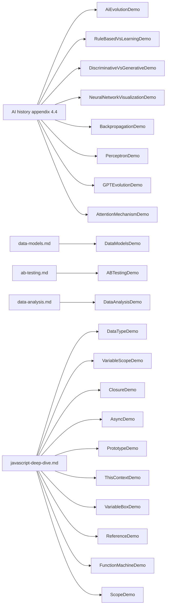
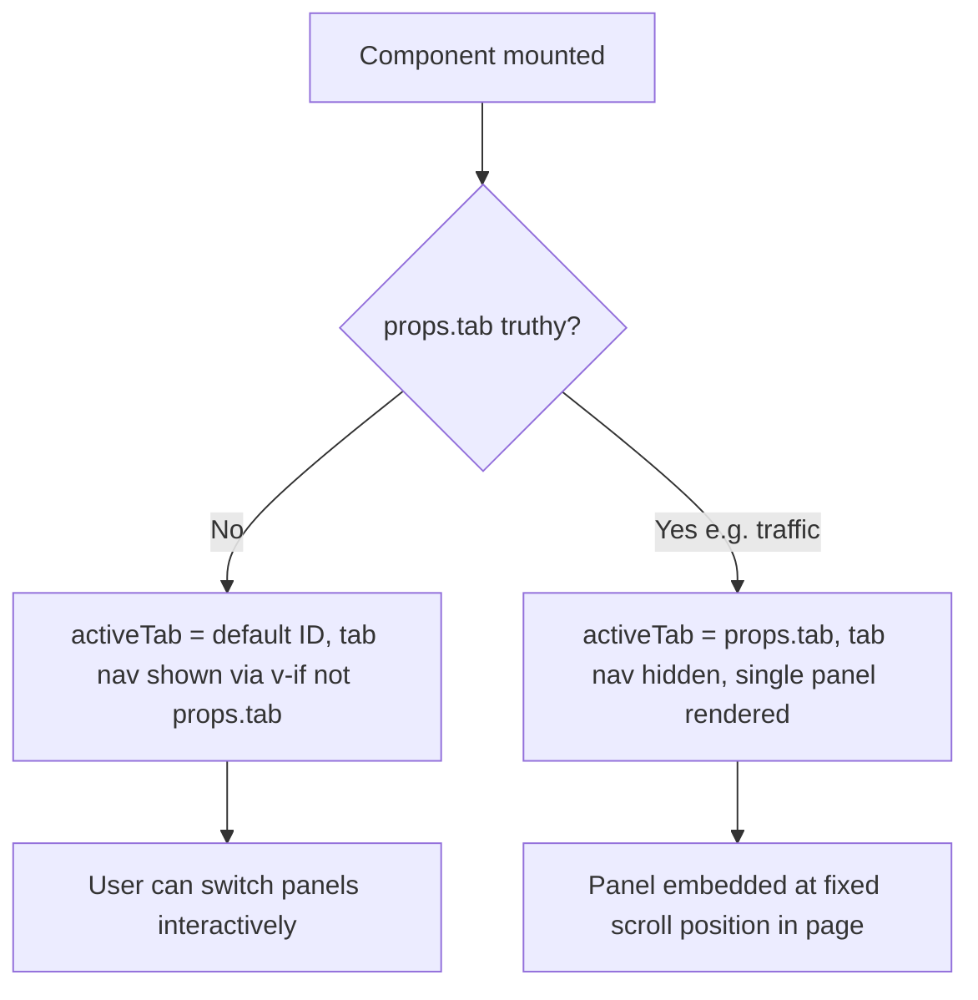
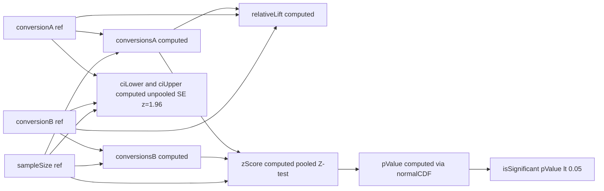
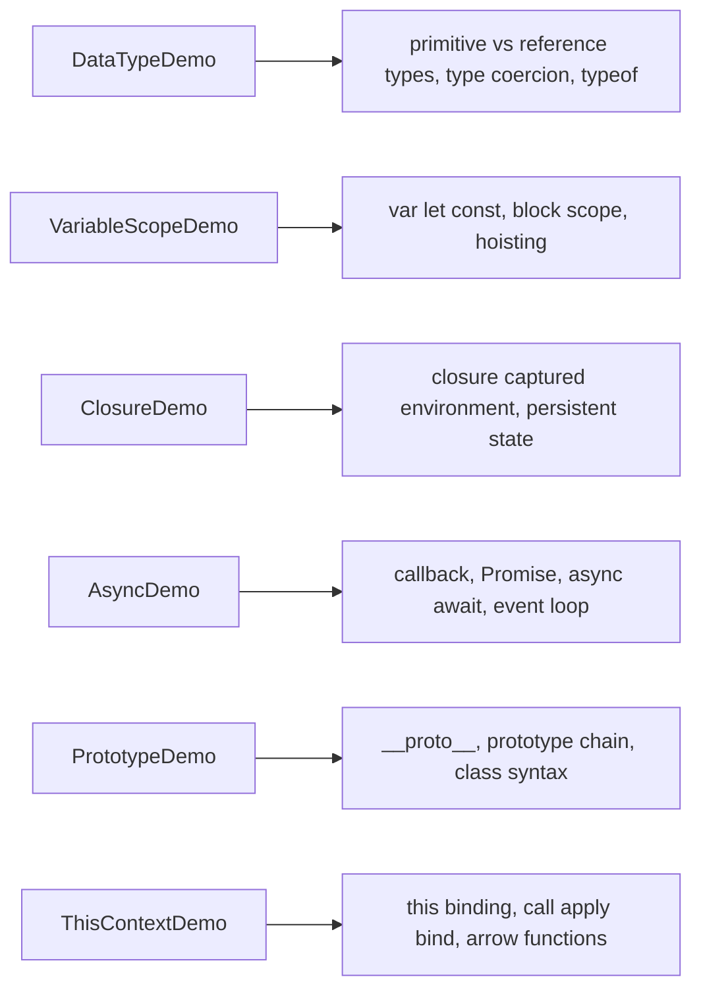

<!-- source: DeepWiki mcp.deepwiki.com · repo datawhalechina/easy-vibe · page 5.4 AI, Data, and JavaScript Demo Components · fetched 2026-10-30 -->

# AI, Data, and JavaScript Demo Components

<details>
<summary>Relevant source files</summary>

The following files were used as context for generating this wiki page:

- [docs/.vitepress/theme/components/appendix/ai-history/AiEvolutionDemo.vue](docs/.vitepress/theme/components/appendix/ai-history/AiEvolutionDemo.vue)
- [docs/.vitepress/theme/components/appendix/ai-history/AttentionMechanismDemo.vue](docs/.vitepress/theme/components/appendix/ai-history/AttentionMechanismDemo.vue)
- [docs/.vitepress/theme/components/appendix/ai-history/BackpropagationDemo.vue](docs/.vitepress/theme/components/appendix/ai-history/BackpropagationDemo.vue)
- [docs/.vitepress/theme/components/appendix/ai-history/DiscriminativeVsGenerativeDemo.vue](docs/.vitepress/theme/components/appendix/ai-history/DiscriminativeVsGenerativeDemo.vue)
- [docs/.vitepress/theme/components/appendix/ai-history/GPTEvolutionDemo.vue](docs/.vitepress/theme/components/appendix/ai-history/GPTEvolutionDemo.vue)
- [docs/.vitepress/theme/components/appendix/ai-history/NeuralNetworkVisualizationDemo.vue](docs/.vitepress/theme/components/appendix/ai-history/NeuralNetworkVisualizationDemo.vue)
- [docs/.vitepress/theme/components/appendix/ai-history/PerceptronDemo.vue](docs/.vitepress/theme/components/appendix/ai-history/PerceptronDemo.vue)
- [docs/.vitepress/theme/components/appendix/ai-history/RuleBasedVsLearningDemo.vue](docs/.vitepress/theme/components/appendix/ai-history/RuleBasedVsLearningDemo.vue)
- [docs/.vitepress/theme/components/appendix/data/ABTestingDemo.vue](docs/.vitepress/theme/components/appendix/data/ABTestingDemo.vue)
- [docs/.vitepress/theme/components/appendix/data/DataAnalysisDemo.vue](docs/.vitepress/theme/components/appendix/data/DataAnalysisDemo.vue)
- [docs/.vitepress/theme/components/appendix/data/DataModelsDemo.vue](docs/.vitepress/theme/components/appendix/data/DataModelsDemo.vue)
- [docs/.vitepress/theme/components/appendix/javascript-intro/AsyncDemo.vue](docs/.vitepress/theme/components/appendix/javascript-intro/AsyncDemo.vue)
- [docs/.vitepress/theme/components/appendix/javascript-intro/ClosureDemo.vue](docs/.vitepress/theme/components/appendix/javascript-intro/ClosureDemo.vue)
- [docs/.vitepress/theme/components/appendix/javascript-intro/DataTypeDemo.vue](docs/.vitepress/theme/components/appendix/javascript-intro/DataTypeDemo.vue)
- [docs/.vitepress/theme/components/appendix/javascript-intro/PrototypeDemo.vue](docs/.vitepress/theme/components/appendix/javascript-intro/PrototypeDemo.vue)
- [docs/.vitepress/theme/components/appendix/javascript-intro/ThisContextDemo.vue](docs/.vitepress/theme/components/appendix/javascript-intro/ThisContextDemo.vue)
- [docs/.vitepress/theme/components/appendix/javascript-intro/VariableScopeDemo.vue](docs/.vitepress/theme/components/appendix/javascript-intro/VariableScopeDemo.vue)
- [docs/.vitepress/theme/components/appendix/web-basics/BrowserRenderingDemo.vue](docs/.vitepress/theme/components/appendix/web-basics/BrowserRenderingDemo.vue)
- [docs/.vitepress/theme/components/appendix/web-basics/DnsLookupDemo.vue](docs/.vitepress/theme/components/appendix/web-basics/DnsLookupDemo.vue)
- [docs/.vitepress/theme/components/appendix/web-basics/HttpExchangeDemo.vue](docs/.vitepress/theme/components/appendix/web-basics/HttpExchangeDemo.vue)
- [docs/.vitepress/theme/components/appendix/web-basics/TcpHandshakeDemo.vue](docs/.vitepress/theme/components/appendix/web-basics/TcpHandshakeDemo.vue)
- [docs/.vitepress/theme/components/appendix/web-basics/UrlParserDemo.vue](docs/.vitepress/theme/components/appendix/web-basics/UrlParserDemo.vue)
- [docs/zh-cn/appendix/3-browser-and-frontend/javascript-deep-dive.md](docs/zh-cn/appendix/3-browser-and-frontend/javascript-deep-dive.md)
- [docs/zh-cn/appendix/5-data/ab-testing.md](docs/zh-cn/appendix/5-data/ab-testing.md)
- [docs/zh-cn/appendix/5-data/data-analysis.md](docs/zh-cn/appendix/5-data/data-analysis.md)
- [docs/zh-cn/appendix/5-data/data-models.md](docs/zh-cn/appendix/5-data/data-models.md)

</details>


This page documents the interactive Vue components embedded in three appendix topic areas: the AI history appendix ([4.4](#4.4)), the data appendix ([4.3](#4.3)), and the JavaScript deep-dive section of the web and frontend appendix ([4.2](#4.2)). Each component is globally registered in the VitePress theme and invoked as a custom HTML tag inside markdown pages. For engineering excellence demo components, see [5.5](#5.5). For computer science demos, see [5.2](#5.2). For web, terminal, and API demos, see [5.3](#5.3).

---

## Component Overview

All components in this section reside under three subdirectories of the global component tree:

| Subdirectory | Components | Appendix Section |
|---|---|---|
| `docs/.vitepress/theme/components/appendix/ai-history/` | `AiEvolutionDemo`, `RuleBasedVsLearningDemo`, `DiscriminativeVsGenerativeDemo`, `NeuralNetworkVisualizationDemo`, `BackpropagationDemo`, `PerceptronDemo`, `GPTEvolutionDemo`, `AttentionMechanismDemo` | 4.4 AI History |
| `docs/.vitepress/theme/components/appendix/data/` | `DataModelsDemo`, `ABTestingDemo`, `DataAnalysisDemo` | 4.3 Backend/Data |
| `docs/.vitepress/theme/components/appendix/javascript-intro/` | `DataTypeDemo`, `VariableScopeDemo`, `ClosureDemo`, `AsyncDemo`, `PrototypeDemo`, `ThisContextDemo` (and others) | 4.2 Web/Frontend |

**Diagram: Component files mapped to their consuming markdown pages**



Sources: [docs/zh-cn/appendix/5-data/data-models.md:203](), [docs/zh-cn/appendix/5-data/ab-testing.md:40-81](), [docs/zh-cn/appendix/5-data/data-analysis.md:32-98](), [docs/zh-cn/appendix/3-browser-and-frontend/javascript-deep-dive.md:168-505]()

---

## Shared Pattern: The `tab` Prop

Three components — `DataModelsDemo`, `ABTestingDemo`, and `DataAnalysisDemo` — accept an optional `tab` prop. When provided, only the specified panel renders and the tab navigation bar is suppressed. This lets a single document embed multiple panels of the same component at different scroll positions, each showing a different section:

```markdown
<ABTestingDemo tab="traffic" />
...prose...
<ABTestingDemo tab="calculator" />
...prose...
<ABTestingDemo tab="results" />
```

**Diagram: `tab` prop routing behavior**



The guard in each component's template is `v-if="!props.tab"` on the tab navigation container, and `activeTab` is initialized to `props.tab || 'defaultId'`.

Sources: [docs/.vitepress/theme/components/appendix/data/ABTestingDemo.vue:314-321](), [docs/.vitepress/theme/components/appendix/data/DataModelsDemo.vue:176-179](), [docs/.vitepress/theme/components/appendix/data/DataAnalysisDemo.vue:7-16]()

---

## AI History Components

All eight AI history components are entirely static — no user interaction beyond display. Data lives in plain JavaScript arrays defined in `<script setup>`. `computed()` properties appear only where a value is mathematically derived from static inputs.

### AiEvolutionDemo

**File:** `docs/.vitepress/theme/components/appendix/ai-history/AiEvolutionDemo.vue`

Renders a proportional horizontal timeline bar. The `eras` array defines eight segments, each with `label`, `years`, `flex` (CSS flex value), and `bg` (gradient string). The bar uses `display: flex` on a container; each era div has `style="flex: era.flex"`. A legend below maps segment color to era category.

| Era Label | Years | `flex` |
|---|---|---|
| 理论奠基 | 1940s–50s | 1.5 |
| 第一次浪潮 | 1960s–70s | 1.5 |
| ❄️ 寒冬 I | 1974–80 | 0.7 |
| 第二次浪潮 | 1980s | 1.0 |
| ❄️ 寒冬 II | 1987–93 | 0.7 |
| ML 崛起 | 1990s–2000s | 1.5 |
| 深度学习 | 2010s | 1.2 |
| 大模型时代 | 2018+ | 1.2 |

No props. No reactive state.

Sources: [docs/.vitepress/theme/components/appendix/ai-history/AiEvolutionDemo.vue:1-41]()

---

### RuleBasedVsLearningDemo

**File:** `docs/.vitepress/theme/components/appendix/ai-history/RuleBasedVsLearningDemo.vue`

Renders a vertical flow of five numbered step cards connected by inline SVG downward arrows. The static `path` array provides `name`, `years`, `desc`, and `color` per step. Each card uses a colored left border and a circular numbered badge.

| Step | Name | Years |
|---|---|---|
| 1 | 理论奠基 | 1940s–1950s |
| 2 | 符号主义主导 | 1960s–1980s |
| 3 | 机器学习转型 | 1990s–2000s |
| 4 | 深度学习革命 | 2010s |
| 5 | 大模型时代 | 2018 至今 |

No props. No reactive state.

Sources: [docs/.vitepress/theme/components/appendix/ai-history/RuleBasedVsLearningDemo.vue:1-49]()

---

### DiscriminativeVsGenerativeDemo

**File:** `docs/.vitepress/theme/components/appendix/ai-history/DiscriminativeVsGenerativeDemo.vue`

Renders a three-column grid of cards, one per AI paradigm: 符号主义 (Symbolism), 连接主义 (Connectionism), 行为主义 (Behaviorism). Each card shows the paradigm's core idea, representative systems, and current relationship to the large-model era. Entirely static.

Sources: [docs/.vitepress/theme/components/appendix/ai-history/DiscriminativeVsGenerativeDemo.vue:1-36]()

---

### NeuralNetworkVisualizationDemo

**File:** `docs/.vitepress/theme/components/appendix/ai-history/NeuralNetworkVisualizationDemo.vue`

Renders a two-column layout: an SVG neural network on the left and a layer legend on the right.

**SVG construction (runs once at setup, not reactive):**
- `layerDef` array specifies three layers: input (3 nodes, `xFrac=0.13`), hidden (4 nodes, `xFrac=0.5`), output (2 nodes, `xFrac=0.87`). The SVG viewport is 380×185.
- Node x-coordinates: `x = xFrac * W`. Node y-coordinates are distributed vertically with gap capped at 46 px.
- The `connections` array is populated by double-nested iteration over adjacent layers, producing `{id, x1, y1, x2, y2}` for each edge. All edges render as `<line>` at 35% opacity.
- Nodes render as `<circle>` elements with fill and stroke colors per layer.
- Layer name labels render as `<text>` below the SVG at `y=194`.

No props. No reactive state.

Sources: [docs/.vitepress/theme/components/appendix/ai-history/NeuralNetworkVisualizationDemo.vue:1-58]()

---

### BackpropagationDemo

**File:** `docs/.vitepress/theme/components/appendix/ai-history/BackpropagationDemo.vue`

Renders two sections:

1. **Four-card grid** — one card per backpropagation step: 前向传播 → 计算误差 → 反向传播 → 更新权重. Each card has a step number badge, icon, name, and description.

2. **SVG loss curve** — a 320×130 viewport with labeled axes (Loss vs. Epochs). The polyline points are computed once at module load using `y = 105 - 85 * e^(-i * 0.12) + noise` for `i` in 0–50. This produces a descending exponential curve with minor random jitter, anchored at `y=20` for epoch 0.

No props. No reactive state.

Sources: [docs/.vitepress/theme/components/appendix/ai-history/BackpropagationDemo.vue:1-78]()

---

### PerceptronDemo

**File:** `docs/.vitepress/theme/components/appendix/ai-history/PerceptronDemo.vue`

Renders a five-column perceptron pipeline: inputs → weighted arrows → summing neuron → threshold check → output node.

The `inputs` array is a plain (non-reactive) JavaScript array with two entries (`x₁=1, w=0.6` and `x₂=0, w=0.4`). `bias=-0.3`. Because `inputs` is not a `ref` or `reactive`, the two `computed()` properties evaluate once and never update:

- `sum` = `Σ(val * weight) + bias` = `(1×0.6 + 0×0.4) + (−0.3)` = `0.30`
- `output` = `sum > 0 ? 1 : 0` = `1`

The output node toggles CSS class `.on` when `output === 1`. No props.

Sources: [docs/.vitepress/theme/components/appendix/ai-history/PerceptronDemo.vue:1-71]()

---

### GPTEvolutionDemo

**File:** `docs/.vitepress/theme/components/appendix/ai-history/GPTEvolutionDemo.vue`

Renders a four-column grid of cards, one per GPT version. The static `models` array drives each card's name, year, parameter count, a `barWidth` percentage for a progress bar, and a short key-capability label.

| Model | Year | Params | `barWidth` |
|---|---|---|---|
| GPT-1 | 2018 | 1.17 亿 | 2% |
| GPT-2 | 2019 | 15 亿 | 6% |
| GPT-3 | 2020 | 1750 亿 | 45% |
| GPT-4 | 2023 | ~1.8 万亿 | 100% |

The `barWidth` value is applied directly as an inline `width` style on a `param-bar` div inside a `param-bar-bg` container. No props, no reactive state.

Sources: [docs/.vitepress/theme/components/appendix/ai-history/GPTEvolutionDemo.vue:1-40]()

---

### AttentionMechanismDemo

**File:** `docs/.vitepress/theme/components/appendix/ai-history/AttentionMechanismDemo.vue`

Visualizes pre-computed attention weights for the token 「他」 (index 4) in the sentence 「小明把苹果给了他的母亲」.

- `sentence` array: 7 tokens.
- `focusIdx = 4` marks the current token.
- `attn` array: `[0.65, 0.05, 0.10, 0.10, 0.05, 0.03, 0.02]` — manually crafted to show that 65% of attention flows to 「小明」.
- `weights` is derived by zipping `sentence` with `attn`.
- `barColor(v)` maps weight magnitude to a CSS color string: `>0.5` → red, `>0.15` → orange, `>0.06` → green, else → divider color.

Renders as a two-column grid: sentence tokens (focus token highlighted via `.focus` class) on the left; horizontal percentage bars on the right.

No props. No reactive state.

Sources: [docs/.vitepress/theme/components/appendix/ai-history/AttentionMechanismDemo.vue:1-50]()

---

## Data Topic Components

### DataModelsDemo

**File:** `docs/.vitepress/theme/components/appendix/data/DataModelsDemo.vue`
**Used in:** `docs/zh-cn/appendix/5-data/data-models.md`

A tabbed component showing four non-relational data model types. The `active` ref (default `'document'`) controls which panel is displayed.

**Props:** `tab` (String, default `''`) — see [Shared Pattern](#shared-pattern-the-tab-prop).

**Tabs:**

| `active` value | Panel | Key Visual Element |
|---|---|---|
| `document` | 文档模型 | JSON code block, trait list (`.trait.good` / `.trait.bad`), use-case tags |
| `graph` | 图模型 | CSS grid node layout with `grid-template-areas`, edge relation list with `.edge-label` spans |
| `timeseries` | 时序模型 | Static `tsData` table (5 rows), `val-high` / `val-normal` CSS classes for CPU% thresholds |
| `vector` | 向量模型 | Query → embedding arrow → `vecResults` list; `score` value drives CSS opacity |

**Static data:**
- `tsData` — 5 rows of `{ts, device, cpu, mem}`.
- `vecResults` — 4 items of `{text, score}`, e.g. `{text: '银座寿司之神', score: 0.96}`.

Sources: [docs/.vitepress/theme/components/appendix/data/DataModelsDemo.vue:1-202](), [docs/zh-cn/appendix/5-data/data-models.md:203]()

---

### ABTestingDemo

**File:** `docs/.vitepress/theme/components/appendix/data/ABTestingDemo.vue`
**Used in:** `docs/zh-cn/appendix/5-data/ab-testing.md`

The most stateful component in the data group, with four tabs and live statistical computation.

**Props:** `tab` (String, default `null`) — see [Shared Pattern](#shared-pattern-the-tab-prop).

**Tab summary:**

| `activeTab` value | Content |
|---|---|
| `traffic` | Proportional split bar driven by `groupAUsers` / `groupBUsers` refs; stat summary |
| `results` | Two A/B result cards; statistical summary panel showing relative lift, Z-score, p-value, significance; 95% CI display |
| `calculator` | Form inputs for baseline rate, MDE, significance level, power; triggers `calculateSampleSize()` on button click |
| `pitfalls` | 6 static anti-pattern cards (early stop, peeking, Simpson's paradox, p-hacking, novelty effect, underpowered) |

**`traffic` tab state:**
- `groupAUsers` (ref, 500) and `groupBUsers` (ref, 500).
- `totalUsers` and `trafficSplit` are computed from these.
- `allocateUser()` increments one group randomly; `allocateBatch()` calls it 100 times; `resetTraffic()` resets to 500/500.

**`results` tab — statistical computation chain:**

All values in the summary panel flow from three input refs through a chain of computed properties:

**Diagram: `ABTestingDemo` results tab computed property chain**



`normalCDF(x)` is implemented using a Horner polynomial approximation with constants `p=0.3275911, a1–a5`. `pValue` is `2 * (1 - normalCDF(|z|))` for a two-tailed test. `isSignificant` is `pValue < 0.05`.

**`calculator` tab:**
- Input refs: `baselineRate`, `minimumDetectable`, `alpha`, `power`.
- `targetRate` computed: `baselineRate * (1 + minimumDetectable/100)`.
- `calculateSampleSize()` applies the two-proportion Z-test power formula using fixed Z-values (`Zα=1.96`, `Zβ=0.84`) and writes to `calculatedSampleSize` ref.
- `estimatedDays` assumes 5000 daily visitors: `ceil((calculatedSampleSize * 2) / 5000)`.

Sources: [docs/.vitepress/theme/components/appendix/data/ABTestingDemo.vue:311-481](), [docs/zh-cn/appendix/5-data/ab-testing.md:40-81]()

---

### DataAnalysisDemo

**File:** `docs/.vitepress/theme/components/appendix/data/DataAnalysisDemo.vue`
**Used in:** `docs/zh-cn/appendix/5-data/data-analysis.md`

A four-tab component illustrating data analysis techniques. The `activeTab` ref (default `'stats'`) controls the active panel.

**Props:** `tab` (String, default `null`) — see [Shared Pattern](#shared-pattern-the-tab-prop).

| `activeTab` value | Content | Key Interactivity |
|---|---|---|
| `stats` | Descriptive statistics (mean, median, mode, std dev); bar chart with mean-line overlay | Text input for comma-separated numbers; `calculateStats()` on input; `generateRandomData()` button |
| `aggregation` | Static raw order table + three selectable aggregation operations with SQL snippet | `activeAggOp` ref switches between GROUP BY user, SUM amount, COUNT orders views |
| `funnel` | Step-by-step funnel bars, per-step and cumulative conversion rates, worst-step insight | Static `funnelSteps` data; `getFunnelWidth`, `getConversionRate`, `worstStep` computed |
| `retention` | Retention cohort data table/chart | (Source truncated in available files) |

**`stats` tab key logic:**
- `dataInput` ref drives `calculateStats()` on each keystroke.
- `sortedData` computed ref drives bar rendering.
- `getBarHeight(val)` scales a bar relative to the max value.
- `meanLinePosition` places the vertical mean indicator as a CSS `left` percentage within the chart container.

**`funnel` tab key logic:**
- `getFunnelWidth(count, i)` computes `(count / funnelSteps[0].count) * 100 + '%'` to produce proportional bar widths.
- `worstStep` finds the step with the lowest step-over-step conversion rate.
- `overallConversion` is `lastStep.count / firstStep.count`.

Sources: [docs/.vitepress/theme/components/appendix/data/DataAnalysisDemo.vue:1-213](), [docs/zh-cn/appendix/5-data/data-analysis.md:32-98]()

---

## JavaScript Concept Components

These components appear in `docs/zh-cn/appendix/3-browser-and-frontend/javascript-deep-dive.md`. Additional components referenced in that file — `VariableBoxDemo`, `ReferenceDemo`, `FunctionMachineDemo`, `ScopeDemo` — exist in the `javascript-intro/` directory but were not included in the available source files.

**Diagram: JavaScript components mapped to language concepts and code symbols**



Sources: [docs/zh-cn/appendix/3-browser-and-frontend/javascript-deep-dive.md:168-505]()

---

### DataTypeDemo

**File:** `docs/.vitepress/theme/components/appendix/javascript-intro/DataTypeDemo.vue`

A three-tab component covering JavaScript's type system.

| `activeTab` value | Content |
|---|---|
| `primitive` | Clickable grid of type cards (string, number, boolean, null, undefined, symbol); clicking sets `selectedType` ref, revealing a detail panel |
| `reference` | Two-column comparison layout: primitive copy semantics (separate `a` and `b` boxes) vs. reference semantics (two variable boxes pointing to a shared `memory-box`); list of reference types (Object, Array, Function) |
| (conversion tab) | Type coercion rules and examples |

**Key state:**
- `activeTab` ref controls panel.
- `selectedType` ref holds the currently selected primitive type card (shown in the `primitive` tab detail panel).
- `primitiveTypes` and `referenceTypes` are static arrays.

Sources: [docs/.vitepress/theme/components/appendix/javascript-intro/DataTypeDemo.vue:1-172]()

---

### VariableScopeDemo

**File:** `docs/.vitepress/theme/components/appendix/javascript-intro/VariableScopeDemo.vue`

Animates a step-by-step walkthrough of variable scope. A `codeLines` array holds source code strings; `currentLine` ref highlights the executing line. A nested `scope-area` layout (`.global-scope` containing `.block-scope`) reveals variable declarations progressively as `step` increases. CSS classes `.let` and `.const` distinguish declaration keyword types; `.error` marks lines where scope violations occur.

**Key state:**
- `step` ref — advanced by a button, controls `v-if="step >= N"` visibility on each scope-area element.
- `currentLine` ref — tracks the active line number.
- `highlightCode(line)` — applies keyword coloring via string replacement.

Sources: [docs/.vitepress/theme/components/appendix/javascript-intro/VariableScopeDemo.vue:1-73]()

---

### ClosureDemo

**File:** `docs/.vitepress/theme/components/appendix/javascript-intro/ClosureDemo.vue`

Referenced at [docs/zh-cn/appendix/3-browser-and-frontend/javascript-deep-dive.md:505]() as `<ClosureDemo />`. Source file not included in the available files. Based on context, it visualizes a closure's captured environment — typically a counter that persists state across function calls — illustrating that the inner function retains access to `count` even after the outer function has returned.

---

### AsyncDemo

**File:** `docs/.vitepress/theme/components/appendix/javascript-intro/AsyncDemo.vue`

A multi-tab component covering JavaScript async patterns. The `activeTab` ref controls the active panel.

| `activeTab` value | Content |
|---|---|
| `callback` | Concept card + div-based code block showing callback function pattern |
| (promise) | Promise chaining code example |
| (async/await) | `async`/`await` syntax example |
| (eventloop) | Event loop visualization |

Each tab uses a `concept-card` (icon, title, description) plus a `code-block` of div-based lines with inline CSS class-based syntax highlighting (`.comment`, `.indent`, etc.). The callback tab content is fully visible in the provided source; subsequent tabs follow the same structure.

Sources: [docs/.vitepress/theme/components/appendix/javascript-intro/AsyncDemo.vue:1-76]()

---

### PrototypeDemo

**File:** `docs/.vitepress/theme/components/appendix/javascript-intro/PrototypeDemo.vue`

A multi-tab component on JavaScript's prototype-based inheritance.

| `activeTab` value | Content |
|---|---|
| `basic` | Code panel showing object literal vs. constructor function; visual prototype chain diagram |
| (prototype) | Prototype chain traversal visualization (step-through or always-on) |
| (class) | ES6 `class` syntax vs. equivalent constructor function comparison |

The `basic` tab includes a code panel and a visual panel side-by-side. Key code examples include `p.__proto__ === Person.prototype` and `obj1.__proto__ === Object.prototype`.

Sources: [docs/.vitepress/theme/components/appendix/javascript-intro/PrototypeDemo.vue:1-65]()

---

### ThisContextDemo

**File:** `docs/.vitepress/theme/components/appendix/javascript-intro/ThisContextDemo.vue`

Shows `this` binding across four scenarios. The `activeScenario` ref (controlled by a `scenario-selector` button group) switches between panels.

| `activeScenario` value | Description |
|---|---|
| `method` | Object method call: `this` → the object. Clicking the method in the visual triggers `simulateMethodCall()`, which sets a result state showing `this.name = "张三"`. |
| (arrow) | Arrow function: `this` inherited from lexical scope, not bound to caller. |
| (event) | DOM event listener: `this` → the element that fired the event; contrast with arrow function behavior in same context. |
| (explicit) | `call`, `apply`, `bind`: `this` explicitly overridden. |

`simulateMethodCall()` is the only function that modifies reactive state (to animate the `this` resolution result) in the visible source.

Sources: [docs/.vitepress/theme/components/appendix/javascript-intro/ThisContextDemo.vue:1-76]()

---

## Summary Table

| Component | Subdirectory | `tab` Prop | Key Tabs or Scenarios | Significant Reactive State |
|---|---|---|---|---|
| `AiEvolutionDemo` | `ai-history/` | — | — | none |
| `RuleBasedVsLearningDemo` | `ai-history/` | — | — | none |
| `DiscriminativeVsGenerativeDemo` | `ai-history/` | — | — | none |
| `NeuralNetworkVisualizationDemo` | `ai-history/` | — | — | none (graph computed at setup) |
| `BackpropagationDemo` | `ai-history/` | — | — | none (curve computed at setup) |
| `PerceptronDemo` | `ai-history/` | — | — | `sum`, `output` (computed from static inputs) |
| `GPTEvolutionDemo` | `ai-history/` | — | — | none |
| `AttentionMechanismDemo` | `ai-history/` | — | — | none |
| `DataModelsDemo` | `data/` | ✓ String | `document`, `graph`, `timeseries`, `vector` | `active` ref |
| `ABTestingDemo` | `data/` | ✓ String | `traffic`, `results`, `calculator`, `pitfalls` | Many refs + computed chain; `normalCDF()` |
| `DataAnalysisDemo` | `data/` | ✓ String | `stats`, `aggregation`, `funnel`, `retention` | `dataInput`, `activeTab`, `activeAggOp` |
| `DataTypeDemo` | `javascript-intro/` | — | `primitive`, `reference`, conversion | `activeTab`, `selectedType` |
| `VariableScopeDemo` | `javascript-intro/` | — | step-through | `step`, `currentLine` |
| `ClosureDemo` | `javascript-intro/` | — | — | (source not available) |
| `AsyncDemo` | `javascript-intro/` | — | `callback`, promise, async/await, event loop | `activeTab` |
| `PrototypeDemo` | `javascript-intro/` | — | `basic`, prototype chain, class | `activeTab` |
| `ThisContextDemo` | `javascript-intro/` | — | `method`, arrow, event, explicit | `activeScenario` |

---

