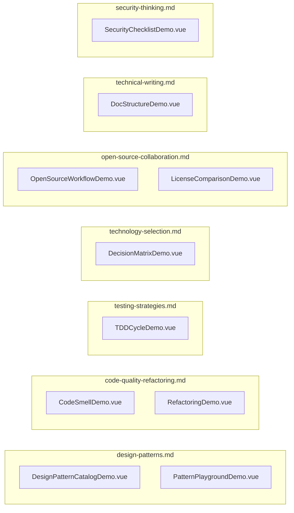
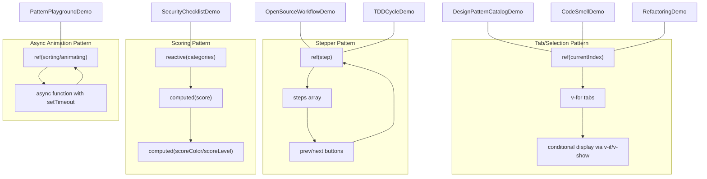
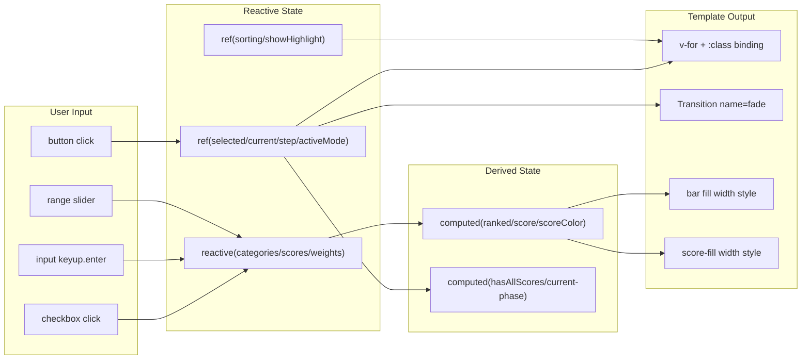

<!-- source: DeepWiki mcp.deepwiki.com · repo datawhalechina/easy-vibe · page 5.5 Engineering Excellence Demo Components · fetched 2026-10-30 -->

# Engineering Excellence Demo Components

Relevant source files

The following files were used as context for generating this wiki page:

- [.gitignore](.gitignore)
- [docs/.vitepress/theme/components/appendix/engineering-excellence/CodeSmellDemo.vue](docs/.vitepress/theme/components/appendix/engineering-excellence/CodeSmellDemo.vue)
- [docs/.vitepress/theme/components/appendix/engineering-excellence/DecisionMatrixDemo.vue](docs/.vitepress/theme/components/appendix/engineering-excellence/DecisionMatrixDemo.vue)
- [docs/.vitepress/theme/components/appendix/engineering-excellence/DesignPatternCatalogDemo.vue](docs/.vitepress/theme/components/appendix/engineering-excellence/DesignPatternCatalogDemo.vue)
- [docs/.vitepress/theme/components/appendix/engineering-excellence/DocStructureDemo.vue](docs/.vitepress/theme/components/appendix/engineering-excellence/DocStructureDemo.vue)
- [docs/.vitepress/theme/components/appendix/engineering-excellence/LicenseComparisonDemo.vue](docs/.vitepress/theme/components/appendix/engineering-excellence/LicenseComparisonDemo.vue)
- [docs/.vitepress/theme/components/appendix/engineering-excellence/OpenSourceWorkflowDemo.vue](docs/.vitepress/theme/components/appendix/engineering-excellence/OpenSourceWorkflowDemo.vue)
- [docs/.vitepress/theme/components/appendix/engineering-excellence/PatternPlaygroundDemo.vue](docs/.vitepress/theme/components/appendix/engineering-excellence/PatternPlaygroundDemo.vue)
- [docs/.vitepress/theme/components/appendix/engineering-excellence/RefactoringDemo.vue](docs/.vitepress/theme/components/appendix/engineering-excellence/RefactoringDemo.vue)
- [docs/.vitepress/theme/components/appendix/engineering-excellence/SecurityChecklistDemo.vue](docs/.vitepress/theme/components/appendix/engineering-excellence/SecurityChecklistDemo.vue)
- [docs/.vitepress/theme/components/appendix/engineering-excellence/TDDCycleDemo.vue](docs/.vitepress/theme/components/appendix/engineering-excellence/TDDCycleDemo.vue)
- [docs/zh-cn/appendix/1-computer-fundamentals/computer-networks.md](docs/zh-cn/appendix/1-computer-fundamentals/computer-networks.md)
- [docs/zh-cn/appendix/9-engineering-excellence/code-quality-refactoring.md](docs/zh-cn/appendix/9-engineering-excellence/code-quality-refactoring.md)
- [docs/zh-cn/appendix/9-engineering-excellence/design-patterns.md](docs/zh-cn/appendix/9-engineering-excellence/design-patterns.md)
- [docs/zh-cn/appendix/9-engineering-excellence/open-source-collaboration.md](docs/zh-cn/appendix/9-engineering-excellence/open-source-collaboration.md)
- [docs/zh-cn/appendix/9-engineering-excellence/security-thinking.md](docs/zh-cn/appendix/9-engineering-excellence/security-thinking.md)
- [docs/zh-cn/appendix/9-engineering-excellence/technical-writing.md](docs/zh-cn/appendix/9-engineering-excellence/technical-writing.md)
- [docs/zh-cn/appendix/9-engineering-excellence/technology-selection.md](docs/zh-cn/appendix/9-engineering-excellence/technology-selection.md)
- [docs/zh-cn/appendix/9-engineering-excellence/testing-strategies.md](docs/zh-cn/appendix/9-engineering-excellence/testing-strategies.md)

This page documents the ten interactive Vue components embedded in the Engineering Excellence appendix (`docs/zh-cn/appendix/9-engineering-excellence/`). Each component provides an interactive demonstration of a software engineering concept covered by the surrounding markdown text. For documentation of the appendix content itself, see [Engineering Excellence Appendix](#4.5). For the theme and navigation components that frame the site, see [Theme and Navigation Components](#5.1).

---

## Component-to-Page Mapping

All ten components live under `docs/.vitepress/theme/components/appendix/engineering-excellence/`. Each is registered globally through VitePress's custom theme and embedded directly as a custom element tag in a markdown file.

**Component-to-markdown mapping:**

| Component File | Tag in Markdown | Host Markdown File |
|---|---|---|
| `DesignPatternCatalogDemo.vue` | `<DesignPatternCatalogDemo />` | `design-patterns.md` |
| `PatternPlaygroundDemo.vue` | `<PatternPlaygroundDemo />` | `design-patterns.md` |
| `TDDCycleDemo.vue` | `<TDDCycleDemo />` | `testing-strategies.md` |
| `CodeSmellDemo.vue` | `<CodeSmellDemo />` | `code-quality-refactoring.md` |
| `RefactoringDemo.vue` | `<RefactoringDemo />` | `code-quality-refactoring.md` |
| `DecisionMatrixDemo.vue` | `<DecisionMatrixDemo />` | `technology-selection.md` |
| `OpenSourceWorkflowDemo.vue` | `<OpenSourceWorkflowDemo />` | `open-source-collaboration.md` |
| `LicenseComparisonDemo.vue` | `<LicenseComparisonDemo />` | `open-source-collaboration.md` |
| `DocStructureDemo.vue` | `<DocStructureDemo />` | `technical-writing.md` |
| `SecurityChecklistDemo.vue` | `<SecurityChecklistDemo />` | `security-thinking.md` |

Sources: [docs/zh-cn/appendix/9-engineering-excellence/design-patterns.md:34](), [docs/zh-cn/appendix/9-engineering-excellence/design-patterns.md:189](), [docs/zh-cn/appendix/9-engineering-excellence/testing-strategies.md:111](), [docs/zh-cn/appendix/9-engineering-excellence/code-quality-refactoring.md:48](), [docs/zh-cn/appendix/9-engineering-excellence/code-quality-refactoring.md:77](), [docs/zh-cn/appendix/9-engineering-excellence/technology-selection.md:74](), [docs/zh-cn/appendix/9-engineering-excellence/open-source-collaboration.md:39](), [docs/zh-cn/appendix/9-engineering-excellence/open-source-collaboration.md:70](), [docs/zh-cn/appendix/9-engineering-excellence/technical-writing.md:39](), [docs/zh-cn/appendix/9-engineering-excellence/security-thinking.md:131]()

---

## Architecture Overview

The diagram below maps the natural-language concept topics to their Vue component files and the markdown pages that host them.

**Engineering Excellence Component Topology**

Sources: `docs/.vitepress/theme/components/appendix/engineering-excellence/`

---

## Component Interaction Patterns

All ten components follow the same structural conventions. The diagram below shows the reactive state patterns they share.

**Shared Reactive State Patterns**

Sources: [docs/.vitepress/theme/components/appendix/engineering-excellence/DesignPatternCatalogDemo.vue:46-50](), [docs/.vitepress/theme/components/appendix/engineering-excellence/TDDCycleDemo.vue:43-47](), [docs/.vitepress/theme/components/appendix/engineering-excellence/SecurityChecklistDemo.vue:63-138](), [docs/.vitepress/theme/components/appendix/engineering-excellence/PatternPlaygroundDemo.vue:110-242]()

---

## DesignPatternCatalogDemo

**File:** `docs/.vitepress/theme/components/appendix/engineering-excellence/DesignPatternCatalogDemo.vue`

**Purpose:** Displays a categorized catalog of GoF design patterns. The user selects a category (Creational, Structural, Behavioral) and then expands individual patterns to see their intent, use cases, and a short code example.

**Key reactive state:**

| Variable | Type | Role |
|---|---|---|
| `selected` | `ref(-1)` | Index of the currently active category card; `-1` means none |
| `expanded` | `ref('')` | Name of the currently expanded pattern item |

**Data structure:** The `categories` array [DesignPatternCatalogDemo.vue:52-150]() holds three objects with fields `name`, `icon`, `cls` (CSS class), and `patterns`. Each pattern object has `name`, `intent`, `when`, and `code` fields.

**Interaction flow:**
1. Click a category card → sets `selected` to that index, reveals a `patterns-list` via `<Transition name="fade">`.
2. Click a pattern header → toggles `expanded` to that pattern's name, revealing `pattern-detail` with the code block.

**CSS classes for category color theming:** `create` (blue), `structure` (green), `behavior` (yellow), with dark mode overrides.

Sources: [docs/.vitepress/theme/components/appendix/engineering-excellence/DesignPatternCatalogDemo.vue:1-233]()

---

## PatternPlaygroundDemo

**File:** `docs/.vitepress/theme/components/appendix/engineering-excellence/PatternPlaygroundDemo.vue`

**Purpose:** An interactive playground for two behavioral patterns. The user switches between an Observer mode and a Strategy mode to see live execution.

**Mode switching:** `activeMode` ref switches between `'observer'` and `'strategy'`. Switching calls `resetState()` [PatternPlaygroundDemo.vue:232-242]() to clear all accumulated state.

### Observer mode

Users add and remove named subscriber objects from the `subscribers` ref array. Publishing an event via `publishEvent()` [PatternPlaygroundDemo.vue:143-154]() iterates over subscribers with staggered `setTimeout` calls (150 ms per subscriber), briefly setting `sub.notified = true` on each, causing a CSS highlight effect. Actions are logged to `observerLog` (shown newest-first).

| State | Type | Description |
|---|---|---|
| `subscribers` | `ref([])` | Array of `{id, name, lastMsg, notified}` objects |
| `eventMessage` | `ref('')` | Controlled input for the event payload |
| `observerLog` | `ref([])` | Chronological log of publish/subscribe actions |

### Strategy mode

Displays a bar chart of `strategyData` (10 numbers). The user selects a sort strategy (`bubble`, `selection`, `insertion`) and clicks "execute". The `executeSort()` async function [PatternPlaygroundDemo.vue:184-231]() pre-computes all swap steps, then replays them with 200 ms delays, animating the bars. `highlightIdx` tracks which bar is being processed.

| State | Type | Description |
|---|---|---|
| `strategyData` | `ref([...])` | Current array being visualized |
| `activeStrategy` | `ref('bubble')` | Key of the selected sort algorithm |
| `sorting` | `ref(false)` | Disables the execute button while animating |
| `sortSteps` | `ref([])` | Precomputed array of `{arr, idx}` snapshots |

Sources: [docs/.vitepress/theme/components/appendix/engineering-excellence/PatternPlaygroundDemo.vue:1-476]()

---

## TDDCycleDemo

**File:** `docs/.vitepress/theme/components/appendix/engineering-excellence/TDDCycleDemo.vue`

**Purpose:** A linear step-by-step walkthrough of the TDD Red → Green → Refactor cycle. Five predefined steps take the learner from a failing test through implementation and refactoring.

**Key reactive state:**

| Variable | Type | Role |
|---|---|---|
| `step` | `ref(0)` | Index into the `steps` array |
| `current` | `computed` | Derives the active phase (0=Red, 1=Green, 2=Blue) from `steps[step].cls` |

**Steps array** [TDDCycleDemo.vue:55-102](): Each step object has `phase`, `cls` (`'red'`/`'green'`/`'blue'`), `desc`, `fileLabel`, `code`, and `result`. The UI applies the step's `cls` to the `.step-card` element for color coding.

**Phase indicator:** The `phases` array drives three circular nodes at the top. The `active` CSS class enlarges the current phase node (via `transform: scale(1.15)`).

**Navigation:** Prev/Next/Reset buttons control `step`. The Reset button sets `step = 0`.

Sources: [docs/.vitepress/theme/components/appendix/engineering-excellence/TDDCycleDemo.vue:1-221]()

---

## CodeSmellDemo

**File:** `docs/.vitepress/theme/components/appendix/engineering-excellence/CodeSmellDemo.vue`

**Purpose:** Tabbed display of four common code smell examples. Each tab shows a problematic code snippet on the left and a description plus improvement suggestion on the right.

**Smells covered** [CodeSmellDemo.vue:38-96]():

| Key | Name | CSS class |
|---|---|---|
| 0 | 过长函数 (Long Method) | `red` |
| 1 | 魔法数字 (Magic Numbers) | `orange` |
| 2 | 重复代码 (Duplicate Code) | `yellow` |
| 3 | 过深嵌套 (Deep Nesting) | `purple` |

**State:** A single `current` ref (integer index) drives tab selection and the right-side info panel color via `:class="smells[current].cls"`.

**Layout:** Two-column CSS grid (`.content`) collapses to single column below 640 px via `@media`.

Sources: [docs/.vitepress/theme/components/appendix/engineering-excellence/CodeSmellDemo.vue:1-205]()

---

## RefactoringDemo

**File:** `docs/.vitepress/theme/components/appendix/engineering-excellence/RefactoringDemo.vue`

**Purpose:** Side-by-side before/after code comparison for four refactoring techniques.

**Techniques covered** [RefactoringDemo.vue:65-131]():

| Index | Name |
|---|---|
| 0 | Extract Function (提炼函数) |
| 1 | Rename Variable (重命名变量) |
| 2 | Remove Duplication (消除重复) |
| 3 | Simplify Conditional (简化条件) |

**Highlight animation:** `showHighlight` ref is set to `false` immediately on tab change, then back to `true` after 300 ms [RefactoringDemo.vue:56-60](). This re-triggers a CSS `transition: background 0.6s ease` on the `.highlight` spans, creating a flash effect on the changed code segments.

**Code segments:** Each `before`/`after` array contains objects with `text` and an optional `changed: true` flag. Segments with `changed: true` receive the `.highlight` class when `showHighlight` is true.

**Layout:** `.compare-area` uses flexbox with an arrow column in the middle. Below 640 px, it switches to column layout and rotates the arrow 90°.

Sources: [docs/.vitepress/theme/components/appendix/engineering-excellence/RefactoringDemo.vue:1-267]()

---

## DecisionMatrixDemo

**File:** `docs/.vitepress/theme/components/appendix/engineering-excellence/DecisionMatrixDemo.vue`

**Purpose:** A fully interactive decision matrix for technology selection. Users add/remove candidate technologies, adjust dimension weights, score each technology per dimension, and see a ranked bar chart.

**Key state:**

| Variable | Type | Description |
|---|---|---|
| `options` | `ref(['React','Vue','Svelte'])` | List of technology names being compared |
| `weights` | `reactive({...})` | Weight (1–5) per dimension key |
| `scores` | `reactive({...})` | Nested: `scores[optName][dimKey]` = score (1–5) |

**Dimensions** [DecisionMatrixDemo.vue:130-136](): `learning`, `ecosystem`, `performance`, `community`, `hiring`.

**Computed outputs:**

- `hasAllScores` — `true` when every option has a score for every dimension. Controls visibility of the results section.
- `ranked` — maps options to weighted sum scores and sorts descending.
- `maxScore` — used to normalize bar widths in the chart.

**Adding/removing options:** `addOption()` [DecisionMatrixDemo.vue:154-161]() pushes to `options` and creates an empty `scores[name]` entry. `removeOption()` [DecisionMatrixDemo.vue:163-167]() refuses to drop below 2 options, then removes both the option and its score entry.

**Preset/Reset:** `loadPreset()` and `resetAll()` both restore the three default options with fixed seed scores, useful for demos.

Sources: [docs/.vitepress/theme/components/appendix/engineering-excellence/DecisionMatrixDemo.vue:1-480]()

---

## OpenSourceWorkflowDemo

**File:** `docs/.vitepress/theme/components/appendix/engineering-excellence/OpenSourceWorkflowDemo.vue`

**Purpose:** A linear eight-step walkthrough of the open source contribution workflow: Fork → Clone → Branch → Commit → Push → PR → Review → Merge.

**State:** A single `current` ref (integer) drives which step is displayed. Steps before `current` show a ✓ checkmark in their dot indicator (class `done`), and the current step gets the `active` class.

**Steps array** [OpenSourceWorkflowDemo.vue:38-47](): Each step has `name`, `icon`, `desc`, and `cmd` (the shell commands or UI action for that step). The `cmd` field is displayed in a styled code block below the description.

**Navigation:** Previous/Next buttons update `current`. Clicking any step dot in the steps bar also jumps directly to it.

Sources: [docs/.vitepress/theme/components/appendix/engineering-excellence/OpenSourceWorkflowDemo.vue:1-82]()

---

## LicenseComparisonDemo

**File:** `docs/.vitepress/theme/components/appendix/engineering-excellence/LicenseComparisonDemo.vue`

**Purpose:** An interactive comparison table for five common open source licenses, with a filter system that recommends the best match for the user's stated requirements.

**Licenses covered** [LicenseComparisonDemo.vue:73-99](): MIT, Apache 2.0, GPL 3.0, BSD 2-Clause, MPL 2.0.

**Permission columns** [LicenseComparisonDemo.vue:63-71](): `commercial`, `modify`, `distribute`, `patent`, `private`, `copyleft`, `liability`.

**Filter/recommendation logic:**

- `activeFilters` ref holds an array of selected filter IDs (e.g., `'commercial'`, `'patent'`).
- The `recommended` computed [LicenseComparisonDemo.vue:117-126]() scores each license by how many of the user's selected filters appear in the license's `tags` array, then returns the highest scorer.
- The recommended row gets the `lc-row--hl` CSS class for visual emphasis.

**Cell values:** Each license's `perms[id]` can be `true`, `false`, or a string like `'cond'` (conditional). The template uses three `v-if`/`v-else-if`/`v-else` branches to render ✓, ✗, or ⚠ accordingly.

Sources: [docs/.vitepress/theme/components/appendix/engineering-excellence/LicenseComparisonDemo.vue:1-234]()

---

## DocStructureDemo

**File:** `docs/.vitepress/theme/components/appendix/engineering-excellence/DocStructureDemo.vue`

**Purpose:** Tabbed display of three documentation type templates (README, API docs, Architecture docs), each showing its standard sections in an expandable accordion.

**State:**

| Variable | Type | Description |
|---|---|---|
| `current` | `ref(0)` | Index of the active doc type tab |
| `selectedSec` | `ref(-1)` | Index of the expanded section; resets to -1 on tab change |

A `watch` on `current` [DocStructureDemo.vue:45]() resets `selectedSec` to `-1` whenever the user switches doc types.

**Doc types** [DocStructureDemo.vue:47-79]():

| Index | Name | Icon |
|---|---|---|
| 0 | README | 📖 |
| 1 | API 文档 | 🔌 |
| 2 | 架构文档 | 🏛️ |

Each section object has `name`, `desc`, and an optional `example` (raw text rendered in a `<pre>` block). If `example` is `null`, no code block is shown.

**Expansion:** Clicking a `.sec-header` toggles `selectedSec` between the section's index and `-1`. The detail content appears inside a `<Transition name="fade">`.

Sources: [docs/.vitepress/theme/components/appendix/engineering-excellence/DocStructureDemo.vue:1-109]()

---

## SecurityChecklistDemo

**File:** `docs/.vitepress/theme/components/appendix/engineering-excellence/SecurityChecklistDemo.vue`

**Purpose:** An interactive security self-assessment checklist organized into four collapsible categories. Checking items updates a live security score (0–100) with a color-coded rating.

**State:** All state lives in a single `reactive(categories)` array [SecurityChecklistDemo.vue:66-108](). Each category has `icon`, `name`, `open` (controls accordion), and an `items` array. Each item has `label`, `checked`, `showDetail`, and `detail` (best practice text).

**Categories and item counts:**

| Icon | Category | Items |
|---|---|---|
| 🔍 | 输入验证 | 3 |
| 🔐 | 认证授权 | 4 |
| 🛡️ | 数据保护 | 3 |
| 🌐 | 通信安全 | 3 |

**Computed scoring:**

| Computed | Formula | Output |
|---|---|---|
| `totalItems` | Sum of all items across categories | Integer |
| `totalChecked` | Sum of checked items | Integer |
| `score` | `round(totalChecked / totalItems * 100)` | 0–100 |
| `scoreColor` | `≥80` → green, `≥50` → amber, else red | CSS color string |
| `scoreLevel` | `≥80` → "优秀", `≥50` → "及格", else "危险" | String |

The score bar's `.score-fill` div uses `transition: width 0.4s, background 0.4s` for animated updates.

**Best practice toggle:** Each item has a "查看最佳实践" button that toggles `item.showDetail`, revealing the `detail` text in a `.item-detail` div.

Sources: [docs/.vitepress/theme/components/appendix/engineering-excellence/SecurityChecklistDemo.vue:1-295]()

---

## Data Flow Summary

The diagram below shows how user interaction flows through the component layer to produce rendered output, using the actual Vue composition API primitives involved.

**Component Data Flow (Composition API Primitives)**

Sources: [docs/.vitepress/theme/components/appendix/engineering-excellence/DecisionMatrixDemo.vue:174-193](), [docs/.vitepress/theme/components/appendix/engineering-excellence/SecurityChecklistDemo.vue:110-135](), [docs/.vitepress/theme/components/appendix/engineering-excellence/RefactoringDemo.vue:51-63](), [docs/.vitepress/theme/components/appendix/engineering-excellence/PatternPlaygroundDemo.vue:184-231]()