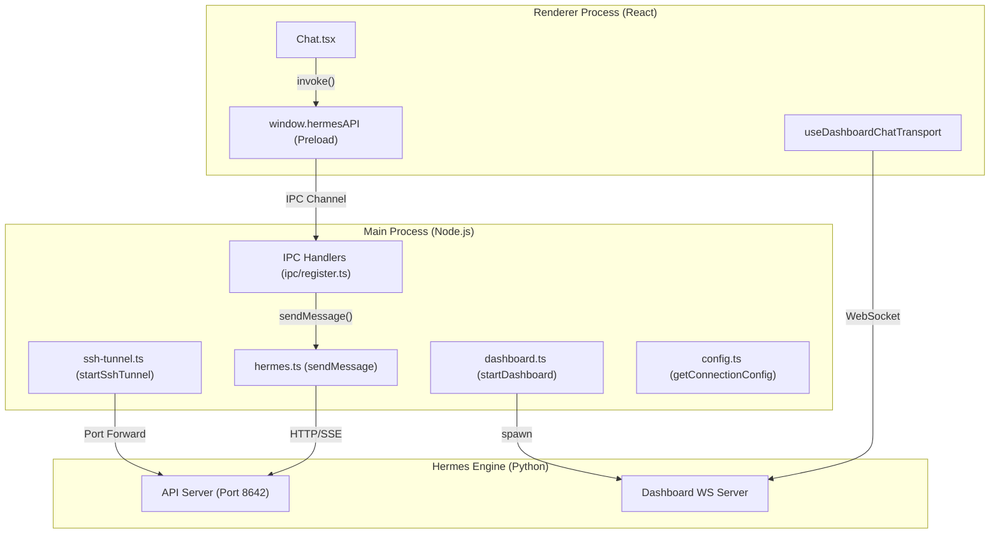
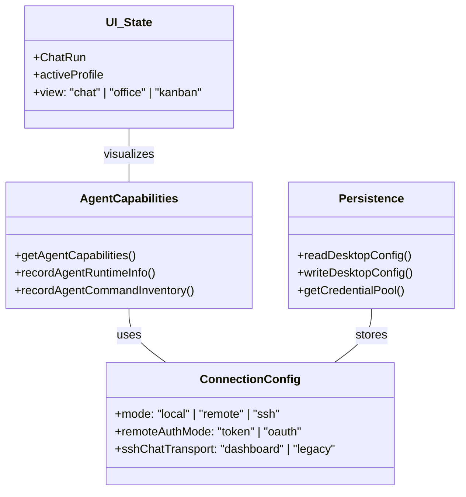

<!-- source: DeepWiki mcp.deepwiki.com · repo fathah/hermes-desktop · page 10 Glossary · fetched 2026-10-30 -->

# Glossary

Relevant source files

The following files were used as context for generating this wiki page:

- [.github/workflows/beta-release.yml](.github/workflows/beta-release.yml)
- [Development.md](Development.md)
- [KANBAN_GAP_REPORT.md](KANBAN_GAP_REPORT.md)
- [README.md](README.md)
- [assets/header.webp](assets/header.webp)
- [assets/partners/atlascloud.webp](assets/partners/atlascloud.webp)
- [assets/partners/greptile.webp](assets/partners/greptile.webp)
- [lat.md/chat-commands.md](lat.md/chat-commands.md)
- [lat.md/desktop-updates.md](lat.md/desktop-updates.md)
- [lat.md/kanban.md](lat.md/kanban.md)
- [lat.md/lat.md](lat.md/lat.md)
- [lat.md/main-process.md](lat.md/main-process.md)
- [lat.md/office-3d-walk-mode.md](lat.md/office-3d-walk-mode.md)
- [lat.md/office-interactions.md](lat.md/office-interactions.md)
- [lat.md/provider-setup.md](lat.md/provider-setup.md)
- [lat.md/sidebar-navigation.md](lat.md/sidebar-navigation.md)
- [lat.md/wallet-token-balances.md](lat.md/wallet-token-balances.md)
- [pr-comment.md](pr-comment.md)
- [previews/discover.png](previews/discover.png)
- [previews/memory.png](previews/memory.png)
- [previews/sessions.png](previews/sessions.png)
- [scripts/set-version.mjs](scripts/set-version.mjs)
- [scripts/verify-nous-discovery.js](scripts/verify-nous-discovery.js)
- [src/main/config.ts](src/main/config.ts)
- [src/main/default-models.ts](src/main/default-models.ts)
- [src/main/gpu-fallback.ts](src/main/gpu-fallback.ts)
- [src/main/hermes.ts](src/main/hermes.ts)
- [src/main/index.ts](src/main/index.ts)
- [src/main/installer.ts](src/main/installer.ts)
- [src/main/ipc/register.ts](src/main/ipc/register.ts)
- [src/main/kanban.ts](src/main/kanban.ts)
- [src/main/model-discovery.ts](src/main/model-discovery.ts)
- [src/main/provider-registry.ts](src/main/provider-registry.ts)
- [src/main/remote-provider-statuses.ts](src/main/remote-provider-statuses.ts)
- [src/main/ssh-remote.ts](src/main/ssh-remote.ts)
- [src/main/wallet-actions.test.ts](src/main/wallet-actions.test.ts)
- [src/main/wallet-sync.test.ts](src/main/wallet-sync.test.ts)
- [src/main/wallet-sync.ts](src/main/wallet-sync.ts)
- [src/preload/index.d.ts](src/preload/index.d.ts)
- [src/preload/index.ts](src/preload/index.ts)
- [src/renderer/src/assets/fonts/SpaceGrotesk-Variable.ttf](src/renderer/src/assets/fonts/SpaceGrotesk-Variable.ttf)
- [src/renderer/src/assets/main.css](src/renderer/src/assets/main.css)
- [src/renderer/src/components/HermesAccountModal.tsx](src/renderer/src/components/HermesAccountModal.tsx)
- [src/renderer/src/components/ProviderKeysSection.tsx](src/renderer/src/components/ProviderKeysSection.tsx)
- [src/renderer/src/components/profile/ProfileWalletPane.test.tsx](src/renderer/src/components/profile/ProfileWalletPane.test.tsx)
- [src/renderer/src/components/profile/ProfileWalletPane.tsx](src/renderer/src/components/profile/ProfileWalletPane.tsx)
- [src/renderer/src/hooks/useDiscoveredModels.ts](src/renderer/src/hooks/useDiscoveredModels.ts)
- [src/renderer/src/screens/Chat/Chat.tsx](src/renderer/src/screens/Chat/Chat.tsx)
- [src/renderer/src/screens/Chat/hooks/useChatActions.ts](src/renderer/src/screens/Chat/hooks/useChatActions.ts)
- [src/renderer/src/screens/Chat/hooks/useDashboardChatTransport.test.tsx](src/renderer/src/screens/Chat/hooks/useDashboardChatTransport.test.tsx)
- [src/renderer/src/screens/Chat/hooks/useDashboardChatTransport.ts](src/renderer/src/screens/Chat/hooks/useDashboardChatTransport.ts)
- [src/renderer/src/screens/Kanban/Kanban.tsx](src/renderer/src/screens/Kanban/Kanban.tsx)
- [src/renderer/src/screens/Layout/Layout.tsx](src/renderer/src/screens/Layout/Layout.tsx)
- [src/renderer/src/screens/Office/Office.tsx](src/renderer/src/screens/Office/Office.tsx)
- [src/renderer/src/screens/Office/RepInteractionPanel.test.tsx](src/renderer/src/screens/Office/RepInteractionPanel.test.tsx)
- [src/renderer/src/screens/Office/RepInteractionPanel.tsx](src/renderer/src/screens/Office/RepInteractionPanel.tsx)
- [src/renderer/src/screens/Office/office3d/interactions/proximity.ts](src/renderer/src/screens/Office/office3d/interactions/proximity.ts)
- [src/renderer/src/screens/Office/office3d/interactions/registry.ts](src/renderer/src/screens/Office/office3d/interactions/registry.ts)
- [src/renderer/src/screens/Providers/Providers.tsx](src/renderer/src/screens/Providers/Providers.tsx)
- [src/shared/i18n/index.ts](src/shared/i18n/index.ts)
- [src/shared/i18n/locales/en/kanban.ts](src/shared/i18n/locales/en/kanban.ts)
- [src/shared/i18n/locales/en/office.ts](src/shared/i18n/locales/en/office.ts)
- [src/shared/i18n/locales/pt-PT/kanban.ts](src/shared/i18n/locales/pt-PT/kanban.ts)
- [src/shared/url-key-map.ts](src/shared/url-key-map.ts)
- [src/shared/wallets.ts](src/shared/wallets.ts)
- [tests/constants.test.ts](tests/constants.test.ts)
- [tests/gpu-fallback.test.ts](tests/gpu-fallback.test.ts)
- [tests/install-gate-providers.test.ts](tests/install-gate-providers.test.ts)
- [tests/installer-utils.test.ts](tests/installer-utils.test.ts)
- [tests/kanban-unsupported.test.ts](tests/kanban-unsupported.test.ts)
- [tests/model-discovery.test.ts](tests/model-discovery.test.ts)
- [tests/provider-registry.test.ts](tests/provider-registry.test.ts)
- [tests/remote-provider-statuses.test.ts](tests/remote-provider-statuses.test.ts)
- [tests/set-model-config-base-url.test.ts](tests/set-model-config-base-url.test.ts)
- [tests/ssh-remote.test.ts](tests/ssh-remote.test.ts)
- [tests/url-key-map.test.ts](tests/url-key-map.test.ts)

This page defines the core terminology, domain concepts, and codebase-specific abbreviations used throughout Hermes Desktop. It serves as a technical reference for onboarding engineers to understand how high-level agent concepts map to specific implementation details in the code, particularly following the v0.7.0 updates.

## System Architecture Overview

Hermes Desktop operates as a bridge between a local or remote **Hermes Engine** (the Python backend) and a React-based **Renderer**.

### Core Terms

#### 1. Hermes Engine (Agent)
The core logic layer written in Python. It handles LLM orchestration, tool execution, and state management. The desktop app manages its lifecycle via the `hermes.ts` module, which supports both a fast-path HTTP API and a CLI fallback.
*   **Implementation**: Spawns as a background process or communicated with via HTTP/SSE.
*   **Code Pointer**: [src/main/hermes.ts:1-25]()

#### 2. Profile
A self-contained environment for an agent. Each profile has its own configuration (`config.yaml`), environment variables (`.env`), memory files, and installed skills. The default profile is rooted at `HERMES_HOME`, while named profiles reside in a sub-directory.
*   **Implementation**: Managed via `listProfiles`, `createProfile`, and `setActiveProfile`.
*   **Code Pointer**: [src/main/ipc/register.ts:278-285](), [src/main/config.ts:148-175]()

#### 3. Gateway
A subsystem that allows the Hermes Agent to communicate over external messaging platforms (e.g., Telegram, Discord, Slack).
*   **Implementation**: Toggled via `setPlatformEnabled` which modifies the `platforms` section in `config.yaml`.
*   **Code Pointer**: [src/main/config.ts:197-198](), [src/main/ipc/register.ts:197-198]()

#### 4. Skill
A modular extension of the agent's capabilities. Skills are typically Python-based and are discovered by walking the filesystem for `SKILL.md` files.
*   **Implementation**: `listInstalledSkills` parses frontmatter from markdown files to extract metadata.
*   **Code Pointer**: [src/main/ipc/register.ts:265-270](), [src/main/ssh-remote.ts:16-19]()

---

## Data Flow & Communication

The following diagram illustrates the relationship between the User Interface, the Electron Main process, and the underlying Hermes Engine, including the new Dashboard transport.

### System Interaction Diagram

**Sources**: [src/main/hermes.ts:131-148](), [src/main/dashboard.ts:134-140](), [src/renderer/src/screens/Chat/hooks/useDashboardChatTransport.ts:23-26](), [src/main/ipc/register.ts:117-140]()

---

## Technical Glossary (v0.7.0+)

| Term | Definition | Relevant Code Entities |
| :--- | :--- | :--- |
| **Dashboard Transport** | A WebSocket-based communication layer for real-time chat and tool events, replacing legacy SSE in v0.7.0. | `useDashboardChatTransport` [src/renderer/src/screens/Chat/Chat.tsx:25-26]() |
| **Config Health** | A diagnostic system that scans `config.yaml` and `.env` for errors, missing keys, or invalid provider URLs. | `ConfigHealthReport` [src/preload/index.d.ts:81-86]() |
| **Wallet** | Profile-scoped Ethereum wallets (Base mainnet) for the agent's token economy. | `ProfileWallet` [src/preload/index.d.ts:8-13]() |
| **Agent Sync** | Pipeline to synchronize agent state (Soul, Memory) across different machines or instances. | `AgentSyncStatus` [src/preload/index.d.ts:23]() |
| **SSH Docker** | Ability to target a specific Docker container on a remote host via SSH for agent execution. | `dockerContainerName` [src/main/config.ts:44-45]() |
| **Secrets Provider** | A layered system for resolving API keys from `.env`, `config.yaml`, or secure OS storage. | `getSecretsProvider` [src/main/config.ts:22-25]() |
| **Walk Mode** | A third-person avatar control mode within the 3D Office environment. | `Office.tsx` [src/renderer/src/screens/Layout/Layout.tsx:72]() |
| **Kanban** | A task management system integrated with agent status polling and task lifecycle. | `KanbanBoard` [src/preload/index.d.ts:196-207]() |
| **Web Preview** | A renderer panel for displaying HTML/web content generated or manipulated by the agent. | `WebPreviewPanel` [src/renderer/src/screens/Chat/Chat.tsx:12]() |

---

## Code Entity Mapping

This diagram maps natural language concepts to the specific TypeScript/JavaScript entities that implement them.

### Concept to Code Map

**Sources**: [src/preload/index.d.ts:99-124](), [src/renderer/src/screens/Layout/Layout.tsx:55-66](), [src/main/ipc/register.ts:182-191](), [src/shared/agent-capabilities.ts:39-40]()

---

## Domain Concepts

### Connection Modes & Transports
Hermes Desktop supports three connection modes, each configurable with specific transports in `desktop.json`:
*   **Local**: Spawns a local API server using bundled Python.
*   **Remote**: Connects via HTTP/HTTPS. Supports **Remote Dashboard OAuth** for secure authentication.
*   **SSH**: Tunnels to a remote host. Supports **SSH Docker** targeting where the agent runs inside a container.
*   **Code Pointer**: [src/main/config.ts:50-58](), [src/main/hermes.ts:150-162]()

### Chat Runs and Multi-Session
The UI manages multiple concurrent conversations using the `ChatRun` model. This allows background sessions to remain mounted while the user switches between agents or projects.
*   **Implementation**: `mintRun` creates a new session identity; `Layout.tsx` tracks an array of `runs`.
*   **Code Pointer**: [src/renderer/src/screens/Layout/chatRuns.ts:8-18](), [src/renderer/src/screens/Layout/Layout.tsx:110-113]()

### Token Economy ($H1/$HD)
Integrates on-chain balances into the agent profile. Users can view and manage $H1 and $HD tokens within the `ProfileWalletPane`.
*   **Implementation**: Uses `TokenBalancesResponse` and `ProvisionWalletResult` via IPC.
*   **Code Pointer**: [src/preload/index.d.ts:7-14](), [src/renderer/src/components/profile/ProfileWalletPane.tsx:1-20]()

### Office and Kanban HQ
The `Office` view provides a 3D interface for agent interaction, while the `Kanban` board provides a structured task view. These are bridged by status polling that updates agent locations (e.g., "Bank", "Showroom") based on their current task.
*   **Implementation**: `KanbanTask` and `KanbanRun` track execution; `Office.tsx` renders the R3F scene.
*   **Code Pointer**: [src/preload/index.d.ts:177-247](), [src/renderer/src/screens/Layout/Layout.tsx:72-73]()

**Sources**:
- [src/main/ipc/register.ts:1-261]()
- [src/main/hermes.ts:122-187]()
- [src/main/config.ts:34-94]()
- [src/preload/index.d.ts:1-261]()
- [src/renderer/src/screens/Layout/Layout.tsx:1-135]()
- [src/renderer/src/screens/Chat/Chat.tsx:1-145]()