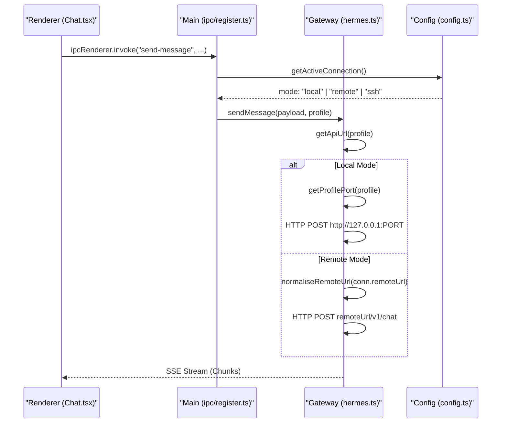
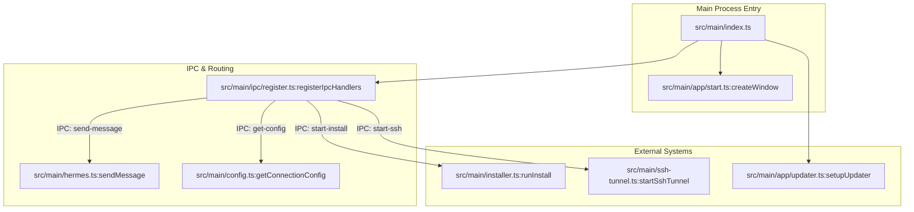

<!-- source: DeepWiki mcp.deepwiki.com · repo fathah/hermes-desktop · page 2.1 Main Process · fetched 2026-10-30 -->

# Main Process

Relevant source files

The following files were used as context for generating this wiki page:

- [docs/superpowers/plans/2026-07-14-remote-dashboard-oauth.md](docs/superpowers/plans/2026-07-14-remote-dashboard-oauth.md)
- [docs/superpowers/specs/2026-07-14-remote-dashboard-oauth-design.md](docs/superpowers/specs/2026-07-14-remote-dashboard-oauth-design.md)
- [lat.md/lat.md](lat.md/lat.md)
- [lat.md/sidebar-navigation.md](lat.md/sidebar-navigation.md)
- [src/main/app/context-menu.ts](src/main/app/context-menu.ts)
- [src/main/app/menu.ts](src/main/app/menu.ts)
- [src/main/app/start.ts](src/main/app/start.ts)
- [src/main/app/updater.ts](src/main/app/updater.ts)
- [src/main/config.ts](src/main/config.ts)
- [src/main/dashboard-websocket-relay.ts](src/main/dashboard-websocket-relay.ts)
- [src/main/hermes.ts](src/main/hermes.ts)
- [src/main/index.ts](src/main/index.ts)
- [src/main/ipc/register.ts](src/main/ipc/register.ts)
- [src/main/security.ts](src/main/security.ts)
- [src/main/ws.d.ts](src/main/ws.d.ts)
- [src/preload/index.d.ts](src/preload/index.d.ts)
- [src/preload/index.ts](src/preload/index.ts)
- [src/renderer/index.html](src/renderer/index.html)
- [src/renderer/src/assets/main.css](src/renderer/src/assets/main.css)
- [src/renderer/src/screens/Chat/Chat.tsx](src/renderer/src/screens/Chat/Chat.tsx)
- [src/renderer/src/screens/Chat/RemoteFolderPicker.tsx](src/renderer/src/screens/Chat/RemoteFolderPicker.tsx)
- [src/renderer/src/screens/Layout/Layout.tsx](src/renderer/src/screens/Layout/Layout.tsx)
- [tests/dashboard-csp.test.ts](tests/dashboard-csp.test.ts)
- [tests/electron-security.test.ts](tests/electron-security.test.ts)
- [tests/ipc-handlers.test.ts](tests/ipc-handlers.test.ts)

The **Main Process** is the entry point and backbone of the Hermes Desktop application. It orchestrates the application lifecycle, manages native browser windows, handles system-level integrations (auto-updates, GPU fallbacks, and notifications), and serves as the secure bridge between the Renderer process and the local filesystem or Hermes engine.

The implementation is centered in `src/main/index.ts`, which bootstraps the environment and delegates logic to specialized modules for window management, IPC registration, and gateway orchestration.

## Application Lifecycle and Start Sequence

The main process initialization follows a strict sequence to ensure environment variables are loaded, GPU preferences are applied, and security guards are in place before any window is created.

### Start Sequence
1.  **Environment Loading**: In development, `loadDotEnvForDev` is called to ensure `process.env` reflects local `.env` changes [src/main/index.ts:9-9]().
2.  **GPU Configuration**: `applyGpuPreferences` and `installGpuCrashGuard` are invoked to manage hardware acceleration stability [src/main/index.ts:11-12]().
3.  **Process Entry**: `startMainProcess` is called to register global error handlers and initialize the app [src/main/index.ts:21-21]().

### Window Creation and Chrome
The `createWindow` function in `src/main/app/start.ts` instantiates the `BrowserWindow`. It configures platform-specific aesthetics, such as the macOS `hiddenInset` title bar and `vibrancy` effects [src/main/app/start.ts:164-181]().

| Feature | Implementation Detail |
| :--- | :--- |
| **Vibrancy** | macOS uses `under-window` vibrancy to create a frosted glass effect [src/main/app/start.ts:180-180](). |
| **Theme Sync** | `nativeTheme.themeSource` is set to "dark" by default to prevent light-mode flashes during boot [src/main/app/start.ts:163-163](). |
| **Security** | `hardenAttachedWebContents` restricts permissions for both the main window and embedded webviews [src/main/app/start.ts:69-69](). |

**Sources:** [src/main/index.ts:1-21](), [src/main/app/start.ts:158-181]()

## IPC Handler Registration

The communication hub is established via `registerIpcHandlers` in `src/main/ipc/register.ts`. This module maps hundreds of frontend requests to backend logic, ranging from session management to complex engine operations.

### Core System Flow: Chat and Gateway
The following diagram illustrates the data flow when a user sends a message, showing how the Main Process bridges the Renderer to the Hermes Gateway (local or remote).

**Chat Execution and Routing Flow**

**Sources:** [src/main/ipc/register.ts:1116-1140](), [src/main/hermes.ts:131-148](), [src/main/hermes.ts:190-206]()

### Service Management Handlers
The main process manages the lifecycle of the Hermes Gateway and the auto-updater.

| IPC Channel | Main Process Function | Description |
| :--- | :--- | :--- |
| `start-gateway` | `startGateway(profile)` | Boots the Python FastAPI server for a specific profile [src/main/ipc/register.ts:1015-1017](). |
| `check-install` | `checkInstallStatus()` | Verifies if Hermes Agent is installed and configured [src/main/ipc/register.ts:634-634](). |
| `run-hermes-doctor` | `runHermesDoctor()` | Executes diagnostic checks on the local environment [src/main/ipc/register.ts:664-665](). |
| `get-gpu-status` | `getGpuStatus()` | Returns the current state of hardware acceleration [src/main/ipc/register.ts:592-592](). |

**Sources:** [src/main/ipc/register.ts:533-1100]()

## Process Lifecycle and Cleanup

The Main Process is responsible for the graceful termination of all subprocesses and connections to prevent orphaned resources.

### Shutdown Sequence
When the `before-quit` event fires, the app executes the following cleanup:
1.  **Polling**: Stops health polling for all gateways via `stopHealthPolling` [src/main/app/start.ts:120-120]().
2.  **Abort Signals**: Iterates through `activeRuns` and triggers abort controllers for in-flight LLM requests [src/main/app/start.ts:121-122]().
3.  **Infrastructure**: Stops all active dashboards and the SSH tunnel process [src/main/app/start.ts:124-128]().
4.  **Database**: Closes the SQLite connection via `closeDbConnection` [src/main/app/start.ts:129-129]().

**Sources:** [src/main/app/start.ts:115-131]()

## Auto-Updater and Notifications

Hermes Desktop uses `electron-updater` to manage the update lifecycle. The logic is encapsulated in `src/main/app/updater.ts` and initialized during the start sequence [src/main/app/start.ts:50-50]().

### Update Flow
- **Detection**: Checks for updates on startup or via the `check-for-updates` IPC.
- **Progress**: The updater emits `download-progress`, which is forwarded to the renderer to update the `StatusBar` [src/renderer/src/screens/Layout/StatusBar.tsx]().
- **Installation**: `quitAndInstall` is called after the user clicks the update button in the UI.

### Notifications
The main process handles native OS notifications. In `src/renderer/src/screens/Chat/Chat.tsx`, a chime is played locally using a shared `AudioContext` to avoid memory leaks when a turn finishes [src/renderer/src/screens/Chat/Chat.tsx:61-84]().

**Sources:** [src/main/app/start.ts:50-50](), [src/renderer/src/screens/Chat/Chat.tsx:57-84]()

## Code Entity Mapping

The following diagram bridges the high-level system components to the specific files and functions that implement them.

**System to Code Entity Mapping**

**Sources:** [src/main/index.ts:1-21](), [src/main/app/start.ts:32-50](), [src/main/ipc/register.ts:1-134]()

---

