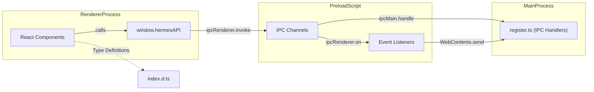
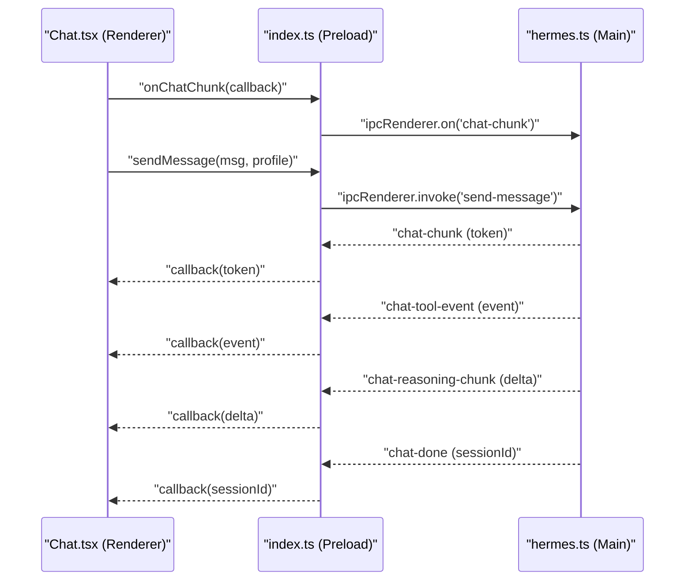

<!-- source: DeepWiki mcp.deepwiki.com · repo fathah/hermes-desktop · page 2.2 Preload Bridge (IPC API) · fetched 2026-10-30 -->

# Preload Bridge (IPC API)

<details>
<summary>Relevant source files</summary>

The following files were used as context for generating this wiki page:

- [lat.md/lat.md](lat.md/lat.md)
- [lat.md/sidebar-navigation.md](lat.md/sidebar-navigation.md)
- [src/main/askpass.ts](src/main/askpass.ts)
- [src/main/config.ts](src/main/config.ts)
- [src/main/gatewayPrompt.ts](src/main/gatewayPrompt.ts)
- [src/main/hermes.ts](src/main/hermes.ts)
- [src/main/index.ts](src/main/index.ts)
- [src/main/ipc/register.ts](src/main/ipc/register.ts)
- [src/main/security.ts](src/main/security.ts)
- [src/preload/askpass.ts](src/preload/askpass.ts)
- [src/preload/index.d.ts](src/preload/index.d.ts)
- [src/preload/index.ts](src/preload/index.ts)
- [src/renderer/src/assets/main.css](src/renderer/src/assets/main.css)
- [src/renderer/src/screens/Chat/Chat.tsx](src/renderer/src/screens/Chat/Chat.tsx)
- [src/renderer/src/screens/Layout/Layout.tsx](src/renderer/src/screens/Layout/Layout.tsx)
- [src/shared/askpass.ts](src/shared/askpass.ts)
- [tests/askpass-security.test.ts](tests/askpass-security.test.ts)
- [tests/electron-security.test.ts](tests/electron-security.test.ts)
- [tests/ipc-handlers.test.ts](tests/ipc-handlers.test.ts)

</details>


The Preload Bridge serves as the secure communication layer between the isolated Renderer process (UI) and the Main process (Node.js/System access). By utilizing Electron's `contextBridge`, Hermes Desktop exposes a type-safe `hermesAPI` interface to the window global, ensuring that the frontend can interact with the Hermes engine without direct access to dangerous Node.js primitives.

### Architecture Overview

The bridge implementation is split between the runtime logic in `src/preload/index.ts` and the TypeScript interface definitions in `src/preload/index.d.ts`. This separation provides full IntelliSense support in the React frontend while maintaining strict process isolation.

#### Data Flow and Security
Hermes enforces strict security by enabling `contextIsolation`, `sandbox`, and `webSecurity` in the `BrowserWindow` configuration [tests/electron-security.test.ts:22-28](). The bridge uses a "Request-Response" pattern via `ipcRenderer.invoke` for most configuration and data fetching, and an "Observer" pattern via `ipcRenderer.on` for streaming chat responses and installation logs [src/preload/index.ts:129-188]().

**IPC Communication Bridge**

Sources: [src/preload/index.ts:1-127](), [src/preload/index.d.ts:261-1349](), [src/main/ipc/register.ts:1-134](), [tests/electron-security.test.ts:22-28]()

---

### The HermesAPI Interface

The `HermesAPI` interface is the primary contract for all agent-related operations. It is injected into the renderer via `contextBridge.exposeInMainWorld("hermes", hermesAPI)` [src/preload/index.ts:1784-1786]().

#### 1. Installation and Engine Info
These methods manage the lifecycle of the Hermes Python backend and the local environment.

| Method | Description | File |
|:---|:---|:---|
| `checkInstall` | Returns `InstallStatus` (installed, configured, etc.) | [src/preload/index.ts:129-133]() |
| `startInstall` | Triggers the `runInstall` pipeline in the main process | [src/preload/index.ts:137-138]() |
| `onInstallProgress` | Subscribes to installation logs and step updates | [src/preload/index.ts:164-188]() |
| `runHermesDoctor` | Executes system diagnostics via CLI | [src/preload/index.ts:219-220]() |
| `inspectInstallTarget`| Checks for existing installations or update states | [src/preload/index.ts:141-145]() |

Sources: [src/preload/index.d.ts:53-67](), [src/preload/index.ts:129-221]()

#### 2. Chat and Streaming
Chat interactions utilize a hybrid model: an initial `sendMessage` invoke followed by multiple event listeners for streaming content.

**Chat Streaming Sequence**

Sources: [src/preload/index.ts:586-630](), [src/main/hermes.ts:63-84](), [src/renderer/src/screens/Chat/Chat.tsx:132-164]()

#### 3. Profile and Configuration Management
The API is "profile-aware," meaning most methods accept an optional `profile` string to target specific agent configurations [src/preload/index.d.ts:285-300]().

*   **`readEnv` / `setEnvValue`**: Manages `.env` files within profile directories [src/preload/index.ts:285-295]().
*   **`getModelConfig` / `setModelConfig`**: Configures the LLM provider and model IDs [src/preload/index.ts:318-329]().
*   **`listProfiles`**: Returns metadata for all available agent profiles [src/preload/index.ts:875-876]().
*   **`getConnectionConfig`**: Retrieves application-wide connection mode (Local, Remote, or SSH) [src/preload/index.ts:347-348]().

Sources: [src/preload/index.ts:285-348](), [src/preload/index.d.ts:285-380]()

---

### New v0.7.0 Features: Wallets and Agent Sync

The v0.7.0 update introduced significant new interfaces for the token economy and cloud synchronization.

#### Wallet and Token Economy
Profile-scoped Ethereum wallets on Base mainnet are managed through these IPC channels.
*   **`provisionWallet`**: Generates a new encrypted wallet for a profile [src/preload/index.ts:1493-1497]().
*   **`getWalletPortfolio`**: Fetches token balances ($H1, $HD) and ETH [src/preload/index.ts:1516-1520]().
*   **`importWallet`**: Allows users to import existing recovery phrases [src/preload/index.ts:1506-1510]().

#### Agent Sync
Synchronizes local profiles with the Hermes One cloud account.
*   **`syncAgents`**: Triggers a bidirectional sync [src/preload/index.ts:1454-1458]().
*   **`getAgentSyncStatus`**: Returns the current sync state (idle, syncing, error) [src/preload/index.ts:1460-1464]().

Sources: [src/preload/index.d.ts:6-14](), [src/preload/index.ts:1454-1525]()

---

### Data Structures and Types

The bridge defines several key interfaces that ensure data consistency between the backend and the React state.

#### CredentialPoolEntry
Shape of a credential-pool entry as the engine expects, supporting both API keys and OAuth [src/preload/index.d.ts:162-175]().
```typescript
interface CredentialPoolEntry {
  id?: string;
  label?: string;
  auth_type?: "api_key" | "oauth_device_code" | string;
  api_key?: string;
  access_token?: string;
  refresh_token?: string;
}
```
Sources: [src/preload/index.d.ts:162-175](), [src/preload/index.ts:45-57]()

#### Kanban System
Interfaces for the multi-agent task board [src/preload/index.d.ts:177-247]().
*   **`KanbanTask`**: Represents a task status, assignee, and associated skills.
*   **`KanbanBoard`**: Represents a collection of tasks (slug, counts, db_path).

Sources: [src/preload/index.d.ts:177-247]()

---

### Implementation Details: Event Unsubscription
To prevent memory leaks in the Renderer, every "on" method returns an unsubscription function. This allows React components to clean up listeners in `useEffect` hooks [src/preload/index.ts:602-607]().

```typescript
// Example from src/preload/index.ts:602-607
onChatChunk: (callback: (chunk: string) => void): (() => void) => {
  const handler = (_event: Electron.IpcRendererEvent, chunk: unknown): void =>
    callback(String(chunk));
  ipcRenderer.on("chat-chunk", handler);
  return () => ipcRenderer.removeListener("chat-chunk", handler);
}
```
Sources: [src/preload/index.ts:602-607](), [src/preload/index.ts:616-621]()

---

