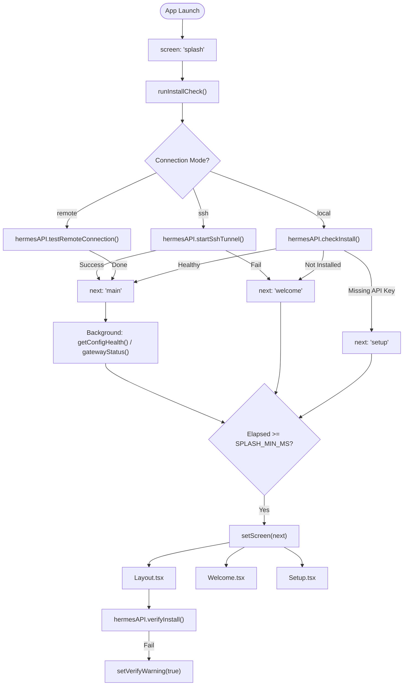
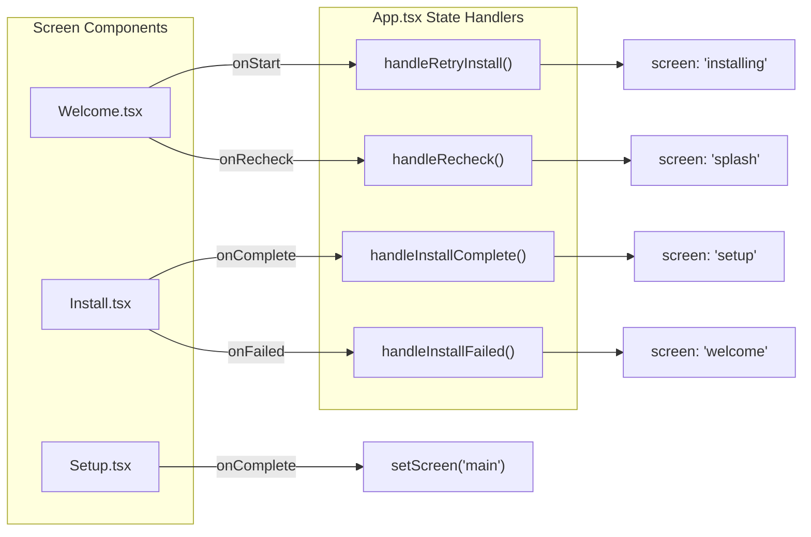

<!-- source: DeepWiki mcp.deepwiki.com · repo fathah/hermes-desktop · page 2.3 Renderer Entry and Routing · fetched 2026-10-30 -->

# Renderer Entry and Routing

Relevant source files

The following files were used as context for generating this wiki page:

- [.env.example](.env.example)
- [lat.md/analytics.md](lat.md/analytics.md)
- [src/main/dashboard.ts](src/main/dashboard.ts)
- [src/main/remote-oauth.ts](src/main/remote-oauth.ts)
- [src/renderer/src/App.tsx](src/renderer/src/App.tsx)
- [src/renderer/src/assets/hermesbg.webp](src/renderer/src/assets/hermesbg.webp)
- [src/renderer/src/assets/splashtext-w.webp](src/renderer/src/assets/splashtext-w.webp)
- [src/renderer/src/assets/startvid.mp4](src/renderer/src/assets/startvid.mp4)
- [src/renderer/src/components/settings/CommunityPane.tsx](src/renderer/src/components/settings/CommunityPane.tsx)
- [src/renderer/src/components/settings/ConnectionPane.test.tsx](src/renderer/src/components/settings/ConnectionPane.test.tsx)
- [src/renderer/src/components/settings/ConnectionPane.tsx](src/renderer/src/components/settings/ConnectionPane.tsx)
- [src/renderer/src/components/settings/DataPane.tsx](src/renderer/src/components/settings/DataPane.tsx)
- [src/renderer/src/components/settings/PrivacyPane.tsx](src/renderer/src/components/settings/PrivacyPane.tsx)
- [src/renderer/src/components/settings/useSettingsData.test.tsx](src/renderer/src/components/settings/useSettingsData.test.tsx)
- [src/renderer/src/components/settings/useSettingsData.ts](src/renderer/src/components/settings/useSettingsData.ts)
- [src/renderer/src/env.d.ts](src/renderer/src/env.d.ts)
- [src/renderer/src/main.tsx](src/renderer/src/main.tsx)
- [src/renderer/src/screens/SplashScreen/SplashScreen.tsx](src/renderer/src/screens/SplashScreen/SplashScreen.tsx)
- [src/renderer/src/utils/analytics.ts](src/renderer/src/utils/analytics.ts)
- [src/shared/i18n/locales/en/settings.ts](src/shared/i18n/locales/en/settings.ts)
- [tests/dashboard-remote.test.ts](tests/dashboard-remote.test.ts)
- [tests/preload-api-surface.test.ts](tests/preload-api-surface.test.ts)
- [tests/remote-auth-mode.test.ts](tests/remote-auth-mode.test.ts)
- [tests/remote-oauth.test.ts](tests/remote-oauth.test.ts)

This page details the entry point and view management of the Hermes Desktop renderer process. It covers how the application initializes, verifies the environment (local, remote, or SSH), and transitions through the onboarding state machine to reach the main interface.

## Application Entry Point

The renderer process begins execution at `src/renderer/src/main.tsx`. This file initializes the React environment and wraps the application in essential providers.

- **`createRoot`**: Mounts the React application into the `#root` DOM element [src/renderer/src/main.tsx:12-18]().
- **`I18nProvider`**: Provides internationalization context to all child components [src/renderer/src/main.tsx:14-16]().
- **`initAnalytics`**: Initializes privacy-first tracking via an in-house service if the user has consented and keys are configured in the build environment [src/renderer/src/main.tsx:10-10](), [src/renderer/src/utils/analytics.ts:63-75]().
- **`StrictMode`**: Enables additional development-time checks for the component tree [src/renderer/src/main.tsx:13-17]().

**Sources:**
- [src/renderer/src/main.tsx:1-19]()
- [src/renderer/src/utils/analytics.ts:1-10]()
- [src/renderer/src/utils/analytics.ts:63-75]()

## View State Machine

The core of the renderer's routing logic resides in `App.tsx`. Unlike a traditional URL-based router, Hermes uses a state-driven "Screen" machine to manage transitions between the splash screen, installation, and the main application layout.

### Screen States
The application defines five primary screen states [src/renderer/src/App.tsx:16-16]():

| State | Component | Purpose |
| :--- | :--- | :--- |
| `splash` | `SplashScreen` | Initial loading animation and background environment check. |
| `welcome` | `Welcome` | Landing page for new users or handling installation errors. |
| `installing` | `Install` | Active execution of the Hermes engine installation pipeline. |
| `setup` | `Setup` | Post-install configuration (e.g., API key entry). |
| `main` | `Layout` | The primary application interface (Chat, Settings, etc.). |

### Logic and Data Flow
The `runInstallCheck` function is the primary driver for state transitions [src/renderer/src/App.tsx:44-140](). It uses the `window.hermesAPI` bridge to query the backend status.

1.  **Connection Configuration**: Fetches the current mode (local, remote, or ssh) via `getConnectionConfig()` [src/renderer/src/App.tsx:53-56]().
2.  **SSH Mode**: If mode is `ssh`, it attempts `startSshTunnel()` [src/renderer/src/App.tsx:58-61](). Success leads to `main` [src/renderer/src/App.tsx:65-65]().
3.  **Remote Mode**: Attempts to ping the `remoteUrl` using `testRemoteConnection()`. Regardless of immediate reachability, it transitions to `main` to allow the user to adjust settings if the remote is down [src/renderer/src/App.tsx:66-74]().
4.  **Local Mode**: Calls `checkInstall()` [src/renderer/src/App.tsx:77-77]().
    - If not installed: Transitions to `welcome` [src/renderer/src/App.tsx:78-79]().
    - If installed but no API key: Transitions to `setup` [src/renderer/src/App.tsx:80-81]().
    - Otherwise: Transitions to `main` [src/renderer/src/App.tsx:82-84]().
5.  **Performance Warming**: While the splash is visible, the app pre-fetches `getConfigHealth()` and `gatewayStatus()` to ensure the first render of the main UI is snappy [src/renderer/src/App.tsx:89-104]().
6.  **Soft Verification**: For local connections, a lazy `verifyInstall()` call is performed after the UI is up. If it fails, `setVerifyWarning(true)` surfaces a dismissible banner rather than forcing a reinstall loop [src/renderer/src/App.tsx:133-138]().

### Screen Transition Diagram
The following diagram illustrates the logic flow from application launch to the main UI.

**Title: Renderer Initialization Flow**

**Sources:**
- [src/renderer/src/App.tsx:16-16]()
- [src/renderer/src/App.tsx:44-140]()
- [src/renderer/src/App.tsx:160-183]()

## Splash Screen Management

The `SplashScreen` component handles the initial visual presentation while the app performs its environment checks.

- **Timing**: The splash screen is guaranteed to stay visible for at least `SPLASH_MIN_MS` (3000ms) to ensure the background video plays through [src/renderer/src/App.tsx:20-20]().
- **Assets**: It renders `hermesbg.webp` as a background and `splashtext-w.webp` as the logo, often accompanied by `startvid.mp4` [src/renderer/src/screens/SplashScreen/SplashScreen.tsx:1-23]().
- **Status Updates**: During initialization, `App.tsx` updates `splashStatus` (e.g., "Checking connection...", "Starting SSH tunnel...") which is displayed on the splash screen [src/renderer/src/App.tsx:52-76]().

**Sources:**
- [src/renderer/src/App.tsx:20-20]()
- [src/renderer/src/App.tsx:52-76]()
- [src/renderer/src/screens/SplashScreen/SplashScreen.tsx:1-23]()

## Routing and State Transitions

The application manages transitions between screens via callback functions passed from `App.tsx` to child components.

**Title: State Transition Mapping**

- **`handleInstallComplete`**: Transitions from the installation pipeline to the API setup screen [src/renderer/src/App.tsx:164-167]().
- **`handleInstallFailed`**: Captures the error message and returns the user to the welcome screen [src/renderer/src/App.tsx:169-172]().
- **`handleRetryInstall`**: Resets the install error and sets the screen to `installing` [src/renderer/src/App.tsx:174-177]().
- **`handleRecheck`**: Resets the state to `splash` and re-runs the environment detection logic [src/renderer/src/App.tsx:179-183]().

**Sources:**
- [src/renderer/src/App.tsx:164-183]()

## Remote Authentication Routing

With the introduction of Remote OAuth in v0.7.0, routing logic also accounts for authenticated states.

- **`probeRemoteAuthMode`**: Called during initialization or when configuring a remote connection to determine if the gateway requires "token" or "oauth" authentication [src/main/remote-oauth.ts:107-176]().
- **OAuth Session State**: The renderer checks `remoteOAuthSessionState` to determine if a browser-based login is required [src/main/remote-oauth.ts:97-105]().
- **Login Flow**: If OAuth is required, the `remoteOAuthLogin` IPC call opens a sandboxed `BrowserWindow` to handle the provider's sign-in flow [src/renderer/src/components/settings/useSettingsData.ts:127-127]().

**Sources:**
- [src/main/remote-oauth.ts:97-176]()
- [src/renderer/src/components/settings/useSettingsData.ts:127-127]()

## Error Handling and Shell

The application shell provides global features regardless of the active screen.

- **Theme & Font**: Wrapped in `ThemeProvider` and `FontProvider` to manage UI appearance [src/renderer/src/App.tsx:3-4]().
- **Error Boundary**: A top-level `ErrorBoundary` catches React rendering errors [src/renderer/src/App.tsx:8-8]().
- **Analytics**: Tracks `screen_view` events every time the `screen` state changes [src/renderer/src/App.tsx:156-158]().
- **macOS Support**: Detects the `darwin` platform to handle specific UI adjustments like title bar behavior [src/renderer/src/App.tsx:38-38]().

**Sources:**
- [src/renderer/src/App.tsx:1-43]()
- [src/renderer/src/App.tsx:156-158]()

---

