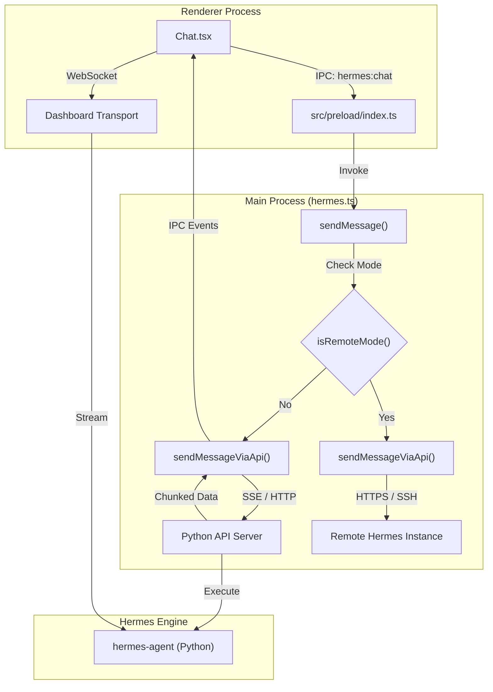
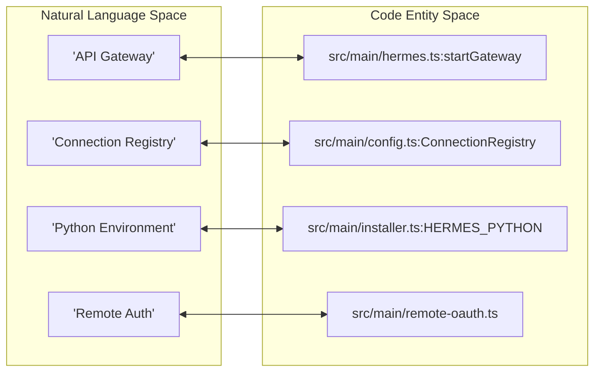

<!-- source: DeepWiki mcp.deepwiki.com · repo fathah/hermes-desktop · page 3 Hermes Engine Integration · fetched 2026-10-30 -->

# Hermes Engine Integration

Relevant source files

The following files were used as context for generating this wiki page:

- [lat.md/lat.md](lat.md/lat.md)
- [lat.md/sidebar-navigation.md](lat.md/sidebar-navigation.md)
- [scripts/verify-nous-discovery.js](scripts/verify-nous-discovery.js)
- [src/main/config.ts](src/main/config.ts)
- [src/main/hermes.ts](src/main/hermes.ts)
- [src/main/index.ts](src/main/index.ts)
- [src/main/installer.ts](src/main/installer.ts)
- [src/main/ipc/register.ts](src/main/ipc/register.ts)
- [src/main/model-discovery.ts](src/main/model-discovery.ts)
- [src/main/provider-registry.ts](src/main/provider-registry.ts)
- [src/preload/index.d.ts](src/preload/index.d.ts)
- [src/preload/index.ts](src/preload/index.ts)
- [src/renderer/src/assets/main.css](src/renderer/src/assets/main.css)
- [src/renderer/src/hooks/useDiscoveredModels.ts](src/renderer/src/hooks/useDiscoveredModels.ts)
- [src/renderer/src/screens/Chat/Chat.tsx](src/renderer/src/screens/Chat/Chat.tsx)
- [src/renderer/src/screens/Layout/Layout.tsx](src/renderer/src/screens/Layout/Layout.tsx)
- [src/shared/url-key-map.ts](src/shared/url-key-map.ts)
- [tests/constants.test.ts](tests/constants.test.ts)
- [tests/install-gate-providers.test.ts](tests/install-gate-providers.test.ts)
- [tests/installer-utils.test.ts](tests/installer-utils.test.ts)
- [tests/model-discovery.test.ts](tests/model-discovery.test.ts)
- [tests/provider-registry.test.ts](tests/provider-registry.test.ts)
- [tests/set-model-config-base-url.test.ts](tests/set-model-config-base-url.test.ts)
- [tests/url-key-map.test.ts](tests/url-key-map.test.ts)

The **Hermes Engine Integration** layer manages the lifecycle and communication between the Electron desktop application and the Python-based `hermes-agent` backend. This integration is responsible for local environment preparation, process orchestration, and the high-performance message routing required for real-time agent interactions.

### Architecture Overview

The integration bridges the TypeScript/Electron environment with a local Python virtual environment. It handles the transition from a "Cold Start" (installation and configuration) to a "Warm State" (active API gateway and message streaming). It supports three primary connectivity modes: **Local**, **Remote**, and **SSH Tunnel** [src/main/config.ts:50-58]().

#### Communication Flow: Renderer to Agent
The following diagram illustrates how a user prompt travels from the UI through the Electron Main process to the Hermes Engine, including the new Dashboard WebSocket transport.

**Message Routing Path**

Sources: [src/main/hermes.ts:131-148](), [src/main/hermes.ts:150-155](), [src/preload/index.ts:127-220](), [src/renderer/src/screens/Chat/Chat.tsx:23-26]()

---

### Core Components

The integration is divided into four primary functional areas:

#### 1. Gateway and Message Routing
The Gateway manages the connection to the Hermes Python backend. It supports a dual-path execution model:
*   **Fast Path (HTTP API):** Communicates with a running local or remote API server using Server-Sent Events (SSE). It handles `session_id` tracking to maintain conversation state [src/main/hermes.ts:95-104]().
*   **Dashboard Transport:** A high-performance WebSocket-based transport that allows for bidirectional communication and richer event types, including tool progress and reasoning deltas [src/preload/index.ts:67-87]().

For details, see [Gateway and Message Routing](#3.1).

#### 2. Installer and Environment Setup
Before the engine can run, the application ensures a valid Python environment exists. The `installer.ts` module manages the `HERMES_HOME` directory, which can be overridden via the "Use existing installation" flow [src/main/installer.ts:80-91](). It handles `venv` creation and utilizes `pythonw.exe` on Windows to prevent console window flashes [src/main/installer.ts:145-147]().

For details, see [Installer and Environment Setup](#3.2).

#### 3. Configuration Management
Configuration is synchronized between the Electron UI and the Python backend through `desktop.json`, `.env`, and `config.yaml`. This layer handles the **Credential Pool** for API keys and profile-scoped settings [src/main/config.ts:182-185](). It also includes a **Config Health** system to diagnose and fix setup issues [src/preload/index.d.ts:69-86]().

For details, see [Configuration Management](#3.3).

#### 4. SSH Remote and Tunnel
For users running Hermes on remote hardware or in Docker containers, the `ssh-tunnel.ts` and `ssh-remote.ts` modules provide a secure proxy. This includes support for targeting specific Docker containers on a remote host [src/main/config.ts:34-45]().

For details, see [SSH Remote and Tunnel](#3.4).

---

### Integration Entity Mapping

The following diagram maps high-level system concepts to their specific implementations and data structures in the codebase.

**System to Code Mapping**

Sources: [src/main/hermes.ts:134-134](), [src/main/config.ts:68-72](), [src/main/installer.ts:145-147](), [src/main/ipc/register.ts:142-147]()

### Key Integration Constants

| Constant | Value / Path | Description |
| :--- | :--- | :--- |
| `HERMES_HOME` | `~/.hermes` or `%LOCALAPPDATA%\hermes` | The root directory for all agent data [src/main/installer.ts:128-131](). |
| `HERMES_PYTHON` | `venv/bin/python` or `pythonw.exe` | The specific interpreter used to run the agent [src/main/installer.ts:145-147](). |
| `HERMES_SCRIPT` | `hermes` or `hermes.exe` | The entry point for the Python CLI [src/main/installer.ts:148-150](). |
| `CONNECTION_REGISTRY_VERSION` | `1` | Versioning for the `desktop.json` connection schema [src/main/config.ts:60-60](). |
| `DEFAULT_PORT` | `8642` | Default local port for the Hermes API [src/main/config.ts:167-167](). |

Sources: [src/main/installer.ts:128-150](), [src/main/config.ts:60-167]()

### Process Lifecycle
1.  **Verification:** `checkInstallStatus()` validates the environment on startup [src/main/ipc/register.ts:61-61]().
2.  **Provisioning:** If missing, `runInstall()` handles the full pipeline (git clone, venv setup, dependency install) [src/main/ipc/register.ts:63-63]().
3.  **Connectivity:** The app resolves the active connection via `getActiveConnection()` and determines if it should use a local gateway or a remote tunnel [src/main/hermes.ts:131-148]().
4.  **Communication:** Messages are sent via `sendMessage()`, which selects the appropriate transport (SSE or Dashboard WebSocket) based on configuration [src/main/ipc/register.ts:119-119]().

---

