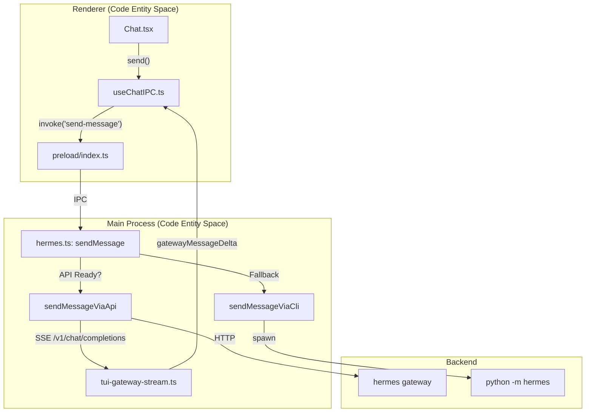
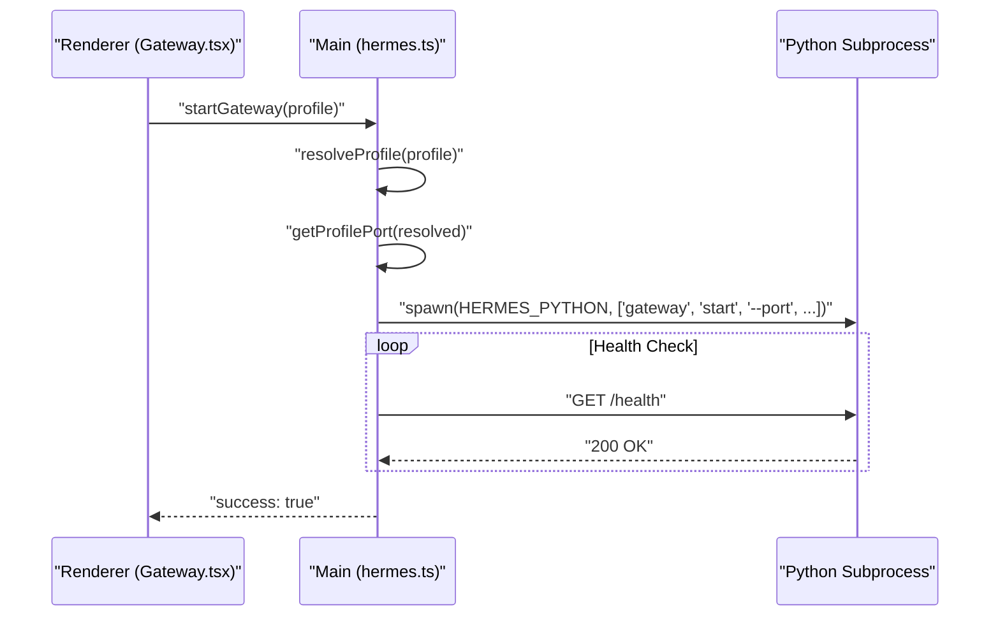

<!-- source: DeepWiki mcp.deepwiki.com · repo fathah/hermes-desktop · page 3.1 Gateway and Message Routing · fetched 2026-10-30 -->

# Gateway and Message Routing

Relevant source files

The following files were used as context for generating this wiki page:

- [lat.md/agent-capabilities.md](lat.md/agent-capabilities.md)
- [lat.md/connections.md](lat.md/connections.md)
- [lat.md/lat.md](lat.md/lat.md)
- [lat.md/remote-dashboard-oauth.md](lat.md/remote-dashboard-oauth.md)
- [lat.md/sidebar-navigation.md](lat.md/sidebar-navigation.md)
- [src/main/config.ts](src/main/config.ts)
- [src/main/connection-status.ts](src/main/connection-status.ts)
- [src/main/dashboard.ts](src/main/dashboard.ts)
- [src/main/hermes.test.ts](src/main/hermes.test.ts)
- [src/main/hermes.ts](src/main/hermes.ts)
- [src/main/index.ts](src/main/index.ts)
- [src/main/ipc/register.ts](src/main/ipc/register.ts)
- [src/main/remote-api.test.ts](src/main/remote-api.test.ts)
- [src/main/remote-api.ts](src/main/remote-api.ts)
- [src/main/remote-oauth.ts](src/main/remote-oauth.ts)
- [src/main/remote-sessions.ts](src/main/remote-sessions.ts)
- [src/main/session-location-store.ts](src/main/session-location-store.ts)
- [src/preload/index.d.ts](src/preload/index.d.ts)
- [src/preload/index.ts](src/preload/index.ts)
- [src/renderer/src/App.tsx](src/renderer/src/App.tsx)
- [src/renderer/src/assets/main.css](src/renderer/src/assets/main.css)
- [src/renderer/src/components/settings/ConnectionPane.test.tsx](src/renderer/src/components/settings/ConnectionPane.test.tsx)
- [src/renderer/src/components/settings/ConnectionPane.tsx](src/renderer/src/components/settings/ConnectionPane.tsx)
- [src/renderer/src/components/settings/useSettingsData.test.tsx](src/renderer/src/components/settings/useSettingsData.test.tsx)
- [src/renderer/src/components/settings/useSettingsData.ts](src/renderer/src/components/settings/useSettingsData.ts)
- [src/renderer/src/screens/Chat/Chat.tsx](src/renderer/src/screens/Chat/Chat.tsx)
- [src/renderer/src/screens/Layout/Layout.tsx](src/renderer/src/screens/Layout/Layout.tsx)
- [src/shared/i18n/locales/en/settings.ts](src/shared/i18n/locales/en/settings.ts)
- [tests/connection-config-security.test.ts](tests/connection-config-security.test.ts)
- [tests/dashboard-remote.test.ts](tests/dashboard-remote.test.ts)
- [tests/gateway-ports.test.ts](tests/gateway-ports.test.ts)
- [tests/hermes-cli-session-id.test.ts](tests/hermes-cli-session-id.test.ts)
- [tests/preload-api-surface.test.ts](tests/preload-api-surface.test.ts)
- [tests/remote-auth-mode.test.ts](tests/remote-auth-mode.test.ts)
- [tests/remote-oauth.test.ts](tests/remote-oauth.test.ts)

The Gateway is the communication backbone of Hermes Desktop, responsible for managing the lifecycle of the Python-based Hermes Agent backend and routing messages between the Electron frontend and the agent engine. It implements a dual-path execution model that prioritizes high-performance HTTP streaming and WebSocket dashboard transport while maintaining a robust CLI fallback for local environments.

## Execution Model: Dual-Path Routing

Hermes utilizes two distinct paths for message delivery, managed within `src/main/hermes.ts`. The system automatically determines the best path based on the availability of the API server and the active connection mode.

### 1. The Fast Path (HTTP API & WebSocket)
The preferred method for message exchange is the HTTP API or the newer WebSocket-based Dashboard transport.
*   **Local Mode**: Connects to a profile-specific port (defaulting to 8642 for the default profile) [src/main/hermes.ts:147-147]().
*   **Remote Mode**: Connects to a user-defined `remoteUrl` [src/main/hermes.ts:140-142]().
*   **SSH Mode**: Connects via a local port forwarded through an SSH tunnel [src/main/hermes.ts:135-139]().
*   **Dashboard Transport**: v0.7.0 introduces a WebSocket transport for the chat interface, enabling richer interaction patterns and bypassing standard HTTP request overhead [src/main/dashboard.ts:122-140]().

### 2. The Fallback Path (CLI)
If the API server is unreachable and the app is in local mode, the system falls back to spawning the Hermes Python script as a child process.
*   **Implementation**: Handled by `sendMessageViaCli` [src/main/hermes.ts:696-696]().
*   **Mechanism**: Uses `child_process.spawn` to execute the agent via the configured `HERMES_PYTHON` interpreter [src/main/hermes.ts:723-735]().

### Message Routing Logic
The `sendMessage` function acts as the primary entry point, orchestrating the transition between these paths.

| Step | Action | Code Reference |
| :--- | :--- | :--- |
| 1 | Resolve targeted profile | [src/main/hermes.ts:102-104]() |
| 2 | Check if API server is ready | [src/main/hermes.ts:854-854]() |
| 3 | If ready, use `sendMessageViaApi` | [src/main/hermes.ts:856-856]() |
| 4 | If not ready and local, use `sendMessageViaCli` | [src/main/hermes.ts:859-859]() |
| 5 | If remote and not ready, return error | [src/main/hermes.ts:857-857]() |

**Sources:** [src/main/hermes.ts:94-162](), [src/main/hermes.ts:840-863](), [src/main/dashboard.ts:1-50]()

---

## SSE Streaming and Dashboard Transport

Hermes uses Server-Sent Events (SSE) and WebSockets to provide a responsive chat experience. The parsing logic handles incremental updates, reasoning tokens, and tool execution progress.

### SSE Stream Parsing
The gateway processes several types of information through the SSE stream:
*   **Content Chunks**: Incremental text updates via `gatewayMessageDelta` [src/main/tui-gateway-stream.ts:25-27]().
*   **Reasoning**: Hidden reasoning tokens (e.g., for DeepSeek R1) are captured via `gatewayReasoningText` [src/main/tui-gateway-stream.ts:28-30]().
*   **Tool Progress**: Notifications when the agent invokes tools, identified by `gatewayToolEvent` [src/main/tui-gateway-stream.ts:31-33]().
*   **Usage Metadata**: Token counts and cost metrics provided at the end of the stream [src/main/tui-gateway-stream.ts:34-36]().

### WebSocket Dashboard Transport
For connections that support it, the `DashboardChatTransport` provides a full-duplex connection.
*   **Lifecycle**: The renderer requests a `freshDashboardWebSocketUrl` via IPC [src/main/ipc/register.ts:136-140]().
*   **Auth**: Uses single-use tickets for secure WebSocket upgrades [src/main/dashboard.ts:137-140]().
*   **Implementation**: The `useDashboardChatTransport` hook in the renderer manages the socket state and message dispatch [src/renderer/src/screens/Chat/hooks/useDashboardChatTransport.ts:25-26]().

### Session ID Tracking
The gateway ensures session persistence by generating a unique `X-Hermes-Session-Id` for fresh chats or passing an existing `sessionId` [src/main/hermes.ts:335-345](). The ID is extracted from response headers to keep the frontend synchronized [src/main/hermes.ts:511-514]().

**Diagram: Message Data Flow**

**Sources:** [src/main/hermes.ts:320-520](), [src/main/tui-gateway-stream.ts:1-40](), [src/main/dashboard.ts:122-150]()

---

## Gateway Lifecycle Management

The gateway lifecycle is managed through stateful operations that ensure the Python backend is correctly configured for the active profile.

### Lifecycle Operations
1.  **Initialization**: `ensureApiServerConfig` checks `config.yaml` to ensure the `api_server` platform is enabled for the specific profile [src/main/hermes.ts:310-318]().
2.  **Startup**: `startGatewayDetailed` spawns the agent with `gateway start` arguments, binding to a profile-specific port [src/main/hermes.ts:875-900]().
3.  **Stopping**: `stopGateway` attempts to kill the process using its stored PID or by finding the process listening on the profile's port [src/main/hermes.ts:942-955]().
4.  **Health Polling**: `isApiServerReady` performs an HTTP GET request to the `/health` endpoint to verify the gateway is accepting connections [src/main/hermes.ts:273-295]().

### Remote and SSH Modes
*   **Remote Mode**: Local process spawning is bypassed. The gateway assumes the endpoint at `remoteUrl` is managed externally [src/main/hermes.ts:877-878]().
*   **SSH Mode**: The gateway ensures the `ssh-tunnel` is active and healthy before attempting communication [src/main/hermes.ts:135-139]().

**Diagram: Gateway Startup Sequence**

**Sources:** [src/main/hermes.ts:870-960](), [src/main/gateway-ports.ts:1-20]()

---

## Remote Mode and Authentication

Hermes supports complex remote configurations, including OAuth-based authentication for remote dashboards.

*   **URL Normalization**: `normaliseRemoteUrl` strips trailing slashes and `/v1` segments to prevent malformed routing (e.g., `.../v1/v1/chat/...`) [src/main/hermes.ts:122-129]().
*   **Bearer Auth**: Standard remote connections inject an `Authorization: Bearer <key>` header [src/main/hermes.ts:171-187]().
*   **Remote Dashboard OAuth**: v0.7.0 adds support for authenticating against a remote Hermes Dashboard via browser-based OAuth [src/main/remote-oauth.ts:40-60](). This flow captures a session cookie which is used to negotiate a WebSocket ticket for the chat transport [src/main/remote-oauth.ts:120-135]().
*   **SSH Remote API Key**: In SSH mode, the API key is automatically resolved from the remote environment's `.env` file once the tunnel is established [src/main/hermes.ts:165-170]().

**Sources:** [src/main/hermes.ts:122-187](), [src/main/remote-oauth.ts:1-150](), [src/main/ipc/register.ts:141-147]()

---

