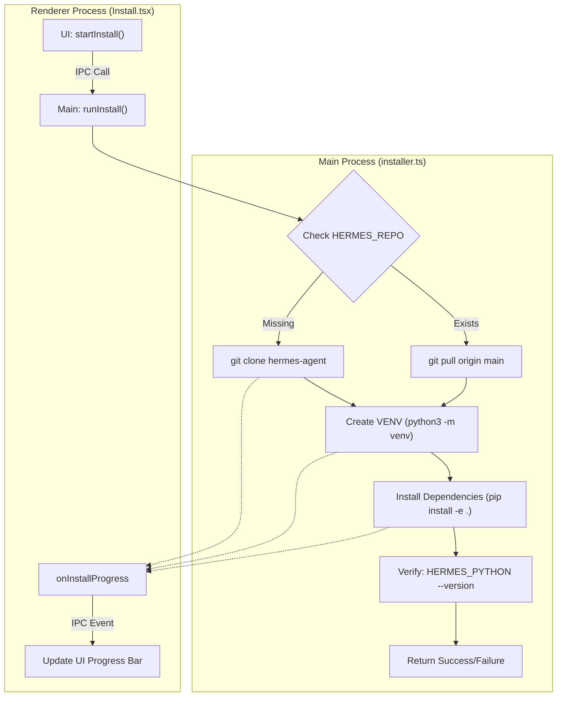

<!-- source: DeepWiki mcp.deepwiki.com · repo fathah/hermes-desktop · page 3.2 Installer and Environment Setup · fetched 2026-10-30 -->

# Installer and Environment Setup

Relevant source files

The following files were used as context for generating this wiki page:

- [scripts/probe-validation-and-banner.js](scripts/probe-validation-and-banner.js)
- [scripts/probe-wsl-detection.js](scripts/probe-wsl-detection.js)
- [scripts/repro-nous-detection-367.js](scripts/repro-nous-detection-367.js)
- [scripts/verify-369-wsl-drift.js](scripts/verify-369-wsl-drift.js)
- [scripts/verify-nous-discovery.js](scripts/verify-nous-discovery.js)
- [scripts/verify-wsl-detection.js](scripts/verify-wsl-detection.js)
- [src/main/config-health.ts](src/main/config-health.ts)
- [src/main/installer.ts](src/main/installer.ts)
- [src/main/model-discovery.ts](src/main/model-discovery.ts)
- [src/main/provider-registry.ts](src/main/provider-registry.ts)
- [src/main/validation.ts](src/main/validation.ts)
- [src/main/wsl-detection.ts](src/main/wsl-detection.ts)
- [src/renderer/src/hooks/useDiscoveredModels.ts](src/renderer/src/hooks/useDiscoveredModels.ts)
- [src/shared/url-key-map.ts](src/shared/url-key-map.ts)
- [tests/api-server-key-migration.test.ts](tests/api-server-key-migration.test.ts)
- [tests/config-health.test.ts](tests/config-health.test.ts)
- [tests/constants.test.ts](tests/constants.test.ts)
- [tests/install-gate-providers.test.ts](tests/install-gate-providers.test.ts)
- [tests/installer-utils.test.ts](tests/installer-utils.test.ts)
- [tests/model-discovery.test.ts](tests/model-discovery.test.ts)
- [tests/provider-registry.test.ts](tests/provider-registry.test.ts)
- [tests/set-model-config-base-url.test.ts](tests/set-model-config-base-url.test.ts)
- [tests/sibling-hermes-home-drift.test.ts](tests/sibling-hermes-home-drift.test.ts)
- [tests/url-key-map.test.ts](tests/url-key-map.test.ts)
- [tests/validation.test.ts](tests/validation.test.ts)

The Hermes Desktop installer and environment management system is responsible for orchestrating the lifecycle of the underlying Python-based Hermes Agent, managing its dependencies, and ensuring the host environment is correctly configured for local execution.

## Overview of `installer.ts`

The core logic for installation and environment validation resides in `src/main/installer.ts`. It manages the `HERMES_HOME` directory and handles the retrieval of the agent repository, virtual environment creation, and diagnostic checks.

### Constants and Paths
The system defines several critical paths for the local environment. Precedence for `HERMES_HOME` is calculated by checking the `HERMES_HOME` env var, then a persistent override file in the app's `userData` directory, and finally a platform-specific default [src/main/installer.ts:128-131]().

- **HERMES_HOME**: The root directory for all Hermes data [src/main/installer.ts:128]().
- **HERMES_REPO**: The location of the agent source code [src/main/installer.ts:132]().
- **HERMES_VENV**: The Python virtual environment directory [src/main/installer.ts:133]().
- **HERMES_PYTHON**: The path to the Python executable. On Windows, this uses `pythonw.exe` to prevent console window flashes during background CLI calls [src/main/installer.ts:145-147]().
- **HERMES_SCRIPT**: The entry point script for the agent [src/main/installer.ts:148-150]().

Sources: [src/main/installer.ts:128-153]()

---

## The Installation Pipeline

The `runInstall` pipeline (exposed via IPC as `startInstall`) is a multi-step process that transitions through cloning, environment setup, and verification.

### Pipeline Execution Flow
The `runInstall` function executes the following sequence:
1. **Directory Preparation**: Ensures `HERMES_HOME` exists using `mkdirSync`.
2. **Sudo/Askpass Setup**: On Linux, it invokes `precacheSudoCredentials` to handle administrative prompts for browser dependencies [src/main/sudoCreds.ts:29-58]().
3. **Repository Management**: Clones the `hermes-agent` repository or performs a `git pull` if it already exists.
4. **Virtual Environment**: Creates a Python venv using the system's `python3`.
5. **Dependency Resolution**: Runs `pip install -e .` to install the agent and its requirements.
6. **Configuration**: Initializes default `.env` and `config.yaml` files if they are missing.
7. **Verification**: Executes `hermes --version` to ensure the installation is functional.

### Installation Progress Tracking
The installer reports progress back to the renderer via a progress interface.
- `step`: Current step index.
- `totalSteps`: Total number of steps.
- `title` & `detail`: Human-readable status strings.
- `log`: Cumulative output from the spawn processes, stripped of ANSI codes via `stripAnsi` [src/main/utils.ts:20]().

### Pipeline Logic Diagram
This diagram maps the natural language steps of the installation to the internal logic within `installer.ts`.

Sources: [src/main/installer.ts:1-175](), [src/main/sudoCreds.ts:29-58](), [src/main/utils.ts:20]()

---

## Status and Diagnostics

### `checkInstallStatus`
This function is called during the application boot sequence to determine the application's readiness state.
- **Remote Mode**: If `connection.mode` is "remote", it returns all status flags as `true` [src/main/config.ts:15]().
- **File Check**: Performs a fast check for the existence of `HERMES_PYTHON` and `HERMES_SCRIPT`.
- **API Key Detection**: Scans the `.env` file for valid keys or OAuth credentials using `hasOAuthCredentials` [src/main/config.ts:17]().

### `verifyInstall`
A lazy background verification that actually invokes the Python process to confirm it can run. It uses a cache with a TTL to avoid redundant process spawning.

### Hermes Doctor
The `runHermesDoctor` function executes `hermes doctor` via the CLI. It captures the output of the agent's internal diagnostic tool and returns it as a string to the UI.

Sources: [src/main/installer.ts:1-175](), [src/main/config.ts:15-18]()

---

## Model Discovery and Provider Registry

Hermes includes a robust system for discovering models available through various providers, powering the autocomplete in the UI.

### Provider Model Discovery
The discovery logic in `src/main/model-discovery.ts` handles three distinct paths:
1. **OpenAI-Compatible**: Hits the provider's `/models` endpoint directly using Node.js `http`/`https` [src/main/model-discovery.ts:170-189]().
2. **OAuth Providers**: Executes a short Python snippet (`PROVIDER_MODELS_SNIPPET`) to call `hermes-agent`'s `provider_model_ids` function [src/main/model-discovery.ts:96-132]().
3. **Nous Portal Free Tier**: Specifically fetches the Nous Portal catalogue and filters for zero-priced models [src/main/model-discovery.ts:154-189]().

### Canonical Provider Registry
The `src/main/provider-registry.ts` serves as the single source of truth for built-in provider base URLs [src/main/provider-registry.ts:15-44](). This ensures that when a user selects a provider like "DeepSeek", the system automatically knows to hit `https://api.deepseek.com/v1` [src/main/provider-registry.ts:20]().

### URL to Env Key Mapping
The `src/shared/url-key-map.ts` maps base URL patterns to their respective environment variable names [src/shared/url-key-map.ts:25-43](). For example, any URL matching `openrouter.ai` maps to `OPENROUTER_API_KEY` [src/shared/url-key-map.ts:27]().

Sources: [src/main/model-discovery.ts:1-189](), [src/main/provider-registry.ts:1-54](), [src/shared/url-key-map.ts:1-131]()

---

## Config Health Audit

The `runConfigHealthCheck` function in `src/main/config-health.ts` performs a startup scan for configuration inconsistencies [src/main/config-health.ts:89-120]().

### Key Health Checks
- **`checkApiServerKeyPlacement`**: Ensures the `API_SERVER_KEY` is in the canonical `.env` location rather than nested in `config.yaml` [src/main/config-health.ts:170-184]().
- **`checkActiveModelKeyPresence`**: Verifies that the currently selected model has a corresponding API key in the environment [src/main/config-health.ts:95]().
- **`checkSiblingHermesHomeDrift`**: Detects if multiple Hermes installations (e.g., WSL vs Native) have drifted in configuration [src/main/config-health.ts:98]().

### Auto-Fix Dispatcher
Issues flagged as `autoFixable` can be resolved via `autoFixIssue`, which dispatches to specific handlers like `fixApiServerKeyPlacement` [src/main/config-health.ts:126-149]().

Sources: [src/main/config-health.ts:1-184]()

---

## Enhanced PATH Mechanism

To ensure the Hermes Agent can find system dependencies (like `git`, `node`, or `npm`) regardless of the user's shell configuration, Hermes implements an **Enhanced PATH** mechanism.

### `getEnhancedPath()`
This function constructs a custom `PATH` string by prepending common binary locations to the existing `process.env.PATH`.
- **Windows**: Includes bundled `git` paths and standard `Program Files` locations.
- **Unix**: Includes `/usr/local/bin`, `/opt/homebrew/bin`, and version manager paths (`NVM`, `Volta`, `asdf`, `fnm`).

### NVM Resolution
The `resolveNvmBin` function dynamically detects the active Node.js version by reading the `default` alias file or falling back to the latest installed version found in the versions directory.

Sources: [src/main/installer.ts:1-175]()

---

## Environment Parsing and Discovery

### Memory Provider Discovery
The system discovers available memory providers by scanning the `plugins/memory/` directory within the agent repository. It checks for the presence of an `__init__.py` file to determine if a provider is installed [tests/installer-utils.test.ts:184-192]().

### MCP Server Parsing
Hermes parses the `config.yaml` to extract Model Context Protocol (MCP) server configurations. It uses regex to identify `mcp_servers` blocks and determines the type (stdio vs http) based on the presence of a `url` field [tests/installer-utils.test.ts:75-98]().

Sources: [tests/installer-utils.test.ts:73-194]()

---

## Sudo Bridge and Pre-caching

On Linux, the installer uses `precacheSudoCredentials` to avoid deadlocks during dependency installation (e.g., Playwright libraries) [src/main/sudoCreds.ts:29-58]().

1. **Check**: It first checks if sudo is already non-interactive via `sudo -n -v` [src/main/sudoCreds.ts:60-66]().
2. **UI Dialog**: If credentials are needed, it pops a native Electron `BrowserWindow` with a password input [src/main/sudoCreds.ts:106-165]().
3. **Validation**: Validates the password using `sudo -S -v` [src/main/sudoCreds.ts:68-84]().
4. **Keep-alive**: Starts a background loop to refresh the sudo cache every 60 seconds until the installation completes [src/main/sudoCreds.ts:86-104]().

Sources: [src/main/sudoCreds.ts:1-165]()

---

## Backup and Import

Hermes provides utilities for managing user data through zip-based backups.

- **`exportBackup`**: Compresses the `.hermes` directory, excluding the `venv` and the agent repository code to keep file sizes manageable.
- **`importBackup`**: Extracts a backup zip into `HERMES_HOME`. It includes logic to handle migrations from legacy structures like `OpenClaw`.

Sources: [src/main/installer.ts:1-175]()

---

