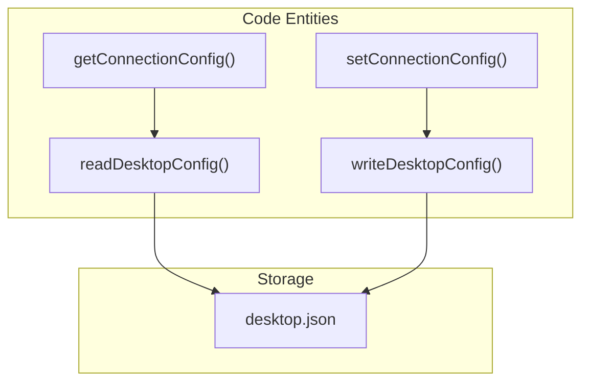
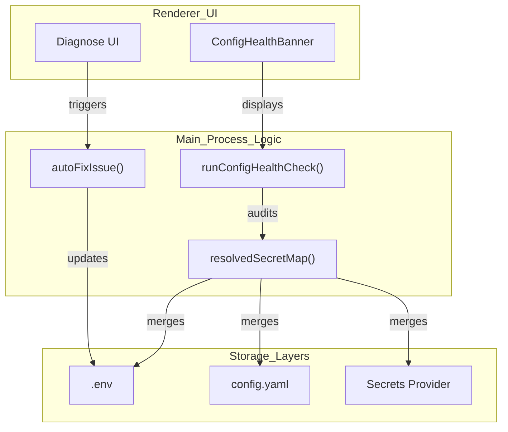

<!-- source: DeepWiki mcp.deepwiki.com · repo fathah/hermes-desktop · page 3.3 Configuration Management · fetched 2026-10-30 -->

# Configuration Management

Relevant source files

The following files were used as context for generating this wiki page:

- [lat.md/lat.md](lat.md/lat.md)
- [lat.md/sidebar-navigation.md](lat.md/sidebar-navigation.md)
- [scripts/probe-validation-and-banner.js](scripts/probe-validation-and-banner.js)
- [scripts/repro-nous-detection-367.js](scripts/repro-nous-detection-367.js)
- [scripts/verify-compat-host-derived-key.js](scripts/verify-compat-host-derived-key.js)
- [src/main/config-health.test.ts](src/main/config-health.test.ts)
- [src/main/config-health.ts](src/main/config-health.ts)
- [src/main/config.ts](src/main/config.ts)
- [src/main/hermes.ts](src/main/hermes.ts)
- [src/main/host-derived-env.ts](src/main/host-derived-env.ts)
- [src/main/index.ts](src/main/index.ts)
- [src/main/ipc/register.ts](src/main/ipc/register.ts)
- [src/main/secrets/commandProvider.stdio.test.ts](src/main/secrets/commandProvider.stdio.test.ts)
- [src/main/secrets/commandProvider.test.ts](src/main/secrets/commandProvider.test.ts)
- [src/main/secrets/commandProvider.ts](src/main/secrets/commandProvider.ts)
- [src/main/secrets/envProvider.ts](src/main/secrets/envProvider.ts)
- [src/main/secrets/getSpawnFloor.test.ts](src/main/secrets/getSpawnFloor.test.ts)
- [src/main/secrets/index.test.ts](src/main/secrets/index.test.ts)
- [src/main/secrets/index.ts](src/main/secrets/index.ts)
- [src/main/secrets/provider.ts](src/main/secrets/provider.ts)
- [src/main/secrets/resolvedSecretMap.test.ts](src/main/secrets/resolvedSecretMap.test.ts)
- [src/main/secrets/spawnRateFloor.test.ts](src/main/secrets/spawnRateFloor.test.ts)
- [src/main/tui-gateway-stream.test.ts](src/main/tui-gateway-stream.test.ts)
- [src/main/validation.ts](src/main/validation.ts)
- [src/preload/index.d.ts](src/preload/index.d.ts)
- [src/preload/index.ts](src/preload/index.ts)
- [src/renderer/src/assets/main.css](src/renderer/src/assets/main.css)
- [src/renderer/src/screens/Chat/Chat.tsx](src/renderer/src/screens/Chat/Chat.tsx)
- [src/renderer/src/screens/Layout/Layout.tsx](src/renderer/src/screens/Layout/Layout.tsx)
- [src/shared/i18n/locales/en/diagnose.ts](src/shared/i18n/locales/en/diagnose.ts)
- [tests/api-server-key-migration.test.ts](tests/api-server-key-migration.test.ts)
- [tests/api-server-key-secrets-provider.test.ts](tests/api-server-key-secrets-provider.test.ts)
- [tests/api-server-key-status.test.ts](tests/api-server-key-status.test.ts)
- [tests/compat-host-derived-key-persistence.test.ts](tests/compat-host-derived-key-persistence.test.ts)
- [tests/compat-host-derived-key.test.ts](tests/compat-host-derived-key.test.ts)
- [tests/config-health.test.ts](tests/config-health.test.ts)
- [tests/validation.test.ts](tests/validation.test.ts)

The configuration management system in Hermes Desktop handles application-level connection settings, profile-specific environment variables, model provider configurations, and toolset toggles. It utilizes a layered approach combining persistent JSON files, YAML configuration for the agent backend, a secrets provider system for credential isolation, and an in-memory TTL (Time-To-Live) cache to optimize performance.

## Connection Configuration

Hermes Desktop supports three primary execution modes: `local`, `remote`, and `ssh` [src/main/config.ts:51](). This state is managed via `desktop.json` located in the `HERMES_HOME` directory [src/main/config.ts:98-100]().

| Property | Key in `ConnectionConfig` | Description |
| :--- | :--- | :--- |
| **Mode** | `mode` | Determines if the app uses the local Python backend, a remote URL, or an SSH tunnel [src/main/config.ts:51](). |
| **Remote URL** | `remoteUrl` | The endpoint for the Hermes Agent when in remote mode [src/main/config.ts:52](). |
| **API Key** | `apiKey` | The credential used for authenticating with a remote instance [src/main/config.ts:53](). |
| **SSH Config** | `ssh` | Contains host, port, username, key path, and tunnel port mappings [src/main/config.ts:34-45, 57](). |
| **Transport** | `remoteChatTransport` | Choice between `dashboard` (WebSocket) or `legacy` (SSE) for remote communication [src/main/config.ts:47, 55](). |

The functions `getConnectionConfig` and `setConnectionConfig` provide the interface for reading and persisting these values [src/main/config.ts:187, 196](). To protect secrets, `getPublicConnectionConfig` is used to send configuration to the renderer, replacing the actual API key with its length (`apiKeyLength`) and a boolean flag (`hasApiKey`) [src/main/config.ts:74-88]().

### Data Flow: Connection Settings
The following diagram illustrates how connection settings are retrieved and stored.

"Connection Configuration Flow"

Sources: [src/main/config.ts:34-100](), [src/main/config.ts:187-196]()

## Profile-Scoped Management

Configuration is isolated by "Profiles". Each profile maintains its own directory containing `.env`, `config.yaml`, and personality files [src/main/utils.ts:46-50]().

### Environment Variables (.env)
The `.env` file stores sensitive credentials and platform toggles.
- **Reading**: `readEnv(profile)` parses the file into a key-value record, stripping quotes and ignoring comments [src/main/config.ts:175]().
- **Writing**: `setEnvValue(key, value, profile)` uses regex to find and update existing keys or append new ones, ensuring the cache is invalidated [src/main/config.ts:176]().

### Backend Configuration (config.yaml)
The `config.yaml` file controls the Hermes Agent's behavior, including the active model and toolsets. Because the app avoids a heavy YAML dependency in the main bundle, it uses a custom indentation-aware parser in `yaml-path.ts` [src/main/yaml-path.ts:1-25]().

- **Model Config**: `getModelConfig(profile)` extracts the `provider`, `default` (model ID), and `base_url` from the `model:` block [src/main/config.ts:180]().
- **Auto-API-Key**: `setModelConfig` includes logic to auto-populate `model.api_key` for custom providers pointing at known commercial hosts using values from the profile's `.env` [src/main/config.ts:181]().

### API Server Key Resolution
The system uses a specific precedence order to resolve the `API_SERVER_KEY` used for internal gateway authentication. `getApiServerKey(profile)` checks [src/main/config.ts:200]():
1. Profile `.env` `API_SERVER_KEY`.
2. The `secrets` provider system (e.g. Keychain/Vault).
3. The `api_server.token` path in `config.yaml`.

Sources: [src/main/config.ts:175-200](), [src/main/utils.ts:46-50](), [src/main/yaml-path.ts:1-25]()

## Secrets Provider System

To support secure credential storage beyond flat `.env` files, Hermes implements a `getSecretsProvider()` system [src/main/config.ts:22]().

- **Provider Resolution**: The system resolves secrets by checking `process.env` first, then the profile's `.env` file, and finally the configured secrets provider [src/main/config-health.ts:39]().
- **Lazy Construction**: Providers are constructed lazily to avoid circular dependencies during module initialization [src/main/config.ts:13-20]().
- **Resolved Map**: `resolvedSecretMap(profile)` provides a merged view of all available credentials across these layers [src/main/config-health.ts:180]().

Sources: [src/main/config.ts:13-25](), [src/main/config-health.ts:36-43](), [src/main/config-health.ts:180]()

## Config Health Validation

The `config-health.ts` module performs startup and on-demand audits for inconsistencies across `.env`, `config.yaml`, and `models.json` [src/main/config-health.ts:2-4]().

- **Check Runner**: `runConfigHealthCheck(profile)` executes a suite of checks, including `checkApiServerKeyPlacement` and `checkRuntimeEnvKeyMismatch` [src/main/config-health.ts:89-100]().
- **Issue Model**: Issues are categorized by `Severity` ("error", "warning", "info") and include an `autoFixable` flag [src/main/config-health.ts:45, 64]().
- **Auto-Fix Dispatcher**: `autoFixIssue(code, profile, context)` routes fix requests from the UI to specific handlers like `fixApiServerKeyPlacement` [src/main/config-health.ts:126-149]().
- **Audit Logging**: Every auto-fix is recorded in `~/.hermes/logs/config-fixes.log` [src/main/config-health.ts:11-12]().

### System Entity Mapping: Health Audit
This diagram maps the health check logic to the UI and physical storage.

"Config Health System Mapping"

Sources: [src/main/config-health.ts:1-149](), [src/renderer/src/screens/Chat/Chat.tsx:30]()

## TTL Cache Strategy

To prevent redundant disk I/O during high-frequency operations, `config.ts` uses an in-memory cache for environment and configuration reads.

- **Invalidation**: `invalidateSecretsCache()` clears cached credential lookups when settings change [src/main/config.ts:200]().
- **Provider Cache**: `invalidateProviderListCache()` specifically targets the list of available secret providers [src/main/config.ts:24]().

## Implementation Details: `yaml-path.ts`

`getYamlPath` is a lightweight, indentation-aware reader designed to avoid the overhead of a full YAML parser [src/main/yaml-path.ts:5-8]().

| Feature | Support Level | Implementation Detail |
| :--- | :--- | :--- |
| **Indentation** | 2+ spaces | Detects `indent` via `raw.length - trimmed.length` [src/main/yaml-path.ts:40](). |
| **Comments** | Trailing supported | Strips ` #` unless inside quotes [src/main/yaml-path.ts:103-105](). |
| **Quotes** | Single/Double | `stripQuotes` handles wrapping on keys and values [src/main/yaml-path.ts:75-84](). |
| **Dotted Keys** | Supported | Recursively descends through `agent.service_tier` style paths [src/main/yaml-path.ts:25-73](). |

Sources: [src/main/yaml-path.ts:1-107](), [src/main/config.ts:12]()

---

