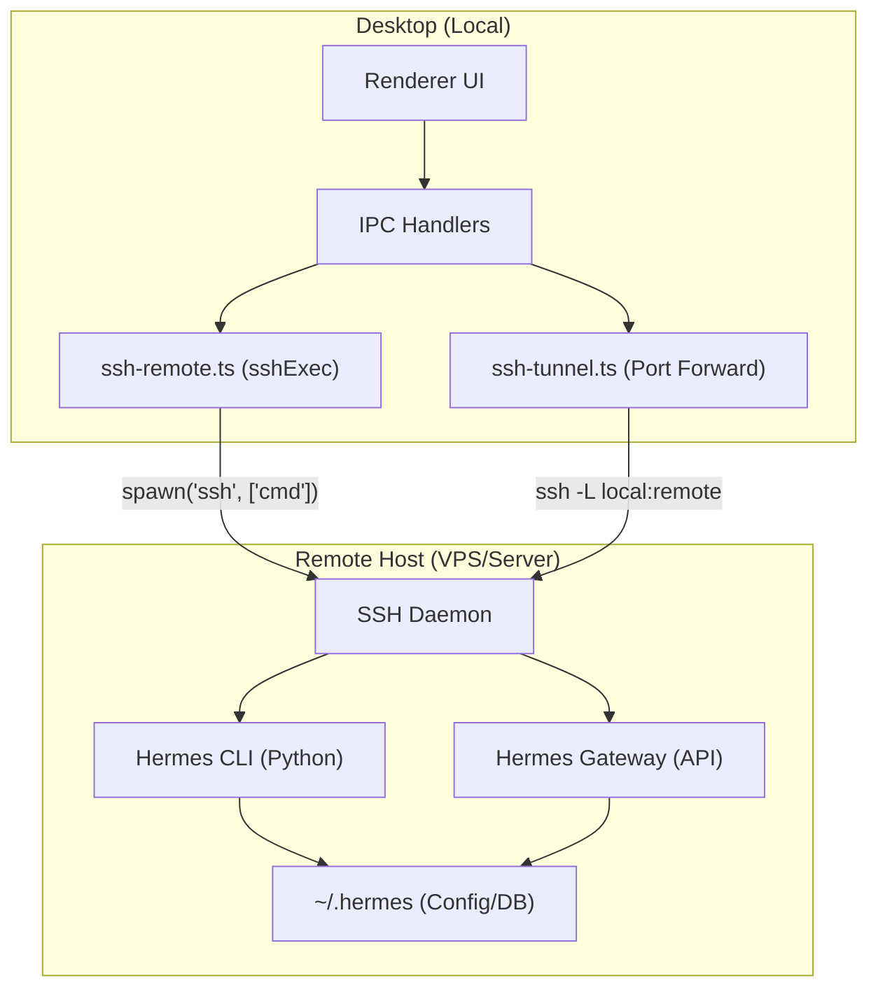
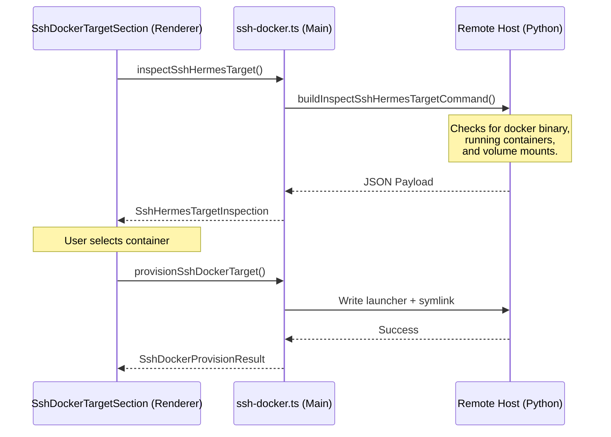

<!-- source: DeepWiki mcp.deepwiki.com · repo fathah/hermes-desktop · page 3.4 SSH Remote and Tunnel · fetched 2026-10-30 -->

# SSH Remote and Tunnel

Relevant source files

The following files were used as context for generating this wiki page:

- [docs/SSH-TUNNEL-VPS.md](docs/SSH-TUNNEL-VPS.md)
- [lat.md/main-process.md](lat.md/main-process.md)
- [pr-comment.md](pr-comment.md)
- [src/main/gpu-fallback.ts](src/main/gpu-fallback.ts)
- [src/main/ssh-docker.ts](src/main/ssh-docker.ts)
- [src/main/ssh-options.ts](src/main/ssh-options.ts)
- [src/main/ssh-remote.test.ts](src/main/ssh-remote.test.ts)
- [src/main/ssh-remote.ts](src/main/ssh-remote.ts)
- [src/main/ssh-tunnel.ts](src/main/ssh-tunnel.ts)
- [src/renderer/src/components/settings/SshDockerTargetSection.tsx](src/renderer/src/components/settings/SshDockerTargetSection.tsx)
- [src/shared/ssh-docker.ts](src/shared/ssh-docker.ts)
- [tests/gpu-fallback.test.ts](tests/gpu-fallback.test.ts)
- [tests/ssh-docker.test.ts](tests/ssh-docker.test.ts)
- [tests/ssh-options.test.ts](tests/ssh-options.test.ts)
- [tests/ssh-remote.test.ts](tests/ssh-remote.test.ts)

The SSH Remote and Tunnel subsystem provides full functional parity between local and remote Hermes installations. Unlike a simple HTTP proxy, this implementation allows the Desktop app to manage remote skills, sessions, memory, and gateway lifecycles as if they were running on the local machine [docs/SSH-TUNNEL-VPS.md:1-7](). It utilizes a dual-transport approach: an SSH command-line proxy for file/CLI operations and an SSH tunnel for the HTTP API and WebSocket dashboard.

## Architecture Overview

The system is split into two primary modules:
1.  **`ssh-remote.ts`**: Handles proxied execution of the Hermes CLI and file system operations on the remote host via `ssh` commands [src/main/ssh-remote.ts:1-5]().
2.  **`ssh-tunnel.ts`**: Manages a persistent background SSH process that forwards a local port to the remote Hermes API server (default `8642`) [src/main/ssh-tunnel.ts:100-123]().

### Data Flow: Desktop to Remote Agent

**Sources:** [src/main/ssh-remote.ts:58-73](), [src/main/ssh-tunnel.ts:100-123](), [docs/SSH-TUNNEL-VPS.md:14-37]()

## SSH Proxy Implementation (`ssh-remote.ts`)

Every feature that normally reads or writes local files (e.g., `sessions.ts`, `memory.ts`) is instead executed on the remote host when the connection mode is set to `ssh` [src/main/ssh-remote.ts:1-5]().

### Key Functions
- **`sshExec`**: The core execution engine. It spawns a system `ssh` process using `BatchMode=yes` and `StrictHostKeyChecking=accept-new` to ensure non-interactive operation [src/main/ssh-remote.ts:40-56](). It handles timeouts (default 30s) and sanitizes SSH-specific errors (e.g., authentication failures) into user-friendly messages [src/main/ssh-remote.ts:62-108](), [src/main/ssh-remote.ts:122-145]().
- **`sshPython`**: A wrapper around `sshExec` that pipes Python scripts to the remote `python3` interpreter, allowing complex logic (like directory scanning or JSON parsing) to run in a single SSH round-trip [src/main/ssh-remote.ts:110-120]().
- **`sshReadDirectory`**: Uses a remote Python script to scan the remote filesystem and return `SshDirectoryEntry` objects, used for profile and skill discovery [src/main/ssh-remote.ts:164-188]().

### Command Mapping (Natural Language to Code)
| Feature | Code Entity | Remote CLI Command / Script |
| :--- | :--- | :--- |
| **Start Gateway** | `buildGatewayStartCommand` | `systemctl start hermes.service` OR `nohup hermes gateway run` [tests/ssh-remote.test.ts:192-202](), [src/main/ssh-remote.test.ts:33-48]() |
| **Stop Gateway** | `buildGatewayStopCommand` | `systemctl stop hermes.service` OR `kill $(cat gateway.pid)` [src/main/ssh-remote.test.ts:50-60]() |
| **Edit .env** | `upsertEnvLine` | `sed` / `awk` style replacement via remote shell [src/main/ssh-remote.test.ts:97-144]() |
| **List Profiles** | `selectSshProfiles` | `ls ~/.hermes/profiles` [tests/ssh-remote.test.ts:17-19]() |

**Sources:** [src/main/ssh-remote.ts:58-63](), [src/main/ssh-remote.ts:110-115](), [src/main/ssh-remote.ts:164-167](), [src/main/ssh-remote.test.ts:21-61]()

## SSH Tunneling (`ssh-tunnel.ts`)

The tunnel provides the transport for the Hermes API and the WebSocket dashboard. It ensures that even if the remote API is bound to `127.0.0.1` on the server, the desktop can reach it via a local loopback port [docs/SSH-TUNNEL-VPS.md:55-57]().

### Tunnel Lifecycle
1.  **Port Discovery**: `findFreePort` searches for an available local port, starting at the user's preferred port (default `18642`) [src/main/ssh-tunnel.ts:83-98]().
2.  **Establishment**: Spawns `ssh` with the `-L` flag (Local Forwarding) and `ExitOnForwardFailure=yes` [src/main/ssh-tunnel.ts:100-123]().
3.  **Health Check**: The `waitForHealth` function polls the local port's `/health` or `/api/status` endpoints to verify the tunnel is actually routing traffic to a functional Hermes Agent [src/main/ssh-tunnel.ts:68-75]().
4.  **Multiplexing**: Uses `buildSshControlOptions` to enable SSH connection sharing (ControlMaster), which significantly speeds up subsequent `sshExec` calls by reusing the tunnel's socket [src/main/ssh-tunnel.ts:114](), [src/main/ssh-remote.ts:49]().

**Sources:** [src/main/ssh-tunnel.ts:27-30](), [src/main/ssh-tunnel.ts:60-75](), [src/main/ssh-tunnel.ts:100-123](), [src/main/ssh-tunnel.ts:135-156]()

## SSH Docker Targeting

Hermes Desktop supports targets where the Agent runs inside a Docker container (e.g., NAS, Coolify). This is handled by `ssh-docker.ts` by provisioning host-side shims [src/main/ssh-docker.ts:11-25]().

### Provisioning Logic
Instead of modifying the container, the system creates two artifacts on the SSH host:
1.  **Launcher Hook**: A script at `~/.config/hermes-desktop/remote-hermes` that wraps `docker exec` to route CLI commands into the container [src/main/ssh-docker.ts:77-98]().
2.  **Data Symlink**: A symlink from `~/.hermes` to the host directory mounted as the container's volume (usually `/opt/data`), allowing the file proxy to see the Agent's real database and logs [src/main/ssh-docker.ts:20-22](), [src/shared/ssh-docker.ts:10-11]().

### Docker Inspection Flow

**Sources:** [src/renderer/src/components/settings/SshDockerTargetSection.tsx:55-118](), [src/main/ssh-docker.ts:105-185](), [src/shared/ssh-docker.ts:16-37]()

## Configuration and Security

### SSH Options
`buildSshControlOptions` configures connection multiplexing. On non-Windows platforms, it uses a ControlPath socket in `~/.ssh/` to reuse existing connections [src/main/ssh-options.ts]().

### API Key Provisioning
The gateway requires a secure `API_SERVER_KEY` to bind. `ssh-remote.ts` includes `isUsableApiServerKey` to detect insecure placeholders (like "changeme") and automatically generates/upserts a fresh key into the remote `.env` file during connection setup [src/main/ssh-remote.test.ts:63-83](), [src/main/ssh-remote.test.ts:97-144]().

### Sanitization
All remote commands are escaped using `shellQuote` to prevent shell injection when user-provided strings (like task titles or session names) are passed to the remote CLI [src/main/ssh-remote.ts:147-149](), [tests/ssh-remote.test.ts:124-178]().

**Sources:** [src/main/ssh-remote.ts:147-149](), [src/main/ssh-remote.test.ts:63-83](), [tests/ssh-remote.test.ts:124-178]()

---

