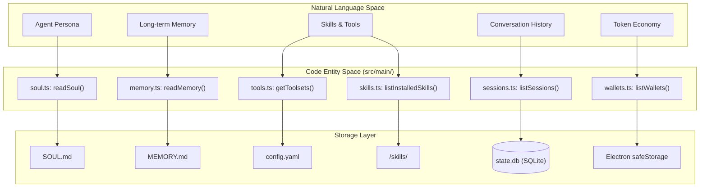
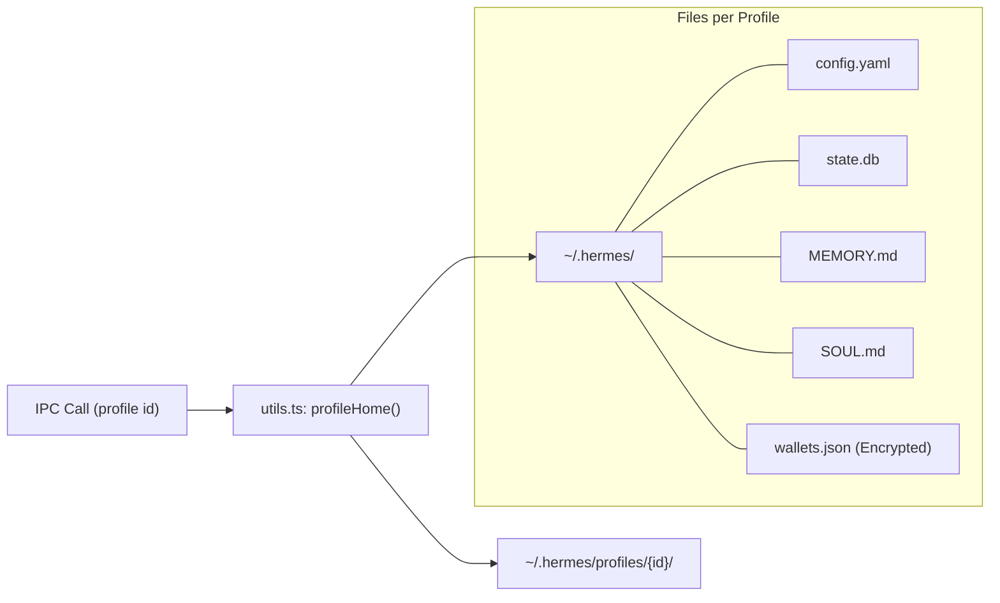

<!-- source: DeepWiki mcp.deepwiki.com · repo fathah/hermes-desktop · page 4 Agent Features and Data Layer · fetched 2026-10-30 -->

# Agent Features and Data Layer

Relevant source files

The following files were used as context for generating this wiki page:

- [Development.md](Development.md)
- [README.md](README.md)
- [assets/header.webp](assets/header.webp)
- [assets/partners/atlascloud.webp](assets/partners/atlascloud.webp)
- [assets/partners/greptile.webp](assets/partners/greptile.webp)
- [previews/discover.png](previews/discover.png)
- [previews/memory.png](previews/memory.png)
- [previews/sessions.png](previews/sessions.png)
- [src/main/default-models.ts](src/main/default-models.ts)
- [src/main/profiles.ts](src/main/profiles.ts)
- [src/renderer/src/components/profile/ProfileModal.tsx](src/renderer/src/components/profile/ProfileModal.tsx)
- [src/renderer/src/screens/Agents/Agents.test.tsx](src/renderer/src/screens/Agents/Agents.test.tsx)
- [src/renderer/src/screens/Agents/Agents.tsx](src/renderer/src/screens/Agents/Agents.tsx)
- [src/shared/i18n/locales/en/agents.ts](src/shared/i18n/locales/en/agents.ts)
- [tests/profiles.test.ts](tests/profiles.test.ts)

This section provides an overview of the backend modules that power the Hermes agent's intelligence, persistence, and extensibility. The data layer is designed around a **Profile-centric isolation model**, where each profile maintains its own distinct configuration, memory, skills, and persona.

The core logic resides in the Electron main process, interacting with a combination of flat-file Markdown stores (`MEMORY.md`, `SOUL.md`), YAML configurations, a SQLite database (`state.db`) for session history, and encrypted storage for blockchain wallets.

### Data Layer Architecture

The following diagram illustrates the relationship between the high-level agent concepts and the underlying code entities.

**Diagram: Agent Entity Mapping**

**Sources:** [src/main/soul.ts:12-21](), [src/main/memory.ts:110-128](), [src/main/tools.ts:170-191](), [src/main/skills.ts:69-118](), [src/main/sessions.ts:179-222](), [src/main/wallets.ts:112-145]()

---

### Subsystem Overviews

#### 4.1 Profiles and Skills
Hermes uses a directory-based isolation model. The "default" profile is located at `HERMES_HOME`, while named profiles reside in `HERMES_HOME/profiles/<id>` [src/main/profiles.ts:23-24](). Profiles are managed via `listProfiles`, which detects directories and retrieves metadata like active status, model configuration, and skill counts [src/main/profiles.ts:176-223](). Skills are modular capabilities organizational by category and are discovered by parsing `SKILL.md` frontmatter [src/main/profiles.ts:119-143](). Profiles can also be synced with a cloud account [src/renderer/src/screens/Agents/Agents.tsx:117-139]().

For details, see [Profiles and Skills](#4.1).

#### 4.2 Memory, Soul, and Tools
The agent's "Soul" (persona) and "Memory" (knowledge) are managed as human-readable Markdown files. 
- **Memory**: Uses a delimited flat-file format (`MEMORY.md`) with character limits to ensure context window efficiency [src/main/memory.ts:6-9]().
- **Soul**: Defines the system prompt and behavioral guidelines in `SOUL.md` [src/main/soul.ts:12-21]().
- **Tools**: Managed via `config.yaml` toggles. The system enables or disables specific capabilities like `web` or `terminal` [src/main/tools.ts:123-168]().

For details, see [Memory, Soul, and Tools](#4.2).

#### 4.3 Sessions and Session Cache
Conversation history is stored in a SQLite database (`state.db`) [src/main/utils.ts:175-177](). To provide a snappy UI, Hermes maintains a `sessions.json` cache [src/main/session-cache.ts:19-25](). 
- **Delta Sync**: Fetches only sessions updated since the last sync to optimize performance [src/main/session-cache.ts:97-165]().
- **Search**: Full-text search is powered by SQLite FTS5 [src/main/sessions.ts:224-245]().

For details, see [Sessions and Session Cache](#4.3).

#### 4.4 Cron Jobs and Automation
Hermes supports scheduled tasks via a Cron Job subsystem. Jobs are persisted in `jobs.json` [src/main/cronjobs.ts:27-29]().
- **Execution**: Jobs can be created, removed, or triggered manually via the Hermes CLI [src/main/cronjobs.ts:142-174]().
- **Remote Mode**: In remote mode, the system fetches jobs via the Hermes API server's `/api/jobs` endpoint [src/main/cronjobs.ts:92-114]().

For details, see [Cron Jobs and Automation](#4.4).

#### 4.5 Wallets and Token Economy
Introduced in v0.7.0, the wallet subsystem allows profiles to manage Ethereum wallets on the Base mainnet.
- **Security**: Private keys/recovery phrases are encrypted using Electron's `safeStorage` before being persisted [src/main/wallets.ts:190-215]().
- **Token Integration**: Supports tracking balances for $H1 and $HD tokens [src/shared/i18n/locales/en/agents.ts:16-16]().
- **UI**: The `ProfileWalletPane` provides a dedicated interface for wallet CRUD and balance refreshing [src/renderer/src/components/profile/ProfileWalletPane.tsx:45-110]().

For details, see [Wallets and Token Economy](#4.5).

---

### Profile Data Flow

The `profileHome` utility function is the primary mechanism for directing data operations to the correct file system path based on the active agent.

**Diagram: Profile-Scoped Data Resolution**

| Entity | Storage Type | Primary Controller | Purpose |
| :--- | :--- | :--- | :--- |
| **Profile** | Directory | `profiles.ts` | Isolation of all agent data and environment [src/main/profiles.ts:23-34](). |
| **Memory** | Markdown | `memory.ts` | Persistent user-specific facts with char limits [src/main/memory.ts:110-128](). |
| **Soul** | Markdown | `soul.ts` | The agent's core identity/persona [src/main/soul.ts:12-21](). |
| **Wallets** | Encrypted JSON | `wallets.ts` | Profile-scoped crypto wallets on Base [src/main/wallets.ts:40-65](). |
| **Sessions** | SQLite | `sessions.ts` | Message history and FTS5 search in `state.db` [src/main/sessions.ts:171-177](). |
| **Cron Jobs** | JSON | `cronjobs.ts` | Scheduled automation tasks [src/main/cronjobs.ts:10-25](). |

**Sources:** [src/main/utils.ts:47-50](), [src/main/profiles.ts:176-223](), [src/main/memory.ts:110-128](), [src/main/wallets.ts:112-145](), [src/main/sessions.ts:171-222](), [src/main/cronjobs.ts:27-29]()

---

