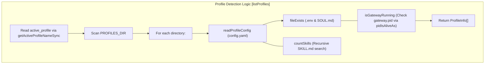
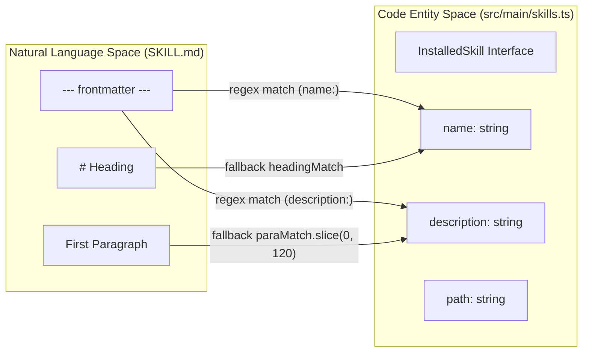
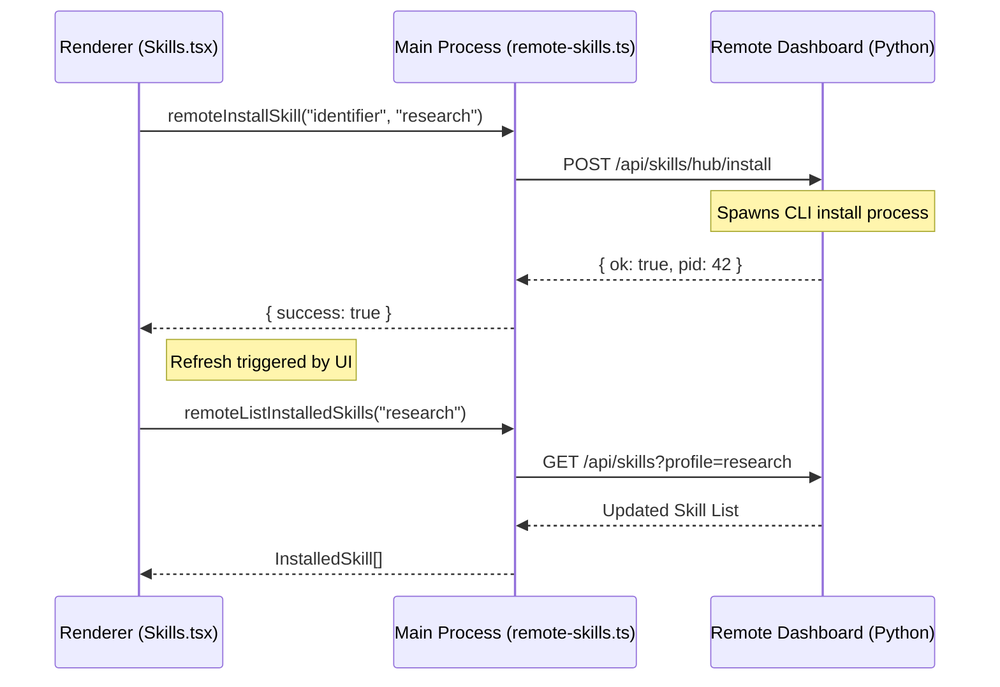

<!-- source: DeepWiki mcp.deepwiki.com · repo fathah/hermes-desktop · page 4.1 Profiles and Skills · fetched 2026-10-30 -->

# Profiles and Skills

Relevant source files

The following files were used as context for generating this wiki page:

- [src/main/cronjobs.ts](src/main/cronjobs.ts)
- [src/main/profiles.ts](src/main/profiles.ts)
- [src/main/remote-skills.test.ts](src/main/remote-skills.test.ts)
- [src/main/remote-skills.ts](src/main/remote-skills.ts)
- [src/main/skills.ts](src/main/skills.ts)
- [src/renderer/src/components/profile/ProfileModal.tsx](src/renderer/src/components/profile/ProfileModal.tsx)
- [src/renderer/src/screens/Agents/Agents.test.tsx](src/renderer/src/screens/Agents/Agents.test.tsx)
- [src/renderer/src/screens/Agents/Agents.tsx](src/renderer/src/screens/Agents/Agents.tsx)
- [src/renderer/src/screens/Skills/Skills.test.tsx](src/renderer/src/screens/Skills/Skills.test.tsx)
- [src/shared/i18n/locales/en/agents.ts](src/shared/i18n/locales/en/agents.ts)
- [tests/cronjobs-ssh.test.ts](tests/cronjobs-ssh.test.ts)
- [tests/cronjobs.test.ts](tests/cronjobs.test.ts)
- [tests/profiles.test.ts](tests/profiles.test.ts)
- [tests/remote-mode-url-and-spawn.test.ts](tests/remote-mode-url-and-spawn.test.ts)
- [tests/skills-cli-output.test.ts](tests/skills-cli-output.test.ts)

This page covers the implementation of the profile isolation model and the skill management system in Hermes Desktop. These systems allow users to maintain multiple independent agent configurations and extend agent capabilities through a structured skill registry.

## Profile Isolation Model

Hermes uses a directory-based isolation model for profiles. The `default` profile is located directly in the `HERMES_HOME` directory (typically `~/.hermes`), while named profiles are stored in a dedicated sub-directory `profiles/` [src/main/profiles.ts:23-23]().

### Directory Structure
Each profile directory acts as a self-contained environment containing:
*   `config.yaml`: Model and provider settings [src/main/profiles.ts:103-103]().
*   `.env`: Profile-specific environment variables and API keys [src/main/profiles.ts:190-190]().
*   `SOUL.md`: The agent's persona and instructions [src/main/profiles.ts:191-191]().
*   `skills/`: A categorized directory of installed skills [src/main/profiles.ts:120-120]().
*   `gateway.pid`: Tracking file for the profile's active gateway process [src/main/profiles.ts:146-146]().
*   `profile-meta.json`: UI-specific metadata like custom names, colors, and avatars [src/main/profiles.ts:21-21]().

### Profile Management Operations
The `profiles.ts` module interfaces with the Python-based `hermes` CLI to perform lifecycle operations. It uses `execFileSync` to trigger the agent's internal management commands [src/main/profiles.ts:1-1]().

| Function | Logic | Source |
| :--- | :--- | :--- |
| `listProfiles()` | Scans `HERMES_HOME` and `profiles/` to aggregate metadata (model, skill count, status). | [src/main/profiles.ts:176-223]() |
| `createProfile()` | Normalizes agent names into slugs and executes the creation logic. | [src/main/profiles.ts:64-97]() |
| `readProfileConfig()` | Parses `config.yaml` using regex to extract `default` model and `provider`. | [src/main/profiles.ts:99-117]() |
| `isGatewayRunning()` | Reads `gateway.pid` and verifies the process via `pidIsAliveAs`. | [src/main/profiles.ts:145-161]() |

**Profile Detection Logic**
The `listProfiles` function aggregates data from multiple files to construct a `ProfileInfo` object. It ensures profiles are visible even if they lack configuration files, preventing "ghost" profiles [src/main/profiles.ts:176-223]().

Sources: [src/main/profiles.ts:23-54](), [src/main/profiles.ts:99-117](), [src/main/profiles.ts:119-143](), [src/main/profiles.ts:145-161](), [src/main/profiles.ts:176-223]()

---

## Skills System

Skills are structured Markdown files (`SKILL.md`) that provide the agent with domain-specific knowledge and tool-use instructions.

### Skill Anatomy and Parsing
The `SKILL.md` file uses YAML frontmatter to define metadata. The `parseSkillFrontmatter` function extracts the name and description for the UI. If frontmatter is missing, it falls back to the first Markdown heading and paragraph [src/main/skills.ts:40-70]().

**Data Mapping: Markdown to Code**

Sources: [src/main/skills.ts:22-27](), [src/main/skills.ts:40-70]()

### Skill Registry and Storage
Hermes distinguishes between skills included in the core repository and those added to a specific profile.

1.  **Bundled Skills**: Located in the `HERMES_REPO` directory under `skills/`. Discovered via `listBundledSkills` [src/main/skills.ts:233-241]().
2.  **Installed Skills**: Located in the profile-specific `skills/` directory. The structure follows `skills/<category>/<skill-name>/SKILL.md` [src/main/skills.ts:76-125]().
3.  **Search Registry**: The `searchSkills` function queries the agent's remote registry using the `skills browse` CLI command with the `--json` flag [src/main/skills.ts:185-228]().

### Remote Skill Management
In Remote Mode, skill operations are routed through the Dashboard API rather than the local CLI to ensure data consistency with the remote agent [src/main/remote-skills.ts:4-10]().

*   **Remote Paths**: Remote skills are identified by a `remote-skill:<profile>:<name>` prefix to allow content lookups to target the correct profile on the remote host [src/main/remote-skills.ts:20-24]().
*   **API Endpoints**: The system communicates with `/api/skills`, `/api/skills/content`, and `/api/skills/hub/install|uninstall` [src/main/remote-skills.ts:8-9]().

**Skill Installation Flow**

Sources: [src/main/remote-skills.ts:20-24](), [src/main/remote-skills.ts:65-86](), [src/main/remote-skills.ts:118-137](), [src/renderer/src/screens/Skills/Skills.test.tsx:22-44]()

### Security and Path Validation
To prevent directory traversal, the `isAllowedSkillFile` function restricts skill file access to `HERMES_HOME/skills`, `HERMES_REPO/skills`, or valid profile skill directories [src/main/skills.ts:152-162]().

Sources: [src/main/profiles.ts](), [src/main/skills.ts](), [src/main/remote-skills.ts](), [tests/profiles.test.ts](), [src/renderer/src/screens/Agents/Agents.tsx]()

---

