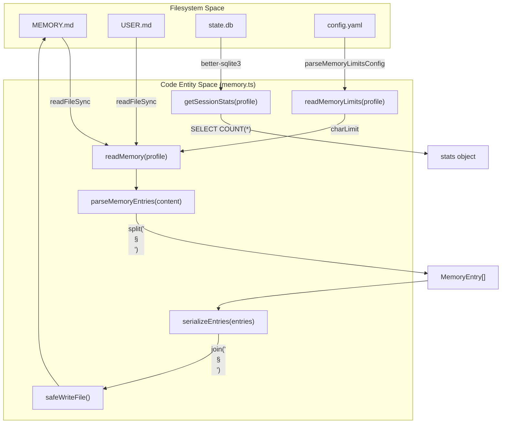

<!-- source: DeepWiki mcp.deepwiki.com · repo fathah/hermes-desktop · page 4.2 Memory, Soul, and Tools · fetched 2026-10-30 -->

# Memory, Soul, and Tools

<details>
<summary>Relevant source files</summary>

The following files were used as context for generating this wiki page:

- [lat.md/mcp-servers.md](lat.md/mcp-servers.md)
- [src/main/mcp-servers.ts](src/main/mcp-servers.ts)
- [src/main/memory-limits.ts](src/main/memory-limits.ts)
- [src/main/memory.ts](src/main/memory.ts)
- [src/main/messaging-platforms.ts](src/main/messaging-platforms.ts)
- [src/main/registry.ts](src/main/registry.ts)
- [src/main/soul.ts](src/main/soul.ts)
- [src/main/tools.ts](src/main/tools.ts)
- [src/renderer/src/screens/Discover/Discover.tsx](src/renderer/src/screens/Discover/Discover.tsx)
- [src/renderer/src/screens/Gateway/Gateway.tsx](src/renderer/src/screens/Gateway/Gateway.tsx)
- [src/renderer/src/screens/Tools/Tools.tsx](src/renderer/src/screens/Tools/Tools.tsx)
- [src/shared/i18n/locales/en/common.ts](src/shared/i18n/locales/en/common.ts)
- [src/shared/i18n/locales/en/discover.ts](src/shared/i18n/locales/en/discover.ts)
- [src/shared/i18n/locales/en/gateway.ts](src/shared/i18n/locales/en/gateway.ts)
- [src/shared/i18n/locales/en/providers.ts](src/shared/i18n/locales/en/providers.ts)
- [src/shared/i18n/locales/en/tools.ts](src/shared/i18n/locales/en/tools.ts)
- [src/shared/messaging-platforms.test.ts](src/shared/messaging-platforms.test.ts)
- [src/shared/messaging-platforms.ts](src/shared/messaging-platforms.ts)
- [src/shared/registry.ts](src/shared/registry.ts)
- [tests/memory-limits.test.ts](tests/memory-limits.test.ts)
- [tests/toolset-toggle.test.ts](tests/toolset-toggle.test.ts)

</details>


This section documents the core modules responsible for managing the agent's persistent identity, knowledge base, and functional capabilities. These features are implemented through a combination of flat-file storage for transparency, SQLite for statistics, and YAML-based configuration for tool orchestration.

## Memory Management

Hermes utilizes a flat-file memory system to provide the agent with long-term context. This system distinguishes between **Memory** (discrete facts or observations) and the **User Profile** (general information about the human user).

### Implementation Details
Memory is stored in `MEMORY.md` and `USER.md` within the `memories/` subdirectory of the profile home [src/main/memory.ts:33-39](). To maintain performance and context window efficiency, the system reads limits from `config.yaml` via `parseMemoryLimitsConfig` [src/main/memory.ts:45-53]().

The system uses a specific delimiter `\n§\n` to separate individual memory entries within the flat file [src/main/memory.ts:7](). This allows for granular CRUD operations on specific "facts" without overwriting the entire file manually.

### Data Structures
The `MemoryInfo` interface aggregates file content, metadata, and session statistics retrieved from the local SQLite `state.db` [src/main/memory.ts:14-31]().

| Entity | File | Purpose |
| :--- | :--- | :--- |
| `MemoryEntry` | `MEMORY.md` | Discrete facts separated by `§` [src/main/memory.ts:9-12](). |
| `User Profile` | `USER.md` | Persistent "About Me" for the user [src/main/memory.ts:37-39](). |
| `Stats` | `state.db` | Aggregate message and session counts [src/main/memory.ts:91-119](). |

### Memory Data Flow
The following diagram illustrates how memory is parsed from the filesystem into the application state.

**Memory Parsing and Storage Flow**

Sources: [src/main/memory.ts:7-12](), [src/main/memory.ts:76-82](), [src/main/memory.ts:91-119](), [src/main/memory.ts:123-142]()

## Soul and Persona

The "Soul" of the agent defines its core personality, instructions, and behavioral constraints. This is managed in `soul.ts` and persisted in `SOUL.md` [src/main/soul.ts:12-13]().

### Personality Management
*   **Default Persona:** If no `SOUL.md` exists, the system defaults to a "friendly, knowledgeable, and clear" persona named Hermes [src/main/soul.ts:5-10]().
*   **Reset Workflow:** The `resetSoul` function allows users to revert their agent to the factory settings by overwriting the file with `DEFAULT_SOUL` [src/main/soul.ts:34-37]().
*   **Persistence:** All changes are written using `safeWriteFile` to ensure the directory structure exists before attempting a write [src/main/soul.ts:27]().

Sources: [src/main/soul.ts:1-37]()

## Tools and Capabilities

The `tools.ts` module manages the availability of functional toolsets (e.g., Web Search, Terminal, Vision). Toolsets are defined in a static registry `TOOLSET_DEFS` [src/main/tools.ts:15-115]().

### Toolset Orchestration
Toolsets are toggled via the `config.yaml` file under the `platform_toolsets` key [src/main/tools.ts:130-138](). The system supports both the `cli` platform and external `messaging` platforms [src/main/tools.ts:236-246](). Because the application avoids a heavy YAML dependency in the main process, `tools.ts` implements a custom line-by-line parser `parsePlatformToolsets` [src/main/tools.ts:139-183]().

### Tool Configuration Mapping
The system maps internal keys to user-friendly labels and descriptions for the UI using the application's locale settings via `localizeToolDefs` [src/main/tools.ts:117-127]().

| Key | Label Key | Purpose |
| :--- | :--- | :--- |
| `web` | `tools.web.label` | Search the web and extract content [src/main/tools.ts:21-24](). |
| `terminal` | `tools.terminal.label` | Execute shell commands and scripts [src/main/tools.ts:36-39](). |
| `vision` | `tools.vision.label` | Analyze images and visual content [src/main/tools.ts:56-59](). |
| `memory` | `tools.memory.label` | Store and recall persistent knowledge [src/main/tools.ts:80-83](). |
| `cronjob` | `tools.cronjob.label` | Schedule and manage automated tasks [src/main/tools.ts:101-104](). |

### MCP Server Registry
Hermes integrates with the **Model Context Protocol (MCP)** to extend capabilities.
*   **Discovery:** The `Discover.tsx` screen allows browsing MCPs from a community registry hosted on GitHub [src/main/registry.ts:25-35]().
*   **Management:** Users can add, edit, or remove MCP servers (both `stdio` and `http` transports) via the Tools screen [src/renderer/src/screens/Tools/Tools.tsx:81-92]().
*   **Registry Fetching:** `fetchRegistry` retrieves the catalog from `index.json` and caches it to prevent redundant network calls [src/main/registry.ts:131-163]().

**Tool Configuration and Sync Flow**
```mermaid
graph TD
    subgraph "Configuration Space"
        YAML["config.yaml"]
    end

    subgraph "Code Entity Space (tools.ts / registry.ts)"
        getTools["getToolsets(profile)"]
        parseYAML["parsePlatformToolsets(content)"]
        fetchReg["fetchRegistry(force)"]
        DEFS["TOOLSET_DEFS"]
        REG_REPO["hermes-registry"]
    end

    subgraph "Renderer Space (Tools.tsx)"
        ToolUI["Tools Screen"]
        McpForm["McpServerInput"]
    end

    YAML -->|readFileSync| getTools
    getTools --> parseYAML
    parseYAML -->|Compare| DEFS
    DEFS -->|Return| ToolUI
    
    REG_REPO -->|fetch| fetchReg
    fetchReg -->|RegistryItem[]| ToolUI
    
    ToolUI -->|formToInput| McpForm
    McpForm -->|IPC| window.hermesAPI
```
Sources: [src/main/tools.ts:15-115](), [src/main/tools.ts:139-183](), [src/main/registry.ts:32-41](), [src/renderer/src/screens/Tools/Tools.tsx:144-154]()

## Shared Registry Types
The system uses shared interfaces to ensure consistency between the main process (which handles fetching and installation) and the renderer (which handles the UI) [src/shared/registry.ts:1-5]().

*   **`RegistryItem`**: Represents a skill, MCP, agent, or workflow in the marketplace [src/shared/registry.ts:9-27]().
*   **`RegistryCatalog`**: A grouped collection of registry items [src/shared/registry.ts:29-34]().
*   **`RegistryModel`**: Defines curated models available for selection in the Models screen [src/shared/registry.ts:66-74]().

Sources: [src/shared/registry.ts:7-94]()

---

