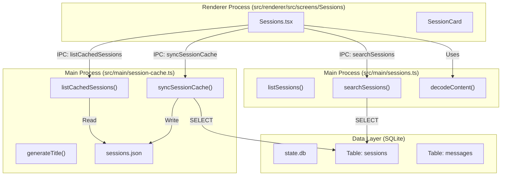
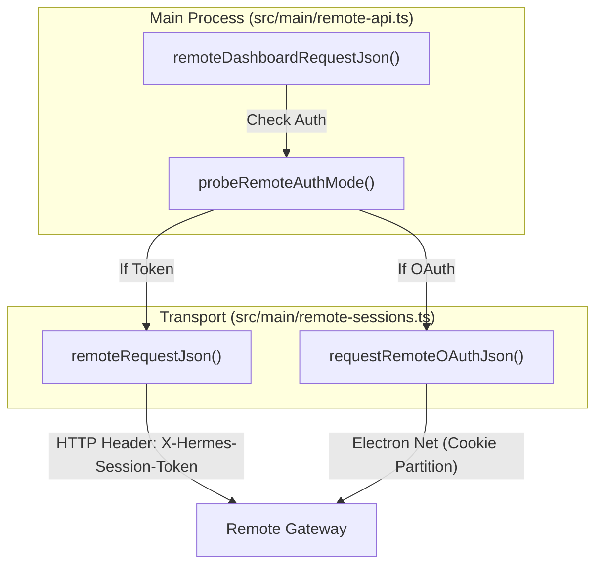
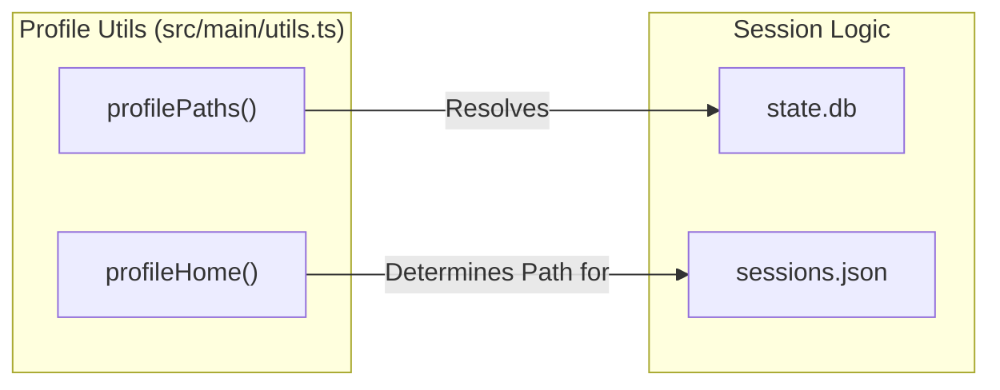

<!-- source: DeepWiki mcp.deepwiki.com · repo fathah/hermes-desktop · page 4.3 Sessions and Session Cache · fetched 2026-10-30 -->

# Sessions and Session Cache

Relevant source files

The following files were used as context for generating this wiki page:

- [lat.md/remote-dashboard-oauth.md](lat.md/remote-dashboard-oauth.md)
- [src/main/remote-api.test.ts](src/main/remote-api.test.ts)
- [src/main/remote-api.ts](src/main/remote-api.ts)
- [src/main/remote-sessions.ts](src/main/remote-sessions.ts)
- [src/main/session-cache.ts](src/main/session-cache.ts)
- [src/main/sessions.ts](src/main/sessions.ts)
- [src/main/utils.ts](src/main/utils.ts)
- [src/renderer/src/screens/Sessions/Sessions.test.tsx](src/renderer/src/screens/Sessions/Sessions.test.tsx)
- [src/renderer/src/screens/Sessions/Sessions.tsx](src/renderer/src/screens/Sessions/Sessions.tsx)
- [src/shared/i18n/locales/en/sessions.ts](src/shared/i18n/locales/en/sessions.ts)
- [tests/remote-sessions.test.ts](tests/remote-sessions.test.ts)
- [tests/session-cache-sync.test.ts](tests/session-cache-sync.test.ts)
- [tests/sessions-delete-session.test.ts](tests/sessions-delete-session.test.ts)

The Hermes Desktop application manages conversation history through a combination of a persistent SQLite database (`state.db`) maintained by the Hermes Agent backend and a localized JSON cache (`sessions.json`) used by the Electron main process for high-performance UI rendering, delta-syncing, and title generation.

## 1. Data Architecture

Hermes utilizes two distinct storage layers for session data to balance data integrity with UI responsiveness. Both layers are isolated per-profile [src/main/session-cache.ts:15-20]().

### 1.1 SQLite Schema (state.db)
The primary source of truth is the SQLite database located at `activeStateDbPath()` [src/main/utils.ts:4-9](). This database stores raw conversation data, including multimodal content and tool execution logs.

| Table | Purpose | Key Columns |
| :--- | :--- | :--- |
| `sessions` | Metadata for each conversation | `id`, `source`, `started_at`, `message_count`, `model`, `title` |
| `messages` | Individual chat turns and tool interactions | `id`, `session_id`, `role`, `content`, `timestamp` |
| `messages_fts` | Virtual FTS5 table for search | Virtual columns for full-text indexing |

Sources: [src/main/sessions.ts:28-37](), [src/main/sessions.ts:39-45](), [src/main/session-cache.ts:129-135](), [src/main/utils.ts:4-9]()

### 1.2 Desktop Cache (sessions.json)
To avoid expensive SQLite joins and frequent disk I/O during sidebar navigation, the main process maintains a `sessions.json` file.
- **Location**: `~/.hermes/desktop/sessions.json` for default, or `~/.hermes/profiles/<name>/desktop/sessions.json` [src/main/session-cache.ts:21-27]().
- **Structure**: Stores a `CacheData` object containing `sessions: CachedSession[]` and a `lastSync` timestamp [src/main/session-cache.ts:39-42]().

Sources: [src/main/session-cache.ts:21-42]()

## 2. Session Synchronization Logic

The `syncSessionCache` function implements a delta-sync strategy to keep the JSON cache updated with the SQLite database while minimizing overhead [src/main/session-cache.ts:120]().

### 2.1 Delta-Sync Flow
1. **Read Cache**: Loads existing data via `readCache()` [src/main/session-cache.ts:121]().
2. **Query SQLite**: Fetches sessions where `s.started_at > ?`. It uses `lastSync - 300` (a 5-minute overlap window) to ensure no sessions are missed due to clock drift [src/main/session-cache.ts:129-143]().
3. **O(N) Merge Optimization**:
   - Existing sessions are indexed into a `Map` (`existingById`) [src/main/session-cache.ts:149-150]().
   - If the ID exists, it updates `messageCount`, `model`, and `title` [src/main/session-cache.ts:156-161]().
   - If new, it generates a title (see 2.2) and adds to `newSessions` [src/main/session-cache.ts:164-192]().
4. **Stale Count Refresh**: For sessions outside the sync window, it performs a batched query to update `message_count` for older active conversations to fix stale counts in the UI [src/main/session-cache.ts:203-204]().
5. **Context Folder Attachment**: Linked folders are attached in a single batched read via `attachContextFolders` [src/main/session-cache.ts:111-117]().

### 2.2 Title Generation Heuristics
If the agent hasn't set a title, `generateTitle` [src/main/session-cache.ts:45]() derives one from the first user message:
- **Sanitization**: Strips Markdown (`#*_~`) and URLs via regex [src/main/session-cache.ts:52-55]().
- **Truncation**: Aims for ~45 characters, breaking at the last word boundary to prevent partial words [src/main/session-cache.ts:64-72]().

Sources: [src/main/session-cache.ts:45-73](), [src/main/session-cache.ts:120-204]()

## 3. History Reconstruction and FTS

Hermes provides a rich "resumed" transcript by reconstructing non-message entities from the database.

### 3.1 Rich History (HistoryItem)
The application reconstructs a full timeline of `HistoryItem` objects [src/main/sessions.ts:56]():
- **Reasoning**: Extracted into a specific kind for collapsible sub-rows [src/main/sessions.ts:73-78]().
- **Tool Calls/Results**: Reconstructed into `tool_call` and `tool_result` kinds to match live conversation flow [src/main/sessions.ts:80-96]().
- **Multimodal Content**: Decoded using `decodeContent` which identifies the `\x00json:` sentinel used by the agent to store base64 images in the content column [src/main/sessions.ts:110-160]().

### 3.2 Full-Text Search (FTS5)
`searchSessions` [src/main/sessions.ts:177]() performs the following:
1. **Query Sanitization**: `escapeLikePattern` handles special characters for SQLite [src/main/sessions.ts:202-204]().
2. **Snippet Generation**: Uses `highlightTextMatch` with `<< >>` markers to provide context around matches [src/main/sessions.ts:206-222]().

### 3.3 Code Entity Space: Session Retrieval

**Session Data Flow**

Sources: [src/main/sessions.ts:110-160](), [src/main/session-cache.ts:120-204](), [src/renderer/src/screens/Sessions/Sessions.tsx:1-50]()

## 4. Remote Session Access

When Hermes is in "Remote" mode, session management is routed through the `remoteDashboardRequestJson` boundary [src/main/remote-api.ts:53]().

### 4.1 Authentication Routing
The system automatically selects the correct transport based on the remote gateway's capabilities [src/main/remote-api.ts:74-77]():
- **OAuth**: Requests are routed through Electron's persistent cookie partition via `requestRemoteOAuthJson` [src/main/remote-api.ts:79-84]().
- **Token**: Uses the `X-Hermes-Session-Token` header via `remoteRequestJson` [src/main/remote-api.ts:86]().
- **Profile Scoping**: Every remote request is scoped using the `?profile=` query parameter to ensure data isolation on multi-profile remote hosts [src/main/remote-sessions.ts:55-69]().

### 4.2 Remote API Boundary
**Remote Request Flow**

Sources: [src/main/remote-api.ts:53-90](), [src/main/remote-sessions.ts:71-152](), [lat.md/remote-dashboard-oauth.md:37-40]()

## 5. Implementation Details

### 5.1 Key Entities and Functions

| Entity | Location | Description |
| :--- | :--- | :--- |
| `SessionSummary` | [src/main/sessions.ts:28]() | Metadata structure for session listing. |
| `HistoryItem` | [src/main/sessions.ts:56]() | Union type for reasoning, tool calls, and messages. |
| `decodeContent` | [src/main/sessions.ts:110]() | Unpacks `\x00json:` multimodal content from the DB. |
| `syncSessionCache`| [src/main/session-cache.ts:120]()| Performs the delta-sync and stale count refresh. |
| `Sessions` (UI) | [src/renderer/src/screens/Sessions/Sessions.tsx:85]() | React component managing session filtering and display. |

### 5.2 Profile Isolation
The following diagram illustrates how the Session system respects the Profile architecture.

**Profile and Session Association**

Sources: [src/main/utils.ts:54-57](), [src/main/utils.ts:63-74](), [src/main/session-cache.ts:21-27]()

### 5.3 Live Refresh Behavior
The `Sessions` screen in the renderer uses an interval to re-sync from `state.db` while visible, ensuring that background tasks (like cron jobs) that create sessions are reflected in the UI [src/renderer/src/screens/Sessions/Sessions.test.tsx:102-119](). It also refreshes when the window regains focus [src/renderer/src/screens/Sessions/Sessions.test.tsx:149-159]().

Sources: [src/renderer/src/screens/Sessions/Sessions.test.tsx:92-159]()

---

