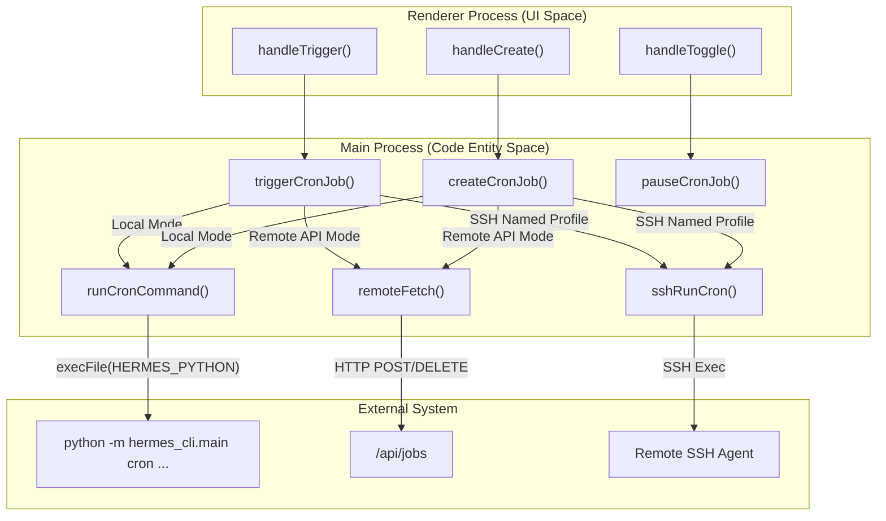
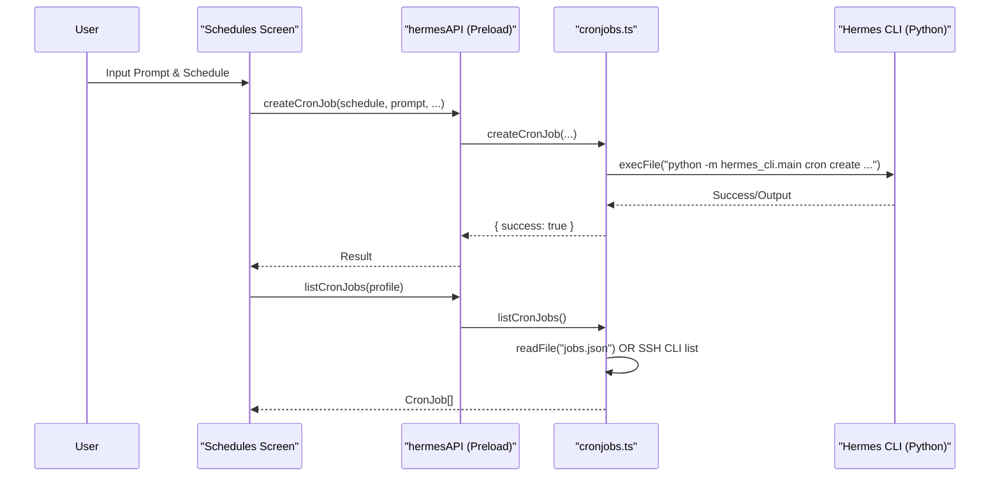

<!-- source: DeepWiki mcp.deepwiki.com · repo fathah/hermes-desktop · page 4.4 Cron Jobs and Automation · fetched 2026-10-30 -->

# Cron Jobs and Automation

Relevant source files

The following files were used as context for generating this wiki page:

- [src/main/cronjobs.ts](src/main/cronjobs.ts)
- [src/main/skills.ts](src/main/skills.ts)
- [src/renderer/src/screens/Skills/Skills.test.tsx](src/renderer/src/screens/Skills/Skills.test.tsx)
- [tests/cronjobs-ssh.test.ts](tests/cronjobs-ssh.test.ts)
- [tests/cronjobs.test.ts](tests/cronjobs.test.ts)
- [tests/remote-mode-url-and-spawn.test.ts](tests/remote-mode-url-and-spawn.test.ts)
- [tests/skills-cli-output.test.ts](tests/skills-cli-output.test.ts)

Hermes Desktop provides a robust scheduling system that allows users to automate agent tasks. This subsystem enables periodic prompts, delivery of results to various platforms (e.g., Slack, Telegram, Email), and script execution. Automation is managed by the Hermes Agent CLI and surfaced in the Electron frontend via a dedicated Schedules UI.

## Data Model and Persistence

Cron jobs are profile-scoped and persisted in a `jobs.json` file located within each profile's `cron` directory [src/main/cronjobs.ts:35-37](). The system uses a standard `CronJob` interface to represent these tasks in both the main process and the renderer.

### The CronJob Interface
The `CronJob` interface defines the state and configuration of an automated task:

| Property | Type | Description |
| :--- | :--- | :--- |
| `id` | `string` | Unique identifier for the job. |
| `name` | `string` | User-defined label for the task. |
| `schedule` | `string` | Cron expression or interval (e.g., `30m`, `1h`). |
| `prompt` | `string` | The natural language instruction sent to the agent. |
| `state` | `active` \| `paused` \| `completed` | The current operational status. |
| `enabled` | `boolean` | Flag indicating if the job is active. |
| `next_run_at` | `string` \| `null` | ISO timestamp of the next scheduled execution. |
| `repeat` | `object` \| `null` | Completion tracking (e.g., `2/5` runs). |
| `deliver` | `string[]` | List of delivery targets (e.g., `local`, `slack`). |
| `skills` | `string[]` | Skills associated with the job execution. |
| `script` | `string` \| `null` | Optional path to a script to execute. |

**Sources:** [src/main/cronjobs.ts:18-33](), [src/main/cronjobs.ts:39-70]()

### Persistence Logic
The `listCronJobs` function retrieves the job list. In local mode, it reads the `jobs.json` file asynchronously [src/main/cronjobs.ts:285-300](). It performs data normalization via `normalizeJob`, ensuring that malformed entries are handled and that delivery targets default to `["local"]` if not specified [src/main/cronjobs.ts:39-70]().

In **Remote Mode**, determined by `isRemoteMode()`, the system can fetch job data from the Hermes API server's `/api/jobs` endpoint using `remoteFetch` [src/main/cronjobs.ts:262-283](). For named profiles in SSH mode, it uses `sshRunCron` to execute the CLI remotely and parses the table-style output via `parseCronListOutput` [src/main/cronjobs.ts:118-171](), [src/main/cronjobs.ts:183-191]().

**Sources:** [src/main/cronjobs.ts:118-171](), [src/main/cronjobs.ts:262-300]()

## CLI Integration and Execution

The Electron app does not run the cron scheduler itself; instead, it acts as a management layer for the underlying Python-based Hermes Agent CLI. All state changes (create, pause, resume, trigger) are executed by calling the `hermes cron` command.

### Command Execution Flow
The `runCronCommand` function encapsulates the execution of the Python CLI [src/main/cronjobs.ts:217-249](). It constructs arguments using `hermesCliArgs()` and targets the specific profile using the `-p` flag [src/main/cronjobs.ts:221-225](). It utilizes `HERMES_PYTHON` as the executable and executes within the `HERMES_REPO` directory [src/main/cronjobs.ts:229-232]().

#### Natural Language to Code Entity: CLI Interaction
This diagram shows how UI actions in the `Schedules` screen map to CLI commands executed via `runCronCommand` or SSH equivalents.

**Sources:** [src/main/cronjobs.ts:217-249](), [src/main/cronjobs.ts:302-342](), [src/main/cronjobs.ts:354-388]()

### Key Automation Functions
The following functions in `src/main/cronjobs.ts` map directly to Hermes logic:

*   **`createCronJob`**: Passes the schedule, prompt, name, and delivery target to the CLI or Remote API. It places the prompt as a positional argument before flags [src/main/cronjobs.ts:354-388]().
*   **`removeCronJob`**: Executes the `remove` command for a specific ID or sends a `DELETE` request in remote mode [src/main/cronjobs.ts:390-413]().
*   **`pauseCronJob` / `resumeCronJob`**: Toggles the job state via the CLI `pause`/`resume` commands or Remote API [src/main/cronjobs.ts:415-456]().
*   **`triggerCronJob`**: Manually executes a job immediately using the `run` command [src/main/cronjobs.ts:458-479]().

**Sources:** [src/main/cronjobs.ts:354-479]()

## Schedules UI Screen

The `Schedules` screen provides a management interface for these jobs, including a schedule builder and status monitoring.

### Schedule Builder
The UI supports five frequency types in `Schedules.tsx`, which are converted into cron strings or interval formats via `buildSchedule()`:

*   **Minutes**: Formatted as `${minutesInterval}m`.
*   **Hourly**: Formatted as `${hourlyInterval}h`.
*   **Daily**: Formatted into standard cron expressions (e.g., `m h * * *`).
*   **Weekly**: Formatted as `m h * * day`.
*   **Custom**: Allows raw cron string input.

### Delivery Targets
Hermes supports a wide array of delivery targets. The available options range from standard messaging apps like Slack and Discord to technical targets like Webhooks and Home Assistant.

### SSH Port Fallback
A specific defensive mechanism exists in `getCronApiUrl` for SSH users. If the standard `getApiUrl()` fails (which happens if the Chat path hasn't initialized the tunnel), the system attempts a `/health` probe on the configured `localPort` or the default `18642` before falling back to the SSH CLI [src/main/cronjobs.ts:205-227]().

#### Data Flow: Schedule Management
This diagram illustrates the lifecycle of a cron job from UI definition to persistence.

**Sources:** [src/main/cronjobs.ts:205-227](), [src/main/cronjobs.ts:262-300](), [src/main/cronjobs.ts:354-388]()

---

