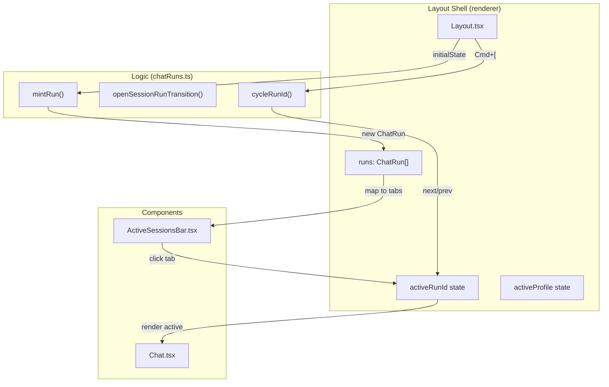
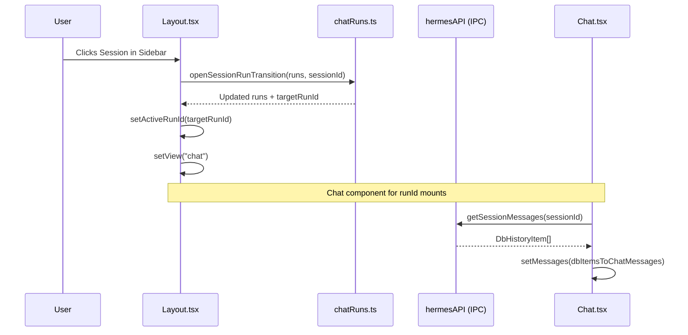

<!-- source: DeepWiki mcp.deepwiki.com · repo fathah/hermes-desktop · page 5.1 Layout Shell and Navigation · fetched 2026-10-30 -->

# Layout Shell and Navigation

Relevant source files

The following files were used as context for generating this wiki page:

- [lat.md/lat.md](lat.md/lat.md)
- [lat.md/sidebar-navigation.md](lat.md/sidebar-navigation.md)
- [lat.md/window-chrome.md](lat.md/window-chrome.md)
- [src/main/config.ts](src/main/config.ts)
- [src/main/hermes.ts](src/main/hermes.ts)
- [src/main/index.ts](src/main/index.ts)
- [src/main/ipc/register.ts](src/main/ipc/register.ts)
- [src/preload/index.d.ts](src/preload/index.d.ts)
- [src/preload/index.ts](src/preload/index.ts)
- [src/renderer/src/assets/icons/index.tsx](src/renderer/src/assets/icons/index.tsx)
- [src/renderer/src/assets/main.css](src/renderer/src/assets/main.css)
- [src/renderer/src/screens/Chat/Chat.tsx](src/renderer/src/screens/Chat/Chat.tsx)
- [src/renderer/src/screens/Layout/ActiveSessionsBar.test.tsx](src/renderer/src/screens/Layout/ActiveSessionsBar.test.tsx)
- [src/renderer/src/screens/Layout/ActiveSessionsBar.tsx](src/renderer/src/screens/Layout/ActiveSessionsBar.tsx)
- [src/renderer/src/screens/Layout/Layout.tsx](src/renderer/src/screens/Layout/Layout.tsx)
- [src/renderer/src/screens/Layout/SidebarRecentSessions.tsx](src/renderer/src/screens/Layout/SidebarRecentSessions.tsx)
- [src/renderer/src/screens/Layout/SidebarSessionMenu.tsx](src/renderer/src/screens/Layout/SidebarSessionMenu.tsx)
- [src/renderer/src/screens/Layout/chatRuns.test.ts](src/renderer/src/screens/Layout/chatRuns.test.ts)
- [src/renderer/src/screens/Layout/chatRuns.ts](src/renderer/src/screens/Layout/chatRuns.ts)
- [src/shared/i18n/locales/en/navigation.ts](src/shared/i18n/locales/en/navigation.ts)
- [tests/chat-runs.test.ts](tests/chat-runs.test.ts)

The `Layout` component serves as the primary container for the Hermes Desktop application. It manages global application state, including the sidebar navigation, active profile context, multi-session management via the `ChatRuns` system, and the auto-update lifecycle. It acts as a coordinator between functional screens and the underlying Electron IPC layer.

### Core Implementation

The `Layout` component is defined in [src/renderer/src/screens/Layout/Layout.tsx:96-1040](). It utilizes a central `view` state to determine which functional screen to render in the main content area. To optimize performance, the layout uses a "lazy-mount" strategy: tabs are mounted on their first visit and then persisted in the DOM using `display: none` to avoid expensive IPC refetches and DOM rebuilds during tab switching [src/renderer/src/screens/Layout/Layout.tsx:104-104]().

#### Navigation State and View Management
The application supports eleven distinct primary views, defined by the `View` type [src/renderer/src/screens/Layout/Layout.tsx:55-66](). These are categorized into pinned items (Discover, Office, Kanban, Schedules) and footer items (Providers, Gateway, Tools, Memory).

| View | Component | Description |
| :--- | :--- | :--- |
| `chat` | `Chat` | The primary interaction interface for the agent. |
| `discover` | `Discover` | Hub for finding models and community content. |
| `agents` | `Agents` | Profile management (CRUD operations). |
| `office` | `Office` | 3D environment for agent interaction. |
| `kanban` | `Kanban` | JIRA-style task board for agent runs. |
| `providers` | `Providers` | API key and endpoint management. |
| `gateway` | `Gateway` | Engine status and environment key management. |
| `tools` | `Tools` | Toolset toggling and MCP server management. |
| `memory` | `Memory` | Long-term memory and persona files. |
| `schedules` | `Schedules` | Cron job and automation management. |

**Sources:** [src/renderer/src/screens/Layout/Layout.tsx:55-84](), [src/renderer/src/screens/Layout/Layout.tsx:104-104]()

### Multi-Session Management (ChatRuns)

Hermes Desktop allows multiple concurrent conversations across different profiles and connections. This is managed by the `ChatRuns` system [src/renderer/src/screens/Layout/chatRuns.ts:1-178]().

*   **ChatRun Entity:** A `ChatRun` represents a unique conversation instance. It tracks a `runId` (stable UI ID), `connectionId`, `profile`, and an optional `sessionId` (gateway-side UUID) [src/renderer/src/screens/Layout/chatRuns.ts:25-36]().
*   **State Transitions:** The `Layout` uses helper functions to manage the `runs` array:
    *   `mintRun`: Creates a new "scratch" run for a profile [src/renderer/src/screens/Layout/chatRuns.ts:39-49]().
    *   `openSessionRunTransition`: Transitions the UI to a specific session, either by finding an existing run or creating a new one [src/renderer/src/screens/Layout/chatRuns.ts:80-112]().
    *   `selectProfileRunTransition`: Ensures a scratch run exists for the target profile when switching [src/renderer/src/screens/Layout/chatRuns.ts:114-138]().

**Multi-Session Orchestration**

**Sources:** [src/renderer/src/screens/Layout/Layout.tsx:110-113](), [src/renderer/src/screens/Layout/chatRuns.ts:39-49](), [src/renderer/src/screens/Layout/chatRuns.ts:80-112]()

### Sidebar and Navigation

The sidebar provides access to global views and recent conversations.

#### SidebarRecentSessions
This component [src/renderer/src/screens/Layout/SidebarRecentSessions.tsx]() implements an infinite-scroll list of conversation history.
*   **Grouping:** It groups sessions by "Projects" (based on the `contextFolder` linked to the session) and "Chats" [lat.md/sidebar-navigation.md:23-32]().
*   **Lazy Loading:** It fetches sessions in pages from the `sessions.json` cache using `window.hermesAPI.listCachedSessions` [lat.md/sidebar-navigation.md:13-22]().
*   **Context Menu:** Each row provides a `SidebarSessionMenu` for Pinning, Renaming, Moving to projects, or Deleting [src/renderer/src/screens/Layout/SidebarSessionMenu.tsx]().

#### Sidebar Scrollbar Implementation
To avoid layout shifts, the sidebar uses a custom overlay scrollbar. `Layout.tsx` measures the `sidebarChatScrollRef` and renders an absolutely positioned thumb only during active scrolling [src/renderer/src/screens/Layout/Layout.tsx:141-180]().

**Sources:** [src/renderer/src/screens/Layout/Layout.tsx:122-131](), [src/renderer/src/screens/Layout/SidebarRecentSessions.tsx](), [lat.md/sidebar-navigation.md:1-46]()

### Active Profile and Session Flow

The `Layout` coordinates transitions between profiles and specific conversation sessions.

*   **Profile Switching:** Handled by `handleSelectProfile` [src/renderer/src/screens/Layout/Layout.tsx:505-520](). It updates the `activeProfile` state and uses `selectProfileRunTransition` to activate the correct scratch run for that agent.
*   **Session Resumption:** `handleResumeSession` [src/renderer/src/screens/Layout/Layout.tsx:540-575]() handles re-opening a conversation from history. It checks if the session is already open in a tab; if not, it triggers `openSessionRunTransition` and switches the view to `chat`.
*   **Active Sessions Bar:** Rendered at the top of the chat view, this component allows users to switch between concurrent `ChatRun` tabs, showing loading spinners for background tasks [src/renderer/src/screens/Layout/ActiveSessionsBar.tsx]().

**Session Loading and Re-attachment**

**Sources:** [src/renderer/src/screens/Layout/Layout.tsx:540-575](), [src/renderer/src/screens/Layout/chatRuns.ts:80-112](), [src/renderer/src/screens/Chat/sessionHistory.ts:36-93]()

### Remote and SSH Mode Support

The `Layout` adapts the UI based on the active connection's mode (Local, Remote, or SSH).
*   **Remote Flag:** `isRemoteMode` is checked to display the `RemoteNotice` [src/renderer/src/screens/Layout/Layout.tsx:884-884]().
*   **Connection Context:** The `connectionId` is passed down to all functional screens to ensure they address the correct backend instance [src/renderer/src/screens/Layout/Layout.tsx:90-90]().

**Sources:** [src/main/hermes.ts:150-155](), [src/renderer/src/screens/Layout/Layout.tsx:884-884]()

### Status Bar and Updates

The `StatusBar` component [src/renderer/src/screens/Layout/StatusBar.tsx]() resides at the bottom of the layout.
*   **Update Tracking:** The `Layout` listens for Electron `autoUpdater` events via IPC (`onUpdateAvailable`, `onUpdateDownloaded`) and passes the state to the `StatusBar` [src/renderer/src/screens/Layout/Layout.tsx:392-427]().
*   **Actions:** Users can trigger `downloadUpdate` or `installUpdate` directly from the status bar [src/renderer/src/screens/Layout/Layout.tsx:430-445]().

**Sources:** [src/renderer/src/screens/Layout/Layout.tsx:392-445](), [src/renderer/src/screens/Layout/StatusBar.tsx]()

---

