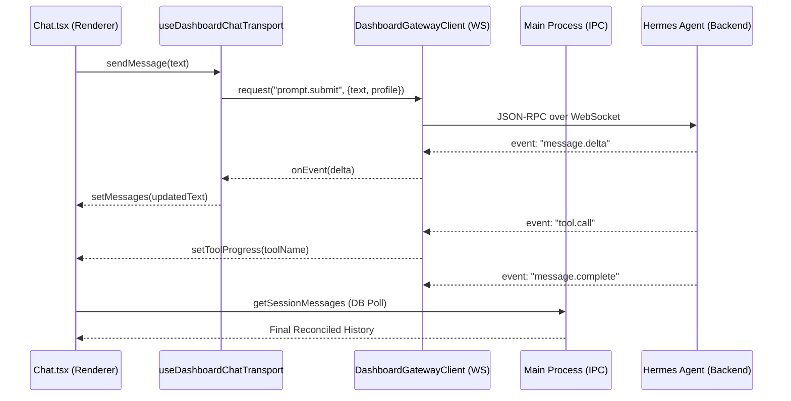
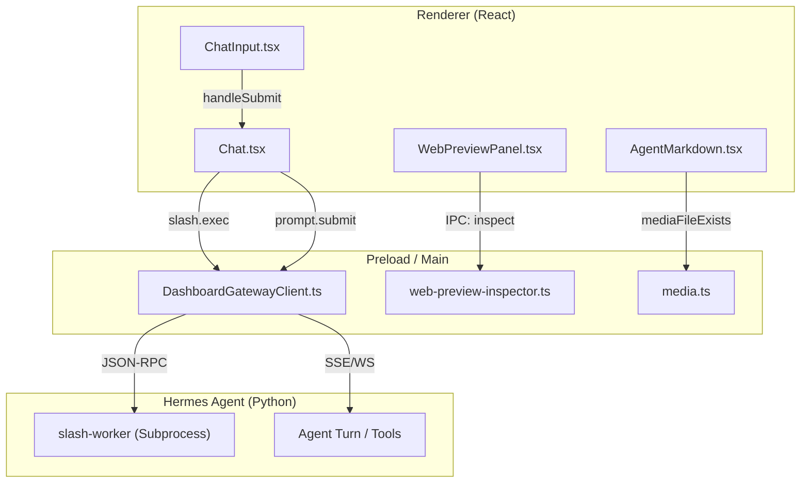

<!-- source: DeepWiki mcp.deepwiki.com · repo fathah/hermes-desktop · page 5.2 Chat Interface · fetched 2026-10-30 -->

# Chat Interface

Relevant source files

The following files were used as context for generating this wiki page:

- [docs/superpowers/plans/2026-08-23-hermes-agent-enhanced-desktop-roadmap.md](docs/superpowers/plans/2026-08-23-hermes-agent-enhanced-desktop-roadmap.md)
- [lat.md/chat-commands.md](lat.md/chat-commands.md)
- [lat.md/chat-performance.md](lat.md/chat-performance.md)
- [lat.md/code-blocks.md](lat.md/code-blocks.md)
- [lat.md/web-preview.md](lat.md/web-preview.md)
- [src/main/db.ts](src/main/db.ts)
- [src/main/media.ts](src/main/media.ts)
- [src/main/web-preview-inspector.test.ts](src/main/web-preview-inspector.test.ts)
- [src/main/web-preview-inspector.ts](src/main/web-preview-inspector.ts)
- [src/renderer/src/components/AgentMarkdown.test.tsx](src/renderer/src/components/AgentMarkdown.test.tsx)
- [src/renderer/src/components/AgentMarkdown.tsx](src/renderer/src/components/AgentMarkdown.tsx)
- [src/renderer/src/components/AttachmentChip.tsx](src/renderer/src/components/AttachmentChip.tsx)
- [src/renderer/src/components/MediaImage.lightbox.test.tsx](src/renderer/src/components/MediaImage.lightbox.test.tsx)
- [src/renderer/src/components/MediaImage.tsx](src/renderer/src/components/MediaImage.tsx)
- [src/renderer/src/hooks/useLightboxClose.ts](src/renderer/src/hooks/useLightboxClose.ts)
- [src/renderer/src/screens/Chat/ChatInput.test.tsx](src/renderer/src/screens/Chat/ChatInput.test.tsx)
- [src/renderer/src/screens/Chat/ChatInput.tsx](src/renderer/src/screens/Chat/ChatInput.tsx)
- [src/renderer/src/screens/Chat/ContextFolderChip.tsx](src/renderer/src/screens/Chat/ContextFolderChip.tsx)
- [src/renderer/src/screens/Chat/MessageRow.tsx](src/renderer/src/screens/Chat/MessageRow.tsx)
- [src/renderer/src/screens/Chat/QueuedMessages.tsx](src/renderer/src/screens/Chat/QueuedMessages.tsx)
- [src/renderer/src/screens/Chat/WebPreviewPanel.test.tsx](src/renderer/src/screens/Chat/WebPreviewPanel.test.tsx)
- [src/renderer/src/screens/Chat/WebPreviewPanel.tsx](src/renderer/src/screens/Chat/WebPreviewPanel.tsx)
- [src/renderer/src/screens/Chat/attachmentUtils.test.ts](src/renderer/src/screens/Chat/attachmentUtils.test.ts)
- [src/renderer/src/screens/Chat/attachmentUtils.ts](src/renderer/src/screens/Chat/attachmentUtils.ts)
- [src/renderer/src/screens/Chat/hooks/useChatActions.ts](src/renderer/src/screens/Chat/hooks/useChatActions.ts)
- [src/renderer/src/screens/Chat/hooks/useChatIPC.test.tsx](src/renderer/src/screens/Chat/hooks/useChatIPC.test.tsx)
- [src/renderer/src/screens/Chat/hooks/useChatIPC.ts](src/renderer/src/screens/Chat/hooks/useChatIPC.ts)
- [src/renderer/src/screens/Chat/hooks/useDashboardChatTransport.test.tsx](src/renderer/src/screens/Chat/hooks/useDashboardChatTransport.test.tsx)
- [src/renderer/src/screens/Chat/hooks/useDashboardChatTransport.ts](src/renderer/src/screens/Chat/hooks/useDashboardChatTransport.ts)
- [src/renderer/src/screens/Chat/mediaUtils.test.ts](src/renderer/src/screens/Chat/mediaUtils.test.ts)
- [src/renderer/src/screens/Chat/mediaUtils.ts](src/renderer/src/screens/Chat/mediaUtils.ts)
- [src/renderer/src/screens/Chat/slash/commandCatalog.test.ts](src/renderer/src/screens/Chat/slash/commandCatalog.test.ts)
- [src/renderer/src/screens/Chat/slash/commandCatalog.ts](src/renderer/src/screens/Chat/slash/commandCatalog.ts)
- [src/renderer/src/screens/Chat/slash/desktopCommands.ts](src/renderer/src/screens/Chat/slash/desktopCommands.ts)
- [src/renderer/src/screens/Chat/slash/executeAgentCommand.ts](src/renderer/src/screens/Chat/slash/executeAgentCommand.ts)
- [src/renderer/src/screens/Chat/slash/handleSlashCommand.test.ts](src/renderer/src/screens/Chat/slash/handleSlashCommand.test.ts)
- [src/renderer/src/screens/Chat/slash/handleSlashCommand.ts](src/renderer/src/screens/Chat/slash/handleSlashCommand.ts)
- [src/renderer/src/screens/Chat/slash/parseSlashCommand.test.ts](src/renderer/src/screens/Chat/slash/parseSlashCommand.test.ts)
- [src/renderer/src/screens/Chat/slash/prepareModelSubmission.ts](src/renderer/src/screens/Chat/slash/prepareModelSubmission.ts)
- [src/renderer/src/screens/Chat/slash/types.ts](src/renderer/src/screens/Chat/slash/types.ts)
- [src/renderer/src/screens/Chat/types.ts](src/renderer/src/screens/Chat/types.ts)
- [src/shared/attachments.ts](src/shared/attachments.ts)
- [tests/db.test.ts](tests/db.test.ts)
- [tests/focus-outline.test.ts](tests/focus-outline.test.ts)
- [tests/hermes-api.test.ts](tests/hermes-api.test.ts)
- [tests/media.test.ts](tests/media.test.ts)
- [tests/remote-history.test.ts](tests/remote-history.test.ts)

The Chat Interface is the primary interaction surface of Hermes Desktop, implemented primarily in `Chat.tsx`. It manages the lifecycle of message streaming, handles complex user inputs via slash commands, and provides specialized rendering for agent outputs including tool progress, code diffs, media delivery, and action approvals.

## Message Streaming Lifecycle

The chat system uses a dual-path transport model: a legacy HTTP/SSE path and a modern JSON-RPC WebSocket transport via the **Dashboard Gateway** [lat.md/chat-commands.md:31-35](). The renderer logic is orchestrated by `useChatActions.ts`, `useChatIPC.ts`, and `useDashboardChatTransport.ts`.

1.  **Input Capture**: User input is captured in `ChatInput.tsx`. It handles auto-resizing via `useLayoutEffect` to avoid per-keystroke reflows [src/renderer/src/screens/Chat/ChatInput.tsx:141-143]().
2.  **Transport Selection**: `useDashboardChatTransport` determines if the WebSocket (`/api/ws`) is available. If the dashboard is running, it avoids the `/v1` HTTP fallback to prevent 405 errors [lat.md/chat-commands.md:37-41]().
3.  **Optimistic UI**: A new message object is added to the `messages` state with `role: "user"` via `pushUser` in `useChatActions.ts` [src/renderer/src/screens/Chat/hooks/useChatActions.ts:143-159]().
4.  **Stream Handling**: 
    *   **Dashboard Events**: `applyDashboardStreamEvent` processes real-time JSON-RPC notifications [src/renderer/src/screens/Chat/hooks/useDashboardChatTransport.ts:9-11]().
    *   **Text Reconciliation**: On `message.complete`, the desktop reconciles streamed deltas with the `final_response` to ensure text isn't clobbered by tool call interruptions [lat.md/chat-commands.md:45-48]().
    *   **DB Polling**: `useChatIPC` runs a background poller (every 750ms) to bridge persisted rows (like reasoning or tool results) that might be omitted from the live stream [src/renderer/src/screens/Chat/hooks/useChatIPC.ts:43-46](), [src/renderer/src/screens/Chat/hooks/useChatIPC.ts:121-123]().

### Data Flow: Message Submission
Title: Chat Submission and Streaming Flow

Sources: [src/renderer/src/screens/Chat/hooks/useDashboardChatTransport.ts:179-203](), [lat.md/chat-commands.md:45-48](), [src/renderer/src/screens/Chat/hooks/useChatIPC.ts:121-123]()

## Slash Commands

Slash commands are executed through a registry-backed worker. Unlike plain prompts, they do not sit in the busy queue; they run on a persistent **slash-worker subprocess** to remain responsive even during model turns [lat.md/chat-commands.md:23-27]().

| Category | Target | Description | Implementation |
| :--- | :--- | :--- | :--- |
| **Local** | `desktop` | UI actions like `/settings`, `/clear`, `/fast` | `desktopCommands.ts` |
| **Agent** | `agent` | Gateway ops like `/compact`, `/reset`, `/remember` | `slash.exec` RPC [lat.md/chat-commands.md:5-7]() |
| **Tool** | `model` | Capability triggers formatted as prompts | `command.dispatch` fallback |

### Quick Ask (/btw)
The `/btw` (or `/background`, `/bg`) command launches a concurrent agent via `prompt.background` [src/renderer/src/screens/Chat/hooks/useChatActions.ts:20-25](). It bypasses the main session's busy queue, and results arrive as `background.complete` events [src/renderer/src/screens/Chat/hooks/useDashboardChatTransport.ts:123-129]().

### Command Parsing
`parseSlash` uses a `dotAll` regex flag, allowing arguments to span multiple lines (e.g., a multi-line note for `/remember`) [lat.md/chat-commands.md:12-14]().

Sources: [lat.md/chat-commands.md:1-22](), [src/renderer/src/screens/Chat/hooks/useChatActions.ts:20-31]()

## Specialized UI Components

### AgentMarkdown and Diff Renderer
The `AgentMarkdown` component handles complex formatting and lazy-loads heavy dependencies [src/renderer/src/components/AgentMarkdown.tsx:9-12]().
*   **Box Diagrams**: Detects tree connectors and progress bars (Unicode U+2500–U+259F). If these dominate a block, it renders as plain text to prevent Prism syntax highlighting from fragmenting and misaligning the characters [src/renderer/src/components/AgentMarkdown.tsx:14-30]().
*   **Diff View**: Renders `diff` blocks with colored line treatments for `+`, `-`, and `@@` hunk headers [src/renderer/src/components/AgentMarkdown.tsx:65-82]().
*   **Persistence**: Uses a module-scope `Set` to track expanded code blocks so that they remain expanded even when `react-markdown` remounts during streaming [src/renderer/src/components/AgentMarkdown.tsx:92-96]().

### Web Preview Panel
A split-screen `<webview>` for rendering links and locally served apps [lat.md/web-preview.md:1-4]().
*   **Security**: The only webview allowed to load remote HTTPS, identified by `partition="web-preview"` [lat.md/web-preview.md:11-15]().
*   **Annotation Mode**: Uses an inspector in Electron isolated world `1001`. Users can select elements and add comments; the system returns only the CSS selector and comment, never the element HTML [lat.md/web-preview.md:5-5]().
*   **Resizable**: Persistence of panel width via `localStorage` (`hermes:webPreviewWidth`) [src/renderer/src/screens/Chat/WebPreviewPanel.tsx:91-94]().

### Media Delivery
*   **Verification**: `MediaSegmentView` verifies local paths via `window.hermesAPI.mediaFileExists` before rendering them as media [src/renderer/src/components/MediaImage.tsx:175-195]().
*   **Lightbox**: Images open in a `createPortal` lightbox to escape `content-visibility` containment in the message list [src/renderer/src/components/MediaImage.tsx:89-93]().

### Entity Association: Chat UI to Backend
Title: UI Component to Backend Service Mapping

Sources: [lat.md/chat-commands.md:23-27](), [lat.md/web-preview.md:5-5](), [src/renderer/src/screens/Chat/ChatInput.tsx:72-89](), [src/renderer/src/components/AgentMarkdown.tsx:130-134]()

## Context and Attachments

*   **Context Folder**: The `ContextFolderChip` displays the working directory bound to the session [src/renderer/src/screens/Chat/hooks/useChatActions.ts:56-57]().
*   **Queued Messages**: If a user sends a message while the agent is busy, it is placed in `QueuedMessages.tsx` [src/renderer/src/screens/Chat/QueuedMessages.tsx:1-5](). Slash commands bypass this queue [lat.md/chat-commands.md:23-27]().
*   **Approval Bar**: `MessageRow` detects dangerous tool requests using `APPROVAL_RE` and renders "Approve" / "Deny" controls [src/renderer/src/screens/Chat/MessageRow.tsx:13-14](), [src/renderer/src/screens/Chat/MessageRow.tsx:171-179]().

Sources: [src/renderer/src/screens/Chat/MessageRow.tsx:13-14](), [lat.md/chat-commands.md:23-27](), [src/renderer/src/screens/Chat/hooks/useChatActions.ts:56-57]()

---

