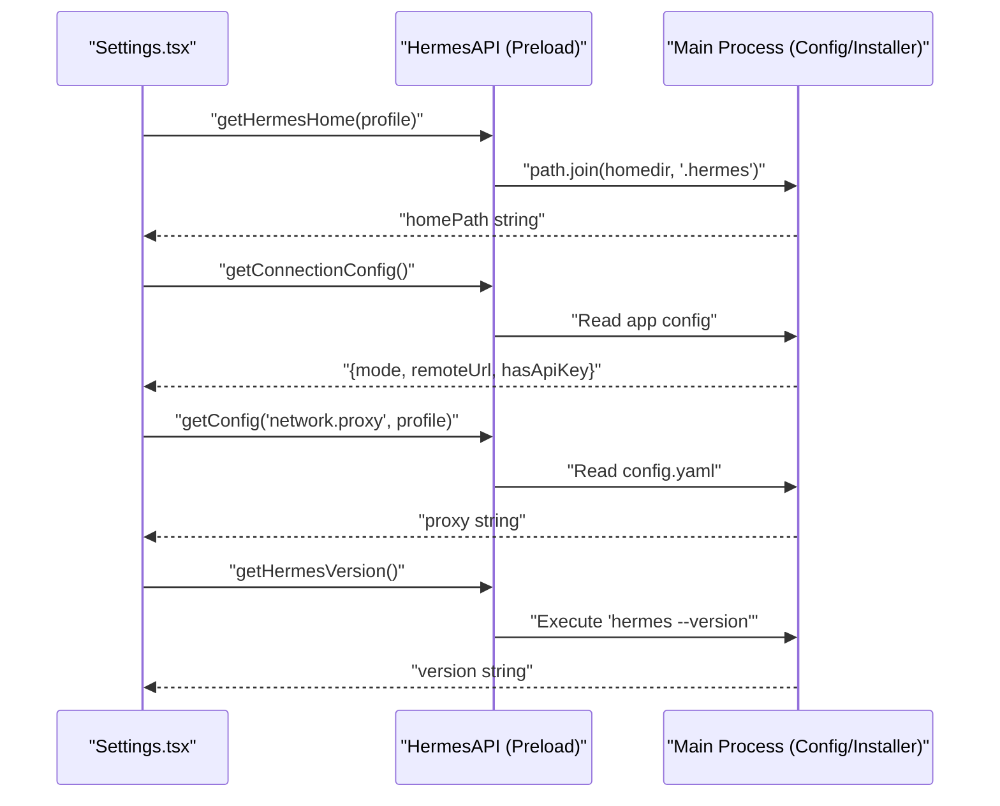
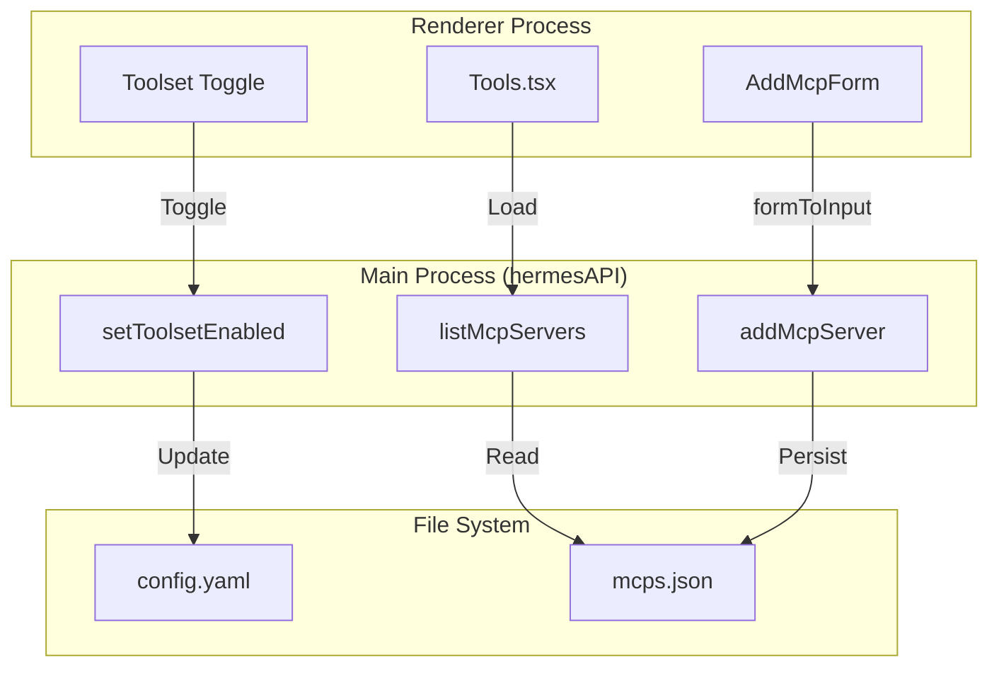

<!-- source: DeepWiki mcp.deepwiki.com · repo fathah/hermes-desktop · page 5.3 Settings, Gateway, Tools, and Providers Screens · fetched 2026-10-30 -->

# Settings, Gateway, Tools, and Providers Screens

Relevant source files

The following files were used as context for generating this wiki page:

- [.env.example](.env.example)
- [.github/workflows/beta-release.yml](.github/workflows/beta-release.yml)
- [lat.md/analytics.md](lat.md/analytics.md)
- [lat.md/desktop-updates.md](lat.md/desktop-updates.md)
- [lat.md/mcp-servers.md](lat.md/mcp-servers.md)
- [lat.md/provider-setup.md](lat.md/provider-setup.md)
- [scripts/set-version.mjs](scripts/set-version.mjs)
- [src/main/mcp-servers.ts](src/main/mcp-servers.ts)
- [src/main/registry.ts](src/main/registry.ts)
- [src/main/remote-provider-statuses.ts](src/main/remote-provider-statuses.ts)
- [src/renderer/src/components/ConfigHealthBanner.test.tsx](src/renderer/src/components/ConfigHealthBanner.test.tsx)
- [src/renderer/src/components/ConfigHealthBanner.tsx](src/renderer/src/components/ConfigHealthBanner.tsx)
- [src/renderer/src/components/HermesAccountModal.tsx](src/renderer/src/components/HermesAccountModal.tsx)
- [src/renderer/src/components/ProviderKeysSection.tsx](src/renderer/src/components/ProviderKeysSection.tsx)
- [src/renderer/src/components/settings/AppearancePane.test.tsx](src/renderer/src/components/settings/AppearancePane.test.tsx)
- [src/renderer/src/components/settings/AppearancePane.tsx](src/renderer/src/components/settings/AppearancePane.tsx)
- [src/renderer/src/components/settings/CommunityPane.tsx](src/renderer/src/components/settings/CommunityPane.tsx)
- [src/renderer/src/components/settings/DataPane.tsx](src/renderer/src/components/settings/DataPane.tsx)
- [src/renderer/src/components/settings/PrivacyPane.tsx](src/renderer/src/components/settings/PrivacyPane.tsx)
- [src/renderer/src/constants.ts](src/renderer/src/constants.ts)
- [src/renderer/src/env.d.ts](src/renderer/src/env.d.ts)
- [src/renderer/src/main.tsx](src/renderer/src/main.tsx)
- [src/renderer/src/screens/Discover/Discover.tsx](src/renderer/src/screens/Discover/Discover.tsx)
- [src/renderer/src/screens/Gateway/Gateway.tsx](src/renderer/src/screens/Gateway/Gateway.tsx)
- [src/renderer/src/screens/Providers/Providers.tsx](src/renderer/src/screens/Providers/Providers.tsx)
- [src/renderer/src/screens/Settings/ConfigHealth.tsx](src/renderer/src/screens/Settings/ConfigHealth.tsx)
- [src/renderer/src/screens/Tools/Tools.tsx](src/renderer/src/screens/Tools/Tools.tsx)
- [src/renderer/src/utils/analytics.ts](src/renderer/src/utils/analytics.ts)
- [src/shared/i18n/locales/en/constants.ts](src/shared/i18n/locales/en/constants.ts)
- [src/shared/i18n/locales/en/discover.ts](src/shared/i18n/locales/en/discover.ts)
- [src/shared/i18n/locales/en/gateway.ts](src/shared/i18n/locales/en/gateway.ts)
- [src/shared/i18n/locales/en/tools.ts](src/shared/i18n/locales/en/tools.ts)
- [src/shared/i18n/locales/es/constants.ts](src/shared/i18n/locales/es/constants.ts)
- [src/shared/i18n/locales/es/diagnose.ts](src/shared/i18n/locales/es/diagnose.ts)
- [src/shared/i18n/locales/id/constants.ts](src/shared/i18n/locales/id/constants.ts)
- [src/shared/i18n/locales/ja/constants.ts](src/shared/i18n/locales/ja/constants.ts)
- [src/shared/i18n/locales/pl/constants.ts](src/shared/i18n/locales/pl/constants.ts)
- [src/shared/i18n/locales/pt-BR/constants.ts](src/shared/i18n/locales/pt-BR/constants.ts)
- [src/shared/i18n/locales/pt-PT/constants.ts](src/shared/i18n/locales/pt-PT/constants.ts)
- [src/shared/i18n/locales/tr/constants.ts](src/shared/i18n/locales/tr/constants.ts)
- [src/shared/i18n/locales/tr/diagnose.ts](src/shared/i18n/locales/tr/diagnose.ts)
- [src/shared/i18n/locales/zh-CN/constants.ts](src/shared/i18n/locales/zh-CN/constants.ts)
- [src/shared/i18n/locales/zh-TW/constants.ts](src/shared/i18n/locales/zh-TW/constants.ts)
- [src/shared/registry.ts](src/shared/registry.ts)
- [tests/remote-provider-statuses.test.ts](tests/remote-provider-statuses.test.ts)

This section covers the management interfaces for the Hermes Desktop application. These screens handle the core configuration of the LLM engine, the messaging gateway for external platform integration, and the toggling of agent capabilities (tools).

## Settings Screen

The Settings screen is the primary configuration hub for the application, managing connection modes, system maintenance, diagnostics, and local network settings.

### Connection Modes
Hermes supports three primary connection modes managed via the `connMode` state:
*   **Local Mode**: Uses the Hermes engine installed on the local device.
*   **Remote Mode**: Connects to a Hermes API server on the network or cloud via a `remoteUrl` and an optional `apiKey`.
*   **SSH Mode**: Tunnels to a remote Hermes instance over SSH.

The connection configuration is persisted via `window.hermesAPI.setConnectionConfig`.

### Diagnostics and Maintenance
*   **Hermes Doctor**: Runs a diagnostic suite via the backend to verify the environment using `window.hermesAPI.runDoctor()`.
*   **Backup/Import**: Exports or restores the entire `.hermes` configuration directory as a ZIP file using `window.hermesAPI.runBackup()` and `window.hermesAPI.runImport()`.
*   **OpenClaw Migration**: Detects existing OpenClaw installations and provides a migration path via `window.hermesAPI.runClawMigrate()`.
*   **Analytics and Privacy**: Manages user consent for anonymous usage tracking. Hermes uses a privacy-first, opt-out model [lat.md/analytics.md:3-5](). A stable, random UUID is stored in `localStorage` as `hermes-anonymous-id` [src/renderer/src/utils/analytics.ts:21-21]() and sent with events to the in-house analytics service if the user has not opted out [src/renderer/src/utils/analytics.ts:94-122](). Consent is managed in the `PrivacyPane` [src/renderer/src/utils/analytics.ts:139-151]().
*   **Appearance**: Allows users to toggle between System, Light, and Dark themes, as well as developer themes like Dracula or Nord.

**Settings Hydration Flow**

Sources: [src/renderer/src/utils/analytics.ts:1-161](), [lat.md/analytics.md:1-33]()

---

## Providers Screen

The Providers screen handles per-provider API key management, the Credential Pool, and interactive OAuth sign-in flows. It has been redesigned to use a two-tab layout: **Providers** and **Auxiliary Tasks** [lat.md/provider-setup.md:33-33]().

### Model Configuration and Auto-Save
The screen sets the active model by choosing from configured providers [lat.md/provider-setup.md:29-31](). 
*   **Provider Selection**: Uses a custom `LogoSelect` component to render brand logos within the dropdown [src/renderer/src/screens/Providers/Providers.tsx:61-117]().
*   **Canonical Providers**: The top grid is limited to providers natively supported by the agent (e.g., Anthropic, OpenAI, DeepSeek) [lat.md/provider-setup.md:13-17]().
*   **Hermes One**: Listed as the first priority provider, routing through the `custom` provider with a hardcoded `baseUrl` of `https://inference.hermesone.org/v1` [lat.md/provider-setup.md:7-11]().
*   **Persistence**: Changes to `modelProvider`, `modelName`, and `modelBaseUrl` are persisted via `window.hermesAPI.setModelConfig` [src/renderer/src/screens/Providers/Providers.tsx:155-157]().

### Credential Pool
The Credential Pool allows users to store multiple credentials for the same provider, following the upstream engine schema [src/renderer/src/screens/Providers/Providers.tsx:177-182]().
*   **Data Structure**: Entries are stored in `credPool` as a record of provider IDs to arrays of `CredentialPoolEntry` objects [src/renderer/src/screens/Providers/Providers.tsx:180-182]().
*   **Fields**: Supports `api_key`, `access_token`, `refresh_token`, and `auth_type` (e.g., `oauth_device_code`) [src/renderer/src/screens/Providers/Providers.tsx:119-131]().

### OAuth Sign-in Flows
Hermes supports interactive OAuth flows. The renderer asks the main process for boolean statuses per supported OAuth provider via `window.hermesAPI.hasOAuthCredentials` [lat.md/provider-setup.md:41-45]().
*   **Security**: Access and refresh tokens remain in `auth.json` on the filesystem and never cross the context-isolated preload boundary into the renderer state [lat.md/provider-setup.md:41-45]().

**Provider Entity Mapping**
| UI Component | Code Entity | Function/Logic |
| :--- | :--- | :--- |
| API Key Masking | `maskKey` | Shows prefix + dots + last 4 chars [src/renderer/src/screens/Providers/Providers.tsx:38-42]() |
| Provider Mapping | `displayProviderFromConfig` | Maps `custom` + `baseUrl` back to brand IDs for UI logos [src/renderer/src/screens/Providers/Providers.tsx:47-57]() |
| Registry Browser | `RegistryBrowserModal` | Adds curated models to the local library [lat.md/provider-setup.md:33-33]() |
| OAuth Status | `oauthProviderStatuses` | Boolean flags for authenticated accounts [src/renderer/src/screens/Providers/Providers.tsx:170-171]() |

Sources: [src/renderer/src/screens/Providers/Providers.tsx:1-184](), [lat.md/provider-setup.md:1-48](), [src/renderer/src/constants.ts:37-178]()

---

## Gateway Screen

The Gateway screen manages the messaging platform integrations (e.g., Telegram, Discord, WhatsApp) and the lifecycle of the messaging gateway subprocess.

### Lifecycle Management
The screen provides controls to `startGateway`, `stopGateway`, and `restartGateway` [src/renderer/src/screens/Gateway/Gateway.tsx:122-204]().
*   **Health Polling**: The UI polls `window.hermesAPI.gatewayStatus()` every 10 seconds [src/renderer/src/screens/Gateway/Gateway.tsx:79-84]().
*   **Error Handling**: If a gateway start fails, the UI displays the error and suggests checking the log path returned by the main process [src/renderer/src/screens/Gateway/Gateway.tsx:142-151]().

### Platform Configuration
Platforms are fetched via `getMessagingPlatforms` [src/renderer/src/screens/Gateway/Gateway.tsx:58-58]().
*   **Environment Variables**: Each platform defines a set of `env_vars` (e.g., `TELEGRAM_BOT_TOKEN`) [src/renderer/src/screens/Gateway/Gateway.tsx:110-110]().
*   **Filtering**: Users can search platforms by name, description, or environment variable keys [src/renderer/src/screens/Gateway/Gateway.tsx:102-120]().

Sources: [src/renderer/src/screens/Gateway/Gateway.tsx:1-204](), [src/shared/i18n/locales/es/constants.ts:134-157]()

---

## Tools Screen

The Tools screen controls the "capabilities" available to the agent, including built-in toolsets and external MCP servers.

### Toolset Toggling
Tools are grouped into functional sets. Toggling a toolset updates the profile's `config.yaml` to enable or disable specific capabilities.
*   **UI Components**: Uses `ToolIcon` to display visual identifiers for different tool categories [src/renderer/src/screens/Tools/Tools.tsx:32-38]().

### MCP (Model Context Protocol) Servers
The screen manages external tool providers via the Model Context Protocol.
*   **Discovery**: Displays active servers, including their transport type (`stdio` or `http`) [src/renderer/src/screens/Tools/Tools.tsx:81-92]().
*   **Logos**: `McpLogo` attempts to resolve icons from the registry, then the server's favicon, before falling back to a generic icon [src/renderer/src/screens/Tools/Tools.tsx:45-79]().
*   **Manual Configuration**: Users can add servers via a form that accepts `command`, `args`, and `env` for `stdio` transports, or a `url` for `http` transports [src/renderer/src/screens/Tools/Tools.tsx:94-154]().
*   **JSON Import/Export**: Supports raw JSON editing of server configurations via `parseServerJson` and `formToJson` [src/renderer/src/screens/Tools/Tools.tsx:157-207]().

**Tool Configuration Flow**

Sources: [src/renderer/src/screens/Tools/Tools.tsx:1-230](), [src/main/registry.ts:24-58]()

---

