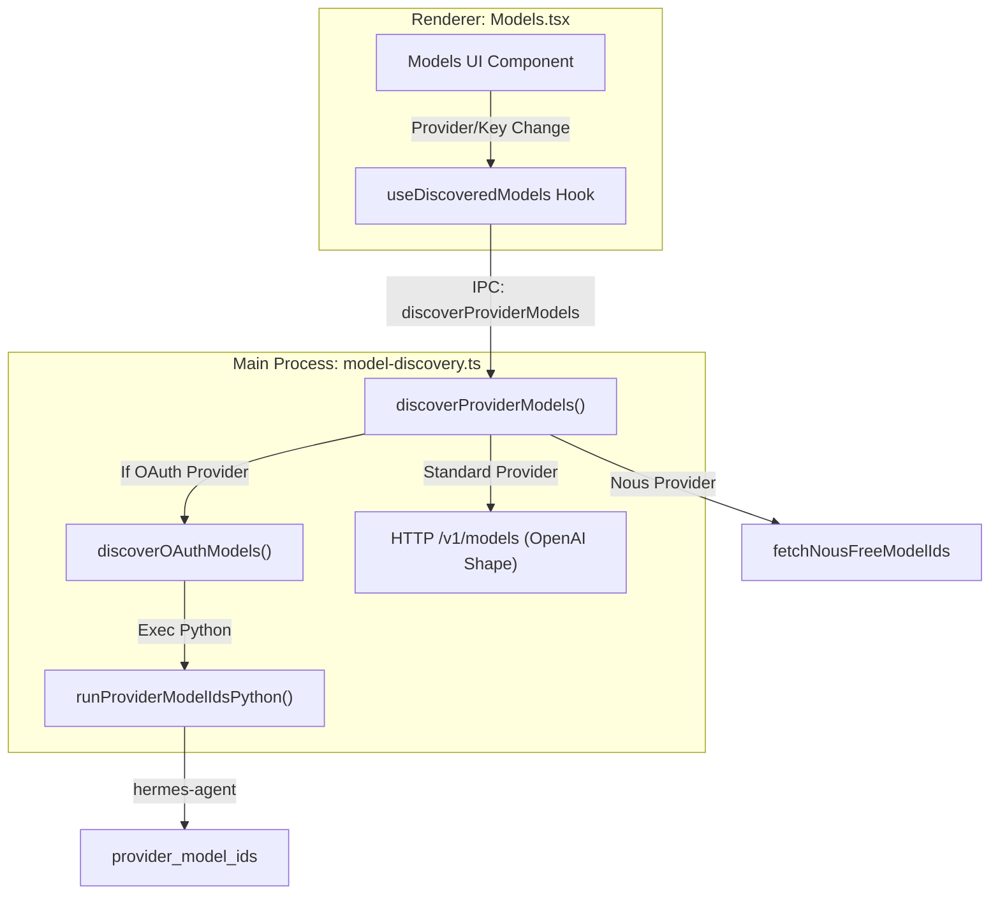
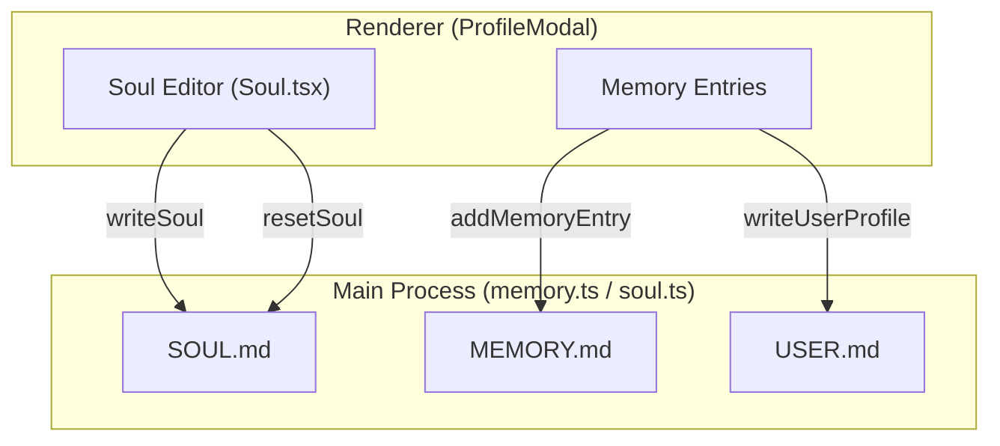

<!-- source: DeepWiki mcp.deepwiki.com · repo fathah/hermes-desktop · page 5.4 Agents, Models, Skills, Memory, and Soul Screens · fetched 2026-10-30 -->

# Agents, Models, Skills, Memory, and Soul Screens

Relevant source files

The following files were used as context for generating this wiki page:

- [lat.md/wallet-token-balances.md](lat.md/wallet-token-balances.md)
- [scripts/verify-nous-discovery.js](scripts/verify-nous-discovery.js)
- [src/main/installer.ts](src/main/installer.ts)
- [src/main/model-discovery.ts](src/main/model-discovery.ts)
- [src/main/profiles.ts](src/main/profiles.ts)
- [src/main/provider-registry.ts](src/main/provider-registry.ts)
- [src/main/wallet-actions.test.ts](src/main/wallet-actions.test.ts)
- [src/main/wallet-sync.test.ts](src/main/wallet-sync.test.ts)
- [src/main/wallet-sync.ts](src/main/wallet-sync.ts)
- [src/renderer/src/components/profile/ProfileModal.tsx](src/renderer/src/components/profile/ProfileModal.tsx)
- [src/renderer/src/components/profile/ProfileWalletPane.test.tsx](src/renderer/src/components/profile/ProfileWalletPane.test.tsx)
- [src/renderer/src/components/profile/ProfileWalletPane.tsx](src/renderer/src/components/profile/ProfileWalletPane.tsx)
- [src/renderer/src/hooks/useDiscoveredModels.ts](src/renderer/src/hooks/useDiscoveredModels.ts)
- [src/renderer/src/screens/Agents/Agents.test.tsx](src/renderer/src/screens/Agents/Agents.test.tsx)
- [src/renderer/src/screens/Agents/Agents.tsx](src/renderer/src/screens/Agents/Agents.tsx)
- [src/renderer/src/screens/Memory/Memory.tsx](src/renderer/src/screens/Memory/Memory.tsx)
- [src/renderer/src/screens/Schedules/Schedules.tsx](src/renderer/src/screens/Schedules/Schedules.tsx)
- [src/renderer/src/screens/Skills/Skills.tsx](src/renderer/src/screens/Skills/Skills.tsx)
- [src/renderer/src/screens/Soul/Soul.tsx](src/renderer/src/screens/Soul/Soul.tsx)
- [src/shared/i18n/locales/en/agents.ts](src/shared/i18n/locales/en/agents.ts)
- [src/shared/url-key-map.ts](src/shared/url-key-map.ts)
- [src/shared/wallets.ts](src/shared/wallets.ts)
- [tests/constants.test.ts](tests/constants.test.ts)
- [tests/install-gate-providers.test.ts](tests/install-gate-providers.test.ts)
- [tests/installer-utils.test.ts](tests/installer-utils.test.ts)
- [tests/model-discovery.test.ts](tests/model-discovery.test.ts)
- [tests/profiles.test.ts](tests/profiles.test.ts)
- [tests/provider-registry.test.ts](tests/provider-registry.test.ts)
- [tests/set-model-config-base-url.test.ts](tests/set-model-config-base-url.test.ts)
- [tests/url-key-map.test.ts](tests/url-key-map.test.ts)

This section documents the management interfaces within the Hermes Desktop renderer. These screens provide the administrative UI for configuring agent identities (Profiles), managing the LLM library (Models), extending capabilities (Skills), maintaining long-term state (Memory), defining agent personalities (Soul), and managing the token economy (Wallets).

## 1. Agents (Profile Management)

The Agents screen `Agents.tsx` provides CRUD operations for **Profiles**. In Hermes, a profile is an isolated workspace containing its own configuration, memory files, and installed skills [src/main/profiles.ts:36-54]().

### Data Flow and Operations
- **Listing**: The renderer calls `window.hermesAPI.listProfiles()` [src/renderer/src/screens/Agents/Agents.tsx:56-59](). The main process aggregates metadata (model, provider, skill counts, and gateway status) from the profile's directory structure [src/main/profiles.ts:176-223]().
- **Creation**: Users can create new profiles with an option to clone the `.env` and `config.yaml` from a source profile (defaulting to `default`) [src/renderer/src/screens/Agents/Agents.tsx:44-50](). Profile IDs are slugified from agent names to ensure filesystem compatibility [src/main/profiles.ts:68-82]().
- **Cloud Sync**: Profiles can be backed up to a Hermes One account. The `syncAgents` IPC trigger pushes local changes and pulls remote agents, creating local directories for new cloud-side agents [src/renderer/src/screens/Agents/Agents.tsx:125-139]().
- **Gateway Polling**: When switching profiles, the UI polls `listProfiles` until the `gatewayRunning` flag (derived from `gateway.pid` and process liveness) returns true [src/renderer/src/screens/Agents/Agents.tsx:74-103]().

### Profile Appearance and Metadata
Profiles support custom accent colors and avatars. These are persisted in a `profile-meta.json` file within each profile directory [src/main/profiles.ts:21-21](). The `ProfileModal` provides the interface for updating these fields via `setProfileColor` and `setProfileAvatar` [src/renderer/src/components/profile/ProfileModal.tsx:175-197]().

**Sources:** [src/main/profiles.ts:1-223](), [src/renderer/src/screens/Agents/Agents.tsx:1-187](), [src/renderer/src/components/profile/ProfileModal.tsx:1-200](), [src/shared/i18n/locales/en/agents.ts:1-132]()

---

## 2. Models Library and Discovery

The Models screen manages a persistent library of LLM configurations. It features live model discovery and provider auto-detection based on the endpoint URL.

### Model Discovery and Auto-Detection
The system uses `URL_KEY_MAP` to map base URLs to specific environment variables (e.g., `api.groq.com` maps to `GROQ_API_KEY`) [src/shared/url-key-map.ts:25-43]().

1.  **Standard Discovery**: For OpenAI-compatible providers, the system hits the `/models` endpoint using the resolved API key [src/main/model-discovery.ts:4-12]().
2.  **OAuth Discovery**: Providers like `openai-codex`, `xai-oauth`, and `nous` require account-aware discovery. The system executes a Python snippet that calls `hermes_cli.models.provider_model_ids` within the Hermes venv [src/main/model-discovery.ts:96-132]().
3.  **Nous Free Tier**: For the Nous provider, the system specifically fetches the model catalog and filters for models with zero pricing to highlight free-tier options [src/main/model-discovery.ts:154-189]().

### Discovery Logic Space
"Model Discovery Logic Space"

**Sources:** [src/main/model-discovery.ts:1-189](), [src/main/provider-registry.ts:1-54](), [src/shared/url-key-map.ts:1-131](), [tests/model-discovery.test.ts:1-204]()

---

## 3. Wallets and Token Economy

Introduced in v0.7.0, the `ProfileWalletPane` manages Ethereum wallets on the **Base** mainnet associated with a profile [src/renderer/src/components/profile/ProfileWalletPane.tsx:5-6]().

### Implementation Details
- **Local vs. Cloud**: Wallets can be created locally (stored in `wallets.json` within the profile) or synced from a Hermes One account [src/renderer/src/components/profile/ProfileWalletPane.tsx:140-177]().
- **Balance Tracking**: The UI fetches real-time balances for $ETH and $HD (Hermes Desktop) tokens using `getTokenBalances` [src/renderer/src/components/profile/ProfileWalletPane.tsx:81-109]().
- **Caching**: A module-level `balanceCache` ensures that previously fetched balances are visible instantly when switching between profile tabs [src/renderer/src/components/profile/ProfileWalletPane.tsx:23-23]().
- **Security**: Local wallets are managed via the main process `wallet-actions.ts` (not shown) and presented through the `WalletView` interface [src/renderer/src/components/profile/ProfileWalletPane.tsx:34-36]().

**Sources:** [src/renderer/src/components/profile/ProfileWalletPane.tsx:1-180](), [src/shared/i18n/locales/en/agents.ts:61-132]()

---

## 4. Memory and Soul Management

These screens manage the agent's long-term context and personality.

### Memory (MEMORY.md and USER.md)
The Memory screen provides CRUD operations for atomic memory entries.
- **Entry Management**: The `MemoryEntries` component (rendered inside `ProfileModal`) uses `readMemory` to fetch entries from the profile's `MEMORY.md` [src/renderer/src/components/profile/ProfileModal.tsx:145-157]().
- **User Profile**: Manages `USER.md`, which stores static context about the user.

### Soul (SOUL.md)
The Soul screen `Soul.tsx` acts as a persona editor.
- **Debounced Sync**: Changes to the persona are debounced to minimize disk writes to `SOUL.md` [src/renderer/src/screens/Soul/Soul.tsx:43-52]().
- **Reset Workflow**: Users can revert the persona to the default Hermes template via `resetSoul` [src/renderer/src/screens/Soul/Soul.tsx:54-64]().

"Soul and Memory Data Flow"

**Sources:** [src/renderer/src/screens/Soul/Soul.tsx:1-127](), [src/renderer/src/components/profile/ProfileModal.tsx:145-168]()

---

## 5. Skills Management

The Skills screen `Skills.tsx` allows users to browse, install, and uninstall capabilities.

- **Installed Skills**: Skills currently active for the profile, listed from the `skills/` subdirectory [src/main/profiles.ts:119-143]().
- **Bundled Skills**: Skills included with the Hermes Desktop distribution (e.g., `electron-pro`, `typescript-expert`).
- **Discovery**: The screen parses `SKILL.md` files to display documentation and requirements for each skill.

**Sources:** [src/renderer/src/screens/Skills/Skills.tsx:1-228](), [src/main/profiles.ts:119-143]()

---

