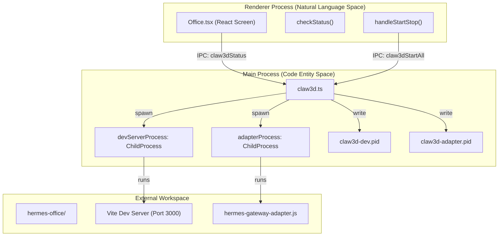
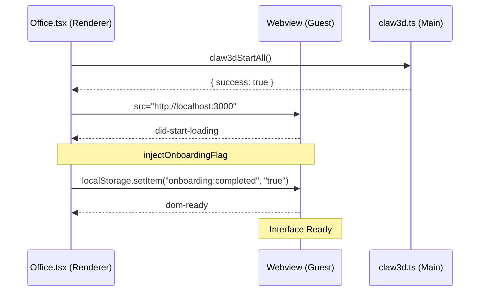

<!-- source: DeepWiki mcp.deepwiki.com · repo fathah/hermes-desktop · page 5.5 Office (Native 3D and Claw3D) Screen · fetched 2026-10-30 -->

# Office (Native 3D and Claw3D) Screen

<details>
<summary>Relevant source files</summary>

The following files were used as context for generating this wiki page:

- [lat.md/office-3d-interiors.md](lat.md/office-3d-interiors.md)
- [lat.md/office-3d-walk-mode.md](lat.md/office-3d-walk-mode.md)
- [lat.md/office-interactions.md](lat.md/office-interactions.md)
- [lat.md/office-world-actions.md](lat.md/office-world-actions.md)
- [src/main/claw3d.ts](src/main/claw3d.ts)
- [src/main/office-start.ts](src/main/office-start.ts)
- [src/renderer/src/assets/fonts/SpaceGrotesk-Variable.ttf](src/renderer/src/assets/fonts/SpaceGrotesk-Variable.ttf)
- [src/renderer/src/screens/Office/Office.statusPolling.test.tsx](src/renderer/src/screens/Office/Office.statusPolling.test.tsx)
- [src/renderer/src/screens/Office/Office.tsx](src/renderer/src/screens/Office/Office.tsx)
- [src/renderer/src/screens/Office/OneChatModal.tsx](src/renderer/src/screens/Office/OneChatModal.tsx)
- [src/renderer/src/screens/Office/RepInteractionPanel.test.tsx](src/renderer/src/screens/Office/RepInteractionPanel.test.tsx)
- [src/renderer/src/screens/Office/RepInteractionPanel.tsx](src/renderer/src/screens/Office/RepInteractionPanel.tsx)
- [src/renderer/src/screens/Office/office3d/Office3D.tsx](src/renderer/src/screens/Office/office3d/Office3D.tsx)
- [src/renderer/src/screens/Office/office3d/agents.test.ts](src/renderer/src/screens/Office/office3d/agents.test.ts)
- [src/renderer/src/screens/Office/office3d/agents.ts](src/renderer/src/screens/Office/office3d/agents.ts)
- [src/renderer/src/screens/Office/office3d/assets/building1.glb](src/renderer/src/screens/Office/office3d/assets/building1.glb)
- [src/renderer/src/screens/Office/office3d/assets/building2.glb](src/renderer/src/screens/Office/office3d/assets/building2.glb)
- [src/renderer/src/screens/Office/office3d/assets/man.glb](src/renderer/src/screens/Office/office3d/assets/man.glb)
- [src/renderer/src/screens/Office/office3d/assets/pantry.glb](src/renderer/src/screens/Office/office3d/assets/pantry.glb)
- [src/renderer/src/screens/Office/office3d/core/cityPlan.ts](src/renderer/src/screens/Office/office3d/core/cityPlan.ts)
- [src/renderer/src/screens/Office/office3d/core/glb.ts](src/renderer/src/screens/Office/office3d/core/glb.ts)
- [src/renderer/src/screens/Office/office3d/core/routing.test.ts](src/renderer/src/screens/Office/office3d/core/routing.test.ts)
- [src/renderer/src/screens/Office/office3d/core/routing.ts](src/renderer/src/screens/Office/office3d/core/routing.ts)
- [src/renderer/src/screens/Office/office3d/core/types.ts](src/renderer/src/screens/Office/office3d/core/types.ts)
- [src/renderer/src/screens/Office/office3d/interactions/missionBus.test.ts](src/renderer/src/screens/Office/office3d/interactions/missionBus.test.ts)
- [src/renderer/src/screens/Office/office3d/interactions/missionBus.ts](src/renderer/src/screens/Office/office3d/interactions/missionBus.ts)
- [src/renderer/src/screens/Office/office3d/interactions/proximity.ts](src/renderer/src/screens/Office/office3d/interactions/proximity.ts)
- [src/renderer/src/screens/Office/office3d/interactions/registry.ts](src/renderer/src/screens/Office/office3d/interactions/registry.ts)
- [src/renderer/src/screens/Office/office3d/interactions/worldActions.test.ts](src/renderer/src/screens/Office/office3d/interactions/worldActions.test.ts)
- [src/renderer/src/screens/Office/office3d/interactions/worldActions.ts](src/renderer/src/screens/Office/office3d/interactions/worldActions.ts)
- [src/renderer/src/screens/Office/office3d/layout.ts](src/renderer/src/screens/Office/office3d/layout.ts)
- [src/renderer/src/screens/Office/office3d/objects/AgentsLayer.tsx](src/renderer/src/screens/Office/office3d/objects/AgentsLayer.tsx)
- [src/renderer/src/screens/Office/office3d/objects/Bank.tsx](src/renderer/src/screens/Office/office3d/objects/Bank.tsx)
- [src/renderer/src/screens/Office/office3d/objects/CarShowroom.tsx](src/renderer/src/screens/Office/office3d/objects/CarShowroom.tsx)
- [src/renderer/src/screens/Office/office3d/objects/CityBackdrop.tsx](src/renderer/src/screens/Office/office3d/objects/CityBackdrop.tsx)
- [src/renderer/src/screens/Office/office3d/objects/OfficeShell.tsx](src/renderer/src/screens/Office/office3d/objects/OfficeShell.tsx)
- [src/renderer/src/screens/Office/office3d/objects/RiggedCharacter.tsx](src/renderer/src/screens/Office/office3d/objects/RiggedCharacter.tsx)
- [src/renderer/src/screens/Office/office3d/objects/SceneEnvironment.tsx](src/renderer/src/screens/Office/office3d/objects/SceneEnvironment.tsx)
- [src/renderer/src/screens/Office/office3d/objects/Traffic.tsx](src/renderer/src/screens/Office/office3d/objects/Traffic.tsx)
- [src/renderer/src/screens/Office/office3d/objects/agents.tsx](src/renderer/src/screens/Office/office3d/objects/agents.tsx)
- [src/renderer/src/screens/Office/office3d/objects/furniture.tsx](src/renderer/src/screens/Office/office3d/objects/furniture.tsx)
- [src/renderer/src/screens/Office/office3d/objects/types.ts](src/renderer/src/screens/Office/office3d/objects/types.ts)
- [src/renderer/src/screens/Office/office3d/trips.ts](src/renderer/src/screens/Office/office3d/trips.ts)
- [src/renderer/src/screens/Office/officeUrl.ts](src/renderer/src/screens/Office/officeUrl.ts)
- [src/shared/i18n/locales/en/office.ts](src/shared/i18n/locales/en/office.ts)
- [tests/office-env.test.ts](tests/office-env.test.ts)
- [tests/office-start.test.ts](tests/office-start.test.ts)
- [tests/office-url.test.ts](tests/office-url.test.ts)

</details>


The **Office Screen** provides a dedicated interface for managing and interacting with both the native React Three Fiber (R3F) 3D environment and the legacy Claw3D integration. This subsystem allows Hermes to operate within a 3D environment, facilitating spatial reasoning and visual agentic workflows. The native R3F office offers a rich, interactive experience with city, office, bank, and showroom locations, walk mode, orbit mode, agent status polling, Space Representatives (bank teller, ATM), the Mission Bus, world actions, and proximity interactions. The legacy Claw3D integration involves managing a local Git repository, a Node.js development server, and an adapter process that bridges Hermes to the 3D canvas.

## Native 3D Office (React Three Fiber)

The primary Office experience is now a native, in-renderer 3D environment built with React Three Fiber (`Office3D.tsx`). This replaces the older webview-based Claw3D integration, offering better performance and tighter integration with the desktop application.

### Core Components and Scene Structure

The `Office3D` component orchestrates the entire 3D scene, managing agents, locations, interactions, and camera controls.

Title: Native 3D Office Component Structure
```mermaid
graph TD
    OfficeScreen[Office.tsx] --> Office3D[Office3D.tsx]
    Office3D --> SceneEnvironment[SceneEnvironment.tsx]
    Office3D --> CityBackdrop[CityBackdrop.tsx]
    Office3D --> TrafficLayer[TrafficLayer.tsx]
    Office3D --> BankSection[BankSection.tsx]
    Office3D --> CarShowroom[CarShowroom.tsx]
    Office3D --> Room[Room.tsx]
    Office3D --> InteriorWalls[InteriorWalls.tsx]
    Office3D --> GlassWalls[GlassWalls.tsx]
    Office3D --> CeoOfficeExtras[CeoOfficeExtras.tsx]
    Office3D --> Workstations[Workstations.tsx]
    Office3D --> FurniturePieces[FurniturePieces.tsx]
    Office3D --> AgentsLayer[AgentsLayer.tsx]
    Office3D --> PedestriansLayer[PedestriansLayer.tsx]
    Office3D --> PlayerLayer[PlayerLayer.tsx]
    Office3D --> CameraRig[CameraRig]
    Office3D --> OrbitControls[OrbitControls (drei)]

    Workstations --> GlbItem[GlbItem]
    FurniturePieces --> GlbItem
    AgentsLayer --> RiggedCharacter[RiggedCharacter.tsx]
    BankSection --> Interactable[Interactable.tsx]
    CarShowroom --> Interactable
    PlayerLayer --> Interactable
```
Sources: [src/renderer/src/screens/Office/Office3D.tsx:1-192](), [src/renderer/src/screens/Office/office3d/objects/furniture.tsx:1-204]()

### Locations and Navigation

The 3D office features several distinct locations:
-   **City**: The main outdoor environment with buildings, roads, and traffic.
-   **Office Interior**: The main workspace with agent desks and a lounge area.
-   **Bank Interior**: A dedicated space for financial interactions.
-   **Car Showroom**: A display area for vehicles.

Users can navigate between these locations:
-   **Orbit Mode**: The default camera control, allowing free rotation and zoom around a target [src/renderer/src/screens/Office/office3d/Office3D.tsx:15]().
-   **Walk Mode**: A third-person perspective where the user controls an avatar (`PlayerLayer`) using WASD/arrow keys and Shift for running. Interactions occur by pressing 'E' near interactable objects [src/renderer/src/screens/Office/Office.tsx:104-105]().
-   **Building Entry/Exit**: Clicking on a building in city view focuses it, and an "Enter" prompt appears. Entering switches the scene to the interior. "Exit to city" returns to the city view [src/renderer/src/screens/Office/Office.tsx:88-93]().
-   **Camera Rig**: The `CameraRig` component handles smooth camera transitions (fly-ins) when changing locations or entering/exiting walk mode [src/renderer/src/screens/Office/office3d/Office3D.tsx:86-159]().

Sources: [src/renderer/src/screens/Office/Office.tsx:88-105](), [src/renderer/src/screens/Office/office3d/Office3D.tsx:15](), [src/renderer/src/screens/Office/office3d/Office3D.tsx:86-159](), [src/shared/i18n/locales/en/office.ts:60-70]()

### Agent Status and Placement

Each Hermes profile appears as an interactive agent in the 3D environment.
-   **Agent Data**: `OfficeAgent` objects are derived from desktop profiles and Kanban tasks, including `id`, `name`, `status` (idle/working), `color`, and `avatarProfile` [src/renderer/src/screens/Office/office3d/core/types.ts:1-10](), [src/renderer/src/screens/Office/office3d/agents.ts:57-86]().
-   **Status Polling**: The `Office` component periodically requests agent statuses from the main process using `window.hermesAPI.listProfiles()` and `window.hermesAPI.kanbanListTasks()` [src/renderer/src/screens/Office/Office.tsx:147-153](). This updates the `OfficeAgent` data, which then reflects in the 3D scene.
-   **Workstations**: Agents are placed at `Workstation` objects, which define desk and chair positions. The `buildWorkstations` function arranges agents in a grid, with a special executive desk for the CEO [src/renderer/src/screens/Office/office3d/layout.ts:210-218]().
-   **CEO Assignment**: A specific agent can be designated as the CEO, which is a desktop-local UI state persisted in `localStorage` [src/renderer/src/screens/Office/Office.tsx:64-74](). The CEO gets a larger, tinted executive desk in a glass-walled corner office [src/renderer/src/screens/Office/office3d/layout.ts:98-149]().

Title: Agent Status Polling and Mapping
```mermaid
graph TD
    OfficeScreen[Office.tsx] -->|useEffect (polling)| requestAgentStatuses[requestAgentStatuses()]
    requestAgentStatuses -->|IPC| hermesAPI.listProfiles()[hermesAPI.listProfiles()]
    requestAgentStatuses -->|IPC| hermesAPI.kanbanListTasks()[hermesAPI.kanbanListTasks()]
    hermesAPI.listProfiles() -->|profilesResult| profilesToOfficeAgents[profilesToOfficeAgents()]
    hermesAPI.kanbanListTasks() -->|runningTasks| profilesToOfficeAgents
    profilesToOfficeAgents -->|OfficeAgent[]| setAgents[setAgents(OfficeAgent[])]
    setAgents --> Office3D[Office3D.tsx]
    Office3D --> AgentsLayer[AgentsLayer.tsx]
    AgentsLayer --> RiggedCharacter[RiggedCharacter.tsx]
```
Sources: [src/renderer/src/screens/Office/Office.tsx:64-74](), [src/renderer/src/screens/Office/Office.tsx:141-171](), [src/renderer/src/screens/Office/office3d/agents.ts:57-86](), [src/renderer/src/screens/Office/office3d/layout.ts:210-218]()

### Space Representatives and Interactions

The 3D environment includes "Space Representatives" like bank tellers and ATMs, which agents can interact with.
-   **Registry**: `REPRESENTATIVES` in `registry.ts` defines the identity and available actions for each representative (e.g., `bank-teller`, `atm`) [src/renderer/src/screens/Office/office3d/interactions/registry.ts:1-11]().
-   **Interaction Panel**: The `RepInteractionPanel` component provides a modal interface for interacting with representatives. It displays available actions (e.g., "Check balance", "Account status", "Create account") and their outcomes [src/renderer/src/screens/Office/RepInteractionPanel.tsx:148-167]().
-   **Wallet Integration**: Actions in the panel (e.g., checking balance) interact with the `window.hermesAPI.syncWallets()` and `window.hermesAPI.getWalletPortfolio()` IPC calls. The panel uses an in-memory cache (`AgentBankCache`) to store an agent's wallet and portfolio data, keyed by `${signed-in account id}::${agent id}` to prevent data leakage across account changes [src/renderer/src/screens/Office/RepInteractionPanel.tsx:127-140]().
-   **Proximity Interactions**: In walk mode, `PlayerInteraction` objects define areas where the player can interact with objects by pressing 'E' [src/renderer/src/screens/Office/office3d/interactions/proximity.ts:1-10]().

Sources: [src/renderer/src/screens/Office/RepInteractionPanel.tsx:1-191](), [src/renderer/src/screens/Office/office3d/interactions/registry.ts:1-11](), [lat.md/office-interactions.md:1-32]()

### Mission Bus and World Actions

The "Mission Bus" facilitates chat-commanded errands in the 3D world, allowing agents to perform actions like "go to the bank and check my balance."
-   **Action Protocol**: The chat system injects a `world-action` JSON block into agent replies, which the renderer parses and validates. `buildWorldActionSystemPrompt` generates the vocabulary of available actions (e.g., `go_to`, `bank` operations) [src/renderer/src/screens/Office/office3d/interactions/worldActions.ts:1-14]().
-   **Mission Definition**: A `Mission` object encapsulates an errand, including the agent ID, destination, and optional interaction (rep ID + panel action) [src/renderer/src/screens/Office/office3d/interactions/missionBus.ts:1-10]().
-   **Orchestration**: `Office.tsx` handles the mission lifecycle. It dispatches the mission via `dispatchMission`, closes the chat, and adjusts the camera. Upon arrival ("arrived" event from the mission bus), it selects the agent, flies into the destination, and if an interaction is specified, opens the `RepInteractionPanel` with `autoAction` [src/renderer/src/screens/Office/Office.tsx:99-101](), [lat.md/office-world-actions.md:32-36]().
-   **Agent Trips**: The `AgentsLayer` component uses the existing trip machinery (`trips.ts`) to guide agents along routes, handling collision and crowd separation [src/renderer/src/screens/Office/office3d/trips.ts:1-10]().

Title: World Action Pipeline
```mermaid
graph TD
    ChatInput[ChatInput.tsx] -->|User Command| OneChatModal[OneChatModal.tsx]
    OneChatModal -->|sendMessage (with system prompt)| AgentLLM[Agent LLM]
    AgentLLM -->|JSON world-action block| OfficeScreen[Office.tsx]
    OfficeScreen -->|parseWorldActions| ParsedActions[Parsed World Actions]
    ParsedActions -->|planWorldActions| Mission[Mission Object]
    Mission -->|dispatchMission| AgentsLayer[AgentsLayer.tsx]
    AgentsLayer -->|Agent Movement| RiggedCharacter[RiggedCharacter.tsx]
    AgentsLayer -->|Emits "arrived"| MissionBus[Mission Bus]
    MissionBus --> OfficeScreen
    OfficeScreen -->|Open RepInteractionPanel| RepInteractionPanel[RepInteractionPanel.tsx]
    RepInteractionPanel -->|autoAction| hermesAPI.syncWallets()[hermesAPI.syncWallets()]
    RepInteractionPanel -->|autoAction| hermesAPI.getWalletPortfolio()[hermesAPI.getWalletPortfolio()]
```
Sources: [src/renderer/src/screens/Office/Office.tsx:99-101](), [src/renderer/src/screens/Office/office3d/interactions/worldActions.ts:1-14](), [src/renderer/src/screens/Office/office3d/interactions/missionBus.ts:1-10](), [lat.md/office-world-actions.md:32-36]()

### GPU Status and Fallback

The 3D office is performance-intensive. The application monitors the GPU status and provides warnings if hardware acceleration is disabled or crashes, suggesting re-enabling it or noting environmental overrides (`HERMES_DISABLE_GPU`) [src/renderer/src/screens/Office/Office.tsx:114-117]().

Sources: [src/renderer/src/screens/Office/Office.tsx:114-117](), [src/shared/i18n/locales/en/office.ts:50-57]()

## Legacy Claw3D Integration

The following sections describe the legacy Claw3D integration, which is now largely superseded by the native R3F 3D office.

### System Architecture

The integration consists of three primary layers: the **Renderer UI** (React), the **Main Process Controller** (Electron), and the **External Processes** (Vite dev server and the Hermes-Claw3D adapter).

#### Process Management Flow
The Main process manages the lifecycle of the Office environment by tracking PIDs and handling process spawning via `child_process` [src/main/claw3d.ts:1-28]().

Title: Office Process Lifecycle and Entity Mapping (Legacy Claw3D)

Sources: [src/main/claw3d.ts:1-32](), [src/renderer/src/screens/Office/Office.tsx:63-78](), [src/renderer/src/screens/Office/Office.tsx:190-212]()

### Setup Pipeline

Before the Claw3D Office screen can be used, the `hermes-office` repository must be cloned and initialized. This is handled by a multi-step setup pipeline.

1.  **Repository Cloning**: Clones `https://github.com/fathah/hermes-office` into `HERMES_OFFICE_DIR` (located within `HERMES_HOME`) [src/main/claw3d.ts:17-18]().
2.  **Environment Discovery**: Resolves `node` and `npm` paths, handling platform-specific differences (e.g., `.cmd` shims on Windows) to ensure the build tools are available [src/main/claw3d.ts:81-115]().
3.  **Dependency Installation**: Runs `npm install` within the cloned directory to populate `node_modules`. The system uses `createNpmCommandInvocation` to correctly wrap calls on Windows to avoid console flashes and handle environment variables [src/main/claw3d.ts:174-192]().
4.  **Configuration**: Generates a `.env` file in the office directory and a `settings.json` in `~/.openclaw/claw3d/` via `writeClaw3dSettings` [src/main/claw3d.ts:25-26](). This ensures the Office model matches the user's configured agent model (Issue #256) and includes necessary API keys for the gateway [src/main/claw3d.ts:248-278]().

#### Setup Progress Tracking
Progress is communicated from the Main process to the Renderer via the `onClaw3dSetupProgress` IPC event [src/renderer/src/screens/Office/Office.tsx:170-172](). The renderer listens for these updates to update the `SetupProgress` state [src/renderer/src/screens/Office/Office.tsx:12-18]().

Sources: [src/main/claw3d.ts:17-26](), [src/main/claw3d.ts:248-278](), [src/renderer/src/screens/Office/Office.tsx:166-188](), [tests/office-env.test.ts:7-17]()

### Dev Server and Adapter Management

The Claw3D Office environment requires two concurrent processes to be "Running":
1.  **Dev Server**: A Node.js process tracked by `devServerProcess` running the frontend [src/main/claw3d.ts:27-29]().
2.  **Adapter**: A process tracked by `adapterProcess` that connects the Hermes gateway to the Claw3D WebSocket [src/main/claw3d.ts:28-30]().

#### Port Conflict Handling
The system checks if the configured port (default `3000`) is available before starting the server. It uses `net.createConnection` to probe the port [src/main/claw3d.ts:11-12](). If the port is in use, the `portInUse` flag is set to true in the status report [src/renderer/src/screens/Office/Office.tsx:33]().

#### Status Polling
The Renderer polls the status every 5 seconds via `window.hermesAPI.claw3dStatus()` when the tab is visible [src/renderer/src/screens/Office/Office.tsx:85-105]().

| Property | Description | Code Entity |
| :--- | :--- | :--- |
| **Installed** | Repository and `node_modules` exist | `state === "ready"` [src/renderer/src/screens/Office/Office.tsx:74]() |
| **Running** | Processes are active | `status.running` [src/renderer/src/screens/Office/Office.tsx:67]() |
| **Port** | The HTTP port for the webview | `status.port` [src/renderer/src/screens/Office/Office.tsx:68]() |
| **Remote URL** | URL if running in SSH tunnel mode | `status.remoteUrl` [src/renderer/src/screens/Office/Office.tsx:66]()

Sources: [src/main/claw3d.ts:204-221](), [src/renderer/src/screens/Office/Office.tsx:63-78](), [src/renderer/src/screens/Office/Office.tsx:85-105]()

### Webview Rendering

Once the processes are active, the UI renders the Office interface using an Electron `<webview>` tag [src/renderer/src/screens/Office/Office.tsx:53]().

#### Onboarding Bypass
The Renderer performs a "stealth" initialization by injecting JavaScript into the webview to skip onboarding screens within the guest application. It uses `executeJavaScript` to set `claw3d:onboarding:completed` in the webview's `localStorage` [src/renderer/src/screens/Office/Office.tsx:123-132]().

Title: Webview Initialization and Communication (Legacy Claw3D)


#### Remote Mode (SSH Tunneling)
If Hermes is running in SSH tunnel mode, the main process detects the Claw3D service on the remote host and provides a `remoteUrl` [src/renderer/src/screens/Office/Office.tsx:48-51](). In this state, the local install/start UX is bypassed, and the webview points directly at the remote instance [src/renderer/src/screens/Office/Office.tsx:73-77]().

Sources: [src/renderer/src/screens/Office/Office.tsx:115-164](), [src/renderer/src/screens/Office/Office.tsx:190-212]()

### Claw3D HQ Kanban Board

The Office screen integrates with the Kanban subsystem by providing a virtual, read-only "HQ" board.

-   **Virtual Board**: The board is identified by the sentinel slug `__claw3d_hq__` [src/renderer/src/screens/Kanban/Kanban.tsx:108-109]().
-   **Read-Only**: When this board is active, all mutation affordances (create, delete, move) are hidden in the UI [src/renderer/src/screens/Kanban/Kanban.tsx:156-160]().
-   **Data Source**: Tasks are fetched from a specific task-store JSON on the remote via `kanbanListClaw3dHqTasks` [src/renderer/src/screens/Kanban/Kanban.tsx:189-210]().

Sources: [src/renderer/src/screens/Kanban/Kanban.tsx:108-112](), [src/renderer/src/screens/Kanban/Kanban.tsx:189-210]()

---

