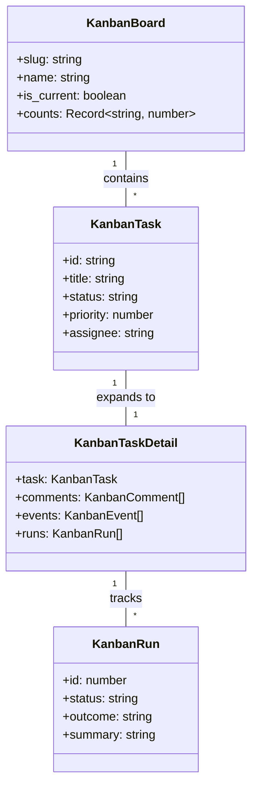

<!-- source: DeepWiki mcp.deepwiki.com · repo fathah/hermes-desktop · page 5.6 Kanban Screen · fetched 2026-10-30 -->

# Kanban Screen

<details>
<summary>Relevant source files</summary>

The following files were used as context for generating this wiki page:

- [KANBAN_GAP_REPORT.md](KANBAN_GAP_REPORT.md)
- [lat.md/kanban.md](lat.md/kanban.md)
- [src/main/kanban.ts](src/main/kanban.ts)
- [src/renderer/src/screens/Kanban/Kanban.tsx](src/renderer/src/screens/Kanban/Kanban.tsx)
- [src/shared/i18n/index.ts](src/shared/i18n/index.ts)
- [src/shared/i18n/locales/en/kanban.ts](src/shared/i18n/locales/en/kanban.ts)
- [src/shared/i18n/locales/pt-PT/kanban.ts](src/shared/i18n/locales/pt-PT/kanban.ts)
- [tests/kanban-unsupported.test.ts](tests/kanban-unsupported.test.ts)

</details>


The Kanban screen provides a durable, multi-agent task management interface, described as "JIRA for AI agents." It allows users to coordinate multiple named agent profiles that pick up cards, execute tasks, and hand off work through a persistent SQLite-backed state machine [lat.md/kanban.md:1-5]().

## Architecture and Data Flow

The Kanban system is implemented as a thin client over the `hermes kanban` CLI [lat.md/kanban.md:5-6](). It supports two primary execution environments:
1.  **Local Mode:** Executes the Python-based Hermes CLI directly on the host machine [src/main/kanban.ts:122-133]().
2.  **SSH Tunnel Mode:** Dispatches commands to a remote Hermes instance over an SSH connection [src/main/kanban.ts:112-120]().

### Data Model associate with Code Entities
The following diagram maps the high-level Kanban concepts to their specific TypeScript interface definitions used in both the main and renderer processes.


**Sources:** [src/main/kanban.ts:13-83](), [src/renderer/src/screens/Kanban/Kanban.tsx:22-92]()

## Core Components

### KanbanBoard and Column Logic
The board organizes tasks into eight canonical columns, synchronized with the agent's `kanban_db.VALID_STATUSES` [lat.md/kanban.md:9-11]().

| Column Key | Tone | Description |
| :--- | :--- | :--- |
| `triage` | neutral | Initial entry point for un-scoped tasks. |
| `todo` | todo | Tasks ready for specification/assignment. |
| `scheduled` | scheduled | Tasks with a delayed start time. |
| `ready` | ready | Tasks available for an agent to claim. |
| `running` | running | Tasks currently being executed by a worker. |
| `blocked` | blocked | Tasks halted due to errors or missing info. |
| `review` | review | Tasks awaiting human or agent verification. |
| `done` | done | Completed tasks. |

**Sources:** [src/renderer/src/screens/Kanban/Kanban.tsx:98-107](), [KANBAN_GAP_REPORT.md:29-35]()

### Drag-and-Drop State Machine
Unlike the web dashboard, the desktop app does not write directly to the database. It maps drag-and-drop actions to specific CLI verbs via the `dragAction` function [src/renderer/src/screens/Kanban/Kanban.tsx:133-157]().

```mermaid
graph TD
    subgraph "Renderer UI"
        [DragStart] --> [dragAction]
    end

    subgraph "Main Process (IPC)"
        [dragAction] -- "complete" --> [completeTask]
        [dragAction] -- "block" --> [blockTask]
        [dragAction] -- "archive" --> [archiveTask]
        [dragAction] -- "unblock/promote" --> [unblockTask]
    end

    subgraph "CLI / Backend"
        [completeTask] --> hermes_kanban_complete
        [blockTask] --> hermes_kanban_block
        [unblockTask] --> hermes_kanban_unblock
    end
```
**Sources:** [src/renderer/src/screens/Kanban/Kanban.tsx:118-131](), [src/main/kanban.ts:202-229](), [lat.md/kanban.md:19-22]()

## Integration and Fallbacks

### Unsupported Mode Fallback
The Kanban screen requires a high-fidelity connection (Local or SSH). Plain remote HTTP mode (API key only) does not expose the required CLI surface. The system uses a specific `unsupportedMode` flag to trigger a "switch modes" UI rather than a generic error [src/main/kanban.ts:90-98]().

*   **Function:** `unsupportedInRemote()` [src/main/kanban.ts:163-172]()
*   **Test Validation:** Ensures the flag is correctly set to prevent mislabeling operational failures [tests/kanban-unsupported.test.ts:10-17]().

### Office 3D Integration (Claw3D HQ)
The Kanban screen includes a virtual, read-only board titled **Claw3D HQ** (`__claw3d_hq__`) [src/renderer/src/screens/Kanban/Kanban.tsx:168]().
*   **Purpose:** Mirrors the remote task-store JSON from the Office 3D environment.
*   **Implementation:** Selecting this board routes reads to `sshListClaw3dHqTasks` and disables all mutation affordances in the UI [lat.md/kanban.md:37-39](), [src/main/kanban.ts:11]()

## Implementation Details

### Polling and Synchronization
The board maintains state through three triggers:
1.  **Interval Polling:** A 6-second tick (`POLL_INTERVAL_MS`) while the tab is visible [src/renderer/src/screens/Kanban/Kanban.tsx:163]().
2.  **Visibility Listeners:** Refetches data when the window gains focus [lat.md/kanban.md:27]().
3.  **Mutation Feedback:** Every successful action (e.g., `createTask`, `blockTask`) triggers an immediate `loadAll(true)` call [lat.md/kanban.md:27]().

### Task Detail View
The `KanbanTaskDetail` view (drawer) provides a deep dive into task history, including:
*   **Comments:** Inter-agent protocol and human notes [src/main/kanban.ts:58-64]().
*   **Events:** A timeline of state changes (kind, payload, run_id) [src/main/kanban.ts:66-73]().
*   **Run History:** Details on specific execution attempts, including heartbeats and errors [src/main/kanban.ts:45-56]().

**Sources:** [src/renderer/src/screens/Kanban/Kanban.tsx:84-92](), [lat.md/kanban.md:29-34]()

---

