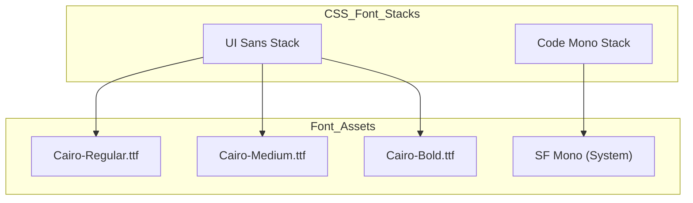
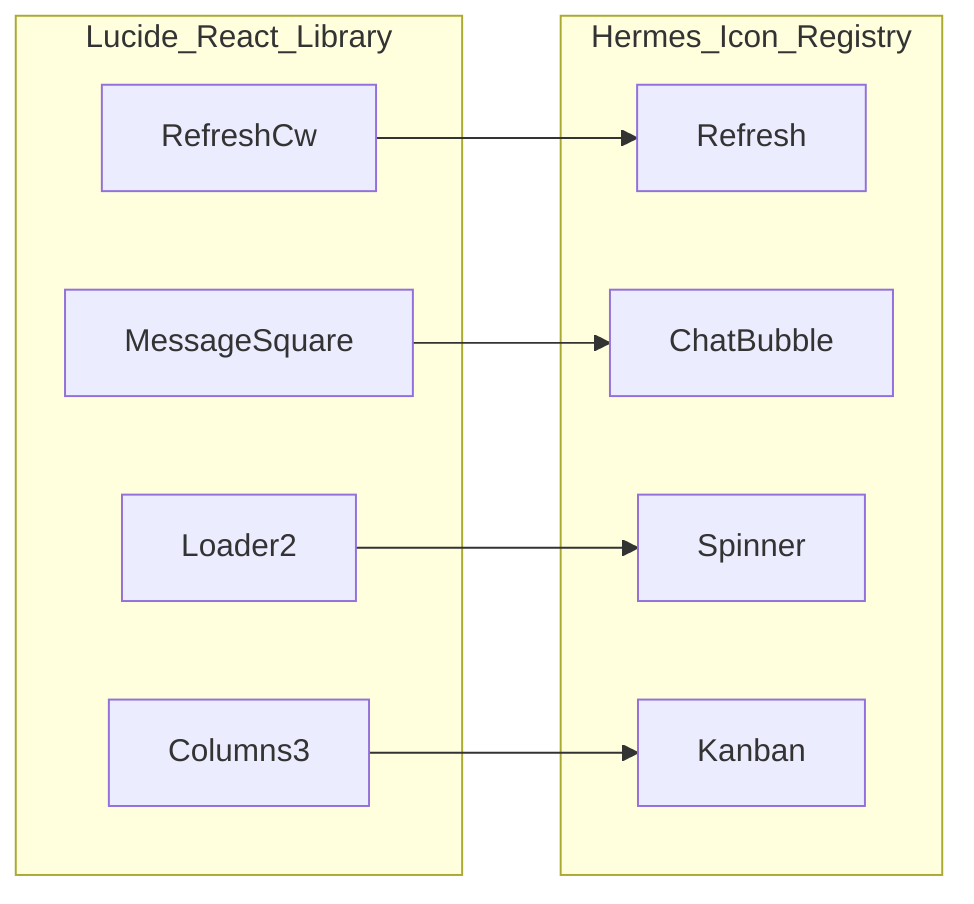

<!-- source: DeepWiki mcp.deepwiki.com · repo fathah/hermes-desktop · page 5.7 Design System and Theming · fetched 2026-10-30 -->

# Design System and Theming

Relevant source files

The following files were used as context for generating this wiki page:

- [lat.md/lat.md](lat.md/lat.md)
- [lat.md/sidebar-navigation.md](lat.md/sidebar-navigation.md)
- [src/main/config.ts](src/main/config.ts)
- [src/main/hermes.ts](src/main/hermes.ts)
- [src/main/index.ts](src/main/index.ts)
- [src/main/ipc/register.ts](src/main/ipc/register.ts)
- [src/preload/index.d.ts](src/preload/index.d.ts)
- [src/preload/index.ts](src/preload/index.ts)
- [src/renderer/src/assets/base.css](src/renderer/src/assets/base.css)
- [src/renderer/src/assets/fonts/Cairo-Bold.ttf](src/renderer/src/assets/fonts/Cairo-Bold.ttf)
- [src/renderer/src/assets/fonts/Cairo-Medium.ttf](src/renderer/src/assets/fonts/Cairo-Medium.ttf)
- [src/renderer/src/assets/fonts/Cairo-Regular.ttf](src/renderer/src/assets/fonts/Cairo-Regular.ttf)
- [src/renderer/src/assets/fonts/Cairo-SemiBold.ttf](src/renderer/src/assets/fonts/Cairo-SemiBold.ttf)
- [src/renderer/src/assets/icons/index.tsx](src/renderer/src/assets/icons/index.tsx)
- [src/renderer/src/assets/logos/atlascloud.svg](src/renderer/src/assets/logos/atlascloud.svg)
- [src/renderer/src/assets/logos/cerebras.svg](src/renderer/src/assets/logos/cerebras.svg)
- [src/renderer/src/assets/logos/fireworksai.svg](src/renderer/src/assets/logos/fireworksai.svg)
- [src/renderer/src/assets/logos/lmstudio.svg](src/renderer/src/assets/logos/lmstudio.svg)
- [src/renderer/src/assets/logos/mimo.svg](src/renderer/src/assets/logos/mimo.svg)
- [src/renderer/src/assets/logos/ollama.svg](src/renderer/src/assets/logos/ollama.svg)
- [src/renderer/src/assets/logos/togetherai.svg](src/renderer/src/assets/logos/togetherai.svg)
- [src/renderer/src/assets/logos/vllm.svg](src/renderer/src/assets/logos/vllm.svg)
- [src/renderer/src/assets/main.css](src/renderer/src/assets/main.css)
- [src/renderer/src/components/common/BrandLogo.tsx](src/renderer/src/components/common/BrandLogo.tsx)
- [src/renderer/src/screens/Chat/Chat.tsx](src/renderer/src/screens/Chat/Chat.tsx)
- [src/renderer/src/screens/Layout/Layout.tsx](src/renderer/src/screens/Layout/Layout.tsx)
- [src/renderer/src/screens/Layout/SidebarRecentSessions.tsx](src/renderer/src/screens/Layout/SidebarRecentSessions.tsx)
- [src/renderer/src/screens/Layout/SidebarSessionMenu.tsx](src/renderer/src/screens/Layout/SidebarSessionMenu.tsx)
- [src/shared/i18n/locales/en/navigation.ts](src/shared/i18n/locales/en/navigation.ts)

The Hermes Desktop design system is built on a flat, clean architectural philosophy that prioritizes high contrast, clear typography, and a consistent token-based CSS structure. It utilizes a custom CSS variable architecture to support seamless switching between Light, Dark, and specialized developer themes while maintaining a unified component interface.

## CSS Architecture and Tokens

The core of the design system is defined in `main.css`, which uses CSS custom properties (variables) to manage colors, spacing, and typography. The system is split into theme-specific tokens and shared global tokens.

### Theme Tokens
Hermes supports two primary themes, **Dark** (default) and **Light**, alongside several developer-centric themes like **Dracula**, **Nord**, and **One Dark**. These are applied via the `data-theme` attribute on the `<html>` element [src/renderer/src/assets/main.css:9-181]().

| Token Category | Dark (`[data-theme="dark"]`) | Light (`[data-theme="light"]`) | Dracula (`[data-theme="dracula"]`) |
| :--- | :--- | :--- | :--- |
| `--bg-primary` | `#212121` | `#ffffff` | `#282a36` |
| `--bg-secondary` | `#171717` | `#f8f8f8` | `#21222c` |
| `--accent` | `#003f7a` | `#003f7a` | `#bd93f9` |
| `--text-primary` | `#ececec` | `#111111` | `#f8f8f2` |
| `--border` | `rgba(255,255,255,0.06)` | `#e5e5e5` | `rgba(255,255,255,0.07)` |
| `--user-bubble` | `#003f7a` | `#003f7a` | `#bd93f9` |

### Shared Global Tokens
Global tokens define the structural feel of the application and remain constant across themes. These are typically managed through Tailwind CSS imports and base styles [src/renderer/src/assets/main.css:1-2]().

**Sources:** [src/renderer/src/assets/main.css:9-41](), [src/renderer/src/assets/main.css:44-76](), [src/renderer/src/assets/main.css:79-111](), [src/renderer/src/assets/main.css:114-146](), [src/renderer/src/assets/main.css:149-181]()

## Typography

The application uses a multi-font strategy to distinguish between UI/Content and Technical/Code data.

*   **UI Typography**: The system leverages **Cairo**, **Manrope**, and **Space Grotesk** for primary interface elements. These are loaded via local `@font-face` declarations in `base.css` and `main.css`.
*   **Monospace (Code)**: **SF Mono** is the primary typeface for code blocks, terminal outputs, and technical identifiers.

### Font Implementation Map
The following diagram maps CSS font categories to their respective code entities and file types.

**Typography Mapping**

**Sources:** [src/renderer/src/assets/main.css:1-20](), [src/renderer/src/assets/fonts/Cairo-Regular.ttf]() (implied by path), [src/renderer/src/assets/fonts/Cairo-Medium.ttf]() (implied by path).

## App Shell and Layout Classes

The layout handles the specific constraints of an Electron window, such as the window drag region and sidebar navigation.

*   **Sidebar Navigation**: The sidebar is managed in `Layout.tsx`. It includes a `PINNED_NAV_ITEMS` array for core views (Discover, Office, Kanban, Schedules) and `FOOTER_NAV_ITEMS` for settings and technical views (Providers, Gateway, Tools, Memory) [src/renderer/src/screens/Layout/Layout.tsx:68-84]().
*   **Drag Region**: To support custom window chrome, the header area uses a drag region class to allow moving the Electron window.
*   **Scroll Management**: The sidebar implements a custom scrollbar logic to avoid layout shifts. An overlay thumb is rendered only while the user is scrolling [lat.md/sidebar-navigation.md:21-22]().

### Sidebar Collapse Swap
The sidebar header's collapse control doubles as the brand mark. It uses a `.sidebar-collapse-swap` box that stacks a `.sidebar-collapse-mark` circle over the `PanelLeftOpen` icon [lat.md/sidebar-navigation.md:9-12]().

**Sources:** [src/renderer/src/screens/Layout/Layout.tsx:68-84](), [lat.md/sidebar-navigation.md:9-22]()

## Component Interfaces

The design system provides standardized visual patterns for shared components.

### Shared Visual Components
*   **OrbLoader**: A specialized loading component used for "thinking" states. It pins dark/light modes from the Hermes theme registry rather than relying on library auto-detection [lat.md/lat.md:13-13]().
*   **BrandLogo**: A dynamic SVG resolver that maps provider names (OpenAI, Anthropic, Ollama, etc.) to their respective brand assets [src/renderer/src/components/common/BrandLogo.tsx:78-158]().
*   **Chat Bubbles**: Message bubbles are styled using `--user-bubble` and `--agent-bubble` tokens to maintain theme consistency [src/renderer/src/assets/main.css:33-36]().

### Chat Interface Elements
The composer and message list utilize theme tokens for high-contrast rendering:
*   **Fast Mode**: Indicated by the `Zap` icon [src/renderer/src/screens/Chat/Chat.tsx:3]().
*   **Context Folder**: The `ContextFolderChip` displays the linked working directory for the current session [src/renderer/src/screens/Chat/Chat.tsx:9]().

**Sources:** [src/renderer/src/assets/main.css:33-36](), [src/renderer/src/screens/Chat/Chat.tsx:1-12](), [lat.md/lat.md:13-13]()

## Icon Registry

Hermes uses a centralized icon registry in `src/renderer/src/assets/icons/index.tsx`. It re-exports selected icons from `lucide-react`, often aliasing them to better match the application's domain language.

| Registry Name | Lucide Original | Usage Context |
| :--- | :--- | :--- |
| `Refresh` | `RefreshCw` | Gateway restarts, health checks [src/renderer/src/assets/icons/index.tsx:43]() |
| `Alert` | `TriangleAlert` | Error states, connection failures [src/renderer/src/assets/icons/index.tsx:44]() |
| `Trash` | `Trash2` | Session/Model deletion [src/renderer/src/assets/icons/index.tsx:45]() |
| `ChatBubble` | `MessageSquare` | Session navigation [src/renderer/src/assets/icons/index.tsx:46]() |
| `Spinner` | `Loader2` | Async operations, streaming [src/renderer/src/assets/icons/index.tsx:52]() |
| `Kanban` | `Columns3` | Task board navigation [src/renderer/src/assets/icons/index.tsx:53]() |

**Icon Entity Mapping**

**Sources:** [src/renderer/src/assets/icons/index.tsx:1-64]()

---

