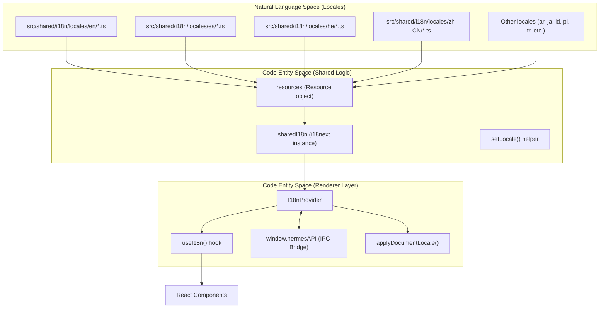
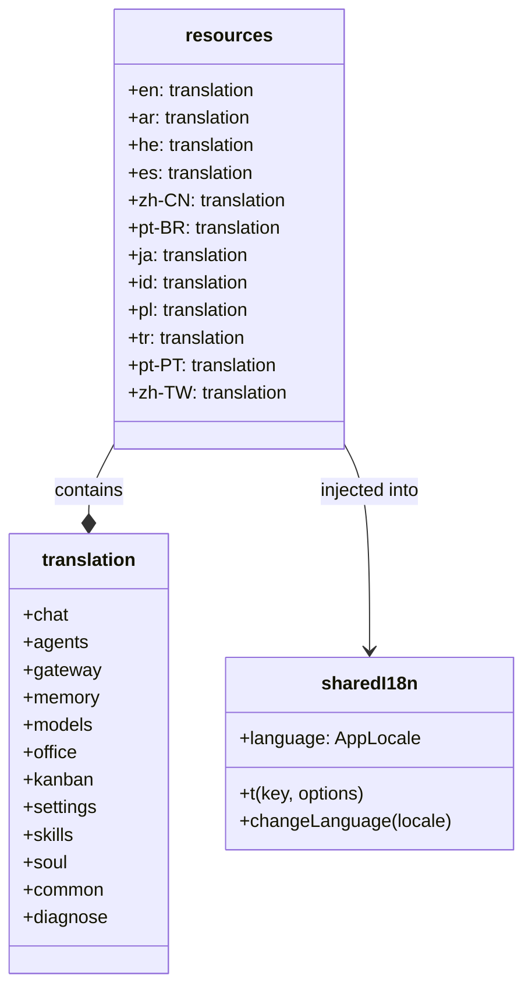

<!-- source: DeepWiki mcp.deepwiki.com · repo fathah/hermes-desktop · page 6 Internationalization (i18n) · fetched 2026-10-30 -->

# Internationalization (i18n)

Relevant source files

The following files were used as context for generating this wiki page:

- [KANBAN_GAP_REPORT.md](KANBAN_GAP_REPORT.md)
- [lat.md/kanban.md](lat.md/kanban.md)
- [src/main/kanban.ts](src/main/kanban.ts)
- [src/main/locale.ts](src/main/locale.ts)
- [src/renderer/src/components/I18nContext.ts](src/renderer/src/components/I18nContext.ts)
- [src/renderer/src/components/I18nProvider.test.tsx](src/renderer/src/components/I18nProvider.test.tsx)
- [src/renderer/src/components/I18nProvider.tsx](src/renderer/src/components/I18nProvider.tsx)
- [src/renderer/src/components/useI18n.ts](src/renderer/src/components/useI18n.ts)
- [src/renderer/src/screens/Kanban/Kanban.tsx](src/renderer/src/screens/Kanban/Kanban.tsx)
- [src/shared/i18n/config.ts](src/shared/i18n/config.ts)
- [src/shared/i18n/index.test.ts](src/shared/i18n/index.test.ts)
- [src/shared/i18n/index.ts](src/shared/i18n/index.ts)
- [src/shared/i18n/locales/en/kanban.ts](src/shared/i18n/locales/en/kanban.ts)
- [src/shared/i18n/locales/pt-PT/kanban.ts](src/shared/i18n/locales/pt-PT/kanban.ts)
- [src/shared/i18n/types.ts](src/shared/i18n/types.ts)
- [tests/kanban-unsupported.test.ts](tests/kanban-unsupported.test.ts)
- [tests/locale-persistence.test.ts](tests/locale-persistence.test.ts)

The Hermes Desktop localization system is built on `i18next` and provides a centralized way to manage UI strings across the application. The system is architected in `src/shared/i18n` to ensure that translation logic and locale resources are accessible to both the React renderer and the Electron main process.

The application currently supports twelve locales: English (`en`), Arabic (`ar`), Spanish (`es`), Hebrew (`he`), Indonesian (`id`), Japanese (`ja`), Polish (`pl`), Brazilian Portuguese (`pt-BR`), Portuguese (`pt-PT`), Turkish (`tr`), Simplified Chinese (`zh-CN`), and Traditional Chinese (`zh-TW`) [[src/shared/i18n/types.ts:1-13]](). English is designated as the source, fallback, and default active locale [[src/shared/i18n/config.ts:3-5]]().

### System Architecture

The i18n system consists of a shared configuration, a resource registry containing namespaced translation files, and a React-specific provider layer that synchronizes with the main process for persistence. It also includes specific support for Right-to-Left (RTL) languages like Arabic and Hebrew by dynamically adjusting the document direction [[src/shared/i18n/config.ts:23-29]]().

**Translation Flow: From Files to UI**

**Sources:** [[src/shared/i18n/index.ts:1-643]](), [[src/renderer/src/components/I18nProvider.tsx:13-46]](), [[src/shared/i18n/config.ts:27-29]]()

### i18n Configuration and Provider

The application initializes an `i18next` instance named `sharedI18n` [[src/shared/i18n/index.ts:635]](). In the renderer, the `I18nProvider` manages the active language state and ensures that the user's preference is persisted via the Electron main process and `localStorage` [[src/renderer/src/components/I18nProvider.tsx:85-100]]().

Key components include:
*   **`sharedI18n`**: The core `i18next` instance initialized with the `resources` object containing all supported languages [[src/shared/i18n/index.ts:635-643]]().
*   **`I18nProvider`**: A React component that wraps the app, providing `I18nContext` and initializing the locale from `window.hermesAPI.getLocale()` [[src/renderer/src/components/I18nProvider.tsx:42-115]]().
*   **`applyDocumentLocale`**: A utility that sets the `dir` (LTR/RTL) and `lang` attributes on the document root to mirror the UI for languages like Hebrew or Arabic [[src/renderer/src/components/I18nProvider.tsx:19-24]]().
*   **`useI18n`**: A hook that provides the translation function `t` and the `setLocale` action to functional components [[src/renderer/src/components/useI18n.ts:6-22]]().
*   **Main Process Persistence**: `src/main/locale.ts` handles reading and writing the `locale` key in the desktop configuration file to persist settings across restarts [[src/main/locale.ts:32-40]]().

For details on the initialization logic and the React integration, see [i18n Configuration and Provider](#6.1).

**Sources:** [[src/shared/i18n/index.ts:635-643]](), [[src/renderer/src/components/I18nProvider.tsx:19-115]](), [[src/main/locale.ts:32-40]](), [[src/shared/i18n/config.ts:23-29]]()

### Locale Strings Reference

Translations are organized into namespaces corresponding to application features. These are aggregated into a central `resources` object that maps locale codes to their respective translation trees [[src/shared/i18n/index.ts:285-633]]().

**Locale Resource Mapping**

The application divides strings into over 20 specific files per language to maintain modularity [[src/shared/i18n/index.ts:12-34]](). Notable namespaces include:
*   **Core UI**: `common`, `navigation`, `welcome`, `errors`, `constants`.
*   **Agent Management**: `agents`, `skills`, `soul`, `memory`.
*   **Feature Specific**: `chat`, `sessions`, `schedules`, `office`, `kanban`, `diagnose`.
*   **Infrastructure**: `gateway`, `models`, `providers`, `settings`, `install`, `setup`.

For a full list of available keys and instructions on adding new translations for specific languages, see [Locale Strings Reference](#6.2).

**Sources:** [[src/shared/i18n/index.ts:9-633]](), [[src/shared/i18n/locales/en/kanban.ts:1-112]](), [[src/shared/i18n/locales/pt-PT/kanban.ts:1-101]]()

---

