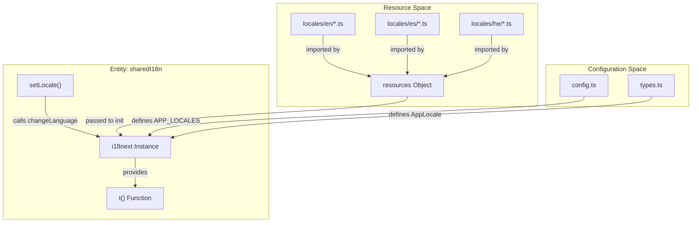
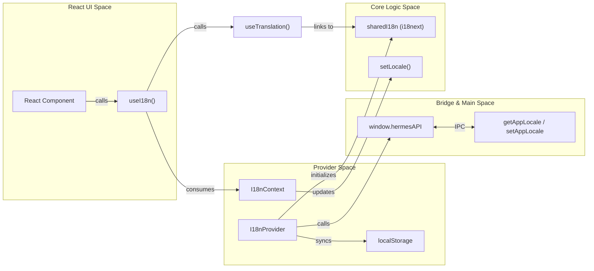

<!-- source: DeepWiki mcp.deepwiki.com · repo fathah/hermes-desktop · page 6.1 i18n Configuration and Provider · fetched 2026-10-30 -->

# i18n Configuration and Provider

Relevant source files

The following files were used as context for generating this wiki page:

- [src/main/locale.ts](src/main/locale.ts)
- [src/renderer/src/components/I18nContext.ts](src/renderer/src/components/I18nContext.ts)
- [src/renderer/src/components/I18nProvider.test.tsx](src/renderer/src/components/I18nProvider.test.tsx)
- [src/renderer/src/components/I18nProvider.tsx](src/renderer/src/components/I18nProvider.tsx)
- [src/renderer/src/components/useI18n.ts](src/renderer/src/components/useI18n.ts)
- [src/shared/i18n/config.ts](src/shared/i18n/config.ts)
- [src/shared/i18n/index.test.ts](src/shared/i18n/index.test.ts)
- [src/shared/i18n/types.ts](src/shared/i18n/types.ts)
- [tests/locale-persistence.test.ts](tests/locale-persistence.test.ts)

This page details the internationalization (i18n) infrastructure of Hermes Desktop. The system is built on `i18next` and provides a unified translation mechanism accessible across the shared logic and the React renderer. It utilizes a provider-pattern to manage locale state, persistence, and synchronization between the renderer and main processes.

## i18n Configuration

The core configuration defines the supported languages and the initialization parameters for the `i18next` instance. The application supports multiple languages including English, Arabic, Spanish, Hebrew, Indonesian, Japanese, Polish, Portuguese (Brazil and Portugal), Turkish, and Chinese (Simplified and Traditional) [src/shared/i18n/config.ts:6-19]().

### Core Constants
The configuration is centralized in `src/shared/i18n/config.ts`, defining the bounds of the localization system:
*   `SOURCE_LOCALE`: The primary language used for development ("en") [src/shared/i18n/config.ts:3-3]().
*   `FALLBACK_LOCALE`: The language used if a key is missing in the active locale ("en") [src/shared/i18n/config.ts:4-4]().
*   `DEFAULT_ACTIVE_LOCALE`: The initial locale used if no preference is found [src/shared/i18n/config.ts:5-5]().
*   `APP_LOCALES`: An array of all supported locale strings [src/shared/i18n/config.ts:6-19]().
*   `RTL_LOCALES`: A list of locales requiring right-to-left layout ("ar", "he") [src/shared/i18n/config.ts:23-23]().

### Text Direction
The system automatically handles Right-to-Left (RTL) mirroring. The function `getLocaleDirection` checks if a locale is in the `RTL_LOCALES` list [src/shared/i18n/config.ts:27-29](). In the renderer, `applyDocumentLocale` sets the `dir` and `lang` attributes on the `document.documentElement` to trigger CSS-level mirroring [src/renderer/src/components/I18nProvider.tsx:19-24]().

**Sources:** [src/shared/i18n/config.ts:1-29](), [src/shared/i18n/types.ts:1-13](), [src/renderer/src/components/I18nProvider.tsx:19-24]()

## Shared i18n Instance

Hermes uses a "shared" `i18next` instance (`sharedI18n`) created via `i18next.createInstance()` [src/shared/i18n/index.ts:200-200](). This allows translation logic to be used in non-React contexts (like the Main process or background utilities) while serving as the backbone for the React integration.

### Initialization and State Management
The instance is initialized with `initImmediate: false` to ensure resources are ready before the UI renders [src/shared/i18n/index.ts:202-213]().

The internal state is managed via:
*   `getLocale()`: Returns the current `AppLocale` [src/shared/i18n/index.ts:215-217]().
*   `setLocale(nextLocale)`: Updates the internal `locale` variable and triggers `sharedI18n.changeLanguage()` [src/shared/i18n/index.ts:219-223]().
*   `t(key, lang, options)`: A standalone translation function that performs manual key lookup via `readKey` and handles string interpolation for `{{variable}}` patterns [src/shared/i18n/index.ts:225-239]().

### i18n Data Flow: Configuration to Instance
The following diagram illustrates how configuration constants and locale files are aggregated into the shared i18n instance.

**Shared i18n Architecture**

**Sources:** [src/shared/i18n/index.ts:189-239](), [src/shared/i18n/config.ts:1-29](), [src/shared/i18n/index.test.ts:1-59]()

## React Integration

The renderer process consumes the shared i18n logic through a dedicated Context and Provider pattern.

### I18nProvider and Persistence
The `I18nProvider` performs several critical tasks:
1.  **Initialization**: Registers `sharedI18n` with `react-i18next` using `initReactI18next` [src/renderer/src/components/I18nProvider.tsx:13-13]().
2.  **Persistence**: Loads the initial locale from `localStorage` (key: `hermes-locale`) [src/renderer/src/components/I18nProvider.tsx:26-36]().
3.  **IPC Sync**: On mount, it attempts to fetch the system locale from the Main process via `window.hermesAPI.getLocale()` [src/renderer/src/components/I18nProvider.tsx:58-83](). It avoids overwriting the main-process locale with the startup fallback if the user hasn't explicitly changed it [src/renderer/src/components/I18nProvider.test.tsx:91-115]().
4.  **State Management**: When the locale changes, it updates `localStorage`, the `sharedI18n` instance, and notifies the Main process via `window.hermesAPI.setLocale()` [src/renderer/src/components/I18nProvider.tsx:85-100]().

### useI18n Hook
Components interact with the i18n system via the `useI18n` hook. This hook combines the standard `useTranslation` hook from `react-i18next` with the custom `I18nContext` [src/renderer/src/components/useI18n.ts:6-22]().

**Entity Association: UI to i18n Logic**

### Main Process Synchronization
The main process maintains a locale state in `src/main/locale.ts`. It persists the selected locale to the desktop configuration file via `readDesktopConfig` and `writeDesktopConfig` [src/main/locale.ts:21-25](). This ensures that the app starts with the correct language even before the renderer process is fully initialized, verified by persistence tests [tests/locale-persistence.test.ts:38-46]().

**Implementation Details:**
*   **Context Definition**: `I18nContext` stores the `locale` and `setLocale` function [src/renderer/src/components/I18nContext.ts:4-9]().
*   **Provider Logic**: Uses `useMemo` to prevent unnecessary context updates [src/renderer/src/components/I18nProvider.tsx:102-108]().
*   **Hook Safety**: `useI18n` throws an error if used outside of an `I18nProvider` [src/renderer/src/components/useI18n.ts:14-16]().

**Sources:** [src/renderer/src/components/I18nProvider.tsx:1-115](), [src/renderer/src/components/I18nContext.ts:1-9](), [src/renderer/src/components/useI18n.ts:1-22](), [src/main/locale.ts:1-40](), [tests/locale-persistence.test.ts:1-47]()

---

